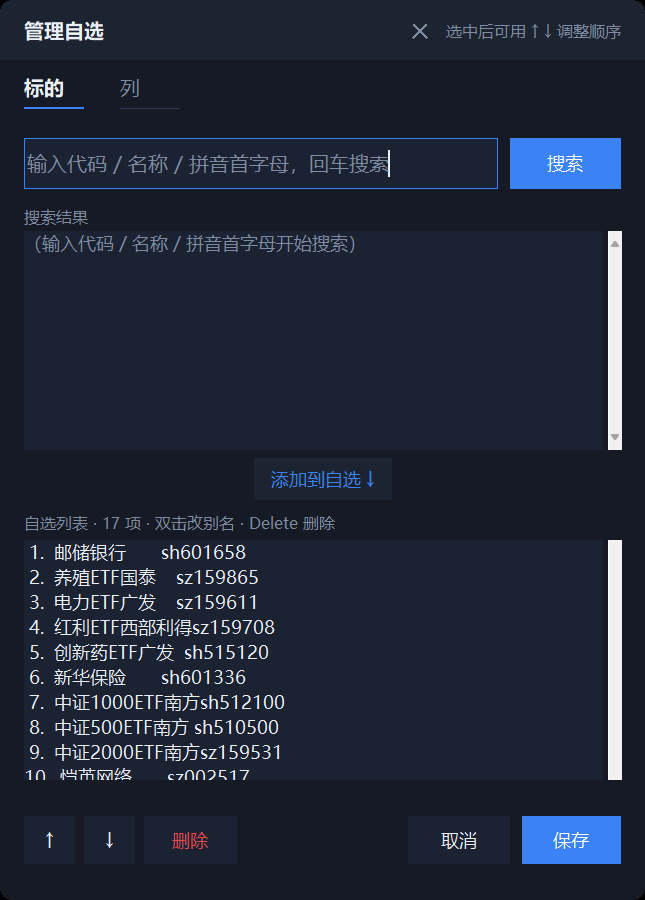

# 盯盘君

一个常驻桌面的实时行情悬浮小窗。置顶、半透明、圆角、可拖动，只显示你自己关注的标的。

零第三方依赖 —— 只用 Python 标准库（tkinter + urllib），数据来自腾讯行情公开接口，实时、免 key。

## 启动

双击 **`启动盯盘.bat`**（无黑框）。或者直接双击 `ticker.pyw`。

想让它开机自动跑：右键窗口 → **开机自动启动**（勾上即可，会在「启动」文件夹里放一个 .vbs）。

## 用法

| 操作 | 效果 |
| --- | --- |
| 按住拖动（窗口内部） | 移动窗口（位置自动记住） |
| **拖窗口边缘 / 四角** | **自由缩放窗口大小**（光标会变成双向箭头，最小 190×90） |
| 鼠标滚轮 | 滚动标的列表（自选多了会出现右侧细滚动条，可直接拖） |
| 双击标题栏 | 折叠成一条 / 展开 |
| 双击某一行 | 浏览器打开该标的行情页 |
| 右键 | 菜单：管理自选 / 立即刷新 / 不透明度 / 置顶 / 恢复自适应高度 / 编辑配置 / 重新加载 / 开机自启 / 退出 |

**红涨绿跌**，平盘灰色。标题栏左侧的小圆点：绿=交易中、灰=休市、红=连接失败。

刷新节奏跟着盘走：交易时段每 5 秒一次，非交易时段每 60 秒一次（省电省流量）。

### 自由缩放

窗口没有系统边框，缩放是自绘的：把鼠标移到**窗口任意一条边或任意一个角**（约 5px 热区），
光标变成 ↔ / ↕ / ⤡ 之后按住拖动即可。松手后新尺寸写入 `config.json`（`width` / `height`），
下次启动保持。想回到"高度跟着内容走"的状态，右键 → **恢复自适应高度**。

窗口位置会被自动拉回屏幕内——换显示器或改缩放比例后，旧坐标不会再把窗口丢到屏幕外。

标的多了窗口不会无限变高——超过 `max_height` 后，标题栏固定、列表内部滚动。以默认 520 计，标的总数超过约 19 行（含分组标题）时右侧出现细滚动条，可直接拖动；未超出时全部显示、滚动条自动隐藏。窗口尺寸每 250ms 自动校准，不会出现"内容被底边裁掉"的情况。


## 管理自选

右键窗口 → **管理自选…**，打开搜索式管理面板（同花顺那套用法）：

- 搜索框支持 **代码 / 中文名 / 拼音首字母** —— `600519`、`茅台`、`gzmt` 都能搜到同一个结果，输入即搜（防抖 0.28 秒）
- 双击搜索结果即可添加；已经在自选里的会标上 `✓` 并置灰，不会重复加
- 双击自选条目可改**显示别名**（窗口窄，长名字建议缩一下）
- `Delete` 键或「删除」按钮移除，「↑」「↓」调整顺序
- 点「保存」立刻写回配置并刷新主窗口；「取消」则原样退出



当然，直接改 `config.json` 也一样有效（右键 → 编辑配置文件，改完右键 → 重新加载配置）。

```json
{
  "name": "自选",
  "items": [
    { "code": "sh510300", "alias": "300ETF" },
    { "code": "600519",   "alias": "贵州茅台" }
  ]
}
```

`code` 可以偷懒只写 6 位数字，程序会自动判断市场：

- `6xxxxx` / `5xxxxx` → 上海
- `0xxxxx` / `3xxxxx` / `1xxxxx` → 深圳
- `4xxxxx` / `8xxxxx` → 北交所
- 常见指数（`000001` `399001` `000300` `000510` `000688` …）会自动认成指数而非个股
- 港股写 `hk` + 代码，如 `hkHSTECH`（恒生科技）、`hkHSI`（恒生指数）
- `alias` 是显示用的短名，不写就用接口返回的全名

## 其他配置

| 字段 | 说明 |
| --- | --- |
| `title` | 标题栏文字 |
| `theme` | `dark`（默认）或 `light` |
| `alpha` | 整体不透明度，0~1 |
| `topmost` | 是否窗口置顶 |
| `trading_refresh` | 交易时段刷新秒数 |
| `idle_refresh` | 非交易时段刷新秒数 |
| `width` | 窗口宽度（逻辑像素） |
| `height` | 窗口高度（逻辑像素）；**不写**则高度跟着内容自适应，`max_height` 封顶 |
| `max_height` | 自适应模式下的最大高度（逻辑像素），超出后列表内部滚动，默认 520 |

## 自检

出问题时先跑一次数据自检，看看是接口的问题还是窗口的问题：

```
python ticker.pyw --selftest
```

## 文件

| 文件 | 用途 |
| --- | --- |
| `ticker.pyw` | 主程序 |
| `config.json` | 标的与外观配置 |
| `position.json` | 自动记录窗口位置（可删，会重新回到右上角） |
| `启动盯盘.bat` | 双击启动 |

## 实现备注：圆角为什么不用 SetWindowRgn

圆角用的是 **颜色键透明**（`-transparentcolor`，一个主题里绝不会出现的品红 `#FE02FD`），
窗口形状由画布自己画（"圆角矩形 = 竖中带 ∪ 横中带 ∪ 四个 1/4 圆盘"），四角再补一层
颜色键遮罩把越界的元素擦掉。

早先版本用的是 `SetWindowRgn`（`CreateRoundRectRgn`），踩了两个坑：

1. 句柄用 `GetParent` 取，窗口映射前后会变，圆角区域设到了"孤儿窗口"上；
2. **致命的一个**：只要窗口被设过窗口区域，之后再缩放窗口，新露出的那一块
   就永远不会被重绘（恒为黑块）。实测 `RedrawWindow`、`SetWindowPos(SWP_FRAMECHANGED)`、
   `withdraw`+`deiconify`、延迟几百毫秒再重设区域、把区域设得比窗口还大……
   全部无效；只有"这个窗口从未设过区域"或"设完区域后再也不缩放"才正常。

因为要支持自由缩放，只能彻底弃用 `SetWindowRgn`。副作用是内容画布（`cc`）底部
让出了一个圆角高度的条带（`vis_cc = vis_h - 圆角半径`），这几像素的可见内容略少，
换来的是缩放后完全正常的绘制。

## 实现备注：K 线窗口首帧布局与尺寸记忆

K 线窗口的记忆尺寸存在 `config.json` 的 `kline.w/h`（逻辑像素）。踩过一个坑：
Tk 在窗口**映射前** `winfo_width/height` 恒为 1，早先的布局兜底写死默认 880×640，
于是当记忆高度不是 640（比如旧版记忆的 560）时，副图区 `vol_y1/tm_y` 按偏大的
假想高度算，量副图和 MACD 副图整体下移被窗口底边裁掉——**表现就是"一打开副图不全，
随便拉一下大小就好了"**（缩放触发 `<Configure>` 重算 + 重绘）。

现在两条保证：

1. `__init__` 记下本次请求的客户区尺寸 `_req_w/_req_h`，映射前兜底用它（高度扣掉工具条 `KLINE_TB_H`）；
2. `_sync_layout()` 在每次 `draw_all` 前对账画布真实尺寸，与缓存不一致就先重算，
   覆盖"数据比最终 `<Configure>` 先到"的时序。

一般不变量：`main_y1 < vol_y1 < tm_y ≤ 画布高`；改布局代码后可用
`.workbuddy/tc_kline_openfit.py` 回归（记忆 880×560 开窗，6 项断言）。

## 实现备注：数据文件隔离与写盘留底

程序的数据文件（`config.json` / `position.json` / `industry_cache.json` / `amount_base.json`）
路径都基于 `BASE`：

```
BASE = os.environ.get("MARKETWIDGET_BASE") or <ticker.pyw 所在目录>
```

**写测试脚本时必须隔离**：脚本 import 真模块后，任何「保存」动作都会落到真实文件上。
2026-10-30 就出过一次事故——回归脚本用只含 `kline` 的测试桩 cfg，`KlineWin.close()` 把
真实 `config.json` 整份覆盖，自选分组全丢。现在测试统一这么写：

```python
import os, tempfile
os.environ["MARKETWIDGET_BASE"] = tempfile.mkdtemp(prefix="mw_test_")
```

另外两条兜底：

- `save_json()` 覆盖前先把旧文件复制成 `*.bak`，整份覆盖类事故可人工回滚；
- `save_kline_state()` 只负责 `kline` 键，传入 cfg 缺 `groups` 时先并回磁盘上的其它键。

## 开发流程（SDLC）

项目内置了一套 SDLC 知识工程体系，后续新功能都按「需求 → 设计 → 编码 → 测试」四步走。

```
wiki/
├── rules/      编码准则 / 文档规范 / 界面规范（改代码前必读）
├── skills/     sdlc 路由 / prd / sdd / coding / test / ui-designer
└── docs/       PRD、SDD、TC、SOP、经验库
```

- **入口规则**：`CLAUDE.md`（与 `AGENTS.md`、`wiki/Agentic.md` 内容一致）
- **规范**：[编码准则](wiki/rules/coding-rules.md)（§5 是本项目专属约定：纯标准库、`px()` 换算、ctypes 类型声明、禁用 `SetWindowRgn`）
- **界面**：[UI 规范](wiki/rules/ui-rules.md)（全部取值为项目真实 Token）

每个环节完成后会停下来等确认，不会自动跳步；文档产出后需同步登记到 `wiki/wiki.md`。

