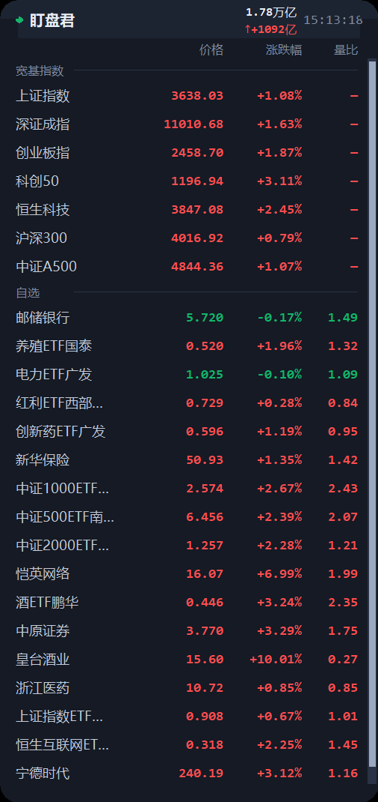
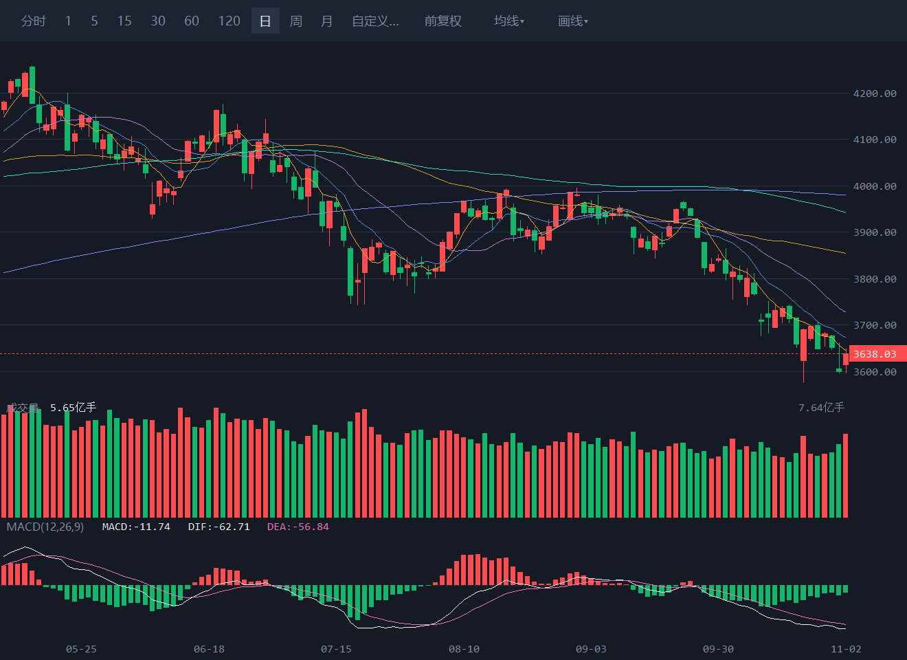

<div align="center">

# 盯盘君

**A 股行情常驻桌面 —— 一屏看完全部自选，随手在 K 线上画线**

纯 Python 标准库 · 零第三方依赖 · 双击即跑


</div>

<table>
<tr>
<td width="30%" valign="top"></td>
<td width="70%"></td>
</tr>
<tr>
<td align="center"><sub>主窗：一屏看全自选</sub></td>
<td align="center"><sub>画线：趋势线 + 水平线</sub></td>
</tr>
</table>

它只是一个小窗口，浮在屏幕角落，半透明、置顶、圆角，只显示你自己关注的标的。
点一下某一行就展开 K 线，看完关掉，不打断手上的事。

数据来自腾讯行情公开接口（免 key），**一个 `ticker.pyw` 就是全部程序**，不需要 pip install 任何东西。

---

## 为什么是它

| | |
| --- | --- |
| 零依赖 | 只用标准库 `tkinter` + `urllib`。拷到任何一台装了 Python 的 Windows 上就能跑，不用配环境、不用装包 |
| 够轻 | 常驻不抢屏幕，可缩到 190×90，也能折叠成一条只显示涨跌幅轮播。5 秒刷新一次，非交易时段自动降到 60 秒 |
| 能画线 | 点开就是完整 K 线：多周期、三档复权、均线、成交量、MACD，还能在上面画线做标记 |
| 记得住 | 窗口位置、大小、自选分组、画过的线，全部落盘，下次打开原样恢复 |

## 行情浮窗

- **分组自选**：宽基指数、自选，也可以自己加分组；空分组自动隐藏
- **六列数据**：名称、价格、涨跌幅、量比、换手率、所属行业（行业可关掉，不联网时显示 `—`）
- **红涨绿跌**、平盘灰色；标题栏左侧小圆点：绿=交易中、灰=休市、红=连接失败
- **两市成交额**：标题栏显示沪深合计成交额与当日增量
- **折叠轮播**：双击标题栏折叠成一条，标的涨跌幅自动轮播（间隔可配）
- **自由缩放**：拖窗口任意边/角改大小（无系统边框，自绘热区），松手即记住
- **品种覆盖**：沪深个股/ETF、北交所、港股、常见指数都能加


## K 线图



- **周期**：分时、1 / 5 / 15 / 30 / 60 / 120 分钟、日、周、月，以及「自定义 N 分钟」
- **复权**：前复权 / 后复权 / 不复权一键切换（分时档不支持复权，控件会自动置灰）
- **副图**：成交量、MACD(12,26,9)；均线可选 MA5 / MA10 / MA20 / MA60
- **操作**：滚轮缩放、按住拖动平移、双击复位视图；回到最左会自动回补更早的历史

## 画线

七种工具：**水平线、垂直线、趋势线、矩形、黄金分割、波浪尺、平行通道**。


- 拖动取点，落点自动吸附到最近的 K 线开高低收；单点工具单击即出线
- 画错了直接撤销；已画的线可选中、拖动、改色、删除
- **换复权或换周期，线会跟着换算价格**，不会因为切到前复权就飘走
- 画线按「标的 + 周期」分开保存，写进 `config.json` 的 `drawings`，重开还在

## 快速开始

1. 装 [Python 3.8+](https://www.python.org/downloads/)（安装时勾上 *Add Python to PATH*）
2. 下载本仓库（`git clone` 或直接下 ZIP 解压）
3. 双击 **`启动盯盘.bat`**

想让它开机自启：右键窗口 → **开机自动启动**（勾上，会在「启动」文件夹里放一个 `.vbs`）。

> 也可以直接双击 `ticker.pyw` 启动；`.bat` 只是用 `pythonw` 拉起，避免黑框。

## 操作速查

| 操作 | 效果 |
| --- | --- |
| 按住拖动（窗口内部） | 移动窗口，位置自动记住 |
| 拖窗口边缘 / 四角 | 自由缩放窗口（最小 190×90） |
| 鼠标滚轮 | 滚动标的列表；列表超长时右侧出现细滚动条 |
| 双击标题栏 | 折叠成一条 / 展开 |
| 双击某一行 | 打开该标的 K 线 |
| 右键 | 管理自选 / 立即刷新 / 不透明度 / 置顶 / 显示列 / 编辑配置 / 重新加载 / 开机自启 / 退出 |
| K 线窗口滚轮 | 缩放可视 K 线根数（20～300 根） |
| K 线窗口拖动 | 平移；双击图表区复位 |
| `Esc` | 取消当前画线 / 退出画线工具 |

## 自选管理

右键 → **管理自选…**，搜索式面板：代码、中文名、拼音首字母都能搜（`600519`、`茅台`、`gzmt` 指向同一条），双击搜索结果即添加，双击已添加的可改显示别名。


也可以直接改 `config.json`（右键 → 编辑配置文件，改完 → 重新加载配置）：

```json
{
  "name": "自选",
  "items": [
    { "code": "sh510300", "alias": "300ETF" },
    { "code": "600519",   "alias": "贵州茅台" }
  ]
}
```

`code` 可以偷懒只写 6 位数字，程序按代码段判断市场：

- `6xxxxx` / `5xxxxx` → 上海
- `0xxxxx` / `3xxxxx` / `1xxxxx` → 深圳
- `4xxxxx` / `8xxxxx` → 北交所
- 常见指数（`000001` `399001` `000300` `000510` `000688` …）自动认成指数
- 港股写 `hk` + 代码，如 `hkHSTECH`（恒生科技）、`hkHSI`（恒生指数）

## 配置项

| 字段 | 说明 |
| --- | --- |
| `title` | 标题栏文字 |
| `theme` | `dark`（默认）或 `light` |
| `alpha` | 整体不透明度，0～1 |
| `topmost` | 是否置顶 |
| `trading_refresh` | 交易时段刷新秒数，默认 5 |
| `idle_refresh` | 非交易时段刷新秒数，默认 60 |
| `width` / `height` | 窗口尺寸（逻辑像素）；不写 `height` 则按内容自适应 |
| `max_height` | 自适应模式的最大高度，超出后列表内部滚动 |
| `columns` | 列宽与列显隐 |
| `marquee_interval` | 折叠态轮播间隔（秒） |
| `show_amount` | 是否在标题栏显示两市成交额 |
| `drawings` | 画线数据（程序自动维护，一般不用手改） |

## 自检与排障

接口还是窗口的问题，先跑一次自检：

```
python ticker.pyw --selftest
```

它会逐项检查行情接口、K 线接口、分时接口与解析逻辑，输出每项结果，退出码 0 表示全通。

窗口不见了：`position.json` 记录的坐标可能落在已断开的显示器上，删掉该文件重启即可回到右上角。

## 开发者笔记

<details>
<summary><b>为什么圆角不用 SetWindowRgn</b></summary>

圆角用的是**颜色键透明**（`-transparentcolor`，取一个主题里绝不会出现的品红），窗口形状由画布自绘（"圆角矩形 = 竖中带 ∪ 横中带 ∪ 四个 1/4 圆盘"），四角再补一层颜色键遮罩。

早先版本用 `SetWindowRgn`（`CreateRoundRectRgn`）踩了两个坑：一是句柄用 `GetParent` 取，窗口映射前后会变，区域设到了孤儿窗口上；二是**致命的**——只要窗口被设过区域，之后再缩放，新露出的那块区域永远不会重绘（恒为黑块）。`RedrawWindow`、`SetWindowPos(SWP_FRAMECHANGED)`、`withdraw`+`deiconify`、延迟重设区域全部无效。

因为要支持自由缩放，只能彻底弃用。副作用是内容画布底部让出一个圆角高度的条带（`vis_cc = vis_h - 圆角半径`），少显示几像素，换来缩放后绘制完全正常。

</details>

<details>
<summary><b>K 线首帧布局与尺寸记忆</b></summary>

Tk 在窗口**映射前** `winfo_width/height` 恒为 1。早先布局兜底写死 880×640，当记忆尺寸不是 640（如 560）时，副图区按偏大的假想高度计算，导致"一打开副图不全，随便拉一下大小就好了"。

现在两条保证：`__init__` 记下本次请求的客户区尺寸，映射前兜底用它；`_sync_layout()` 在每次 `draw_all` 前对账画布真实尺寸，不一致先重算，覆盖"数据比最终 `<Configure>` 先到"的时序。不变量：`main_y1 < vol_y1 < tm_y ≤ 画布高`。

</details>

<details>
<summary><b>数据文件隔离与写盘留底</b></summary>

数据文件路径都基于：

```
BASE = os.environ.get("MARKETWIDGET_BASE") or <ticker.pyw 所在目录>
```

写测试脚本时必须设 `MARKETWIDGET_BASE` 指向临时目录——脚本 import 真模块后，任何「保存」动作都会落到真实文件上。另外两条兜底：`save_json()` 覆盖前先复制 `*.bak`；`save_kline_state()` 只负责 `kline` 键，缺 `groups` 时先并回磁盘上的其它键。

</details>

<details>
<summary><b>开发流程（SDLC）</b></summary>

项目内置「需求 → 设计 → 编码 → 测试」四步流程与配套文档体系：

```
wiki/
├── rules/      编码准则 / 文档规范 / 界面规范（改代码前必读）
├── skills/     sdlc 路由 / prd / sdd / coding / test / ui-designer
└── docs/       PRD、SDD、TC、SOP、经验库
```

入口规则见 [`CLAUDE.md`](CLAUDE.md)（与 `AGENTS.md`、`wiki/Agentic.md` 一致）。每个环节结束会停下等确认，不自动跳步；文档产出后登记到 [`wiki/wiki.md`](wiki/wiki.md)。

</details>

## 文件

| 文件 | 用途 |
| --- | --- |
| `ticker.pyw` | 主程序（全部逻辑，约 7 千行） |
| `config.json` | 标的、外观、列、画线配置 |
| `position.json` | 窗口位置（可删，会重新回到右上角） |
| `amount_base.json` | 两市成交额历史基准缓存（可删，会重新拉取） |
| `industry_cache.json` | 行业名称缓存，7 天过期（可删） |
| `启动盯盘.bat` | 双击启动 |

## 更新日志

**v1.0.0**（2026-10）

- K 线窗口：分时、1～120 分钟、日 / 周 / 月，外加自定义 N 分钟；三档复权、均线、成交量、MACD、滚轮缩放与拖动平移
- 画线：七种工具、自动吸附、选中拖动、撤销、复权/周期自适应换算、落盘保存
- 两市成交额：标题栏显示沪深合计与增量
- 折叠态轮播：标题栏轮播自选涨跌幅
- 自定义列与列宽、搜索式自选管理、自由缩放与尺寸记忆
- 行业数据源迁移至东财 `datacenter-web`（原 `push2` 通道整域断连）

## 说明

- 采用 [MIT License](LICENSE) 开源；行情数据来自公开接口，仅供个人学习与研究使用，**不构成任何投资建议**，据此操作风险自担
