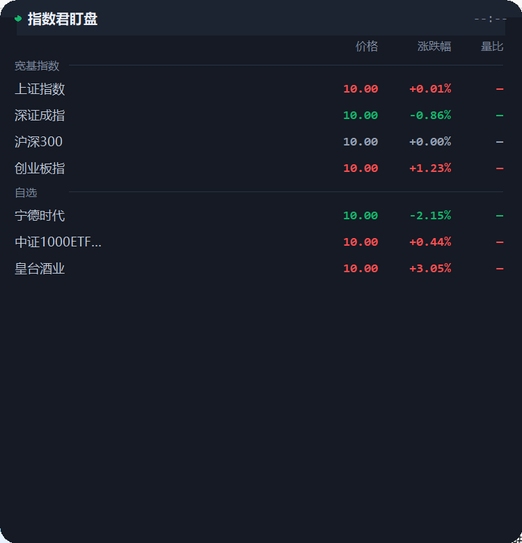
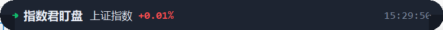
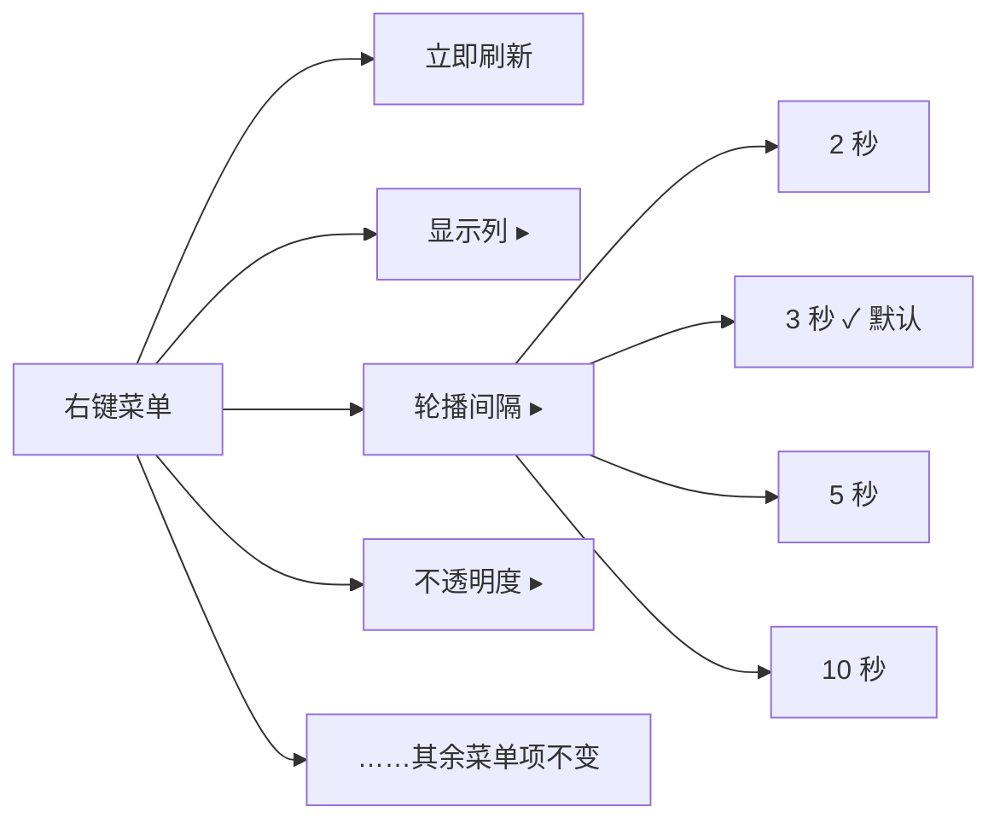
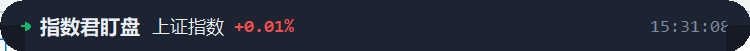
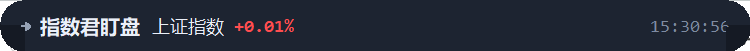
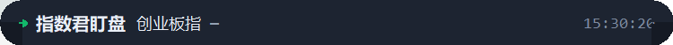

# SOP-盯盘君-折叠轮播-v1.0.0

## 1. 文档概述

### 1.1 文档信息

| 字段 | 内容 |
| --- | --- |
| 项目名称 | 盯盘君 MarketEye（桌面行情悬浮窗） |
| 文档版本 | v1.0.0 |
| 版本状态 | 未发布 |
| 创建日期 | 2026-10-21 |
| 更新日期 | 2026-10-21 |
| 基于需求 | [PRD-盯盘君-折叠轮播-v1.0.0](../../../../需求文档/折叠轮播/v1.0.0/PRD-盯盘君-折叠轮播-v1.0.0.md) |
| 配套文档 | [TC-盯盘君-折叠轮播-v1.0.0](../../../../测试文档/盯盘君/折叠轮播/v1.0.0/TC-盯盘君-折叠轮播-v1.0.0.md)（本手册截图均取自其 `screenshots/` 目录） |

### 1.2 变更记录

| 版本 | 日期 | 变更人 | 变更类型 | 关联章节 | 变更内容 |
| --- | --- | --- | --- | --- | --- |
| v1.0.0 | 2026-10-21 | - | 新增 | §1–§5 | 初始版本：覆盖折叠看大盘、调整轮播间隔、定制轮播清单、窄窗显示、展开再折叠 5 个操作场景与 11 条常见问题，配 12 张实机截图。经 1 轮独立审核修订（1 主要 + 8 次要意见已全部合并）：修正「重新加载配置」不重建轮播清单的生效时机、回退清单改为跨分组去重口径、平盘配色与主文字色表述对齐 ui-rules、补充行业列接口与改配置前备份提示 |

### 1.3 SOP 目的

指导日常使用「折叠态标题栏轮播」功能：折叠悬浮窗后不展开面板就能瞟一眼大盘涨跌，并能自行调节轮播节奏、定制轮播标的、应对窄窗截断等显示情况。

### 1.4 功能概览

面板折叠成一条标题栏后，标题文字与时钟之间会出现一个轮播显示区：

- 按 `指数名称  涨跌幅` 的格式一次显示一条宽基指数，每隔设定间隔自动切到下一条，循环往复
- 涨跌幅红涨绿跌、零涨跌灰色，恒为两位小数带符号，与列表区口径完全一致
- 间隔在右键菜单「轮播间隔」选档（2 / 3 / 5 / 10 秒，默认 3 秒），选完立即生效且重启后仍记得
- 轮播标的默认取自「宽基指数」分组；没有该分组时自动改用自选里全部指数类标的（跨分组收集、按出现顺序去重，不含个股与 ETF/LOF）
- 展开面板轮播即停；轮播文字不挡鼠标，拖动、双击、右键照常

### 1.5 阅读前提

- 已能正常启动盯盘君并看到悬浮窗（启动方式见 §2.1）
- 掌握三个基本操作：双击标题栏折叠 / 展开、按住标题栏拖动窗口、右键呼出菜单

## 2. 运行环境

### 2.1 运行环境

| 项 | 要求 |
| --- | --- |
| 操作系统 | Windows 10 / 11 |
| Python | 3.8 及以上，安装时勾选 tkinter（默认勾选） |
| 启动方式 | 双击 `启动盯盘.bat`；或在同目录执行 `pythonw ticker.pyw` |
| 管理员权限 | 日常使用不需要；勾选「开机自动启动」时由程序自行写入启动文件夹，也无需管理员 |
| 屏幕缩放 | 100%~200% 均可，轮播文字大小与截断阈值自动适配 |
| 窗口宽度 | 建议 ≥ 273 逻辑像素；过窄时轮播自动让位（见场景四） |

### 2.2 网络环境

- 需可访问 `qt.gtimg.cn` 与 `smartbox.gtimg.cn`（行情与标的搜索）。若同时显示「所属行业」列，程序还会访问 `push2.eastmoney.com` 取行业数据；不显示该列时可忽略。
- 轮播本身**不产生任何额外网络请求**，显示的涨跌幅完全来自面板既有的行情刷新；公司内网配置代理时放行上述域名即可。

## 3. 操作指南

### 3.1 操作场景

#### 场景一：折叠后看大盘（核心用法）

**场景说明**：交易时段把悬浮窗折叠成一条标题栏钉在屏幕边缘，标题栏中部自动轮流显示宽基指数涨跌幅，瞟一眼即知大盘温度，无需展开面板。

| 步骤 | 操作 | 预期效果 |
| :--: | --- | --- |
| 1 | 双击标题栏（或右键选「折叠 / 展开」） | 面板折叠成一条标题栏，标题右侧出现轮播文字 |
| 2 | 观察轮播区 | 显示如 `上证指数  +0.01%`：名称用主题主文字色（深色主题下为白色）、涨跌幅红色（涨）；名称与涨跌幅之间隔两个空格 |
| 3 | 等待设定间隔（默认 3 秒） | 自动切到下一条，如 `深证成指  -0.86%`（跌幅绿色）；播到末尾后回到第一条循环 |
| 4 | 交易时段继续观察 | 行情每次刷新后，当前条目的涨跌幅数字自动更新，条目顺序和节奏不受影响 |

折叠前（展开态，无轮播文字）：

折叠后第一条（上涨红色）：

自动换条到下一条（下跌绿色）：

播完一轮回到第一条（循环）：

#### 场景二：调整轮播间隔

**场景说明**：觉得换得太快看不清、或太慢不够灵活时，从右键菜单选一档新的间隔；选完立即生效，重启程序后仍然记得。

右键菜单结构（「轮播间隔」子菜单固定四档，当前档带对勾）：

| 步骤 | 操作 | 预期效果 |
| :--: | --- | --- |
| 1 | 在标题栏任意位置右键 | 弹出主菜单 |
| 2 | 鼠标悬停「轮播间隔」 | 展开子菜单，四档按 2 / 3 / 5 / 10 秒排列，当前档带对勾 |
| 3 | 点击目标档位（如「5 秒」） | 菜单关闭，对勾移到 5 秒；**当前这条立即按 5 秒重新计时，不跳条** |
| 4 | （可选）重启程序验证 | 仍按 5 秒轮播，对勾仍在 5 秒 |

点选新档位前后（当前条目不动，仅重新计时）：

#### 场景三：定制轮播清单（「宽基指数」分组）

**场景说明**：轮播默认取「宽基指数」分组里的标的、按分组内顺序播放。想指定播哪几只、按什么顺序播，就建这个分组；分组名必须**一字不差**（区分大小写与全半角，首尾不能带空格）。没有该分组时，程序自动回退为全部自选标的中的指数类标的（跨分组按出现顺序去重，不含个股、不含 ETF/LOF 等场内基金）。

> **改前先备份**：手工编辑配置文件有风险——文件出现语法错误时，程序读不出内容会按空配置启动，自选分组会全部丢失。动手前把配置文件复制一份到别处，保存后确认格式合法再点「重新加载配置」。

| 步骤 | 操作 | 预期效果 |
| :--: | --- | --- |
| 1 | 右键 →「编辑配置文件」 | 用系统关联的编辑器打开本地配置文件（通常是记事本或 VS Code） |
| 2 | 参照文件中已有的「自选」分组的写法，新增（或修改）一个名为「宽基指数」的分组，把想轮播的指数标的放进去 | 分组内标的的排列顺序就是轮播顺序 |
| 3 | 保存文件并关闭编辑器 | 文件已按新分组写盘（编辑器标题栏的未保存标记消失） |
| 4 | 右键 →「重新加载配置」 | 配置被重新读取：主题、不透明度、轮播间隔档位等即时生效；**轮播清单不会在此时重建**，当前这条继续播完 |
| 5 | 双击折叠验证（若当前已是折叠态，先展开再折叠） | 折叠瞬间清单重新计算，轮播按新分组、新顺序播放 |

有「宽基指数」分组时（只播分组内的标的，顺序与分组一致，不混入自选里的个股与 ETF）：

删掉分组后的自动回退（自选里混有个股与 ETF，只保留指数类标的照常轮播）：

> 配置文件的具体格式（字段、代码写法）见 [SDD-盯盘君-折叠轮播-v1.0.0 §3.1](../../../../设计文档/折叠轮播/v1.0.0/SDD-盯盘君-折叠轮播-v1.0.0.md)；最稳妥的做法是照抄「自选」分组的一段再改名。

#### 场景四：窄窗口下的显示（截断与让位）

**场景说明**：窗口被拖得比较窄时，标题、时钟、轮播文字可能挤不下。程序的处理原则是：**标题和时钟永远完整，涨跌幅尽量完整，名称不够放就从尾部截断加省略号，再不够就整个轮播留空**。

| 步骤 | 操作 | 预期效果 |
| :--: | --- | --- |
| 1 | 按住窗口右边缘向左拖动收窄 | 名称先被截断，如 `中证10…  +0.01%`，涨跌幅始终完整 |
| 2 | 继续收窄到很窄（约 250 逻辑像素以下） | 轮播区整个留空，标题与时钟仍完整；不是故障，是主动让位 |
| 3 | 向右拖宽窗口 | 轮播自动恢复显示，无需任何操作 |

名称被截断（涨跌幅完整）：

窗口过窄时轮播让位（标题与时钟完整）：

#### 场景五：展开看细节、再折回来

**场景说明**：轮播只显示名称和涨跌幅；想看价格、量比等完整数据时展开面板，看完再折叠，轮播自动恢复。

| 步骤 | 操作 | 预期效果 |
| :--: | --- | --- |
| 1 | 轮播运行中双击标题栏展开 | 轮播立即停止并清空，面板恢复完整列表 |
| 2 | 浏览列表、查看明细 | 无轮播文字干扰 |
| 3 | 再次双击折叠 | 轮播从清单第 1 条重新开始，重新计时 |

展开后轮播清空：

> 折叠期间在「管理自选…」里增删标的，本轮播清单**保持不变**（被删的标的行情缺失时按占位符显示）；展开再折叠一次，新清单即生效。

## 4. 常见问题

### 4.1 FAQ

**Q1：折叠后标题栏中部是空的，轮播没出现？**
按顺序检查：① 窗口是否太窄——往右拖宽试试（见场景四）；② 是否既没有「宽基指数」分组、自选里也没有任何指数类标的——建立分组或加一只指数（见场景三）；③ 是否处于展开态——轮播只在折叠态显示。

**Q2：名称显示成「上…」「中证10…」，是不是坏了？**
不是，这是窗口宽度不够时的主动截断，涨跌幅优先保证完整。把窗口拖宽即可显示全名（见场景四）。

**Q3：有的条目显示「指数名称  —」，那条短线是什么？**
表示该标的此刻取不到涨跌幅（如停牌、休市未取到数据），条目照常轮播，数据恢复后自动显示数字。示例：

**Q4：只想轮播我关心的几只指数，怎么控制？**
新建名为「宽基指数」的分组，把这几只放进去即可（见场景三）。分组名必须一字不差；不想用了就把分组删掉，程序会自动回退到「全部自选标的中的指数类标的」。

**Q5：轮播顺序由什么决定？**
由「宽基指数」分组内标的的排列顺序决定；没有分组时按各分组标的的出现顺序（同一标的多组出现只取首次）。调整分组（或自选）内顺序即可调整轮播顺序。

**Q6：折叠状态下改了自选，为什么轮播没变？**
这是设计行为：折叠期间的清单是冻结的，避免播着播着脚下标的突然消失。展开再折叠一次即生效。

**Q7：轮播间隔设置后重启又变回 3 秒？**
只有 2 / 3 / 5 / 10 秒是合法档位。若配置文件里的值被改成了其它数字或文本，程序一律按默认 3 秒运行，不会报错。

**Q8：轮播文字会不会挡住拖动、双击、右键？**
不会。轮播显示区不拦截任何鼠标事件，按住它一样能拖动窗口，双击一样折叠 / 展开，右键一样弹菜单。

**Q9：轮播会额外消耗流量吗？**
不会。涨跌幅全部复用面板既有的行情刷新结果，轮播自身零网络请求。

**Q10：深色、浅色主题下颜色一样吗？**
规则一样：涨红、跌绿、平盘与「—」用比正文淡一档的平盘灰，名称用主题的主文字色；切换主题（右键菜单）后立即生效。

**Q11：折叠态能不能上下拉高？**
不能。折叠态只保留横向拖宽，纵向高度由折叠高度决定，属设计决策；展开态的「恢复自适应高度」不受影响。

## 5. 附录

### 5.1 术语表

| 术语 | 解释 |
| --- | --- |
| 折叠态 / 展开态 | 双击标题栏在两种形态间切换：折叠态只有一条标题栏；展开态显示完整列表 |
| 宽基指数 | 反映大盘整体表现的指数，如上证指数、深证成指、沪深300、创业板指、恒生科技等 |
| 轮播 | 显示区一次显示一条、按设定间隔自动切换到下一条、循环往复的展示方式 |
| 轮播清单 | 参与轮播的标的有序列表；默认取「宽基指数」分组，缺失时回退为全部自选标的中的指数类标的（跨分组按出现顺序去重） |
| 指数类标的 | 沪深交易所的指数与港交所指数；不含个股，也不含 ETF/LOF 等场内基金 |
| 档位 | 轮播间隔的可选值，固定四档：2 / 3 / 5 / 10 秒 |
| 占位符 `—` | 当前条目涨跌幅暂无数据时显示的占位短线 |
| 截断 | 名称超出显示宽度时从尾部裁掉并追加省略号（如 `中证10…`），涨跌幅优先保证完整 |
| 清单冻结 | 折叠期间轮播清单保持不变，期间的自选变更在下次折叠时生效 |
| 逻辑像素 | 与系统 DPI 缩放无关的窗口宽度计量单位；本手册的宽度建议值均指逻辑像素 |
