# SDD-盯盘君-K线图-v1.0.0

> **⚠️ v1.0.1 数据源变更（2026-10-30 编码阶段实测）**：东方财富 `push2his.eastmoney.com`
> 对本机**整域不可达**（含 `1.`–`9.` IDC 分片全部 `RemoteDisconnected`），K 线取数恒失败。
> 已整体迁移到腾讯：分钟线走 `appstock/app/kline/mkline`、日以上走
> `appstock/app/fqkline/get`。**代码无需 secid 映射**（腾讯代码与内部代码一致），
> 港股数字代码（`hk00700`）实测可用。腾讯**不返回成交额** → bar 第 7 位恒 0，
> 十字光标「成交额」行显示 `—`（副图量柱本就用成交量，不受影响）。详见 §10.3。

> **⚠️ v1.0.0 第二轮设计（2026-10-30，需求追加）**：周期扩到 10 档（补「分时」`tick`、
> 「120 分」`m120`）、均线扩到 6 条（补 MA120/MA250，默认全开，收纳为工具条「均线▾」浮层
> 面板）、新增 MACD(12,26,9) 常驻副图（F-14）与分时走势图（F-13）；布局改主图:量:MACD =
> 6:2:2，窗口默认 880×640、最小 640×480；分时数据源实测见 §3.2.1；本轮任务清单见 §10 的
> T020~T028。
>
> **⚠️ v1.0.0 第三轮设计（2026-10-31，需求追加画线）**：新增 7 种画线工具（水平线 / 垂直线 /
> 趋势线 / 矩形 / 黄金分割 / 波浪尺 / 平行通道）与 D0/D1/D2 绘制子态；锚点一律存「时间标签 +
> 价格值 + 基准价」三元组（**禁止存像素与 bar 下标**，§3.7.5）；画线按「标的 + 周期」独立
> 分组写入 `config.json` 的**独立 `drawings` 键**（不并入 `kline`，§3.1）；复权切换按**锚点逐个**
> 换算（§3.3.5）；新增画线专用图层 `draw` / 预览层 `drawp`，重绘后须重提层（§3.5.5）。本轮
> 任务清单见 §10 的 T029~T041，设计期口径与取舍见 §10.6。

## 1. 文档概述

### 1.1 文档信息

| 字段 | 内容 |
| --- | --- |
| 项目名称 | 盯盘君 MarketEye |
| 文档版本 | v1.0.0 |
| 版本状态 | 未发布 |
| 创建日期 | 2026-10-30 |
| 更新日期 | 2026-10-31 |
| 基于需求 | [PRD-盯盘君-K线图-v1.0.0](../../需求文档/K线图/v1.0.0/PRD-盯盘君-K线图-v1.0.0.md)（v1.0.0，含 2026-10-31 第三轮画线 F-15~F-18 / R-08 / AC-39~AC-63） |
| 基于设计 | 本文件前两轮（T001~T028 已编码落地）；第三轮采用**增量设计模式**，仅在受影响章节追加画线内容 |

### 1.2 变更记录

| 版本 | 日期 | 变更人 | 变更类型 | 关联章节 | 变更内容 |
| --- | --- | --- | --- | --- | --- |
| v1.0.0 | 2026-10-30 | - | 新增 | §1–§10 | 新增独立 K 线窗口的完整设计：新增 `KlineWin` 类（系统边框 Toplevel + 单 Canvas 分层重绘）、东财日/分钟 K 线取数与 secid/klt/fqt 映射、30 秒内存缓存与按标的 LRU（≤3）、自定义 N 分钟/N 日本地聚合（时段分组 + 残段保留）、滚轮锚点缩放与拖动平移回溯、十字光标吸附与 9 项信息浮层、末根实时刷新（复用主面板报价，零新增轮询）、K0~K4 状态机与失败重试禁用、状态记忆（`config.json` 新增 `kline` 键）、双击行手势迁移与 3 逻辑像素位移阈值、港股周期降级，T001~T019 任务清单；**第二轮设计（2026-10-30 同版本合并）**：数据源整体迁腾讯 （`tsym_of` 直通 + `mkline`/`fqkline`，§3.2.1 重写）；周期扩 10 档（补分时 `tick`、120 分 `m120`）；均线扩 6 条并收纳为「均线▾」浮层开关面板；新增 MACD(12,26,9) 常驻副图 （`calc_macd` 纯函数 + `draw_macd` + 标题行联动）；新增分时走势图（`fetch_minute` + `minute_axis`，整日时槽固定、不缩放不平移、30 秒惰性刷新）；布局 6:2:2、窗口 880×640 / 最小 640×480；追加 T020~T028 任务。**第三轮设计（2026-10-31 同版本合并，画线）**：新增 `DRAW_*` 常量组与 7 工具几何纯函数（§3.7.1/§3.7.2）；`config.json` 新增独立 `drawings` 键与逐条白名单校验（§3.1/§3.7.6）；新增坐标反查 `_p_of` / `_tidx` / `_i_of` 与统一命中判定（§3.7.5）；新增 `draw_lines` 与 `draw` / `drawp` 两层及重提层规则（§3.5.5）；`on_press`/`on_drag`/`on_release`/`on_double`/`Esc`/`Ctrl+Z` 按 D0/D1/D2 分流（§3.3.3/§3.3.4）；工具条新增「画线▾」浮层面板并重算宽度预算（§3.5.7/§3.5.8）；复权按锚点逐个换算（§3.3.5）；撤销栈按分组快照（§3.7.6）；追加 T029~T041 任务 |

### 1.3 技术选型

| 维度 | 选型 | 说明 |
| --- | --- | --- |
| 运行环境 | Python 3.8+ 标准库 | 不引入任何第三方绘图库；蜡烛/均线/量柱全部 `Canvas.create_*` |
| 窗口 | `Toplevel` + 系统边框 | 与主面板的颜色键自绘窗口**刻意不同**：重交互、可最大化、无穿透需求；不复用 `SetWindowRgn` 路线 |
| 渲染策略 | 单 Canvas + 标签分层 | 蜡烛/均线 tag `chart`，量柱 tag `vol`，MACD tag `macd`，光标 tag `cross`，提示 tag `toast`；十字光标移动只重建 `cross`，蜡烛不重绘（AC-18 的 ≤8ms 由分层保证） |
| K 线数据源 | 腾讯 `ifzq.gtimg.cn` kline | 分钟走 `kline/mkline`（不复权）、日以上走 `fqkline/get`（`qfq`/`hfq`/空串=不复权）；**代码直通无需段位映射**（`tsym_of`）；实测深度 m1–m60/day/week 各 800、m120 320、month 302（PRD R-03 表，§10.3）。腾讯不返回成交额 → bar[6] 恒 0，浮层「成交额」显 `—`。**打开才取 + 30 秒缓存 + 失败不自动重试**仍是硬约束（腾讯常态 0.2 秒，约束保留防限流策略变化） |
| 分时数据源 | 腾讯 `minute/query` | `web.ifzq.gtimg.cn/appstock/app/minute/query?code=`：沪深指数/个股、港股均有当日逐分钟序列；每行 `HHMM 价 累计量(手) 累计额(元)`，**指数实测同样带额（4 段）→ 均价线全品种可画**；沪深个股 267 点含 15:01–15:30 盘后（绘制时截断，见 §3.2.1）、港股 314 点含 16:00 后竞价；`data.date` 供跨日判定 |
| 网络线程 | daemon `Thread` + 既有 `self.q` 队列 | 与行情/成交额同构；消息 `("kline", payload)` / `("kline_err", (seq, code))`（§10.2 #1），`poll` 增分支 |
| 实时刷新 | 复用主面板报价 `self.data` | 双击行必然来自自选，代码必在轮询清单内 → 末根刷新**零新增请求**（PRD R-04-3） |
| 状态记忆 | `config.json` 新增 `kline` 对象键 | 只写偏好（尺寸/位置/周期/复权/均线开关），不落任何行情数据（PRD §4.2） |
| 画线渲染 | 同一 Canvas 内新增 `draw` / `drawp` 两层 | 全部 `Canvas.create_line/rectangle/polygon/text`，点阵填充用 `stipple="gray25"` 而非 alpha 蒙版（Tk 无逐 item 透明度）；不引入 SVG/位图 |
| 画线存储 | `config.json` 新增**独立** `drawings` 键 | 不并入 `kline`：`kline` 的语义是「窗口偏好、可整体丢弃」（§3.1 已定），画线是用户资产，必须逐条容错、独立成键；两键分写，互不覆盖 |
| 画线几何 | 模块级纯函数 | 档位价、通道斜率、点到线段距离均为无副作用纯函数，可直接单元自检（对应既有 `selftest` 风格） |

### 1.4 文档目的

本设计解决"主面板发现异动后如何在同一程序内看完形态"这一个问题，职责范围严格限定为：

- **在范围内**：`KlineWin` 窗口与其数据层、聚合、渲染、交互、状态机、记忆；主面板的打开入口、右键菜单两项与手势迁移；**第三轮追加**：7 种画线的几何计算、绘制图层、绘制/选中交互子态、按「标的 + 周期」的本地持久化与复权换算
- **不在范围内**：主面板列表/轮播/成交额渲染（仅 `on_double`/`on_menu` 两处小改）、管理自选面板、写自选等操作（PRD 明确本期不含）；画线不做文字标注、箭头、斐波那契扩展、江恩角度线（R-08-1），不做多选、不做 Redo、不做 Delete 键删除（R-08-12）

设计目标：

1. 一切绘制纯 Canvas，300 根蜡烛 + 4 均线 + 300 量柱首帧 ≤50ms，缩放/平移单帧 ≤16ms；**加 50 条画线后上述两项不劣化**（AC-54）
2. 请求面收敛到"打开/切换才取，30 秒缓存，失败手动重试"，绝不与限流对抗
3. 任何数据异常都落进 K1/K3/K4 三态之一，主面板不受任何影响（R-04-5）
4. **画线的坐标正确性高于手势便利**：锚点只存「时间 + 价格 + 基准价」，缩放、平移、回溯、复权切换、末根刷新后一律重算像素，绝不缓存像素或 bar 下标（R-08-4，冲突裁决见 PRD §3.3.8 末段）

## 2. 系统架构

### 2.1 整体架构

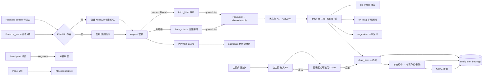

K 线全部逻辑运行在 UI 线程（含绘制），网络只在 daemon 线程；`KlineWin` 不自建队列，复用主面板 `self.q`，由 `poll` 转发。

### 2.2 模块划分

| 模块 | 职责 | 边界 |
| --- | --- | --- |
| 取数与映射 | 模块级 `tsym_of` / `per_of` / `tqf_of` / `fetch_kline` / `fetch_minute` / `minute_axis` | 只按 `(代码, 周期, 复权)` 拉原始 bar 序列、按代码拉当日分时序列；不懂视图 |
| 缓存与聚合 | `KlineWin.cache`（LRU）+ 模块级 `aggregate_bars` | 30 秒有效期只门禁请求；聚合为纯函数 |
| 状态与调度 | `KlineWin.request` / `_on_timeout` / 失败计数 | 产出 K1/K2/K3/K4；不渲染 |
| 渲染 | `_layout` / `draw_all`（内含蜡烛、均线、网格、量柱、轴刻度）/ `draw_macd` / `draw_tick` / `draw_cross` | 只读 bar（或分时序列）与视图态，不碰网络；MACD 值由 `calc_macd` 内存递推。**量柱与价格/时间轴为 `draw_all` 内联段，不单独拆函数**（与既有实现一致，拆开会让末根局部刷新要跨函数协调） |
| 交互 | `on_wheel` / `on_press` / `on_drag` / `on_release` / `reset_view` | 只改视图态（`view_n` / `view_off`），改完请求重绘 |
| 生命周期 | `Panel` 三个入口 + `KlineWin.save_state` / `close` | 单实例；记忆读写 `config.json` |
| 画线几何 | 模块级 `seg_dist` / `stack_labels` / `fg_on` | 纯函数：只吃「坐标 + 容差」，吐出距离、避让后的纵坐标、对比色；不碰 Canvas、不碰配置 |
| 画线存储 | 模块级 `load_drawings` / `save_drawings` / `norm_rec` / `group_key`；`KlineWin._draw_list` | 逐条白名单校验、分组键生成、延迟落盘；不懂绘制 |
| 画线交互 | `KlineWin._dtool` 子态机：`_d_set_tool` / `_d_press` / `_d_drag` / `_d_release` / `_d_motion` / `_d_cancel` / `_d_commit` / `_d_hit` / `_d_undo` / `_d_capacity` | 只维护「绘制子态 + 选中 + 撤销栈」，几何与绘制委托上面两层 |

### 2.3 分层职责

| 层 | 职责 | 本功能相关实现 |
| --- | --- | --- |
| 窗口层 | Toplevel、工具条、Canvas、布局 | `KlineWin.__init__`、`_layout`、`_on_configure` |
| 数据层 | 取数、缓存、聚合、末根刷新 | `fetch_kline`、`apply`、`aggregate_bars`、`on_quote` |
| 渲染层 | 坐标映射与全部图形 | `draw_all`（chart+vol+axes+lastline）、`draw_cross`、`draw_lines`（tag `draw` / `drawp`） |
| 交互层 | 缩放/平移/复位/周期/复权/均线 | 工具条回调与 Canvas 事件绑定 |
| 画线层（第三轮） | 画线子态、命中、选中、改色、删除、撤销、持久化 | `_d_*` 系列方法 + 模块级几何纯函数；不参与取数与聚合 |
| 主面板集成层 | 入口、菜单、退出、报价推送 | `Panel.on_double` / `on_menu` / `_build_menu` / `paint` / 退出处理 |

### 2.4 界面区块地图

| 区块 | 载体 | 本功能关系 | 回链 PRD |
| --- | --- | --- | --- |
| 主面板列表行（双击） | 既有 `cv` / `cc` | 行为变更：双击开 K 线（R-06-1），位移 >3 逻辑像素不算 | §2.4「标的行」 |
| 右键菜单 | 既有 `Menu` | 新增「查看K线」「在浏览器打开」两项 | §2.4 两个菜单项 |
| K线工具条 | `Toplevel` 内 `tk.Frame`（高 40 逻辑像素） | 10 周期按钮 + 「自定义…」+ 复权 + 「均线▾」面板按钮（§3.5.3） | §2.4「工具条」 |
| K线图表区 | `tk.Canvas`（单画布） | 主图 6 : 量 2 : MACD 2，右价格轴 56、底时间轴 22 | §2.4「图表区」 |
| 分时视图 | 同一 Canvas（`period="tick"`） | 价格线 + 均价线 + 昨收基准线 + 涨跌幅右轴，横轴固定整日时槽（F-13） | §2.4「图表区」 |
| 十字光标与浮层 | Canvas tag `cross` | 吸附 K 线中心；浮层固定图表左上 | §2.4「十字光标与浮层」 |
| 画线▾工具面板 | `Toplevel`（`overrideredirect`）内 7 个工具项 | 复用「均线▾」的浮层实现序列（§3.5.7） | §2.4「画线▾工具面板」 |
| 画线图层 | Canvas tag `draw`（已存线）/ `drawp`（预览线） | 位于 chart/vol/macd 之上、cross 之下，每次整图重绘后重提层（§3.5.5） | §2.4「画线图层」 |
| 画线右键菜单 | `tk.Menu`（`tearoff=0`） | 8 色块 + 删除这条 / 删除当前周期全部 / 取消选中（§3.5.7） | §2.4「右键菜单 颜色/删除」 |

## 3. 详细设计

### 3.1 数据模型

**配置结构（`config.json` 新增对象键）**

| 键 | 类型 | 默认值 | 约束 | 可缺省 |
| --- | --- | --- | --- | --- |
| `kline.w` / `kline.h` | int | `880` / `640` | ≥640 / ≥480，小于按最小值恢复 | 是 |
| `kline.x` / `kline.y` | int | 居中 | 恢复时校验在屏幕可用区内，超界居中 | 是 |
| `kline.period` | str | `"day"` | ∈ 固定 10 档键（含 `tick` 分时、`m120`） | 是 |
| `kline.custom` | dict | `{"n":45,"unit":"min"}` | n：分钟 1–120 / 日 1–250；unit：`min`/`day` | 是 |
| `kline.fq` | str | `"qfq"` | ∈ `qfq`/`hfq`/`none` | 是 |
| `kline.ma` | dict | `{"ma5":true,"ma10":true,"ma20":true,"ma60":true,"ma120":true,"ma250":true}` | 六键布尔，缺键按 `true` 补（兼容旧四键记忆） | 是 |

整个 `kline` 键损坏（非 dict）→ 按默认值恢复，不回写、不阻断（PRD F-11-5）。

**画线结构（`config.json` 新增独立对象键 `drawings`）**

三级结构：`drawings[code][group] = [记录, ...]`。**不并入 `kline`**——`kline` 的语义是「窗口偏好，整键损坏即整体丢弃」，而画线是用户资产，必须逐条容错（F-18-11），两者容错粒度不同，混存会让「kline 损坏」连带清掉画线。

以下为结构示意（依据 doc-rules §5.2 §3.1「配置文件结构可用 JSON 示例说明」，仅表达层级与字段，非可直接使用的运行配置）：

```json
{
  "drawings": {
    "sh600519": {
      "day": [
        {"tool": "gold", "color": 3, "fq": "qfq",
         "points": [{"t": "2026-06-12", "p": 1520.0, "v": 1518.60},
                    {"t": "2026-09-30", "p": 1380.0, "v": 1379.20}]}
      ],
      "c45min": [],
      "tick": [{"tool": "hline", "color": 1, "fq": "none",
                "points": [{"t": "2026-10-31 10:15", "p": 1520.0, "v": 1519.80}]}]
    }
  }
}
```

| 字段 | 类型 | 约束 | 可缺省 | 说明 |
| --- | --- | --- | --- | --- |
| `drawings` | dict | `code → group → list`；整键损坏按空处理（不阻断） | 是 | 顶层容器 |
| `code` | str | 与 `groups[].items[].code` 同标识（如 `sh600519`） | — | 一级分组 |
| `group` | str | 固定档 = `KLINE_PERIODS` 的键（`tick`/`m1`…`month`）；自定义档 = `c{n}{unit}`（如 `c45min`、`c3day`） | — | 二级分组，**自定义档必须带 `c` 前缀独立成组**（R-08-3） |
| `tool` | str | ∈ `hline`/`vline`/`trend`/`rect`/`gold`/`wave`/`channel` | 否 | 未知值整条跳过 |
| `color` | int | 1–8，对应 `DRAW_COLORS` 下标 +1 | 否 | 非法值回落 `1`（反差色），不丢弃整条 |
| `fq` | str | ∈ `qfq`/`hfq`/`none` | 否 | **记录时的复权口径**，复权换算的判据（§3.3.5） |
| `points` | list | 长度必须等于该工具的锚点数（1/1/2/2/2/3/3）；结构缺失或多出即整条跳过 | 否 | 锚点数组 |
| `points[].t` | str | K 线档：日以上 `YYYY-MM-DD`、分钟档 `YYYY-MM-DD HH:MM`；分时档 `YYYY-MM-DD HH:MM` | 否 | 横向唯一来源，绘制时据此二分定位 |
| `points[].p` | float | `> 0` 且有限；2 位小数 | 否 | 纵向唯一来源 |
| `points[].v` | float | `> 0` 且有限；缺失/非法时回落 `p` | 是 | 绘制时该锚点所在 K 线（或分时槽）的收盘价/现价，复权换算的基准价（F-18-1） |

工具键与锚点数的对应（`DRAW_TOOLS`，§3.7.1）：

| `tool` | 中文名 | 锚点数 | 拾取方式 |
| --- | --- | --- | --- |
| `hline` | 水平线 | 1 | 单击 |
| `vline` | 垂直线 | 1 | 单击 |
| `trend` | 趋势线 | 2 | 拖动 |
| `rect` | 矩形 | 2 | 拖动 |
| `gold` | 黄金分割 | 2 | 拖动 |
| `wave` | 波浪尺 | 3 | 拖动 + 单击 |
| `channel` | 平行通道 | 3 | 拖动 + 单击 |

> 校验口径（对应 AC-59）：**工具类型未知 / 锚点数不匹配 / `p` ≤ 0 或非数值 / `t` 格式不符 → 整条跳过**；`color`、`fq` 非法只回落默认值不丢弃；`v` 非法回落 `p`。理由是 PRD F-18-11 的丢弃条件只列了前四项，`v` 是内部派生字段，不值得为它丢掉用户画的线。

**画线内存态（`KlineWin` 第三轮新增属性）**

| 属性 | 类型 | 初值 | 说明 |
| --- | --- | --- | --- |
| `draw` | dict | `{}` | `drawings` 的内存副本（`code → group → list`），与磁盘同构；读一次、改内存、延迟冲刷 |
| `dtool` | str / None | `None` | 当前绘制工具键；`None` = 浏览态 D0（子态机见 §3.3.3） |
| `danchors` | list | `[]` | 本次绘制已确认的锚点 `[(t, p, v), ...]`；D2 时长度为 2 |
| `_dpress` | tuple / None | `None` | 「按下未松开」的按下点 `(x, y)`；**三类手势共用**（单点工具靠它算位移判「单击 vs 误拖」，两点/三点靠它算 `DRAW_MIN_DIST`） |
| `_dpreview` | tuple / None | `None` | 跟随鼠标的预览锚点 `(t, p, v)`；两点工具 D1 拖动中、三点工具 D2 等待 C 时非空；单点工具恒为空 |
| `_dswallow` | bool | `False` | 一次性吞并标志：三点工具在 `_d_press` 内提交 C 点后置真（**在 `_d_cancel()` 之后置**，否则会被清回），让紧随的 `<ButtonRelease-1>` 不再走 D0 的命中判定（否则刚成的线会被立刻选中） |
| `dsel` | int / None | `None` | 选中线在当前分组列表中的下标；切换标的/周期/复权即清空（R-08-17） |
| `_dmenu` | `tk.Menu` / None | `None` | 右键菜单实例；每次弹出前重建（当前色标记需重算） |
| `_dpanel` | `Toplevel` / None | `None` | 「画线▾」浮层面板（与 `_ma_panel` 同构、独立生命周期） |
| `undo` | dict | `{}` | `(code, group) → [快照, ...]`，每桶独立、栈深 20（R-08-12） |
| `_dflush` | str / None | `None` | 延迟冲刷的 `after` 句柄（300ms 合并落盘） |
| `_dq_warned` | bool | `False` | 「复权口径已变化，画线可能偏移」只提示一次（F-18-8）；每次 `switch_fq` 重置 |
| `_dchg_warned` | bool | `False` | 「分时画线仅当日有效，已清理」只提示一次（F-18-6）；**在分时数据日期发生变化（跨日）时重置为假**，否则次日再清理会静默 |
| `_dlast` | str / None | `None` | 上次使用的工具键（PRD F-15 输入表默认值「上次使用的工具」）；**会话内**记忆、不落盘（§10.6 补充 #6）；面板打开时据此高亮 |
| `_ts` | list | `[]` | `[b[0] for b in bars]`，升序，`_tidx` 的二份依据；**与 `bars` 必须等长同序**，三处维护点见 §3.7.5 |

**画线内存态的不变式**（编码期必须满足，T031 加断言）：

1. `dtool is None` 时，`danchors` / `_dpress` / `_dpreview` 必全为空——否则下次进绘制态会被误判为「已拾取一半」（see §3.3.3 判据），用旧周期的锚点直接成线；
2. `_ts` 与 `bars` 等长且逐项对齐（三处维护点：`_rebuild_view` 末尾、`on_quote` 跨桶追加、`switch_code` 清零）；
3. `dsel` 非空时必须小于当前分组列表长度，任何会改变列表长度的操作（删除、删除全部、撤销、切换分组）之后都要重新校验或置空；
4. `_dswallow` 仅在三点工具提交 C 点后为真，被紧随的 `<ButtonRelease-1>` 消费后立即复位；任何其他时刻为真都说明漏了消费。

**初始化时序（硬约束）**：`self.draw = load_drawings(panel.cfg)` 必须在 `self.request()` **之前**（首帧 `draw_all` 就要画线）；`_dflush` / `_dchg_warned` 在 `__init__` 内初始化，不能懒加载——`save_drawings` 在首次成线前就可能被 `switch_code` 冲刷调用。

**状态关系（第三轮补充）**

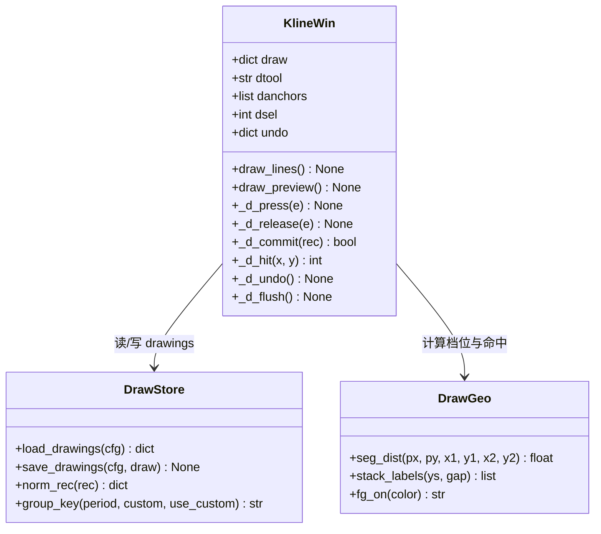

**内存态（`KlineWin`）**

| 属性 | 类型 | 初值 | 说明 |
| --- | --- | --- | --- |
| `code` / `name` | str | 打开参数 | 当前标的 |
| `state` | str | `"K1"` | K0 不落窗（窗不在即 K0） |
| `bars` | list | `[]` | 当前视图数据（固定档为原始 bar；自定义档为聚合结果），元素 `[date, open, close, high, low, vol, amount]` |
| `at_start` | bool | False | 已到数据源深度上限 |
| `view_n` / `view_off` | int / float | `120` / `0.0` | 可见根数（20–300）/ 右端距最新一根的偏移（0=贴最新）；`view_off` 为 **float**（缩放锚点误差 <0.5px，见 §3.4 R-02-2），不落盘 |
| `cache` | dict | `{}` | `(code, pkey, fq)` → `{"bars","ts","at_start"}`；插入序即 LRU |
| `req_seq` | int | 0 | 请求序号：响应/超时比对，旧序号结果丢弃 |
| `fail_cnt` | dict | `{}` | 同条件连续失败计数；≥3 禁用重试 30 秒 |
| `_retry_banned_until` | float | `0.0` | 失败重试的禁用截止时刻（`time.time()` 时间戳，不是定时器句柄）；`_draw_k3` 据此判按钮是否可点 |
| `period` / `custom` / `fq` / `ma` | — | 记忆恢复 | 当前档位状态 |
| `hover` | int / None | None | 十字光标选中根下标 |
| `min_data` | dict / None | `None` | 分时档专用：当日序列（`fetch_minute` 返回 `slots` / `idx` / `price` / `cumv` / `cuma` / `prev` / `date`）；跨日整体丢弃重取；K 线档恒 `None` |
| `macd` | tuple(list×3) / None | `None` | 与 `bars` 等长的 `(dif, dea, hist)`，`calc_macd` 产出；末根刷新只重算末位（F-14-6） |
| `min_warned` | bool | False | 分时档滚轮「只提示一次」旗标（PRD F-04-7） |

**初始化时序（硬约束）**：`Panel.kwin = None` 必须在 `_build_menu()` 之前（菜单回调引用）；`KlineWin.__init__` 内先恢复记忆再 `request()`，先建 Canvas 再绑定事件。

**状态关系**

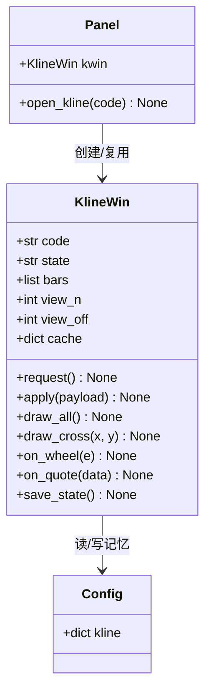

### 3.2 外部接口设计

#### 3.2.1 新增外部接口

三个接口同属腾讯 `ifzq.gtimg.cn` 域，共用一套超时/UA/异常约定（§3.2.1.4），故归入本节并按接口各成一目。

##### 3.2.1.1 腾讯分钟 K 线（`mkline`）

| 项 | 内容 |
| --- | --- |
| 地址与方法 | `GET https://ifzq.gtimg.cn/appstock/app/kline/mkline?param={sym},{per},,{lmt}` |
| 用途 | 分钟档（1/5/15/30/60/120 分）历史 K 线，**不复权**（该接口无复权参数） |
| 关键参数 | `sym` 代码直通、`per` ∈ `m1`/`m5`/`m15`/`m30`/`m60`/`m120`、`lmt` 取数根数（§3.2.1.4） |
| 返回 | `data.{sym}.{per}` 为数组，每条 `["202610301500", open, close, high, low, volume]`（时间标签为段尾时刻、12 位压缩格式） |
| 异常 | `code != 0` / HTTP 非 200 / JSON 解析失败 → 抛出 → K3；目标数组缺失或为空 → 空列表 → K4 |

返回报文示例（UTF-8；数值为示意）：

```json
{"code":0,"data":{"sh600519":{"m5":[["202610301500",1392.0,1392.05,1392.4,1391.5,23140.0]]}}}
```

##### 3.2.1.2 腾讯日以上 K 线（`fqkline`）

| 项 | 内容 |
| --- | --- |
| 地址与方法 | `GET https://web.ifzq.gtimg.cn/appstock/app/fqkline/get?param={sym},{per},,,{lmt},{fq}` |
| 用途 | 日/周/月历史 K 线，支持前/后/不复权 |
| 关键参数 | `per` ∈ `day`/`week`/`month`；`fq` ∈ `qfq`/`hfq`/空串（不复权，注意是空串不是 `none`） |
| 返回 | 结构同 `mkline`，但时间标签为 8 位 `YYYYMMDD` |
| 异常 | 同 `mkline` |

##### 3.2.1.3 腾讯当日分时（`minute/query`）

| 项 | 内容 |
| --- | --- |
| 地址与方法 | `GET https://web.ifzq.gtimg.cn/appstock/app/minute/query?code={sym}` |
| 用途 | 分时档当日逐分钟序列（含昨收） |
| 返回 | `data.{code}.data.data`：每行 `"HHMM 价 累计量(手) 累计额(元)"`（**指数亦带额**，实测 4 段）；`data.date` 当日 `YYYYMMDD`；`data.{code}.qt.{code}` 第 5 位为昨收 |
| 异常 | 同 `mkline`；`fetch_minute` 在序列为空时直接抛异常 → K3 |

**分时序列解析（`fetch_minute`，daemon 线程）**

| 项 | 规则 |
| --- | --- |
| 时槽轴 | `minute_axis(market)`：沪深 09:30–11:30 + 13:00–15:00 共 242 槽、港股 09:30–12:00 + 13:00–16:00 共 332 槽（按「各时段含首尾端点的分钟标记」计）；返回 `HHMM` 字符串序列（保前导零），为横轴唯一基准 |
| 截断 | 沪深个股丢弃 15:01–15:30 盘后固定价点（实测 267 点 → 242 点）；港股 16:01–16:10 竞价点不绘制、16:00 槽取该时段最后一个价 |
| 同分钟多点 | 取最后一个；14:57–15:00 收盘集合竞价并入 15:00 槽（PRD F-13-1） |
| 均价线 | `累计额 ÷ (累计量 × 100)` 逐点计算；指数实测同样带额，**全品种可画**；额段缺失（防御分支）时均价线不绘制、浮层「均价」行 `—` |
| 昨收 | `qt.{code}` 第 5 位；缺失或 ≤0 时以首点价代替并置「昨收缺失」提示行（PRD F-13 输入表） |
| 返回结构 | `{slots, idx, price, cumv, cuma, prev, date}`：`slots` 时槽序列、`idx` 槽标签→下标映射、`price`/`cumv`/`cuma` 与槽等长（未到槽为 `None`）、`prev` 昨收（可能为 `None`）、`date` 当日 `YYYYMMDD` 字符串 |
| 跨日 | 结果附带 `date`；与本地日期不符整体丢弃重取；缓存有效期 `KLINE_TICK_TTL=30` 秒（与 R-04-1 同门禁） |

> 时间标签约定：分钟档为 `"YYYYMMDDHHMM"`、日以上为 `"YYYYMMDD"`，统一手工切分为 `YYYY-MM-DD HH:MM` / `YYYY-MM-DD` 后进 `bar[0]`（与既有实现一致）。东财通道已于 2026-10-30 整域断连弃用（§10.3）。

##### 3.2.1.4 参数映射与调用约束

**参数映射**

| 参数 | 取值 | 说明 |
| --- | --- | --- |
| `sym` | **代码直通**：`tsym_of(code)` 原样返回（sh/sz/hk 数字代码腾讯自识），不认识的返回 None | 北交所（`bj`）与港股字母指数一律 None；`open_kline` 入口先判 None → toast「暂不支持该标的K线」且**不开窗**（与 PRD F-01 一致，审核 S12）；AC-28 用 `hk00700` 验收 |
| `per` | 1分→`m1`、5分→`m5`、15分→`m15`、30分→`m30`、60分→`m60`、120分→`m120`、日→`day`、周→`week`、月→`month`（`per_of`） | 120 分原生支持（每交易日 2 根：11:30、15:00），不参与自定义聚合；自定义分钟仍按 R-01-6 折算基础周期 |
| `fq` | 前复权→`qfq`、后复权→`hfq`、不复权→空串（`tqf_of`） | 分钟档恒传空串（不复权，控件置灰）；港股日线三档实测均通（§10.3） |
| `lmt` | 首取 `min(cap, view_n + 250 + KLINE_VIEW_DEF)`，回溯每次 `+250`；cap：`m120` 320、`month` 302、其余全档 800（PRD R-03 表，腾讯实测） | 250 = MA250 预热（R-03-1）；自定义档折算 `(view_n+370)×n` 再 min(cap) |

**分时序列解析（`fetch_minute`，daemon 线程）**

见 §3.2.1.3 的解析表（时槽轴 / 截断 / 同分钟多点 / 均价线 / 昨收 / 返回结构 / 跨日）。

调用约束（`fetch_kline` / `fetch_minute` 内）：必须带 `User-Agent` 与 `Referer: https://gu.qq.com/`，超时 8 秒；只在 daemon 线程调用。**`req_seq` 门闩只丢弃过期响应、不阻止并发**（审核 S2）：回溯在途时切周期会再起一个线程，旧线程结果因 seq 失效被丢弃、且不写缓存（下次回溯按新周期补齐）——这是刻意取舍，避免为串行化引入取消机制；稳态最多 2 个在途线程。

**cap 截断行为（审核 P3）**：大周期自定义档（如 45 分 = m5×9）按 `(view_n+370)×n` 折算后会被 `cap`（800）截断，聚合后只剩 80~90 根，**首屏装不满 120 根**。规定：

1. `apply` 后把 `view_n` 钳到「不超过实际根数、且不小于 1」；不足 20 根也照常绘制（按实际根数铺满绘图宽，单根变宽），不报错、不降级；
2. 若首取根数已达 `cap`（`at_start=True` 初值即为真），**不弹 toast**（用户尚未主动回溯），只在时间轴上沿显示小字 `数据仅 X 根`；
3. 用户再左拖才弹 `已到最早数据`；缩放上限仍 300，但 `view_n` 不超过实际根数；
4. AC-06 / AC-31 只验时段对齐与残段保留，**不以 120 根满屏为前提**。

#### 3.2.2 复用的既有接口

| 接口 | 用途 | 说明 |
| --- | --- | --- |
| 主面板报价（腾讯行情，既有） | 末根实时刷新 | `Panel.paint` 把当前标的那条报价 dict（按代码从主面板数据里取）整条推给 `KlineWin.on_quote`（含 `price`/`prev`/`vol`/`amount`）；零新增请求 |

#### 3.2.3 第三轮（画线）接口结论

**画线不新增任何外部接口，也不新增任何网络请求**（PRD F-18-13）。全部数据来自本地 `config.json`，全部计算来自内存中的 `bars` / `min_data` 与当前坐标映射：

| 依赖 | 用途 | 说明 |
| --- | --- | --- |
| `config.json` 的 `drawings` 键 | 画线读写 | 唯一落盘点；写盘复用既有 `save_json`（原子替换 + `.bak`），不新增 IO 通道 |
| `bars[i][0]` / `bars[i][2]` | 横向定位 + 基准价 | 时间标签二分、收盘价取 `v`；**不请求任何补充数据** |
| `min_data["slots"]` / `min_data["price"]` / `min_data["date"]` | 分时档横向定位 + 基准价 + 跨日判定 | 分时档锚点时间 = `date` 转 `YYYY-MM-DD` + 槽 `HH:MM`（F-16 输入表） |

> 复权换算所需的「新口径收盘价」**不额外取数**：`switch_fq` 本身会 `request(reset=False)` 重取当前档数据，换算在数据落地后的 `_after_data` 中完成（§3.3.5）。因此画线在数据未就绪时一律不绘制，不需要「为换算而单独拉一次历史」——这条是本期请求面的关键收敛点。

### 3.3 业务流程

#### 3.3.1 打开 → 取数 → 渲染（PRD §3.4 主链路）

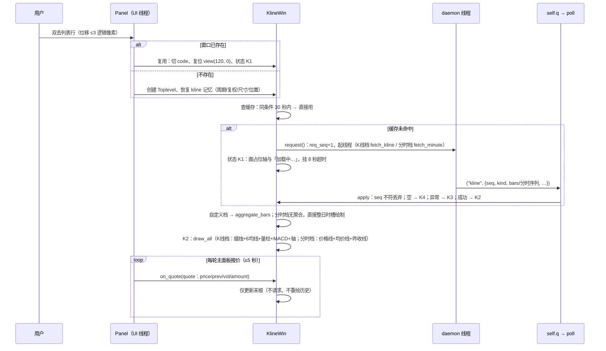

#### 3.3.2 缩放与回溯（PRD §3.4 交互段）

> **分时档守卫（F-13-9）**：`on_wheel` / `on_press` / `on_drag` 的**平移/缩放分支**入口先判「当前是否为分时档」，是则直接返回；滚轮首次触发弹 toast「分时视图固定整日，不支持缩放」1.5 秒（`min_warned` 置位，此后不再弹）；双击仅隐藏十字光标。本节流程只对 K 线档生效。
>
> **判定次序不可颠倒（否则 AC-55 失效）**：绘制态委派必须排在分时守卫之前。`on_press` 的完整次序是 ① `dtool` 非空 → 转 `_d_press` 并返回 → ② 分时档 → 平移短路 → ③ K 线档平移。若按相反次序，分时档在判 `dtool` 之前就 return，「分时档画水平线/黄金分割」永远进不去。`on_wheel` 同理：① `dtool` 非空只记「需重画预览」不拦截 → ② 分时档提示并返回 → ③ 缩放。

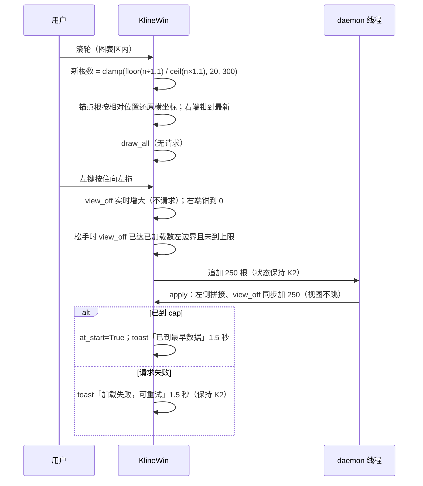

#### 3.3.3 画线拾取 → 成线（PRD §3.3.8 子态机 D0/D1/D2）

三类手势共用一条主链路，差别只在「需要几个锚点」与「何时算完成」。子态判据按**固定顺序**求值（`need` = 该工具的锚点数，取自 `DRAW_TOOLS`），不额外存 state 字符串（避免与 `self.state` 的 K1~K4 混淆）：

| 次序 | 子态 | 判据 | 对应 PRD |
| --- | --- | --- | --- |
| 1 | D0 浏览态 | `dtool` 为空 | R-08 表 |
| 2 | D2 半成品 | `dtool` 非空、该工具需 3 个锚点、且已拾取恰好 2 个 | D2（三点工具已定 A、B，等 C） |
| 3 | D1（按住中） | `dtool` 非空、且本次按下尚未松开 | D1 的瞬时子态，不单独设态 |
| 4 | D1 待拾取 | `dtool` 非空、且不满足 2、3 | **兜底分支**，对需 1 / 2 / 3 个锚点的工具一律成立 |

> **次序不可调换，第 4 条必须是兜底**：任何「拿已拾取锚点数与所需锚点数直接比大小」的写法都会在「只需 1 个锚点」时算错（「已拾取数 < 需要数 − 1」对单点工具恒为假，水平线/垂直线会掉出状态机）。以「D2 是唯一的特例，其余非 D0 皆 D1」表述，三类手势才共用一个判据（审核 M1）。

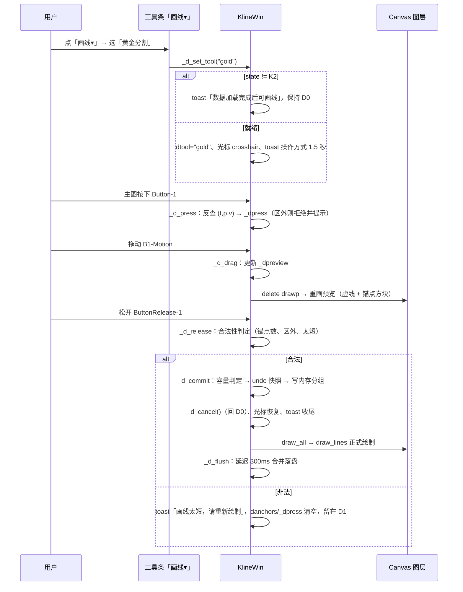

**三类手势的完成判据**（`_d_release` 内按 `need` 分派）：

| 工具类别 | `need` | 按下 | 拖动 | 松开 | 完成时机 |
| --- | --- | --- | --- | --- | --- |
| 单点（水平线、垂直线） | 1 | 吸附取锚点（写入 `_dpress`） | 无动作（不产生预览线） | 位移 < `px(DRAW_MIN_DIST)` → `_d_commit`；≥ 该值 → 视为误拖，清 `_dpress` 并留在 D1 | 松开时 |
| 两点（趋势线、矩形、黄金分割） | 2 | 吸附取 A | 更新 `_dpreview`（B） | A、B 合法 → `_d_commit`；不合法 → toast + 清空，留在 D1 | 松开时 |
| 三点（波浪尺、平行通道） | 3 | 第一次：吸附取 A；第二次（D2）：吸附取 C 并直接 `_d_commit` | 更新 `_dpreview` | 第一次松开定 B、`danchors=[A,B]` 进 D2；第二次不等待松开 | 第二次按下时 |

> 单点工具「按下取点、松开校验位移」而非「按下即成」：按下即成的实现会把「按住想拖动看看」误判成画线，且与两点工具的最小间距口径不一致（§10.6 补充 #3）。

**三点工具的第二段**：`_d_release` 完成 A→B 后**不 commit**，只把 `danchors = [A, B]`、清 `_dpress`、置 `_dpreview` 跟随；随后 `<Motion>` 持续重画 `drawp`；下一次 `_d_press` 取 C 并在同一次事件内直接走 `_d_commit`（C 点由按下时刻确定，不等待松开——若等松开，用户按下后微动会导致 C 点漂移，与「单击定 C」的手感不符）。

**子态与既有手势的边界**（实现落点见 §3.4 R-08-6）：
- `on_press` / `on_drag` / `on_release` / `on_double` 四个入口**首行**判 `dtool`，命中即转入 `_d_*` 并 `return`，绝不继续走平移/回溯/复位；
- `on_wheel` **不拦截**（R-08-6 要求缩放保持可用），但缩放后必须按新映射重画 `drawp`，否则预览线会停在旧像素上；
- `on_motion` 在绘制态**同时**做两件事：更新预览 + 画十字光标（保留十字是为了对位价格，浮层在 `cross` 层、预览在 `drawp` 层，后者在下，不互相遮挡）。

#### 3.3.4 选中 → 改色 → 删除（PRD F-17）

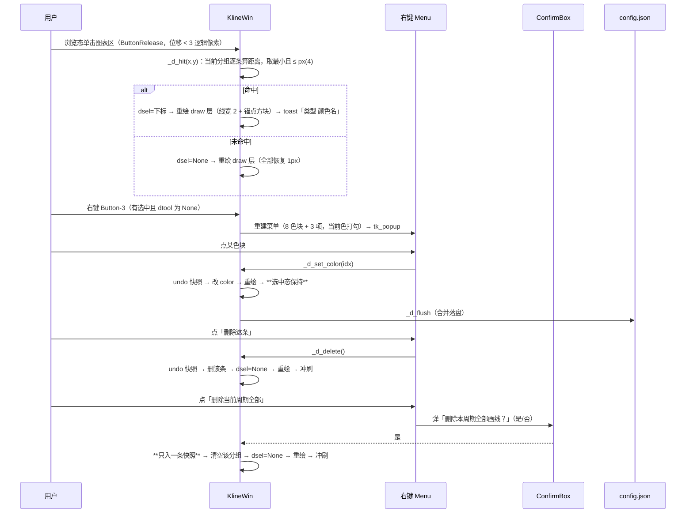

**命中判定为「逐条算距离、取最小」而不是「按图层 tag 命中」**：Tk 的 `find_closest` 对 `draw` 层的细线（1px）在缩放后容差极小，而 PRD 要求 4 逻辑像素的容差；且一条黄金分割有 7 条档位线 + 1 条斜线，必须整体算一条记录的距离。故用几何距离自算（§3.7.5），不做 item 级命中。

**右键菜单为本期新增绑定**：K 线画布此前没有 `<Button-3>`（PRD F-17-3 已核实）。绑定统一挂在 `self.cv`，内部先判「有选中 + 非绘制态 + 就绪态」三条，任一不满足直接 `return`（不弹空菜单、不弹灰菜单）。

#### 3.3.5 保存 / 恢复 / 复权逐锚点换算（PRD F-18）

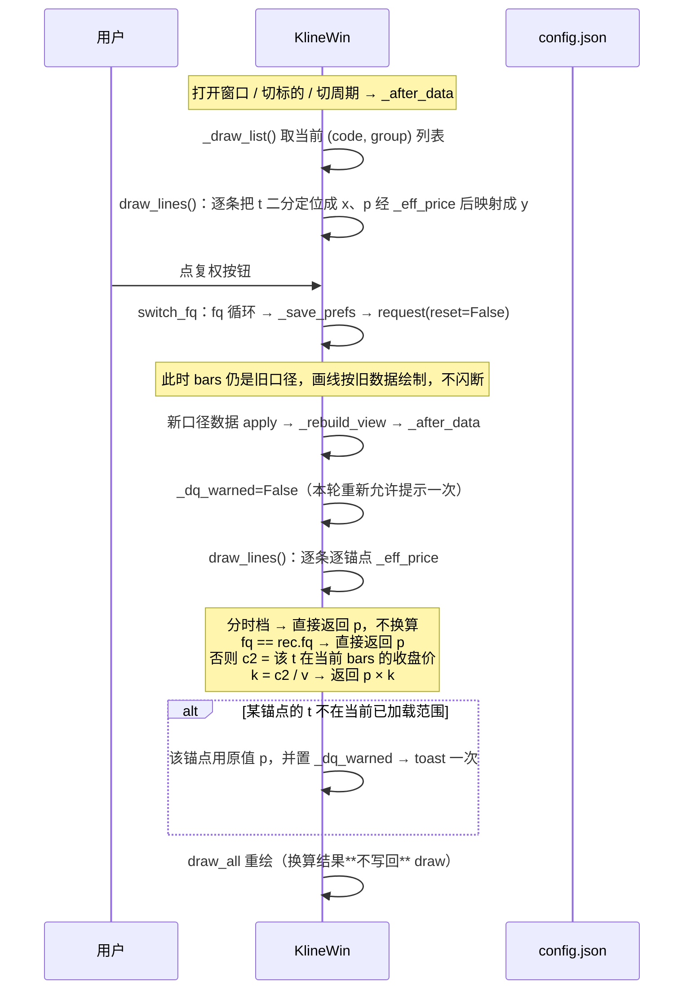

**为什么必须逐锚点**（AC-58 的数值依据）：前复权下 A（除权日前）、B（除权日后）两点的 `v` 都是前复权价；切到不复权后，A 的 `c2` 是未复权原值（比前复权大），B 的 `c2` 与 `v` 基本相等（除权日之后前复权=不复权）。若用单一系数（例如以 B 的 `k≈1` 乘全部锚点），A 端会整体偏低一个复权幅度——正是「一端贴住、另一端偏移」。逐锚点后两端各自 `k` 不同，各自贴住。

**为什么分时档必须短路**（容易漏的反向陷阱）：分时档的复权按钮只是被 `disabled`（PRD F-02 的置灰要求），`self.fq` 仍停在进入分时前的档位（如 `qfq`），而分时画线记录的 `fq` 是 `none`。两者恒不相等 → 若照常走换算，会拿**分时槽下标**去索引上一 K 线周期的 `bars`：轻则取到毫无关系的价格让线整体飞离，重则下标越界抛异常。分时图没有复权口径，短路是唯一正确解；同理分钟档虽然 `fq` 恒 `none` 与记录一致、不会触发换算，也不能依赖这个巧合。

**分时档跨日清理**（F-18-6，与上图同一条 `_after_data` 链路）：

| 时机 | 判据 | 动作 |
| --- | --- | --- |
| `_apply_tick` 成功（`min_data` 已写入） | 分组 `draw[self.code]["tick"]` 非空，且 `points[0].t` 的日期部分 ≠ `min_data["date"]` | 清空该分组 → `_d_flush()` 立即写盘 → `_dchg_warned` 为假时 toast 一次「分时画线仅当日有效，已清理」，随后置真；日期再次变化时复位为假 |
| 同日切周期再切回分时 | 日期相同 | 不清、正常绘制 |
| 分时档无数据（K4） | 无 `min_data` | 不清理（没有新日期可比，避免把用户当天的线误删） |

> 判据取 `points[0].t` 而不是逐条比对：同一分组内的锚点由同一个交易日绘制，日期必相同（跨日会被上一条规则整组清掉），比对首条即可，省一次全组遍历。
>
> **分时档日期口径**：`min_data["date"]` 是 `YYYYMMDD`（8 位，`fetch_minute` 原样返回），锚点的 `t` 用 `YYYY-MM-DD HH:MM`。两者比较前统一去掉 `-`，不做 `datetime.strptime`（避免脏数据抛异常打断绘制）。

#### 3.3.6 周期 / 复权切换 → 取数 → 重绘（PRD §3.4 的 O / O1 分支）

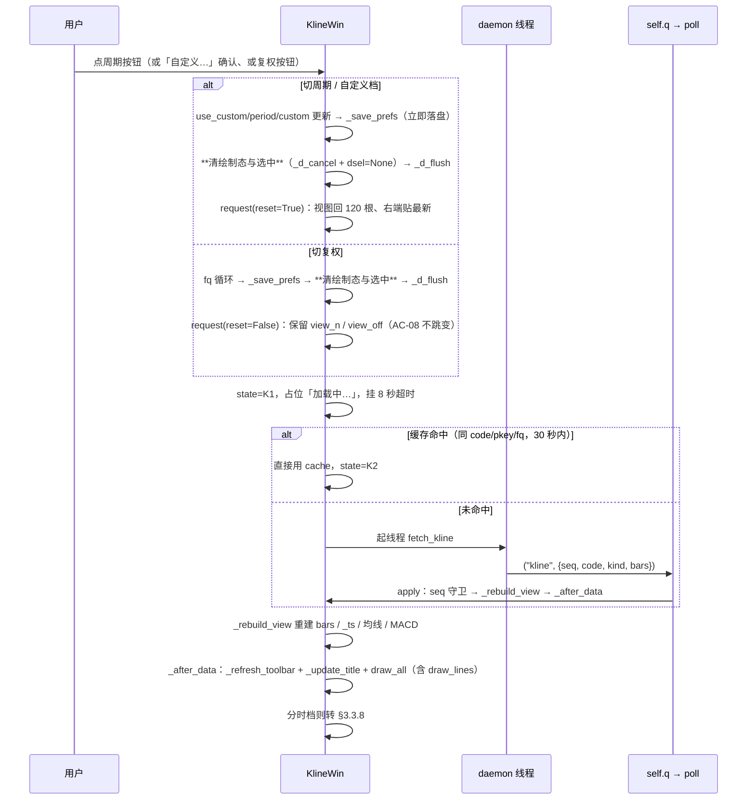

| 要点 | 规则 |
| --- | --- |
| 内存态清理 | 切周期/复权都**必须**调 `_d_cancel()`（它一并清 `dtool`/`danchors`/`_dpress`/`_dpreview`/`_dswallow`），只置 `dtool=None` 会留下半截锚点，下次进绘制态被误判为 D2（审核 M2、§3.1 不变式 1） |
| 视图复位差异 | 切周期 `reset=True`（AC-05 回 120 根）；切复权 `reset=False`（AC-08 保留根数与右端位置） |
| 冲刷时机 | `switch_period` / `set_custom` / `switch_fq` 三者都先 `_d_flush()` 再请求——否则切走的那个周期的画线可能还没落盘就因 `save_state` 覆盖写盘而丢失 |
| 画线重绘 | 新数据到达后的 `draw_all` 自带 `draw_lines`，无需额外调用；复权换算在 `_eff_price` 里按新口径逐锚点完成（§3.3.5） |

#### 3.3.7 鼠标移动读数（PRD §3.4 的 P 分支）

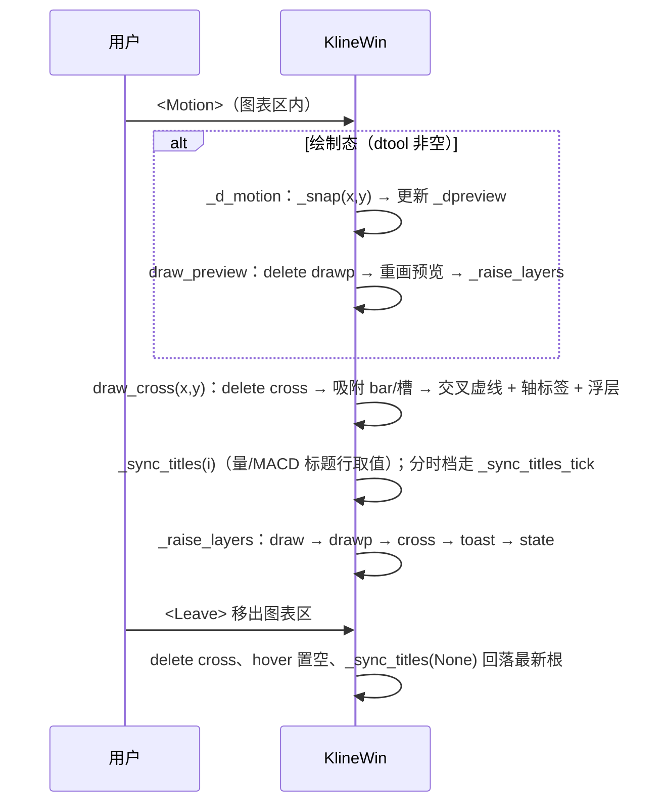

| 要点 | 规则 |
| --- | --- |
| 只重建 `cross` | 不动 chart / draw（AC-54「光标移动不重绘画线层」的落地） |
| 顺序 | 预览先画、光标后画——光标层在上，浮层不被预览线压住 |
| 绘制态不隐藏光标 | 保留十字以便对位价格（§3.3.3 末段） |

#### 3.3.8 分时档取数与整日时槽渲染（PRD §3.4 的 O2 分支）

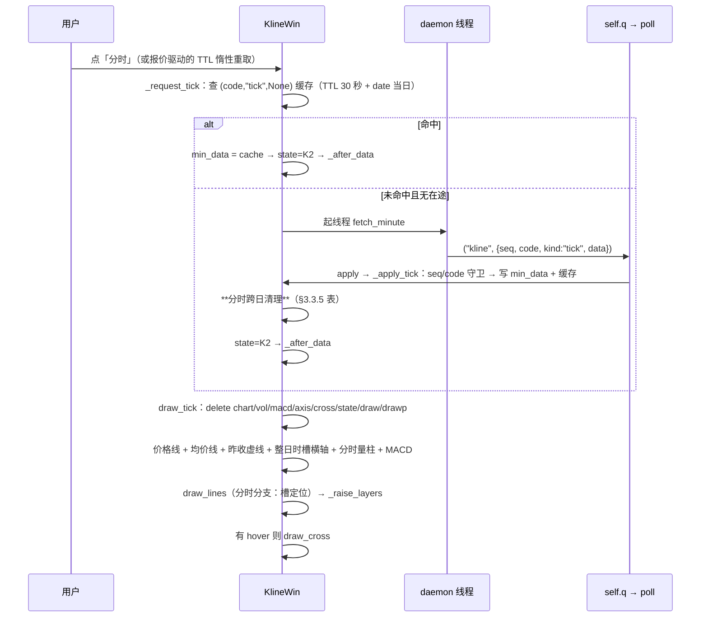

| 要点 | 规则 |
| --- | --- |
| 横轴不随数据点数变化 | 恒 `minute_axis` 的 242/332 槽（AC-32/AC-33），画线 x 由槽下标决定，与已到达多少点无关 |
| 画线落点 | `draw_tick` 内 `draw_lines()` 插在 MACD 绘制之后、末尾 `draw_cross` 之前（`draw_tick` 没有 `_li = li` 这一锚点，不能照抄 `draw_all` 的位置，审核 S3） |
| 报价驱动 | `_on_quote_tick` 只改当前分钟点的价/量，随后 `draw_tick` 整体重绘（含画线），不请求历史 |

#### 3.3.9 关闭窗口保存状态（PRD §3.4 的 S 分支）

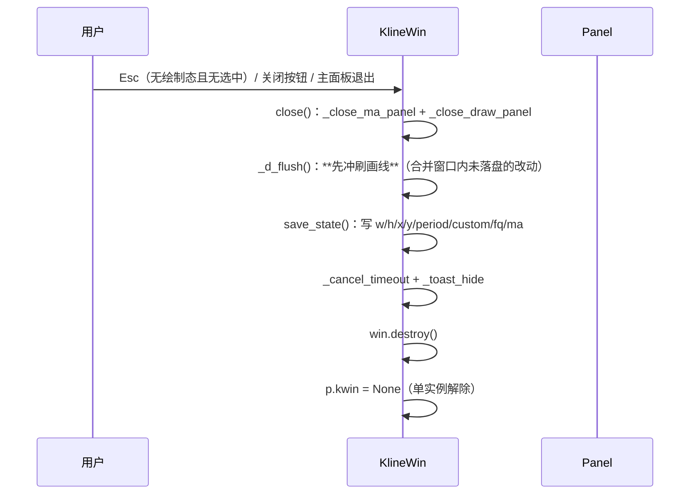

| 要点 | 规则 |
| --- | --- |
| 冲刷必须先于 `save_state` | 两者都写整份 `cfg`：若先 `save_state`，它带的是内存里的 `drawings`（此时 `cfg["drawings"]` 与 `self.draw` 同一对象，见 §3.7.6「对象归属」），顺序正确才不会写丢 |
| 退出路径唯一 | 主面板 `overrideredirect`，无 `WM_DELETE_WINDOW` 注册；「退出」菜单 → `Panel.quit()` → `kwin.close()`（§3.7.4 第 5 条） |
| 撤销栈 | 随对象销毁，不落盘 |

### 3.4 业务规则

对照 PRD §3.3 逐条给出实现方案。

| 规则 | PRD 要求 | 实现方案 |
| --- | --- | --- |
| R-01-1 固定 10 档 | 分时、1/5/15/30/60/120 分 + 日/周/月 | 工具条 10 个周期按钮由 `KLINE_PERIODS` 常量生成（**键、文案二元组**；请求用的周期串由 `per_of(键)` 派生，不冗余存第三列），不写死按钮数量 |
| R-01-2 自定义档定义 | 分钟 1–120、日 1–250 | `CustomDialog` 校验区间（整数、越界红字不关面板）；`kline.custom` 持久化；`base_of` 折算基础周期与每根含量 |
| R-01-7 周期记忆 | 打开时恢复上次周期 | 每次 `switch_period` / `switch_fq` 即 `save_kline_state`；恢复值与标的限制冲突（港股+分钟档）→ 回退「日」并落盘（T018） |
| R-03-3 上限提示 | 到上限提示 1.5 秒 | toast（tag `toast` + `after(1500)` 删除），与 R-02-4 同源同一函数 |
| R-01-3 分钟聚合边界 | 不跨日、不跨午休，09:30 重新起算 | `aggregate_bars(intraday=True)`：按 bar 的日期段与时间跳变分段（`HH:MM` 从 ≥11:30 跳到 <13:00 即断段、日期变化即断段），段内自左向右每 N 根聚一根，末段不足 N 根单独保留 |
| R-01-4 日聚合边界 | 按连续交易日累加，不按自然周/月 | `aggregate_bars(intraday=False)`：从最新一根向左每 N 根一组，最左残组单独保留（R-01-8） |
| R-01-5 聚合算法 | 开=首开、收=末收、高低=极值、量额=求和 | 纯函数逐组合并，输出结构与原始 bar 一致 |
| R-01-6 基础周期选择 | N 能被 5 整除用 5 分钟线，否则 1 分钟；N 日用日线 | `base_of(custom)`：`n%5==0 → ("m5", n//5)` else `("m1", n)`；日档 `("day", n)` |
| R-01-8 残段处理 | 不丢弃、不并入下一段 | 分组循环里余组照常输出一根（其时间跨度取组内首尾 bar），AC-31 由该实现保证 |
| R-01-9 120 分档 | 每交易日固定 2 根（上午/下午），属分钟档不涉及复权 | `per_of("m120")` 原生取数、不参与聚合；深度 320（cap 表，首取即 `at_start`）；AC-35 验收 |
| R-01-10 分时档 | 取当日逐分钟序列，整日时槽固定展示 | `period="tick"`：走 `fetch_minute`，横轴 = `minute_axis`，缩放/平移/回溯全部短路（§3.3.2 注）；30 秒缓存、跨日丢弃；记忆与恢复同固定档（R-01-7） |
| R-01-11 分时与自定义互斥 | 二者不得同时选中 | `switch_period` 按钮单选语义天然互斥；记忆键同为 `kline.period`，恢复时按值落在唯一档 |
| R-02-1 根数钳制 | 20–300 | `on_wheel` 先算新根数再钳制；边界处继续滚动无效果 |
| R-02-2 锚点稳定 | 偏差 ≤1px | 锚点根的相对位置 `t=(锚点x−x0)/绘图宽`，缩放后 `x0+t×宽` 反解新 `view_off`；**`view_off` 存 float**（仅视图态、不落盘），绘制用浮点坐标——取整时误差上界为 `bw/2`（300 根时 ≈2px > 1px，审核 S1 指出原「≥1px 时 <1px」论证方向反了）；浮点后误差 <0.5px，AC-10 成立 |
| R-02-3 右端约束 | 不超最新一根 | `view_off ≥ 0` 恒成立；缩放/平移后统一 `view_off = max(0, view_off)` |
| R-02-4 回溯上限 | 到上限停止并提示 | 缓存记 `at_start`；已达则 toast 后不再请求 |
| R-02-5 复位 | 双击恢复最新 120 根 | `reset_view()`：`view_n=120, view_off=0`，隐藏光标 |
| R-02-6 纵轴自适应 | 不支持纵向操作 | `draw_all` 每次按可见区极值重算 y 映射；纵轴无滚轮/拖动绑定 |
| R-03-1 首次取数 | min(可见 + 均线预热 250 + 一屏余量, cap) | 一屏余量 = `KLINE_VIEW_DEF`（120 根 = 默认视窗满屏），见 §3.2.1 lmt 公式；250 = MA250 预热（PRD R-03-1 第二轮口径）；`m120` cap 320 不足 490 → 首取即 `at_start`，按 cap 截断行为处理 |
| R-03-2 递进加载 | 每次追加 250 | 回溯请求 `lmt = 已有根数+250`，取回后保留末尾既有条数对齐；重叠去重键 = `bar[0]` **完整字符串**（分钟档含 `HH:MM`、日档为日期），**禁止按 `YYYY-MM-DD` 前缀去重**（会把同日几十根分钟 bar 全删，审核 P10） |
| R-04-1 30 秒缓存 | 同条件复用 | `cache[key]["ts"]` 与 `time()` 比 ≤30 直接用；过期**不删数据**，仅标记可重取（F-09-6） |
| R-04-2 请求合并 | 30 秒内切周期不重复请求 | 同上：切回已缓存周期命中缓存 |
| R-04-3 无自动轮询 | 只有末根跟随报价 | `KlineWin` 无历史数据定时器；`on_quote` 纯内存更新 |
| R-04-4 失败节奏 | 手动重试；3 连败禁 30 秒 | 连败计数按 `(代码, 周期, 复权)` 记；3 连败时写禁用截止时刻并 `after(30000)` 调 `_retry_unban` 解禁；禁期内重试按钮 `state="disabled"` |
| R-04-5 请求隔离 | 不影响主面板 | 网络只在 daemon 线程；`poll` 的 `kline` 分支独立 try/except |
| R-05-1 涨跌配色 | 收≥开涨色，与主面板同色值 | 蜡烛/量柱同取 `theme["up"/"down"]`；**不新增红绿色值** |
| R-05-2 均线配色 | 6 色、两两不同、先登记 UI 规范 | `MA_COLORS` 六元组（§3.7.1），已登记 `wiki/rules/ui-rules.md` §1.5.1（含浅色主题三处深一档） |
| R-05-3 主题跟随 | 主面板切主题立即同步 | `Panel.reload()`（重读 theme 后走 `_rebuild` 的唯一落点）内、`_rebuild` 之后追加 `kwin.apply_theme()`：重取 token、工具条换色、`draw_all`（审核 P8：原「主面板主题切换处」未指名函数） |
| R-05-4 字体 | 数字等宽、中文雅黑 | 轴刻度/浮层与主面板同用 `f_num`（Consolas）与 `f_cn` |
| R-05-5 尺寸换算 | 不写死物理像素 | 全部尺寸经 `px()`；`KlineWin.s` 取创建时主面板 `s`，窗口 DPI 与主面板一致 |
| R-05-6 网格 | 主图与两个副图各画水平淡网格 | `create_line` 用 `theme["line"]`；主图随价格刻度（3–8），量/MACD 副图各补最大值参考线 |
| R-05-7 MACD 配色 | DIF/DEA 各一色、与均线与涨跌色不冲突、柱按正负取涨跌色 | `MACD_COLORS = (DIF色, DEA色)`（§3.7.1），已登记 ui-rules §1.5.2；柱色复用 `theme["up"/"down"]`，不新增红绿 |
| R-05-8 分时配色 | 价格线随最新价 vs 昨收取涨跌色、均价线用均线第 1 色、昨收线用次要文字色虚线 | 价格线色 = 最新价≥昨收 ? `up` : `down`；均价线取 `MA_COLORS[0]`；昨收线 `dash=(4,3)` + `theme["sub"]` |
| R-06-1/2 手势迁移 | 双击开 K 线；网页入口进右键菜单 | `Panel.on_double` 行分支改调 `open_kline`；原打开网页函数保留，挂到新菜单项（F-12） |
| R-06-3 折叠态 | 双击标题栏仍是展开 | `on_double` 既有 `e.y <= head_h` 分支在前，不动 |
| R-06-4 单实例 | 复用切换 | `Panel.open_kline`：`self.kwin` 存活即 `switch_code` |
| R-06-5 关闭联动 | 主面板退出关窗 | `Panel.quit()` 内、`root.destroy()` 之前判存调 `kwin.close()`（先 `save_state` 再 destroy）；无 `WM_DELETE_WINDOW` 路径（审核 P8） |
| R-06-6 双击判定 | 位移 >3 逻辑像素不算双击 | `on_press` 记起点，且**只在距上次按下 >600ms 时**清零 `_row_dragged`（双击间隔内的第二次按下不得清零）；`<B1-Motion>` 行分支位移超 `px(KLINE_DOUBLE_TOL)` → `_row_dragged=True`（持久标志）；`on_double` 行分支见该标志为真则消费并返回。**不能用「两次按下坐标比位移」**：AC-29 场景两次按下点本就几乎重合，且第二次按下会抹掉拖动证据（审核 P1） |
| R-07 状态机 | K0–K4 | `state` 字符串字段；超时由 `after(8000)` + `req_seq` 守卫；流转表见 PRD §3.3.7，实现逐一对应 |

**第三轮：R-08 画线规则（PRD §3.3.8）**

| 规则 | PRD 要求 | 实现方案 |
| --- | --- | --- |
| R-08-1 工具清单 | 7 种，不含文字标注/箭头/扩展/江恩 | `DRAW_TOOLS = ((键, 中文名, 锚点数, 拾取方式), …)` 为**四元组**驱动，工具面板与几何分派都由它生成，不写死分支数（字段定义见 §3.7.1） |
| R-08-2 归属维度 | 按「标的 + 周期」独立 | 存储路径 `draw[code][group]`；`_draw_list()` 只返回当前 `(code, group)` 的列表，绘制/命中/撤销全部限定在该列表内 |
| R-08-3 周期归属 | 自定义档必须独立成组 | `group_key()`：`use_custom` 为真时返回「字母 `c` + 整数 n + 单位」拼成的串（如 `c45min`、`c3day`），否则返回 `self.period`。**禁止用 `self.period` 代表自定义档**——自定义生效时它仍停在上一个固定档，会把「自定义 45 分」的画线存进「30 分」组（T031 自检断言） |
| R-08-4 坐标口径 | 横向存时间、纵向存价格，禁存像素/下标 | 记录三元组 `{t, p, v}`；绘制时 `t` 二分查下标 → `_x_of(i)`（K 线档）或 `(i+0.5)*sw`（分时档），`p` → `_y_of(p)`。**代码中不出现任何「把画线锚点存成 x/y 像素或 bar 序号」的路径** |
| R-08-5 吸附 | 横向吸最近 K 线/槽中心，纵向优先吸收盘价（容差 4 逻辑像素） | `_snap(x, y)`：横向 `i = clamp(round(_lidx() + x/bw − 0.5), 可见区首, 可见区末)`；纵向判 `abs(y − _y_of(bars[i][2])) <= px(4)` → 取收盘价，否则 `_p_of(y)`。分时档横向按 `round(x/sw − 0.5)` 且**只吸已有数据的槽**（向前找最近非空，见 §3.7.5） |
| R-08-6 手势优先级 | 绘制态左键归画线、双击忽略、滚轮可用；浏览态恢复既有语义 | `on_press` / `on_drag` / `on_release` / `on_double` 首行 `if self.dtool: … ; return`；`on_wheel` 不拦（但缩放后重画 `drawp`）；浏览态代码路径与原实现逐行等价（不含任何画线判断） |
| R-08-7 图层与叠放 | 画线在 K 线/副图之上、光标之下；重绘后重提层；三态不显示 | tag `draw`（已存）+ `drawp`（预览）；**所有重绘路径统一调同一个 `_raise_layers()`**（次序 `draw`→`drawp`→`cross`→`toast`→`state`），不在各处零散 `tag_raise` —— 只提 `cross` 会把光标压到 toast 之上，只提 `draw` 会把预览压在已存线之下；`_draw_state` / `_draw_k3` 的 delete 列表加入 `"draw", "drawp"` |
| R-08-8 越界处理 | 横向时间不在范围 → 整条跳过；纵向超范围 → 画布裁剪，标注越界则跳过标注 | `_tidx(t)` 返回 `None` 即整条 `continue`（不删除、不改写）；纵向不判，`create_line` 交给画布裁剪；标注绘制前判 `0 <= y <= main_y1` 才画 |
| R-08-9 复权换算 | 按锚点逐个换算，禁单一系数 | `_eff_price(rec, pt)` 三步：① **分时档直接返回记录价**（分时无复权口径，记录里 `fq` 恒 `none` 而 `self.fq` 停在进入分时前的值，不短路必然误判为「口径已变」）；② 当前 `fq` 与记录 `fq` 相同 → 返回记录价；③ 否则以该锚点时间在当前 `bars` 的收盘价为新口径价 `c2`，显示价 = 记录价 × (c2 ÷ 基准价 `v`)。逐锚点调用，**不存在「先算一个系数再乘全组」的代码路径**（T031 自检断言） |
| R-08-10 颜色 | 8 色，默认反差色；默认色不与均线同值、任一不与涨跌色同值 | `DRAW_COLORS` / `DRAW_COLORS_LIGHT` 八元组，取值与 ui-rules §1.5.3 逐位一致；新成线 `color=1`；`color` 越界回落 1 |
| R-08-11 容量 | 单组 ≤50、全局 ≤500，两级不同文案 | `_d_capacity()` 先判「本组是否已达 50」，再判「所有标的、所有周期的记录总条数是否已达 500」，两级分别给不同 toast；判定在**成线前**，拒绝时不产生任何写入 |
| R-08-12 撤销 | Ctrl+Z、栈深 20、覆盖新增/删除/改色、按分组分桶、切标的清空、不做 Redo | `undo[(code, group)]` 存**操作前整组深拷贝快照**，撤销即整组替换——不为每种操作写逆操作，天然满足「删除全部只占一次」；超过 20 步时丢掉最早一步；`switch_code` 清空整个 `undo`；不做 Redo |
| R-08-13 分时档 | 7 种全可用，横向吸槽，时间=当日日期+槽时刻，不缩放不平移 | `_is_tick()` 分支：横向用当日时槽下标反查，时间标签拼成「当日日期 + 槽的 HH:MM」；`on_wheel` / `on_press` 的平移分支本就分时短路（第二轮已有），画线分支插在其前，二者不冲突 |
| R-08-14 非就绪态 | 三态下可展开面板但不响应绘制，提示「数据加载完成后可画线」 | `_d_set_tool` 与 `_d_press` 首行判「是否处于就绪态 K2」；面板照常展开（`_toggle_draw_panel` 不判状态）；非就绪态下 `draw_lines` 直接返回（不绘制残留旧线） |
| R-08-15 工具条宽度 | 新增「画线▾」不得换行/截断 | 预算与压缩优先级见 §3.5.8；编码期以 `tb.winfo_reqwidth()` 实测断言，超限按「周期按钮 padx 6→4 → 功能按钮 padx 10→6 → 周期文案去「分」」三步降级 |
| R-08-16 末根刷新 | 锚点按时间重新定位，不沿用上次像素 | 画线**不缓存任何像素**：`draw_lines` 每次从 `t` 重新算 x。同桶刷新走 `_refresh_last`（len / view_n / view_off 未变 → x 不变，故不重绘画线层）；跨桶追加 len 变化 → `_li_key` 失配 → 走 `draw_all` 重绘画线 |
| R-08-17 切换清理 | 切标的清选中+撤销；切周期/复权清选中，撤销按分组保留 | `switch_code`：`_d_cancel()` → `dsel=None` → `undo.clear()` → 冲刷；`switch_period` / `set_custom` / `switch_fq`：**`_d_cancel()` → `dsel=None` → 冲刷**（撤销桶按 `(code, group)` 天然隔离，无需清）。**只置 `dtool=None` 不算清理**——`danchors` 残留会让下次进绘制态被误判为 D2 并用旧锚点成线（§3.1 不变式 1） |

**PRD 状态机的实现对应**

| PRD 状态 | 实现落点 |
| --- | --- |
| K1 加载中 | `request()` 后：清 chart 保留轴骨架、居中 `加载中…`、挂 8 秒超时 |
| K2 就绪 | `apply` 成功：`draw_all`；此后缩放/平移/光标全部可用 |
| K3 失败 | `apply` 异常或超时：居中 `数据加载失败` + 重试按钮；底部小字=最后尝试时刻；已有图时的回溯失败**不进入 K3**（toast 即可，PRD §3.3.7 注）。**热区实现**（审核 S4）：Canvas 无按钮控件，用 `canvas.tag_bind(item, "<Button-1>", self._on_retry_click)` + `itemconfig(item, cursor="hand2")`；点击后文案改 `重试中…` 并 `tag_unbind` 忽略后续点击，结果回 K2 或还原为可点 |
| K4 空数据 | `apply` 成功但 bars 空：居中 `暂无K线数据`；切周期回到 K1 |
| 重试禁用 | `fail_cnt[key] ≥ 3`：重试热区显示 `30 秒后可重试`，`after(30000)` 恢复 |

### 3.5 界面设计

无 PROTO（PRD 已确认不出原型）。

#### 3.5.1 布局与坐标

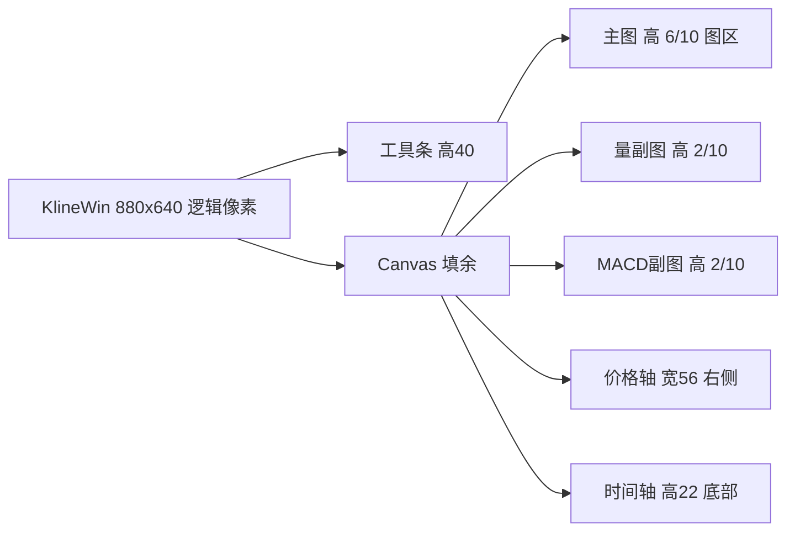

> **口径统一（审核 P4）**：下表「实测」列一律为**画布尺寸**。Tk 的 `geometry()` 设置的就是客户区，不含系统标题栏与边框，因此 画布 = 逻辑尺寸 × s；原「640×420 校验」扣了 31 逻辑像素标题栏，与 880×560 的口径不一致，已重算。

| 量 | 公式（画布单位，`px()` 换算） | 880×640@150% 实测 |
| --- | --- | --- |
| 工具条高 | `px(40)` | 60 |
| 价格轴宽 | `px(56)` | 84 |
| 时间轴高 | `px(22)` | 33 |
| 绘图宽 | `画布宽 − 价格轴宽` | 1236 |
| 图区高 | `画布高 − 工具条 − 时间轴` | 867 |
| 主图 / 量 / MACD 高 | `h_main = round(图区×6/10)`；`h_vol = (图区−h_main)//2`；`h_macd = 图区 − h_main − h_vol` | 520 / 173 / 174 |
| 分时 y | 以昨收为中轴，上下对称取最大偏离 ×1.08（8% 余量）→ 主图区间 | — |
| MACD y | 以 0 为中轴，上下对称取可见区 max(abs(DIF), abs(DEA), abs(柱)) ×1.1（10% 余量）→ MACD 区间 | — |
| 单根宽 `bw` | `绘图宽 / view_n`，实体宽 = `max(1, bw×0.7)` | 120 根 → 10.3 |
| bar 中心 x | `x0 + (i − 视图首根 + 0.5) × bw` | — |
| 价格 y | 线性映射 `[min×0.95, max×1.05]` → 主图区间 | — |
| 量 y | 按可见区最大量归一 → 副图区间 | — |

最小尺寸校验（640×480 逻辑 → 画布 960×720）：绘图宽 876、图区 627、主图 376、量 125、MACD 126；MACD 副图 126 物理像素 = 84 逻辑像素 ≥ 60 降级线（不触发 §3.5.2 降级）；20 根时 `bw = 876/20 ≈ 43.8`。

> **待 PRD 订正偏差**：PRD F-01 校验段按「480 − 31 标题栏 − 40 − 22」扣出 387/232/77；本表按审核 P4 确立的「`geometry()` 即客户区」口径为 960×720 画布 → 627/376/125/126。**以本表为准**（Tk 无系统标题栏计入），PRD 校验段数字待订正。

#### 3.5.2 视觉规格

| 元素 | 规格 |
| --- | --- |
| 蜡烛 | 涨 `theme["up"]`、跌 `theme["down"]`；实体 `create_rectangle`、影线 `create_line` 1px |
| 均线 MA5/10/20/60/120/250 | `MA1=#F5A623`、`MA2=#4A90D9`、`MA3=#B57EDC`、`MA4=#C9A227/#9A7B1F`、`MA5=#2DD4BF/#0B8C7F`、`MA6=#818CF8/#4F46E5`（斜杠前后为深/浅主题，已登记 ui-rules §1.5.1）；数据不足 N 根不绘制该段；MA120/MA250 在 1 分、120 分等短周期档整段不出现属预期 |
| 最新价虚线 | `dash=(4,3)` 贯穿主图；右轴标签底色=当日涨跌色、文字白 |
| 量柱 | 颜色随该根涨跌；顶部 `成交量` 与可见区最大量刻度（`f_num` 8pt） |
| MACD 副图 | 标题行 `MACD(12,26,9)  MACD:xx  DIF:xx  DEA:xx`（`f_num`，各数值颜色=对应元素色，无光标时取最新根）；DIF `#F2F2F2/#262626`、DEA `#F472B6/#C2255C`（深/浅）；柱 ≥0 涨色、<0 跌色；0 轴 `theme["line"]` 虚线；副图高 <60 逻辑像素 → 只画柱与 0 轴、标题行保留（PRD F-14-7） |
| 分时视图 | 价格线整条一色 = 最新价≥昨收 ? `up` : `down`；均价线 = `MA_COLORS[0]`；昨收基准线 = `theme["sub"]` + `dash=(4,3)`；右轴双刻度：价格与涨跌幅（`+1.23%`），`f_num` 8pt；未到达时槽留空，横轴恒为整日。**量副图照常绘制（PRD F-13-7）**：量 = 相邻点累计量差分（每分钟成交量），颜色 = 该分钟价 vs 前一分钟价取涨跌色（首点与昨收比），未到时槽留空 |
| 轴刻度 | 价格 3–8 档（按极值自动取整间隔）；时间 3–8 档抽稀（分钟档 `MM-DD HH:MM`、日线以上多时只标 `MM-DD`/`YYYY-MM`） |
| 十字光标 | 竖虚线贯穿主图+量+MACD 三段、横虚线仅当前所在图区；横坐标吸附 bar/时槽中心（`round` 后取整）；量与 MACD 副图标题行同步显示选中根数值 |
| 信息浮层 | 图表左上角固定：圆角底（`theme["panel"]`）+ K 线档 9 行（时间/开/高/低/收/涨跌幅/涨跌额/成交量/成交额）或分时档 6 行（时间/价格/均价/涨跌幅/成交量/成交额），数字 `f_num`、标签 `f_cn`，缺失行 `—` |
| toast | 图表顶部居中一行小字（tag `toast`），1.5 秒 `after` 自动删除 |
| 主题 | 全部颜色取 token；主面板切主题 → `apply_theme()` 重绘 |

#### 3.5.3 工具条控件

| 控件 | 实现 | 状态联动 |
| --- | --- | --- |
| 周期按钮 ×10 | `tk.Button`（flat），当前档高亮（实底+亮字+凹框，保持 normal——Tk 禁用按钮忽略 `fg`，§10.2 #4） | 点击 → `switch_period(key)`；分时档键 `tick` |
| 「自定义…」 | `tk.Button` → `CustomDialog`（`Toplevel`：Entry + 分钟/日 Radiobutton + 确定/取消） | 越界在框下 `tk.Label` 红字提示，不关面板（AC-07） |
| 复权按钮 | `tk.Button` 循环切换 `前复权→后复权→不复权`，文本随档 | 分钟档/港股日线以上限制时 `state="disabled"`（AC-09） |
| 「均线▾」+ 浮层面板 | `tk.Button` → 无边框 `Toplevel`（`overrideredirect(True)` + `grab_set()`）内 6 个 `tk.Checkbutton`，每行文字左侧 8px 色块 `tk.Label`（bg=对应线色）；勾选即时 `draw_all` 不取数且面板保持打开；面板外点击 / 再次点按钮关闭；**不使用 `tk.Menu` checkbutton**——勾选标记在深色菜单上不可见（自定义列 SDD 已踩坑）；面板打开期间若发生主题切换（`apply_theme`）或窗口关闭（`close`），先 `grab_release` 并销毁面板再继续 | 变更即 `save_kline_state` |
| 港股/复权置灰 | 1/5/15/30/60/120 分 6 档 + 自定义「分钟」单位 `state="disabled"`；「分时」档对港股可用；分时与 120 分档复权按钮置灰；**分时档「均线▾」按钮一并置灰**（PRD F-02-9/F-13-7），切回 K 线档恢复原勾选态 | `_apply_market_limits` / `switch_period`（T023） |

#### 3.5.4 交互流程

| 用户动作 | 绑定 | 行为 |
| --- | --- | --- |
| 滚轮 | `Canvas <MouseWheel>`（图表区内） | 缩放（§3.4 R-02-1/2/3） |
| 滚轮（分时档） | 同上；**判定次序 `dtool` → 分时 → 缩放** | 无效果；首次提示 toast 1.5 秒（`min_warned`） |
| 左键拖动（分时档） | `<B1-Motion>`；**判定次序 `dtool` → 分时 → 平移** | 无效果、不回溯；双击仅隐藏十字光标。**绘制态下的拖动预览不受分时守卫影响**（守卫只在 `dtool` 为空时才生效） |
| 左键按下拖动 | `<Button-1>` / `<B1-Motion>` / `<ButtonRelease-1>` | 平移；松手判回溯 |
| 双击图表区 | `<Double-Button-1>` | `reset_view` |
| 移动 | `<Motion>` | 十字光标（出图区隐藏）；工具条上方不触发 |
| 绘制态左键 | `<Button-1>` / `<ButtonRelease-1>`（`dtool` 非空时） | 只拾取锚点，**不平移、不选中**；完整分流见 §3.7.7 |
| 单击已有画线 | `<ButtonRelease-1>`（浏览态、位移 < 3 逻辑像素） | 命中容差 4 逻辑像素内取最近一条 → 选中加粗；未命中则取消选中（§3.3.4） |
| 右键（有选中画线） | `<Button-3>` | 弹 8 色 + 删除/删除全部/取消选中菜单；无选中或绘制态不弹（§3.5.7） |
| Esc | `Toplevel bind("<Escape>")` | **三段语义**：绘制态 → 取消本次绘制 / 退出绘制态；有选中 → 取消选中；都没有 → `close()`（同关闭按钮）。详见 §3.7.7 |
| Ctrl+Z | `Toplevel bind("<Control-z>")` | 撤销当前（标的+周期）分组最近一步；输入框有焦点时让路（§3.7.7） |
| 窗口缩放 | `bind("<Configure>")` | `_layout` 重算 + `draw_all`；缩放结束（松手/Configure 稳定 300ms）保存记忆 |

#### 3.5.5 画线图层与叠放（R-08-7）

单 Canvas 的叠放次序**由 item 创建顺序决定**，没有 z-index 可设。画线要在「K 线之上、十字光标之下」，靠两件事保证：

1. **创建时机**：`draw_lines()` 在 `draw_all` 末尾调用（此时 chart/vol/macd 已建完），`draw_cross()` 在其后调用；
2. **显式重提层**：任何一次重绘后调用 `_raise_layers()`，按固定次序把四层依次提到最顶，末尾动的层在最上。

| 层（自下而上） | tag | 创建者 | 说明 |
| --- | --- | --- | --- |
| 网格与刻度 | `axis` | `draw_all` / `draw_tick` | 水平网格、价格轴文字、时间轴文字、最新价标签 |
| 蜡烛与均线 | `chart` | `draw_all` | 含最新价虚线、分时档价格线/均价线/昨收线 |
| 成交量柱 | `vol` | `draw_all` / `draw_tick` | — |
| MACD | `macd` | `draw_macd` | 副图三条线 + 柱 + 0 轴 |
| **已存画线** | `draw` | `draw_lines` | 7 种几何 + 标注 + 点阵填充 + 选中加粗 |
| **预览画线** | `drawp` | `draw_preview` | 虚线 + 锚点方块，只在 D1 拖动中 / D2 等 C 时存在 |
| 十字光标与浮层 | `cross` | `draw_cross` | 每次移动只 `delete("cross")` 重建 |
| 顶部提示 | `toast` | `toast` | 1.5 秒自动删除 |
| 三态占位 | `state` | `_draw_state` / `_draw_k3` | K1/K3/K4 的居中文字与重试热区；三态下 `draw` / `drawp` 已被清空 |

`_raise_layers()` 的调用次序（**次序本身是设计约束，不得调换**）：依次对 `draw`、`drawp`、`cross`、`toast`、`state` 五个 tag 调 `Canvas.tag_raise`，即「先提画线层、再提预览层、最后提光标与提示」——反过来会把预览压在已存线之下、把光标压在画线之下。调用点：`draw_all` 末尾、`draw_tick` 末尾、`draw_lines` 末尾、`draw_preview` 末尾、`toast` 创建后、`_draw_state` / `_draw_k3` 末尾。**对不存在的 tag 调 `tag_raise` 是空操作**（Tk 静默忽略），因此不必判存在性。

三层协同的硬规则：

| 场景 | 必须做 | 禁止做 |
| --- | --- | --- |
| 十字光标移动 | 只 `delete("cross")` 后重建 + `_raise_layers()` | 重绘 chart / draw 层（否则 8ms 预算立即破，AC-54 失败） |
| 整图重绘 | `delete` 列表加入 `"draw", "drawp"`，绘制顺序 chart→…→draw→drawp→cross | 在 `draw_lines` 之后又整体 `delete` 一次（会把画线删掉） |
| 三态（K1/K3/K4） | `_draw_state` / `_draw_k3` 的 delete 列表含 `"draw", "drawp"` | 保留旧线（坐标已失效，会浮在空图上，R-08-7 明令不显示） |
| 预览刷新（绘制态移动） | 只 `delete("drawp")` 重建 + `_raise_layers()` | 重建 `draw` 层（50 条线每次移动都重画，白耗 3ms） |

#### 3.5.6 画线视觉规格

| 元素 | 规格 |
| --- | --- |
| 线条颜色 | `DRAW_COLORS[color-1]`（深色）/ `DRAW_COLORS_LIGHT[color-1]`（浅色）；取值见 ui-rules §1.5.3，实现逐位对齐 |
| 线宽 | 常态 `max(1, px(1))`；选中 `max(2, px(2))`（逻辑像素 1 与 2，不写死物理像素，R-05-5） |
| 虚线 | `dash=(px(3), px(2))`：黄金分割除 0%/100% 外 5 档、波浪尺全部 4 档、预览线、昨收基准线 |
| 实线 | 水平线、垂直线、趋势线、矩形边框、通道两轨、黄金分割 0%/100% |
| 锚点方块 | 仅选中态绘制（预览态也画）；边长 `px(4)`，`fill=线色`，无描边 |
| 点阵填充 | 矩形内部、通道两轨之间：`stipple="gray25"` + `fill=线色` + `outline=""`；深浅主题同一密度（Tk 无逐 item alpha，`gray25` 是唯一可控半透明观感） |
| 标注字体 | 数字 `f_small`、中文标签 `f_small_cn`；颜色 = 线色（与线同色，PRD F-16-5） |
| 价格标注格式 | 价格一律**固定 2 位小数**（如 `1380.00`，PRD F-16-6）；**不复用 `fmt_price`**——后者在 <10 元时给 3 位，会让画线标注与 AC-41 的期望值格式不一致 |
| 比例标注格式 | 档位百分比与波浪尺回撤均**保留 1 位小数并带 `%`**（如 `61.8%`）；涨跌幅/幅度**保留 2 位小数且带正负号**（如 `+3.25%`） |
| 标注位置 | 横贯线：`x = ax_x − px(4)`、`anchor="e"`、右端内侧；趋势线两端：起点 `anchor="e"` 偏左、终点 `anchor="w"` 偏右；段中点涨跌幅：`anchor="s"` 置于线上方 `px(4)`；矩形：框内顶边下方 `px(4)`、左对齐 `px(6)`；垂直线：时间轴上方 `tm_y − px(4)`、`anchor="s"` |
| 标注避让 | 同一组档位线（黄金分割 7 条 / 波浪尺 4 条）的 y 先升序排序，再按「下一标签 y ≥ 上一标签 y + `px(12)`」逐档下推（`_stack_labels`）；**不下推则丢弃**，确保密集档位仍可读，且不越出主图底边 |
| 标注裁剪 | 任何标注若 y 落在 `[0, main_y1]` 之外则不绘制（R-08-8 纵向） |
| 预览样式 | 线色 `DRAW_COLORS[0]`（反差色），虚线；已确认锚点画方块；未确认的最后一个点画方块但**不画档位标注**（未成线，标注无数值意义） |
| 选中提示 | 顶部 toast 显示 `黄金分割 · 蓝`（类型 · 颜色名），1.5 秒 |
| 绘制态光标 | `cv.configure(cursor="crosshair")`；退出绘制态恢复 `cursor=""`（不恢复成 `hand2`，浏览态本就没有光标形状） |

**7 种几何的绘制内容**（坐标均为画布像素；横向由 `_tidx(t)` 查下标再经 `_x_of(i)` 换算，纵向由 `_y_of(p)` 换算，两者定义见 §3.7.5）：

| 工具 | 绘制内容 | 标注 |
| --- | --- | --- |
| 水平线 | 1 条 `(0, y) → (ax_x, y)` | 右端价格 |
| 垂直线 | 1 条 `(x, 0) → (x, tm_y)` | 时间轴上方该根时间标签 |
| 趋势线 | A→B 单段（不延长） | 两端价格 + 中点涨跌幅 |
| 矩形 | 边框矩形 + 内部点阵 | 顶边下方「价差 / 幅度%」 |
| 黄金分割 | A→B 斜线 + 7 条 `(0, y_k) → (ax_x, y_k)`（0%/100% 实线，其余虚线） | 每档 `61.8% 1234.56` |
| 波浪尺 | A→B、B→C 两段 + 自 C 价格起的 4 条 `(0, y_k) → (ax_x, y_k)` 全虚线 | 4 档 `0.618 1234.56`（格式：档位去尾零 + 空格 + 价格 2 位，即 `0.382` / `0.618` / `1` / `1.618`）+ C 旁回撤比例 |
| 平行通道 | 基线延长至左右边界 + 过 C 的同斜率平行线 + 两线间点阵 | 上/下轨价格 + 通道幅度 |

#### 3.5.7 画线工具面板与右键菜单

**「画线▾」按钮**：置工具条最右（「均线▾」之后），文案恒为 `画线▾`（**不随当前工具改名**——改名会撑宽工具条，与 R-08-15 的宽度上限冲突）。绘制态用实底高亮表示「正在绘制」，工具名靠 toast 提示（PRD F-15-2 已要求 toast，不重复表达）。

| 控件 | 实现 | 状态联动 |
| --- | --- | --- |
| 「画线▾」按钮 | `tk.Button`（flat），`command=_toggle_draw_panel` | 面板开/合；`dtool` 非空 → `relief="solid"` + 实底 + 亮字 |
| 工具面板 | `Toplevel`（`overrideredirect(True)`）+ 竖排 7 个 `tk.Button`（左对齐、宽 `px(96)`、行高 `px(24)`） | 当前工具实底高亮；点击 → 关面板 + `_d_set_tool(key)` |
| 面板几何 | 调 `geometry` 时必须**带尺寸**（宽×高 + 横纵偏移），再 `update()`、再 `grab_set()`、grab 后重申一次几何、最后置顶 | **逐条复制「均线▾」的踩坑序列**（§10.5 缺陷 #5/#6：只给偏移会落在屏幕 (0,0)，`grab_set` 会重置几何），不抽公共函数——两面板生命周期独立，抽公共会在 `apply_theme` 的关闭路径引入耦合 |
| 右键菜单 | `tk.Menu(self.win, tearoff=0)`，每次弹出前 `destroy` 重建 | 8 个色块项（`label=色名`、`background=该色`、`foreground=_fg_on(该色)`、当前色 `image=img_chk_on, compound="left"`）+ 分隔线 + `删除这条` / `删除当前周期全部` / `取消选中` |
| 色块勾选 | 复用主面板的白色对勾 `PhotoImage`（`Panel._mk_check_imgs` 产出的 `img_chk_on` / `img_chk_off`） | **不用文本 `✓`**：Windows 深色菜单下符号字符被按暗色渲染，实测不可见（主面板「显示列」已因此改为位图） |
| 删除全部确认 | 自绘 `ConfirmBox`（`Toplevel` + 两按钮 + `grab_set`），返回 bool 回调 | 不用 `tkinter.messagebox`：其原生对话框不跟随深浅主题，与窗口风格断裂 |
| 弹菜单前置条件 | 三条同时成立：已选中一条画线、不在绘制态、处于就绪态 K2 | 任一不满足直接 return：无选中不弹、绘制态右键不弹（PRD F-17-4） |

**`ConfirmBox` 规格**（新增，轻量）：`Toplevel`（`transient(kwin.win)`、`overrideredirect(True)`、`-topmost`）居中于 K 线窗口，尺寸 `px(300)×px(120)`，一行问句（`f_cn` 10pt）+ 「否」「是」两按钮（是 = 强调色）。Esc / 点「否」= 取消。

#### 3.5.8 工具条宽度预算（支撑 AC-57）

现状（第二轮）：10 周期按钮 + 自定义… + 复权 + 均线▾，PRD 记载 150% 下实测约占 **630 / 640 逻辑像素**，几乎没有余量。第三轮再加「画线▾」必须重新核算并**主动压缩既有内边距**。

估算口径：9pt 雅黑（实测 `tkfont.measure` 口径，汉字 ≈12、数字 ≈6.7 逻辑像素），按钮宽 = 文本宽 + `2×padx`，相邻控件之间另计两侧 padx 之和。

| 控件 | 文本宽 | padx（现 → 拟） | 小计（拟） |
| --- | --- | --- | --- |
| 分时 | 24 | 6 → 4 | 32 |
| 1分 / 5分 | 18.7 ×2 = 37.4 | 6 → 4 | 37.4 + 16 = 53 |
| 15分 / 30分 / 60分 | 25.4 ×3 = 76.2 | 6 → 4 | 76.2 + 24 = 100 |
| 120分 | 32 | 6 → 4 | 40 |
| 日 / 周 / 月 | 12 ×3 = 36 | 6 → 4 | 60 |
| 自定义… | 42 | 6 → 4 | 50 |
| 复权（前复权） | 36 | 10 → 6 | 48 |
| 均线▾ | 30 | 10 → 6 | 42 |
| **画线▾** | 30 | — → 6 | **42** |
| 周期组内间隙 ×10（10 个周期按钮 + 自定义，共 11 个控件） | — | 2 → 1 | 20 |
| 功能按钮间隙 ×3（自定义↔复权↔均线▾↔画线▾） | — | 10 → 6 | 36 |
| Frame 左右边距 | — | — | 24 |
| **合计** | | | **547.6**（表内 53.4 / 100.2 两行按整数显示，故上列相加得 547） |

结论：**估算 547.6 < 640，单行成立**。断言门槛取「窗口宽 − 左右边距」= 616；因 547.6 里**已含**那 24 边距，余量按 `616 − (547.6 − 24) ≈ 92` 计算（不要再用 `616 − 547.6`，那会把边距扣两次）。但与 PRD「实测 630」仍存在约 82 逻辑像素的口径差（PRD 数据来自目测，未记录测量方法），因此本表**只作为设计意图，不作为验收依据**。编码期必须实测并断言（T034/T040）：

1. 逻辑宽度 = `tb.winfo_reqwidth() / self.s`（`winfo_reqwidth` 返回物理像素，除一次 DPI 系数即逻辑宽；**不要再除 2 或乘 2**），须 ≤ `640 − 24`；
2. 若超限，按以下**固定优先级**降级，每步重测：
   - ① 周期按钮内 `padx` 6 → 4、按钮间 `padx` 2 → 1；
   - ② 复权/均线▾/画线▾ 三按钮 `padx` 10 → 6；
   - ③ 周期文案去掉「分」字（`15分` → `15`），仅在 ①② 后仍超限时启用；
3. **禁止**降字号、禁止把周期按钮改成两行、禁止给工具条加横向滚动（R-08-15 与 AC-57 均要求单行不截断）。

### 3.6 错误处理定义

| 场景 | 处理 | 用户可见表现 | 日志 |
| --- | --- | --- | --- |
| 请求超时（8 秒） | `after` 触发且 `req_seq` 未变 → K3 | `数据加载失败` + 重试 | `_dbg("kline timeout")` |
| 返回异常 / JSON 损坏 | 线程内 catch → `("kline_err", seq)` → K3 | 同上，底部小字=最后尝试时刻 | `_dbg` |
| 空数据（新股/长期停牌/退市） | bars 空 → K4 | `暂无K线数据` | 不记（正常分支）；北交所/港股指数已在开窗前拦截，不会走到这里 |
| 回溯失败 | 状态保持 K2，toast 1.5 秒 | 顶部一行提示，画面不动 | `_dbg` |
| 回溯进行中 | 左上角常驻小字 `加载更早数据…`（tag `toast`，不自动消失） | 响应到达或 8 秒超时后清除（PRD F-05-3） | 不记 |
| 分时取数失败 / 超时 | 首屏 → K3 + 重试；已有走势 → 顶部 toast `加载失败，可重试`，保留当前序列 | 同左 | `_dbg` |
| 分时序列缺昨收 | 以首点价代替，副图内一行小字 `昨收缺失` | 走势照常绘制 | 不记 |
| 分时额段缺失（防御分支，实测指数/个股均带额） | 均价线不绘制、浮层「均价」行 `—` | 价格线照常 | `_dbg("tick no amount")` |
| `m120` cap 320 不足首取 490 | 首取即 `at_start=True`，时间轴上沿小字 `数据仅 320 根`，不弹 toast | 正常绘制 | 不记 |
| 数据不足 20 根 | 时间轴上沿小字 `数据不足，仅 X 根` | 新股 / 大周期 cap 截断 | 不记 |
| 3 连败 | 禁用重试 30 秒 | `30 秒后可重试` | `log_once` |
| 限流断连（ConnectionReset） | 同"返回异常"路径 | 同 K3 / toast | `log_once`（同因去重） |
| 末根报价缺失（`data` 无该 key） | `on_quote` 直接返回 | 末根保持上次值 | 不记 |
| 自定义输入非法（0/121/3.5/非数字） | 输入面板内拦截，不发请求 | 框下红字提示范围 | 不记 |
| 记忆损坏 / 位置超界 | 按默认值恢复 / 居中 | 无感 | `_dbg("kline state discarded")` |
| 画线条目非法（工具未知 / 锚点数不符 / 价格非法 / 时间格式不符） | 逐条跳过，其余照常加载（F-18-11） | 该条不出现，无提示 | `_dbg("drawing skipped")`（只记一次，同因去重） |
| `drawings` 整体损坏（非 dict / code 非 dict / group 非 list） | 该层按空处理，不删除原文件、不回写 | 无感 | `_dbg("drawings discarded")` |
| 画线写入失败（磁盘只读 / 权限） | `save_json` 改为**返回布尔**（既有调用方均不判返回值，行为不变）；`save_drawings` 透传该布尔，`_d_flush` 收到假即 toast 一次并保留内存态，下次写操作再试 | `画线保存失败`，线条**仍在本次会话可见**（不静默丢弃，F-18 失败反馈） | `log_once("drawings save failed")` |
| 单组超 50 条 | 成线前拦截，不写入 | `本周期最多 50 条画线，请先删除` | 不记（正常分支） |
| 全局超 500 条 | 同上，两级文案不同 | `画线总数已达 500 条，请先删除部分画线` | 不记 |
| 锚点落在主图区外（量/MACD 副图） | 拒绝本次拾取，不清空已确认锚点 | `请在主图上取点` | 不记 |
| 锚点太短（两两间距 < 3 逻辑像素） | 丢弃本次绘制、清空 `danchors`，保持绘制态 | `画线太短，请重新绘制` | 不记 |
| 非就绪态试图绘制 | 不产生任何记录 | `数据加载完成后可画线` | 不记 |
| 复权后锚点时间不在已加载范围 | 该锚点用原值绘制 | 首次提示 `复权口径已变化，画线可能偏移`（`_dq_warned` 只提示一次） | `_dbg` |
| 分时画线跨日 | 清空 `tick` 分组并冲刷 | `分时画线仅当日有效，已清理`（`_dchg_warned` 只提示一次） | `_dbg("tick drawings aged out")` |
| 撤销栈空时按 Ctrl+Z | 无动作 | 无任何变化、不报错（AC-52/AC-60） | 不记 |
| 画线面板打开期间窗口关闭 / 换肤 | 先 `_close_draw_panel()` 再继续 | 无残留浮层 | 不记 |
| 缓存条目结构异常 | 丢弃该条目重新请求 | 加载中→正常 | `_dbg` |
| `poll` 转发时窗口已销毁 | `isinstance` + `winfo_exists` 守卫 | 无感 | 不记 |
| 主面板退出 | 退出处理 `kwin.destroy()`（先存记忆） | 窗口随主程序关闭 | 不记 |

**日志策略**：沿用 `_dbg` / `log_once`；正常路径零写入。

### 3.7 其他设计

#### 3.7.1 常量定义

| 常量 | 取值 | 单位 | 说明 |
| --- | --- | --- | --- |
| `KLINE_DEF_W` / `KLINE_DEF_H` | `880` / `640` | 逻辑像素 | 默认窗口尺寸 |
| `KLINE_MIN_W` / `KLINE_MIN_H` | `640` / `480` | 逻辑像素 | 最小尺寸 |
| `KLINE_TB_H` / `KLINE_AX_W` / `KLINE_TM_H` | `40` / `56` / `22` | 逻辑像素 | 工具条 / 价格轴 / 时间轴 |
| `KLINE_SPLIT` | `(6, 2, 2)` | — | 主图 : 量 : MACD 高度比 |
| `KLINE_VIEW_DEF` / `KLINE_VIEW_MIN` / `KLINE_VIEW_MAX` | `120` / `20` / `300` | 根 | 可见根数 |
| `KLINE_ZOOM` | `1.1` | — | 单次缩放系数 |
| `KLINE_BACKTRACK` | `250` | 根 | 每次回溯追加 |
| `KLINE_CACHE_TTL` | `30` | 秒 | 请求门禁 |
| `KLINE_TIMEOUT` | `8000` | 毫秒 | 取数超时 |
| `KLINE_FAIL_LIMIT` / `KLINE_RETRY_BAN` | `3` / `30000` | 次 / 毫秒 | 连败禁用 |
| `KLINE_LRU_CODES` | `3` | 标的 | 缓存保留的标的数 |
| `KLINE_CAPS` | `{"m1":800,"m5":800,"m15":800,"m30":800,"m60":800,"m120":320,"day":800,"week":800,"month":302}` | 根 | 数据源深度上限（腾讯实测，§10.3） |
| `KLINE_PERIODS` | `(("tick","分时"),("m1","1分"),…,("m120","120分"),("day","日"),("week","周"),("month","月"))` | — | 10 档定义（**键、文案二元组**；请求周期串由 `per_of` 派生） |
| `MA_COLORS` | 深色 `("#F5A623","#4A90D9","#B57EDC","#C9A227","#2DD4BF","#818CF8")`；浅色第 4/5/6 位换 `#9A7B1F` / `#0B8C7F` / `#4F46E5` | — | MA5→MA250 六色；已登记 ui-rules §1.5.1 |
| `MACD_COLORS` | 深色 `("#F2F2F2","#F472B6")`、浅色 `("#262626","#C2255C")` | — | DIF、DEA 线色；柱复用涨跌色；已登记 ui-rules §1.5.2 |
| `KLINE_MACD_MIN_H` | `60` | 逻辑像素 | MACD 副图降级阈值（低于只画柱与 0 轴） |
| `KLINE_TICK_TTL` | `30` | 秒 | 分时序列缓存有效期（与 `KLINE_CACHE_TTL` 同门禁语义） |
| `KLINE_DOUBLE_TOL` | `3` | 逻辑像素 | 行双击位移阈值（R-06-6） |
| `DRAW_TOOLS` | `(("hline","水平线",1,"click"), ("vline","垂直线",1,"click"), ("trend","趋势线",2,"drag"), ("rect","矩形",2,"drag"), ("gold","黄金分割",2,"drag"), ("wave","波浪尺",3,"drag+click"), ("channel","平行通道",3,"drag+click"))` | — | 工具定义四元组（键、中文名、锚点数、拾取方式）；面板、校验、几何分派全部由它派生 |
| `DRAW_COLORS` | `("#FFFFFF","#F5A623","#4A90D9","#2DD4BF","#E879F9","#A78BFA","#EAB308","#94A3B8")` | — | 深色主题 8 色，与 ui-rules §1.5.3 逐位一致 |
| `DRAW_COLORS_LIGHT` | `("#111827","#D97706","#2563EB","#0B8C7F","#A21CAF","#6D28D9","#A16207","#475569")` | — | 浅色主题 8 色 |
| `DRAW_COLOR_CN` | `("反差","橙","蓝","青","品红","紫","黄","灰")` | — | 选中提示与菜单文案 |
| `DRAW_GOLD` | `(0.0, 0.236, 0.382, 0.5, 0.618, 0.786, 1.0)` | — | 黄金分割 7 档（0% = P_B、100% = P_A） |
| `DRAW_WAVE` | `(0.382, 0.618, 1.0, 1.618)` | — | 波浪尺 4 档 |
| `DRAW_LIMIT_GROUP` / `DRAW_LIMIT_ALL` | `50` / `500` | 条 | 两级容量上限（先判组、再判全局） |
| `DRAW_UNDO_MAX` | `20` | 步 | 撤销栈深（按分组分桶） |
| `DRAW_SNAP` | `4` | 逻辑像素 | 纵向吸附收盘价的容差 |
| `DRAW_MIN_DIST` | `3` | 逻辑像素 | 锚点合法性的最小间距（任意两锚点的横向或纵向） |
| `DRAW_HIT` | `4` | 逻辑像素 | 选中命中的点到线距离容差 |
| `DRAW_W` | `1` | 逻辑像素 | 常态线宽；选中为 `2×` |
| `DRAW_FLUSH_MS` | `300` | 毫秒 | 连续操作的落盘合并窗口 |
| `DRAW_LABEL_GAP` | `12` | 逻辑像素 | 档位标注纵向最小行距（`_stack_labels`） |

#### 3.7.2 函数设计

| 函数 | 位置 | 职责 | 关键约束 |
| --- | --- | --- | --- |
| `tsym_of(code)` | 模块级 | 代码直通校验（sh/sz/hk 数字 → 原样；bj/字母指数 → None） | 纯函数；None **由 `open_kline` 入口拦截并不开窗**（不进 K4，审核 S12） |
| `per_of(pkey)` / `tqf_of(fq)` | 模块级 | 周期→`m1…m120/day/week/month`、复权→`qfq/hfq/空串` | 纯函数 |
| `fetch_minute(sym)` | 模块级 | 子线程内请求当日分时并解析为 `{slots, idx, price, cumv, cuma, prev, date}` | 按 §3.2.1 分时解析规则（截断/并槽/均价线/昨收）；**禁止 UI 线程调用** |
| `minute_axis(market)` | 模块级 | 生成沪深 242 / 港股 332 时槽 `HHMM` 序列 | 纯函数；`HHMM` 字符串保前导零 |
| `calc_macd(closes)` | 模块级 | 递推 DIF/DEA/柱（12,26,9，柱 ×2） | 纯函数；首根 EMA=收盘价；800 根 ≤3ms（PRD §4.1） |
| `fetch_kline(sym, per, fq, lmt)` | 模块级 | 子线程内请求并解析 bar 列表（腾讯 mkline/fqkline） | 带 UA/Referer（gu.qq.com）；超时 8s；解析失败抛异常；**禁止 UI 线程调用** |
| `aggregate_bars(bars, n, intraday)` | 模块级 | 自定义周期聚合 | 纯函数；时段分组 + 残段保留（R-01-3/4/8） |
| `base_of(custom)` | 模块级 | 自定义档 → (基础周期键, 每根含 N 个基础 bar) | 纯函数（R-01-6） |
| `Panel.open_kline(code, name)` | Panel | 创建或复用窗口并切换标的 | 单实例（R-06-4）；折叠态不触发（调用方保证） |
| `Panel.paint`（修改） | Panel | 末尾追加 `kwin.on_quote(...)` 推送 | `winfo_exists` 守卫 |
| `KlineWin.request()` | KlineWin | 缓存判定 → 起线程 / 直接用缓存 | `req_seq` 自增；K1 占位与超时 |
| `KlineWin.apply(payload)` | KlineWin | seq 守卫 → 定状态 → 拼 bar → 聚合 → `draw_all`；分时 payload 走 `apply_tick`（写 `min_data`/`min_date` → `draw_tick`） | 回溯路径走 `apply_backtrack`（左侧拼接、视图不跳） |
| `KlineWin._on_timeout()` | KlineWin | seq 未变且仍 K1 → K3 | 超时后到达的旧响应被 seq 丢弃 |
| `KlineWin._layout()` | KlineWin | 由当前窗口尺寸算绘图区各边界 | `<Configure>` 触发 |
| `KlineWin.draw_all()` | KlineWin | 清 `chart`/`vol`/`macd`/`axis` 重建全部图形；分时档走 `draw_tick` 分支 | 只重绘当前视图；**双层预算**：首帧 ≤50ms、交互路径（缩放/平移）≤16ms（PRD §4.1），300 根下按 16ms 设计；手段=单 Canvas 分层 tag + 只在必要分支清 tag（审核 P5） |
| `KlineWin.draw_cross(x, y)` | KlineWin | 只重建 tag `cross` | 吸附 bar/时槽中心；K 线档 9 项浮层、分时档 6 项；MACD/量标题行数值联动；预算 8ms |
| `KlineWin.draw_macd()` / `draw_tick()` | KlineWin | MACD 三线一柱与 0 轴 / 分时主图分支 | `calc_macd` 结果缓存于 `self.macd`，末根刷新只重算末位（EMA 增量递推只需前值，与 PRD F-14-6「重算末两根引用」数值等价，TC 按数值比对）；分时档 `calc_macd` 以当日价格序列入参（跨日不延续） |
| `KlineWin.on_wheel / on_press / on_drag / on_release / reset_view` | KlineWin | 视图态变更 + 重绘 | 平移不请求；松手判回溯；分时档全部短路（§3.3.2 注） |
| `KlineWin.switch_period / switch_fq / toggle_ma` | KlineWin | 档位切换 + 记忆 + 重新 `request`；`toggle_ma` 为均线▾面板回调（立即 `draw_all` 不取数） | 切换即存（F-11-2）；港股分钟 6 档置灰、分时可用；分时/120 分复权置灰 |
| `KlineWin.on_quote(quote)` | KlineWin | 末根 收/高/低/量/额 更新，或新周期桶追加 | 纯内存；入参为完整 quote dict（`price`/`prev`/`vol`/`amount`，审核 S6）；桶判定用本地时钟与末根 `bar[0]` 尾部 `HH:MM`/日期比对，接受 ±5 秒误差（审核 S7）；涨跌额口径：末根用 `prev`、历史根用前一根收盘；分时档更新末点价格/累计量并按 `KLINE_TICK_TTL` 惰性重取当日序列（交易时段内约 30 秒一次，静止 0 请求；**在途守卫：TTL 到期且无在途分时请求才重发**，复用 `req_seq` 判定） |
| `KlineWin.save_state / close` | KlineWin | 记忆落盘 / 销毁并清缓存 | 关闭=任意→K0 的唯一出口 |
| `group_key(period, custom, use_custom)` | 模块级 | 当前档 → 画线分组键 | 纯函数；`use_custom` 为真返回 `c{n}{unit}`（**必须带 `c` 前缀**，R-08-3） |
| `load_drawings(cfg)` | 模块级 | 读 `cfg["drawings"]` 并逐条校验，返回可直接使用的 dict | 纯函数式（不改 cfg）；整层损坏返回 `{}`；单条损坏跳过（§3.7.6） |
| `save_drawings(cfg, draw)` | 模块级 | 写 `cfg["drawings"]` 并 `save_json`，**返回布尔** | 沿用 `save_kline_state` 的「cfg 缺 `groups` 时先从磁盘并回」防丢兜底；失败返回假（不抛），由 `_d_flush` toast |
| `norm_rec(rec)` | 模块级 | 单条记录白名单校验与归一 | 返回 `None` 表示丢弃；`color`/`fq`/`v` 非法只回落不丢弃 |
| `seg_dist(px, py, x1, y1, x2, y2)` | 模块级 | 点到线段距离（退化线段按点距） | 纯函数；供命中判定与自检 |
| `stack_labels(ys, gap)` | 模块级 | 标注纵向避让：升序后逐档下推至间距 ≥ gap | 纯函数；输入已排序的 y 列表，返回同长度新列表 |
| `fg_on(color)` | 模块级 | 依 `#RRGGBB` 亮度返回 `#111827` 或 `#FFFFFF` | 纯函数；菜单色块文字对比色 |
| `KlineWin._p_of(y)` / `_tidx(t)` / `_i_of(x)` / `_snap(x, y)` | KlineWin | 纵向反解价格 / 时间二分查下标 / 横向反查下标 / 吸附取锚点 | `_p_of` 返回 float（`_y_of` 的逆）；`_tidx` 返回 int 或 `None`（`None` = 时间不在已加载范围或 `_ts` 异常）；`_i_of` 返回 int 或 `None`（`None` = 横向反查后落在无数据的槽，仅分时档会出现）；`_snap` 返回三元组「时间标签 + 价格 + 基准价」或 `None`（纵向落在主图区外、或分时档已无可用非空槽）——三元组同时是 `danchors` 的元素形状 |
| `KlineWin._draw_list()` / `_eff_price(rec, pt)` | KlineWin | 取当前分组列表 / 单锚点的**显示价**（复权换算） | `_eff_price` 不写回配置（F-18-7） |
| `KlineWin.draw_lines()` / `draw_preview()` | KlineWin | 重建 tag `draw` / tag `drawp` | 各自末尾调 `_raise_layers()`；`draw_lines` 不在 `draw_preview` 之后调用 |
| `KlineWin._segments(rec)` / `_d_hit(x, y)` | KlineWin | 单条记录 → 画布线段列表 / 命中下标 | 命中取距离最小且 ≤ `px(DRAW_HIT)`（§3.7.5） |
| `KlineWin._d_set_tool(key)` / `_d_cancel()` | KlineWin | 进入/退出绘制态（D0↔D1） | `_d_cancel` 清 `dtool`/`danchors`/`_dpress`/`_dpreview`/`_dswallow`、光标复原、重绘；它是「退出绘制态」的唯一出口（切周期/复权/标的、Esc、提交后都调它） |
| `KlineWin._d_press(e)` / `_d_drag(e)` / `_d_release(e)` / `_d_motion(e)` | KlineWin | D1/D2 三类手势的事件入口 | 只由 `on_press`/`on_drag`/`on_release`/`on_motion` 在 `dtool` 非空时委派 |
| `KlineWin._d_preview_at(x, y)` | KlineWin | 由画布坐标算预览锚点（`_snap` 后取三元组） | 供 `_d_drag` / `_d_motion` 共用；单点工具不调用；返回 `None` 表示本次预览落点在主图外、不画预览 |
| `KlineWin._d_commit(rec)` | KlineWin | 容量判定 → 快照 → 写内存 → 退出绘制态 → 重绘 → 标脏 | 拒绝时返回 False 且不产生写入 |
| `KlineWin._d_capacity()` | KlineWin | 两级容量判定：先本组 ≥50、再全局 ≥500 | 返回 `None`（通过）或提示文案（超限）；两级文案不同（F-18-9） |
| `KlineWin._d_snapshot()` / `_d_undo()` | KlineWin | 入栈前快照 / 撤销一步 | 快照为整组深拷贝；`_d_undo` 后重绘 + 标脏 |
| `KlineWin._d_set_color(idx)` / `_d_delete()` / `_d_delete_all()` | KlineWin | 改色 / 删本条 / 删本组 | 三者均先 `_d_snapshot()`；删除全部只入栈一次（AC-60） |
| `KlineWin._d_touch()` / `_d_flush()` | KlineWin | 标脏并排 300ms 合并落盘 / 立即写盘 | `_d_flush` 幂等；关窗、切标的、切周期时强制调用 |
| `KlineWin._toggle_draw_panel()` / `_close_draw_panel()` | KlineWin | 画线工具浮层面板 | 几何/grab/置顶序列与 `_toggle_ma_panel` 同构（§3.5.7） |
| `KlineWin._on_menu_draw(e)` | KlineWin | `<Button-3>`：重建菜单并 `tk_popup` | 三条前置判据（§3.5.7） |
| `KlineWin._on_esc()` / `_on_ctrl_z()` | KlineWin | Esc 三段语义 / Ctrl+Z 撤销 | Esc 次序：绘制态 → 选中态 → `close()`（PRD F-15-8 + F-17-7） |

#### 3.7.3 缓存与并发机制

- **缓存键**：`(code, pkey, fq)`；值 `{"bars", "ts", "at_start"}`；分时档键 `(code, "tick", None)`，值多一个 `date` 字段用于跨日丢弃。同一标的的多个周期条目共享 LRU 名额（按标的最久未用淘汰，淘汰即整组丢弃）。
- **30 秒门禁只管"要不要发请求"**：过期条目不删，缩放/平移/改均线永远用现有 bars 重绘（F-09-6）。
- **在途请求门闩**：`req_seq` 自增比对，旧响应/迟到响应一律丢弃（切换周期后慢返回的旧数据不会污染新图）。
- **回溯拼接**：新批次按 `bar[0]` 升序与旧 bars 拼接，**去重键 = `bar[0]` 完整字符串**（分钟档 `"YYYY-MM-DD HH:MM"`、日档 `"YYYY-MM-DD"`），重叠取旧值；拼接后 `view_off += 新增根数`，视图保持不动（AC-12）。**拼接后 `self.macd` 必须用新序列整段重算**（左侧 prepend 改变 EMA 递推起点，不能只补末端），重算后与 `bars` 等长（T022 自检断言）。**不得按日期前缀去重**——分钟档同日数十根会被整批删掉（审核 P10）；T019 加自检断言。
- **末根刷新不进缓存有效期**：`on_quote` 是内存操作，与 `ts` 无关（AC-19）。

#### 3.7.4 主面板手势迁移（R-06）

1. `on_press`：记按下点的屏幕坐标到 `self._sx` / `self._sy`、时间戳到 `self._press_ms`（既有实现即此三字段，**不是** `_press_xy`）；距上次按下 >600ms 才把 `self._row_dragged` 清零（双击间隔内的第二次按下**不清零**，否则拖动证据被抹掉）；
2. `on_double`：折叠分支在最前（AC-04）不受影响；行分支先判 `self._row_dragged`——为真则清零并直接返回（AC-29），为假才调 `open_kline`。该标志由 `on_drag` 置位、由 `on_double` 消费，是**跨按下/松开持久**的证据（审核 P1）；
3. 原「打开行情网页」逻辑抽成 `Panel.open_web(code)`，菜单项回调 `_menu_open_web` 读 `self._menu_code`（AC-25）；
4. `_build_menu` 新增「查看K线」「在浏览器打开」两项（`add_command`，登记 `self.kline_menu_idx` / `self.web_menu_idx`）。**行上下文的取法**：菜单是启动时一次性构建的全局菜单（`on_menu` 在任何位置弹同一个），右键所在行只能在弹出前确定——`on_menu` 先按 `e.y` 反查命中行（复用既有行命中逻辑），命中则 `self._menu_code = code` 且 `entryconfigure(idx, state="normal")`，未命中（折叠态/空白区）则 `self._menu_code = None` 且 `state="disabled"`。审核 P7：「折叠态天然无此两项」不成立——两项恒在，只能置灰；
5. `Panel.quit()` 内、`root.destroy()` 之前：`if self.kwin and self.kwin.winfo_exists(): self.kwin.close()`（审核 P8：主面板 overrideredirect、**无 `WM_DELETE_WINDOW` 注册**，「退出」菜单是唯一退出路径）。

#### 3.7.5 画线坐标反查、几何与命中

**双向映射的唯一来源**：横向只认时间标签，纵向只认价格值。像素只是每次绘制时的临时产物，绝不回流到记录。

| 方向 | K 线档 | 分时档 |
| --- | --- | --- |
| 记录 → 下标 | `_tidx(t)`：对 `_ts` 二分查找，命中要求**精确相等**，否则返回 `None` | 取时间标签的 `HH:MM` 部分查当日「槽索引表」；若标签日期与当日日期不一致 → `None` |
| 下标 → 横坐标 | `_x_of(i)` = `(i − _lidx() + 0.5) × bw`，`bw = ax_x / view_n` | `(i + 0.5) × sw`，`sw = ax_x / 时槽总数` |
| 横坐标 → 下标 | `_i_of(x)`：记 `l = _lidx()`（视图左端浮点下标）、`r = l + view_n − 1`（右端），则 `i = round(l + x/bw − 0.5)`，**clamp 到可见区** `[max(0, ceil(l)), min(n−1, floor(r))]` | `_i_of(x)`：`j = round(x/sw − 0.5)`，clamp 到 `[0, ns−1]`，再向前找最近 `price[j] is not None` 的槽；全为空则返回 `None`（本次拾取作废） |
| 价格 → 纵坐标 | `_y_of(p)`（既有，顶部让 `px(8)`） | 同左（分时档纵轴同样是 `_ylo/_yhi`） |
| 纵坐标 → 价格 | `_p_of(y)` = `_ylo + (top + h − y) / h × (_yhi − _ylo)`，`top = px(8)`、`h = max(1, main_y1 − top)` | 同左 |

> **`_ts` 的维护点（三处，缺一即错位）**：`bars` 有**三条**独立变更路径，`_ts` 必须跟着走：
> 1. `_rebuild_view()` 末尾整体重建（覆盖首次取数、回溯拼接、切周期/复权、自定义聚合——它们都经此函数）；
> 2. `on_quote()` 的**跨桶追加**分支——它直接 `bars.append(新根)`，不经过 `_rebuild_view`，必须同步 `_ts.append(新根时间)`；漏了会让 `_ts` 比 `bars` 少一根，`_tidx` 用下标访问时越界；
> 3. `switch_code()` 清空 `bars` 的同处清空 `_ts`。
>
> `_tidx` 自身还要双重保护：`_ts` 为空、或二分结果已越过 `_ts` 末尾时一律返回 `None`（相等判定必须先判越界再取值，否则下标越界异常会从 `draw_lines` 抛进 `draw_all`，整张图黑掉）。
>
> **禁止把 `_ts` 建在 `base_bars` 上**——自定义档展示的是聚合后的 `bars`，索引必须与 `bars` 对齐。

> **为什么分时档要「向前找最近非空槽」**：`price[j]` 在未到达的时槽上是 `None`（§3.2.1 解析规则）。若不跳过，用户午后画线时可能吸附到一个尚未产生价格的未来槽，锚点时间就落在「未来」，跨日清理与复权换算都会拿到空值。向前找 = 取最近一个已成交的槽，语义正确。

**吸附规则（`_snap`）**

1. 横向按上表反查，得到 `i`、时间标签 `t`、该根收盘价/现价 `v`；
2. 纵向：`abs(y − _y_of(v)) <= px(DRAW_SNAP)` → 价格取 `v`（吸附收盘价，R-08-5）；否则 `p = _p_of(y)`；
3. 价格统一 `round(p, 2)` 后入记录（F-16-6：计算用原始浮点、仅在显示与存储时取整）；
4. `y` 必须落在 `[0, main_y1]`，否则本次拾取作废（§3.6「锚点落在主图区外」）。**这条是 PRD 未覆盖处的设计收紧**：PRD F-15 只写「纵向不越过底部时间轴」，但副图区没有价格刻度，`_p_of` 在那里反解出的价格没有意义，与其静默钳制到边界，不如明确拒绝并提示。

**7 种几何的算式**（`P_A`/`P_B`/`P_C` 为锚点的**显示价**，即经 `_eff_price` 换算后的价格；`x_A`/`y_A` 为对应画布坐标）

| 工具 | 算式 | 备注 |
| --- | --- | --- |
| 水平线 | `y = _y_of(P_A)`，横贯 `0 → ax_x` | 锚点的时间不参与绘制，但仍存（用于归属与命中） |
| 垂直线 | `x = _x_of(_tidx(t_A))`，纵贯 `0 → tm_y` | 锚点价格不参与绘制，仍存（结构统一，便于复权换算与命中） |
| 趋势线 | 直接连 `(x_A, y_A) → (x_B, y_B)` | 两端价格标注；中点 `((x_A+x_B)/2, (y_A+y_B)/2)` 标涨跌幅 `(P_B − P_A)/P_A` |
| 矩形 | `x0 = min(x_A,x_B)`、`x1 = max`、`y0 = min(y_A,y_B)`、`y1 = max`；边框 + `stipple` 填充 | 标注 `abs(P_上 − P_下)` 与 `/P_A` 幅度，`P_上 = _p_of(y0)` |
| 黄金分割 | `P_k = P_B + (P_A − P_B) × k`，`k` 取 `DRAW_GOLD`；7 条横贯线 + `A→B` 斜线 | `k` 为 0 与 1 的档位画实线，其余虚线；标注 = 档位百分比（1 位小数）+ 空格 + 价格（2 位小数，如 `61.8% 1466.52`） |
| 波浪尺 | `H = P_B − P_A`；`P_k = P_C + H × k`，`k ∈ DRAW_WAVE`；4 条自 C 起的横贯虚线 + `A→B`、`B→C` | 回撤比例 `(P_B − P_C) / H`，`H == 0` 时该标注显示 `—`（避免除零） |
| 平行通道 | 基线斜率 `m = (y_B − y_A)/(x_B − x_A)`（`abs(x_B − x_A) < 1` 时退化为竖直线）；`dy = y_C − (y_A + m(x_C − x_A))`；平行线 `y = y_A + m(x − x_A) + dy`；两线延长到 `0`/`ax_x` 并围成多边形填充 | 上下轨价取 **A 的横坐标处**两条线的 `_p_of` 值；幅度 `abs(上轨 − 下轨)/P_A` |

> **档位价必须由价格算、不能由像素插值算**：虽然 `_y_of` 是线性映射、两种算法数值等价，但像素插值会在「锚点落在可见区外、`_y_of` 被 clamp」时悄悄改变档位间距。用价格算则与缩放级别完全无关，AC-41/AC-42 的数值在任何缩放下一律成立。
>
> **平行通道在画布坐标里算斜率、不在价格坐标里算**：价格轴上 `_y_of` 是线性映射，两者等价；但画布坐标能直接处理「A、B 横向重合（竖直线）」这一退化情形，价格坐标下会除零。

**命中判定（`_d_hit`）**

遍历当前分组列表，对每条记录先由 `_segments(rec)` 展开成若干线段，逐段用 `seg_dist(x, y, x1, y1, x2, y2)` 求点到线段距离；**保留距离最小且 ≤ `px(DRAW_HIT)` 的那一条的下标**，全部超出容差则返回 `None`。比较时用严格小于（`d < best`），同距离取先出现的那条（即列表顺序，等价于「先画的优先」），不做「后画的优先」——后者会让后画的线把先画的线永久压住、无法选中。

`_segments(rec)` 的展开方式：水平线/档位线 → 1 条横贯段；垂直线 → 1 条纵贯段；趋势线 → 1 段；矩形 → 4 条边；黄金分割 → 斜线 + 7 条横贯；波浪尺 → 2 条斜线 + 4 条横贯；平行通道 → 两轨各 1 段（填充区不算命中，避免「点到面里就算选中」的误判）。

> **不看 `draw` tag 的 item**：Tk 的细线在图元级命中上容差极小，且一条黄金分割有 8 个 item，必须整体算一条记录的距离。故完全用几何自算，`Canvas` 只负责画。

**性能分配**（支撑 AC-54）：50 条记录 × 平均 3.5 段 ≈ 175 段，`seg_dist` 是纯算术，单次 < 1μs → 命中判定总计 < 0.2ms；`draw_lines` 创建约 200 个 item，Tk 单 item ≈ 15μs → ≈ 3ms，落在「缩放/平移 ≤16ms」的总预算内（chart 部分既有实测 4~9ms，余量充足）。

#### 3.7.6 画线持久化、校验与撤销

**写入时机**

| 时机 | 行为 |
| --- | --- |
| 成线 / 改色 / 删除 / 删除全部 / 撤销 | 改内存 → `_d_touch()`：标脏并 `after(300, _d_flush)`（连续操作合并成一次写盘） |
| 关闭窗口（`close`） | 先 `_d_flush()` 再 `save_state()` 再 `destroy` |
| 切换标的 / 周期 / 复权 / 自定义档 | 先 `_d_flush()`（F-18-2「立即冲刷」），再走切换逻辑 |
| 分时跨日清理 | 清空后立即 `_d_flush()`（不延迟，避免与随后的绘制抢写） |
| 只读路径（缩放/平移/光标/选中） | **不写盘**（选中态不持久化，`dsel` 只在内存） |

**对象归属（`self.draw` 与 `cfg["drawings"]` 必须是同一个对象）**

本应用有两条独立的写盘链路都写**整份** `cfg`：`save_kline_state`（窗口尺寸/周期/复权/均线，`_save_geom` 与 `save_state` 都走它）与 `save_drawings`（画线）。若二者持有不同的 `drawings` 副本，后写的一方会把对方的改动覆盖掉——典型现象是「拖一下窗口大小，刚画的线没了」。

规定：`KlineWin.__init__` 里在建窗时**一次性对齐引用**——`self.draw = load_drawings(cfg)` 之后立刻把 `cfg["drawings"] = self.draw`。`load_drawings` 返回的是归一化后的新 dict（不是 `cfg` 里那个原始 dict，因为要丢弃非法条目），对齐之后两者指向同一对象，`save_drawings` 内部不再另建副本。此后任何一条写盘链路写出的 `drawings` 都是内存最新值。

> 这条与 `save_kline_state` 的「防丢兜底」互补：兜底解决「cfg 不完整」，引用对齐解决「两份副本互相覆盖」。

**读取与校验（`load_drawings` / `norm_rec`）**

`load_drawings` 自外向内逐层判类型，任何一层非法就跳过该层、**继续处理其余层**（不得因一个 `code` 损坏丢掉其他标的的线）；到记录级后交给 `norm_rec` 逐条判定：

| 判据对象 | 合法条件 | 不满足时 | 依据 |
| --- | --- | --- | --- |
| 顶层 `cfg["drawings"]` | 是 dict | 整体返回空 dict，不回写、不删原文件 | F-18-12 |
| `code` 层 | 是 dict | 跳过该 code | F-18-11 |
| `group` 层 | 是 list | 跳过该 group | F-18-11 |
| `tool` | ∈ `DRAW_TOOLS` 的 7 个键 | **丢弃该条** | F-18-11 ① |
| `points` | 是 list，且长度 == 该工具的锚点数（1/1/2/2/2/3/3） | **丢弃该条** | F-18-11 ② |
| `points[].t` | str 且匹配 `YYYY-MM-DD` 或 `YYYY-MM-DD HH:MM`（正则 `^\d{4}-\d{2}-\d{2}( \d{2}:\d{2})?$`） | **丢弃该条** | F-18-11 ④ |
| `points[].p` | 可转 float、`isfinite`、`> 0` | **丢弃该条** | F-18-11 ③ |
| `points[].v` | 可转 float、`isfinite`、`> 0` | `v = p`，**不丢弃** | §10.6 补充 #5 |
| `color` | int 且 1–8 | `color = 1`（反差色），**不丢弃** | F-18 输入表「非法值回落默认反差色」 |
| `fq` | ∈ `qfq`/`hfq`/`none` | `fq = "qfq"`，**不丢弃** | 同 `kline.fq` 的容错口径 |

> **只用 `float()` + `math.isfinite()` 判数值，不用 `isinstance(x, (int, float))`**：手工编辑配置常见 `"1500"` 这种字符串数字，整条丢弃太粗暴；`float("abc")` 抛 `ValueError` 正好用来判非法。`isfinite` 挡掉 `inf`/`nan`（JSON 里表现为 `1e999` 或 `NaN`）。

**撤销栈（`undo`）**

| 项 | 设计 |
| --- | --- |
| 键 | `(code, group)`——与存储路径的二、三级同构，天然按分组分桶 |
| 值 | 快照列表，每个快照是该分组在**操作前**的整组深拷贝（`copy.deepcopy`） |
| 入栈时机 | 四种写操作：成线、改色、删除本条、删除全部。**撤销本身不入栈**（无 Redo） |
| 不入栈的写 | 分时跨日清理（自动行为，用户无感）：清空后**同时丢弃该分时桶的快照**（`undo.pop((code, "tick"))`），否则按 Ctrl+Z 会把昨日的分时线整组复活，违反 F-18-6 |
| 撤销动作 | `pop()` 最后一个快照 → 用快照整组替换当前分组 → 清 `dsel` → 重绘 → 标脏 |
| 深度 | `len > DRAW_UNDO_MAX` 时 `pop(0)`（丢最老的一步） |
| 清空 | `switch_code` 清空整个 `undo`；`close` 随对象销毁；切周期/复权**不清**（按桶天然隔离） |
| 内存 | 最坏 20 步 × 每步 50 条 × 3 锚点 ≈ 3000 个小 dict，约 1MB 以内，不纳入 30MB 预算考虑 |

> **为什么用「整组快照」而不是「逆操作」**：四种写操作里，「删除全部」删掉的是 N 条，逆操作要精确重建 N 条的原始顺序与下标，容易写错；整组快照对四种操作是同一段代码，且天然满足「删除全部只占一次撤销」（AC-60）。代价只是内存，而 1MB 对本应用无感。

#### 3.7.7 手势分流矩阵

`on_press` / `on_drag` / `on_release` / `on_double` / `on_motion` / `on_wheel` / `<Button-3>` / `<Escape>` / `<Control-z>` 九个入口，按「当前子态」决定行为。**表的每一格都是实现必须逐条覆盖的分支**：

| 事件 | D0 浏览态 | D1 待拾取（未按住） | D1 按住中 | D2 等 C |
| --- | --- | --- | --- | --- |
| `<Button-1>` | 记平移起点 `_drag` | `_d_press`：吸附取首锚点 → `_dpress` | —（不会发生） | `_d_press`：吸附取 C → 立即 `_d_commit` |
| `<B1-Motion>` | 平移（既有） | 无动作 | **两点/三点工具**：更新 `_dpreview` → `draw_preview`；**单点工具无动作**（单击即定位，拖动不产生预览，避免「按住看看」被误认为在画线） | 更新 `_dpreview` → `draw_preview` |
| `<ButtonRelease-1>` | 位移 < 3 逻辑像素 → `_d_hit` 选中/取消；否则判回溯（既有）。**首行先看一次性吞并标志**：三点工具 C 点提交后该标志为真 → 清除并直接返回，不做命中 | 无动作（未按住时不存在发布态） | **单点工具：位移 < 3 逻辑像素 → `_d_commit`，≥ 3 → 丢弃本次拾取、留在 D1**；两点工具 → `_d_commit`；三点工具 → `danchors=[A,B]` 进 D2 | 无动作（C 点已在按下时提交，此时 `dtool` 已清空，靠一次性吞并标志挡住 D0 分支） |
| `<Double-Button-1>` | `reset_view`（既有） | **忽略** | **忽略** | **忽略** |
| `<Motion>` | 十字光标（既有） | 十字 + 无预览 | 十字 + 预览 | 十字 + 预览 |
| `<MouseWheel>` | 缩放（既有） | 缩放 + 重画预览 | 缩放 + 重画预览 | 缩放 + 重画预览 |
| `<Button-3>` | 有 `dsel` → 弹菜单；无则不响应 | 不弹 | 不弹 | 不弹 |
| `<Escape>` | 有 `dsel` → 取消选中；否则 `close()` | 退出绘制态（D0） | 取消本次（回 D1） | 取消本次锚点（回 D1） |
| `<Control-z>` | 撤销当前分组一步 | 撤销（不影响绘制态） | 撤销 | 撤销 |

> **Esc 在 D2 回 D1 而不是回 D0——这是对 PRD 内部二义的处理，需知会 PRD 订正**：PRD F-15-8 写「有进行中的绘制（已拾取部分锚点但未完成）→ 取消本次绘制、**保持绘制态**」，而 §3.3.8 状态图与流转表写「D2 → D0：Esc 取消本次绘制」。D2 恰好就是「已拾取 A、B 两个锚点但未完成」，按 F-15-8 应保持绘制态。本设计取 **F-15-8（更具体的交互条款）**：D2 按 Esc 清空 `danchors`、回 D1（工具仍选中），再按一次 Esc（此时无进行中绘制）才回 D0。这样「Esc 两段语义」自洽，也与同花顺一致。状态图/流转表这 2 行建议在 PRD 下一版订正为 `D2 → D1`。
>
> **「位移」的测量口径**：`_dpress` 与浏览态的 `_drag` 都要记住**按下点的 (x, y)**，松开时取两点欧氏距离 `hypot(dx, dy)` 与 `px(DRAW_MIN_DIST)` 比较。既有的 `_drag` 只存 `(x, view_off)`（无 y），画线侧不能复用，须在 `_d_press` 里单独记按下像素点。只比 x 会在「竖着拖」时漏判。
>
> **三点工具的「提交后吞并」**：C 点在 `_d_press` 内就已完成提交（`dtool` 已清空），同一次点击的 `<ButtonRelease-1>` 落下来时状态已是 D0，会走「位移 < 3 → `_d_hit`」把刚画好的线顺手选中并弹 toast。因此在 `_d_commit` 内部**先** `_d_cancel()` 清理状态、**再**置 `_dswallow = True`（次序不能反，`_d_cancel` 会把它清回假），`on_release` 首行判该标志：为真则复位并直接返回，不做命中、不做回溯。
>
> **Esc 在 D0 不再直接关窗**：有选中时先取消选中（PRD F-17-7 要求）。这是对既有「Esc 即关窗」的行为变更，属需求明确要求，登记在 §9 版本影响中。

**Ctrl+Z 的焦点守护**：绑定挂在 `self.win`（Toplevel），事件从焦点控件沿 bindtags 冒泡上来。若焦点落在输入框（`CustomDialog` 的 `tk.Entry`），Ctrl+Z 应归输入框做文本撤销，画线撤销必须让路。`_on_ctrl_z` 的三步：

1. 取 `self.win.focus_get()`（窗口无焦点时返回 `None`，视为可撤销）；
2. 若该控件是 `tk.Entry` 或 `tk.Text` → 直接 `return`（**不返回 `"break"`**，让类绑定继续处理文本撤销）；
3. 否则调 `_d_undo()` 并返回 `"break"`，阻止类绑定对同一事件再做一次处理。

> `CustomDialog` 是独立 `Toplevel`，其 Entry 焦点不会冒泡到 K 线窗口的 bindtags；但同一进程内曾出现焦点归属误判（§10.5 缺陷 #1 属同类：事件来源不能用「当前推测」代替「事件自带信息」），因此显式加这一层守卫，成本一行。

### 3.8 功能点追溯

| 功能点（PRD §3.2） | 技术产物 | 设计章节 | 代码位置 | 任务 |
| --- | --- | --- | --- | --- |
| F-01 打开与关闭 | `Panel.open_kline`、`KlineWin.__init__`、单实例复用、尺寸布局、R-06-6 拖动标志、`tsym_of` 拦截 | §3.3.1、§3.5.1、§3.7.4 | §4.1 | T003、T004 |
| F-02 周期切换 | `switch_period`、`per_of`、`base_of`、`aggregate_bars`、`CustomDialog`、10 档、港股降级（含 120 分）、视图复位 | §3.4（R-01）、§3.5.3、§3.7.2 | §4.1、§4.2 | T002、T007、T015、T018、T019、T023 |
| F-03 复权切换 | `switch_fq`、`tqf_of`、分钟/分时置灰、视图保持 | §3.4、§3.5.3 | §4.2 | T015 |
| F-04 缩放 | `on_wheel`、锚点反解（float `view_off`）、钳制 | §3.4（R-02）、§3.7.2 | §4.1 | T011 |
| F-05 平移与回溯 | `on_press/drag/release`、`reset_view`、回溯拼接、`at_start` | §3.3.2、§3.7.3 | §4.1 | T012、T013 |
| F-06 主图绘制 | `draw_all`（蜡烛/6 均线/轴/最新价线/网格）、`MA_COLORS` 六色、均线▾面板 | §3.5.2、§3.5.3、§3.7.1 | §4.2 | T008、T009、T015、T018、T023、T024 |
| F-07 成交量副图 | `draw_all` 的副图内联段（量柱 + 标题 + 最大量刻度） | §3.5.2 | §4.2 | T010 |
| F-08 十字光标 | `draw_cross`、吸附、9 项浮层（分时档 6 项）、副图标题行联动 | §3.5.2、§3.7.2 | §4.2 | T014、T026 |
| F-09 数据与缓存 | `fetch_kline`、`cache`、`apply`、`on_quote`、`poll` 转发 | §3.2、§3.7.3 | §4.1 | T002、T005、T006、T016、T019 |
| F-10 三态与重试 | K1/K3/K4 呈现、超时、连败禁用、toast、`重试中…` | §3.6、§3.7.2 | §4.1 | T005 |
| F-11 状态记忆 | `kline` 配置键、`save_state`、位置校验 | §3.1、§3.7.2 | §4.3 | T001、T015、T017 |
| F-12 在浏览器打开 | `Panel.open_web`、菜单项与行上下文（`_menu_code`） | §3.7.4 | §4.1 | T003 |
| F-13 分时走势图 | `fetch_minute`、`minute_axis`、`draw_tick`、`draw_all` 的副图内联段改走「累计量差分」、缩放/平移/回溯短路、30 秒惰性刷新、均线▾与复权置灰 | §3.2.1、§3.4（R-01-10）、§3.5.2 | §4.1、§4.2 | T021、T025、T027、T028 |
| F-14 MACD 副图 | `calc_macd`、`draw_macd`、6:2:2 布局与 <60px 降级、标题行联动 | §3.4（R-05-7）、§3.5.1、§3.5.2 | §4.1、§4.2 | T022、T024、T026、T027 |
| F-15 画线工具条与绘制手势 | `DRAW_TOOLS`、`_toggle_draw_panel`、`_d_set_tool`、`_d_press/drag/release/motion`、子态判据、`_d_commit`、`_d_capacity`、工具条宽度预算 | §3.3.3、§3.4（R-08-1/5/6/11/14/15）、§3.5.7、§3.5.8、§3.7.7 | §4.1、§4.2 | T029、T032、T035、T036、T037、T039 |
| F-16 七种画线的几何与标注 | `DRAW_GOLD`/`DRAW_WAVE`、`draw_lines` 七分支、`stack_labels`、`_p_of`、`seg_dist` | §3.5.6、§3.7.5 | §4.1、§4.2 | T030、T032、T033 |
| F-17 画线的选中、改色与删除 | `_d_hit`、`_segments`、`dsel` 渲染、`_on_menu_draw`、`DRAW_COLORS`、`ConfirmBox`、`_d_set_color`/`_d_delete`/`_d_delete_all` | §3.3.4、§3.4（R-08-7/10/17）、§3.5.6、§3.5.7 | §4.1、§4.2 | T033、T034、T038 |
| F-18 画线的保存、恢复与复权换算 | `group_key`、`load_drawings`/`save_drawings`/`norm_rec`、`_eff_price`、`_d_flush`、`undo` 桶、分时跨日清理 | §3.1、§3.3.5、§3.4（R-08-2/3/4/8/9/12/13/16）、§3.7.6 | §4.1、§4.3 | T029、T031、T039、T040 |

**验收项追溯（AC-39~AC-63，第三轮画线）**

| 验收项 | 关联功能点 | 落地设计章节 | 任务 |
| --- | --- | --- | --- |
| AC-39 面板 7 项 / 选中高亮 / 光标十字 / 单击成线 | F-15 | §3.5.7（面板与按钮）、§3.3.3（单点手势）、§3.5.6（标注与线宽） | T034、T035、T032 |
| AC-40 拖动不平移、双击被吞、松手成线并退出绘制态 | F-15 | §3.3.3（三类手势完成判据）、§3.7.7（手势分流矩阵） | T035 |
| AC-41 黄金分割 7 档数值 | F-16 | §3.7.5（几何算式表）、§3.5.6（档位标注） | T030、T031、T032 |
| AC-42 波浪尺 4 档与回撤比例 | F-16 | §3.7.5（`H = P_B − P_A` 与 `H == 0` 兜底）、§3.5.6 | T030、T031、T032 |
| AC-43 平行通道斜率一致 / 点阵填充 / 上下轨标注 | F-16 | §3.7.5（画布坐标算斜率、竖直线退化）、§3.5.6 | T032 |
| AC-44 趋势线端点与涨跌幅、矩形幅度、垂直线贯穿 | F-16 | §3.7.5、§3.5.6 | T032 |
| AC-45 相邻中点吸附、2px 吸附收盘价 | F-15 | §3.7.5（吸附规则四条） | T030、T035 |
| AC-46 改色生效 + 重开保持 | F-17 | §3.5.7（8 色块菜单）、§3.7.6（`_d_set_color` 入栈与落盘） | T037、T039 |
| AC-47 删本条 / 删本组（周期隔离） | F-17 | §3.3.4（命中与选中）、§3.5.7（菜单三项）、§3.7.6 | T037 |
| AC-48 周期隔离、标的不串 | F-18 | §3.1（`drawings[code][group]` 三级结构）、§3.7.6（`group_key`） | T029、T039 |
| AC-49 关窗重开后位置/颜色/标注一致 | F-18 | §3.7.6（写入时机与 `_d_flush`）、§3.3.9（关窗时序） | T029、T039 |
| AC-50 缩放平移后横坐标不漂、标注价格不变 | F-18 | §3.7.5（`_tidx` 只认时间标签、像素不回流） | T032、T033 |
| AC-51 前复权 ↔ 不复权切换不飞线 | F-18 | §3.4 R-08-9（`_eff_price` 三步）、§3.3.5（分时短路） | T030 |
| AC-52 Ctrl+Z 两次递减、栈空静默 | F-17 | §3.7.6（撤销表）、§3.7.7（焦点守护） | T038 |
| AC-53 单组 50 条拒绝 | F-15 | §3.6（容量两级）、§3.3.3（`_d_capacity` 先组后全局） | T036 |
| AC-54 缩放/平移 16ms、光标 8ms、不重绘画线 | F-15 | §3.7.5（性能分配）、§3.5.5（图层与重绘分工） | T032、T033 |
| AC-55 分时档可画、滚轮提示、画线不清空 | F-15 | §3.3.5（分时取点与跨日）、§3.7.5（分时反向映射） | T030、T032、T035 |
| AC-56 三态下拒绝绘制并提示 | F-15 | §3.6（非就绪态）、§3.3.3（`_d_press` 前置判据） | T035 |
| AC-57 三档缩放下工具条单行、面板 7 项可见 | F-15 | §3.5.8（547 宽预算与三步降级） | T034、T040 |
| AC-58 复权因子偏离 ≥1% 时两端各自贴价 | F-18 | §3.4 R-08-9（逐锚点换算，禁止单一系数乘全员） | T030 |
| AC-59 非法记录跳过、同组其余正常 | F-18 | §3.6（非法条目/整层损坏）、§3.7.6（`norm_rec` 判据） | T029、T031 |
| AC-60 删除全部只占一次撤销、可整体恢复 | F-17 | §3.7.6（四种写操作入栈、删除全部只入栈一次） | T037、T038 |
| AC-61 8 色切换取色一致、主题默认色 | F-17 | §3.5.6（视觉规格）、§3.5.7（色块前景对比）、§3.7.1（`DRAW_COLORS` 深浅两套） | T029、T037 |
| AC-62 分时跨日自动清理并提示 | F-18 | §3.3.5（跨日比对 `min_data["date"]`）、§3.6（跨日清理） | T039 |
| AC-63 全局 500 条拒绝 | F-18 | §3.6（两级容量第二级）、§3.3.3 | T036 |

## 4. 代码位置

### 4.1 程序逻辑

| 设计产物 | 文件 | 函数 / 方法 | 说明 |
| --- | --- | --- | --- |
| §3.7.1 常量与映射 | `ticker.pyw` | 模块级常量区、`tsym_of` / `per_of` / `tqf_of` / `base_of` / `minute_axis` / `calc_macd` | 新增 |
| §3.2.1 取数 | `ticker.pyw` | `fetch_kline` / `fetch_minute` | 新增（仅子线程） |
| §3.4 R-01 聚合 | `ticker.pyw` | `aggregate_bars` | 新增模块级纯函数 |
| §3.7.4 入口迁移 | `ticker.pyw` | `Panel.on_double` / `on_press` / `_build_menu` / `on_menu` / `open_web` / 退出处理 | 修改 6 处 |
| §3.3.1 报价推送 | `ticker.pyw` | `Panel.paint` | 修改：末尾追加 `kwin.on_quote` |
| §3.2.1 队列转发 | `ticker.pyw` | `Panel.poll` | 修改：新增 `kline` / `kline_err` 分支 |
| §3.1 窗口类 | `ticker.pyw` | `class KlineWin` | 新增（已落地约 +1200 行；本轮扩展分时/MACD 分支见 T020~T028） |
| §3.1 状态锚 | `ticker.pyw` | `Panel.__init__` | 修改：`self.kwin = None`（早于 `_build_menu`） |
| §3.6 自检覆盖 | `ticker.pyw` | `selftest` | 修改：新增 K 线自检段 |
| §3.7.1 画线常量 | `ticker.pyw` | 模块级常量区（`DRAW_TOOLS` / `DRAW_COLORS` / `DRAW_GOLD` / `DRAW_WAVE` / `DRAW_LIMIT_*` 等） | 新增 |
| §3.7.2 / §3.7.5 画线纯函数 | `ticker.pyw` | `group_key` / `norm_rec` / `seg_dist` / `stack_labels` / `fg_on` | 新增（模块级） |
| §3.7.6 画线存储 | `ticker.pyw` | `load_drawings` / `save_drawings` | 新增（模块级） |
| §3.1 / §3.3.3 / §3.3.4 / §3.3.5 / §3.7.5 / §3.7.7 画线主逻辑 | `ticker.pyw` | `KlineWin` 新增 `_p_of` / `_tidx` / `_i_of` / `_snap` / `_draw_list` / `_eff_price` / `_segments` / `_d_hit` / `_d_*` 系列 / `_raise_layers` / `_toggle_draw_panel` / `_close_draw_panel` / `_on_menu_draw` / `_on_esc` / `_on_ctrl_z` | 新增（约 +900 行） |
| §3.3.3 / §3.5.5 既有方法改写 | `ticker.pyw` | `KlineWin._bind` / `on_press` / `on_drag` / `on_release` / `on_double` / `on_motion` / `on_wheel` / `draw_all` / `draw_tick` / `draw_cross` / `toast` / `_draw_state` / `_draw_k3` / `_rebuild_view` / `switch_code` / `switch_period` / `set_custom` / `switch_fq` / `apply_theme` / `close` | 修改：手势分流、delete 列表加 `draw`/`drawp`、重提层、`_ts` 重建、切换清理与冲刷（逐处见 §10 T029~T041） |
| §3.5.7 确认框 | `ticker.pyw` | `class ConfirmBox` | 新增（约 60 行） |
| §3.6 写盘反馈 | `ticker.pyw` | `save_json` | 修改：末尾补 `return True/False`（**既有 17 处调用点均不判返回值，行为不变**）；供 `save_drawings` 判失败 |

### 4.2 界面绘制

| 设计产物 | 文件 | 绘制函数 / 画布元素 | 说明 |
| --- | --- | --- | --- |
| §3.5.3 工具条 | `ticker.pyw` | `KlineWin.__init__` 内 `tk.Frame` + 按钮/浮层面板 | 10 周期 + 自定义 + 复权 + 均线▾ |
| §3.5.2 MACD 副图 | `ticker.pyw` | `draw_macd`（tag `macd`） | DIF/DEA 线 + 双色柱 + 0 轴 + 标题行；<60 逻辑像素降级 |
| §3.5.2 分时视图 | `ticker.pyw` | `draw_tick`（tag `chart` 分支） | 价格线/均价线/昨收虚线/右轴双刻度/整日时槽 |
| §3.5.1 主图 | `ticker.pyw` | `KlineWin.draw_all` → `create_rectangle`/`create_line`（tag `chart`） | 蜡烛、均线、网格、最新价虚线 |
| §3.5.1 副图（量） | `ticker.pyw` | `draw_all` 内联段（tag `vol`） | 量柱 + 标题 + 最大量刻度；**不单独拆 `draw_vol`**（既有实现即内联，`on_quote` 的末根局部刷新直接按 tag 定位） |
| §3.5.1 轴 | `ticker.pyw` | `draw_all` 内联段（tag `axis`） | 价格/时间刻度、抽稀；**不单独拆 `draw_axes`** |
| §3.5.2 光标与浮层 | `ticker.pyw` | `draw_cross`（tag `cross`） | 虚线 + 轴标签 + 9 项信息块 |
| §3.5.2 toast | `ticker.pyw` | tag `toast` + `after(1500)` | 回溯失败 / 到上限提示 |
| §3.5.1 尺寸 | `ticker.pyw` | `KlineWin._layout` + `px()` | 全部经 DPI 换算 |
| §3.5.2 主题 | `ticker.pyw` | `apply_theme` | token 重取 + 重绘 |
| §3.5.5 画线图层 | `ticker.pyw` | `draw_lines`（tag `draw`）、`draw_preview`（tag `drawp`）、`_raise_layers` | 七种几何 + 标注 + 点阵 + 选中加粗；末尾统一重提层 |
| §3.5.7 画线工具面板 | `ticker.pyw` | `_toggle_draw_panel`（`Toplevel` + 7 个 `tk.Button`） | 与 `_toggle_ma_panel` 同构的浮层序列 |
| §3.5.7 右键菜单 | `ticker.pyw` | `_on_menu_draw`（`tk.Menu` + `img_chk_on`） | 8 色块 + 3 项，每次重建 |
| §3.5.7 确认框 | `ticker.pyw` | `ConfirmBox`（`Toplevel` + 2 按钮） | 删除全部二次确认 |

### 4.3 配置与脚本位置

| 设计产物 | 文件 | 路径 / 配置项 | 说明 |
| --- | --- | --- | --- |
| §3.1 记忆 | `config.json` | `kline` 对象键 | 新增；损坏按默认恢复 |
| §3.7.1 色值 | `wiki/rules/ui-rules.md` | §1.5.1 / §1.5.2 | 6 均线色与 DIF/DEA 色已登记 |
| §3.7.1 画线色值 | `wiki/rules/ui-rules.md` | §1.5.3 | `DRAW_COLORS` 深浅两套 8 色与线型，已登记（v1.3.0） |
| §3.1 画线存储 | `config.json` | `drawings` 对象键 | 新增；首条画线成线时创建；整键缺失按空处理 |
| §3.6 日志 | `ticker.log` | 追加 | 沿用既有 |

## 5. 依赖关系

### 5.1 内部模块依赖

| 依赖方向 | 对方 | 依赖内容 | 目的 |
| --- | --- | --- | --- |
| 单向（本 → 既有） | `Panel.on_double` / `_build_menu` / `on_menu` / `paint` / 退出处理 | 入口与数据推送 | 手势迁移、单实例、末根刷新 |
| 单向（本 → 既有） | `self.q` / `poll` | 队列交接 | 取数结果回 UI 线程 |
| 单向（本 → 既有） | `px` / `theme` / `f_cn` / `f_num` / `s` | 尺寸、配色、字体 | 与主面板同 DPI、同主题 |
| 单向（本 → 既有） | `normalize` / `quote_kind` | 代码归一与品种判定 | 周期/复权档位合法性校验（替代原「secid 映射」——腾讯代码直通后不需要段位拼接）、港股降级 |
| 单向（本 → 既有） | `save_json` / `load_json` / `_dbg` / `log_once` | 配置与日志 | 记忆与静默降级 |
| 单向（本 → 既有） | `Panel.img_chk_on` / `img_chk_off`（白色对勾 `PhotoImage`） | 画线右键菜单的当前色标记 | 复用主面板位图；文本 `✓` 在 Windows 深色菜单下不可见（主面板「显示列」已踩坑） |
| 单向（本 → 既有） | `AMT_EMPTY`（`—` 占位符） | 标注缺失值 | 与浮层同口径，不新造占位符 |

### 5.2 外部系统依赖

| 依赖 | 方向 | 依赖目的 | 说明 |
| --- | --- | --- | --- |
| 腾讯 `ifzq.gtimg.cn`（kline / minute） | 直接（daemon 线程） | 历史 K 线（全周期）+ 当日分时 | 打开才取 + 30 秒缓存 + 手动重试（防限流策略变化） |
| 腾讯行情 `qt.gtimg.cn` | 间接（主面板轮询 → `on_quote`） | 末根实时刷新 | 不新增请求；字段 `price`/`prev`/`vol`/`amount` 均取自既有解析 |
| Win32 窗口管理 | 间接 | Toplevel 系统边框 | 不新增 Win32 调用（无颜色键、无穿透） |
| Windows GDI 字体子系统 | 单向 | 轴刻度与浮层度量 | 既有 `pick_family` 回退 |
| 本地 `config.json`（画线） | 双向（读/写） | 画线的唯一持久化通道 | **第三轮不新增任何外部接口与网络请求**（§3.2.3）；写盘复用既有 `save_json`（原子替换 + `.bak`），失败不阻断 K 线主功能 |

## 6. 部署配置

### 6.1 环境要求

| 项 | 要求 |
| --- | --- |
| Python | 3.8+（含 tkinter，Tk 8.6） |
| 操作系统 | Windows 10/11 |
| DPI 缩放 | 100%~200%（尺寸全经 `px()`；K 线窗口与主面板同进程同 DPI 感知） |
| 屏幕 | 最小窗口 640×480 逻辑像素需完整显示于 1280×720 之上 |
| 网络 | 需可访问 `ifzq.gtimg.cn`（kline 与 minute/query；打开/切换才取，静止 0 次/30 秒） |

### 6.2 关键配置项

| 配置项 | 默认值 | 取值 | 说明 |
| --- | --- | --- | --- |
| `kline.*` | 见 §3.1 | — | 首次关闭窗口时写入；缺省全程用默认 |
| `drawings` | 见 §3.1 | `{code: {group: [记录]}}` | 首条画线成线时创建；缺省/损坏按空处理，不影响 K 线其他功能；单组 ≤50、全局 ≤500 |
| `width` / `groups` 等既有键 | — | — | 本功能只读 |

### 6.3 发布配置清单

| 配置类型 | 配置名称 | 变更内容 | 执行环境 | 顺序依赖 |
| --- | --- | --- | --- | --- |
| `config.json` | `kline` | 首次关闭 K 线窗口自动写入 | 本机 | 无 |
| `config.json` | `drawings` | 首条画线成线时自动创建 | 本机 | 无 |
| `wiki/rules/ui-rules.md` | 均线与 MACD 色值 | §1.5.1 六色 + §1.5.2 DIF/DEA（已登记） | 仓库 | 随代码提交 |
| `wiki/rules/ui-rules.md` | 画线色值 | §1.5.3 八色（深浅两套）+ 线型约定（已登记，v1.3.0） | 仓库 | 随代码提交 |

## 7. 模块间交互

### 7.1 交互关系

| 交互方向 | 对方 | 接口 / 消息 | 调用时机 | 数据流向 |
| --- | --- | --- | --- | --- |
| 本 ← 主面板 | 双击行 / 右键菜单 | `Panel.open_kline(code, name)` | 用户触发 | 事件 → 窗口 |
| 本 ← 主面板 | 报价刷新 | `KlineWin.on_quote(quote)` | 每轮行情落地后 | 行情 → 末根 |
| 本 ← 取数线程 | `fetch_kline` 结果 | `self.q` 消息 `("kline", payload)` / `("kline_err", seq)` | 取数完成 | 网络 → 渲染 |
| 本 → 配置层 | `save_json` | `cfg["kline"]` | 关窗 / 档位变更 / 缩放结束 | 窗口 → 磁盘 |
| 本 ↔ 配置层（画线） | `load_drawings` / `save_drawings` | `cfg["drawings"]` | 读：开窗时一次；写：成线/改色/删除/撤销后延迟 300ms，关窗/切标的/切周期立即 | 内存 ↔ 磁盘 |
| 本内部（画线层） | `draw_lines` / `draw_preview` | tag `draw` / `drawp` | 每次整图重绘、绘制态鼠标移动 | 内存记录 → 画布 |
| 既有 ← 本（画线） | 主题切换 | `apply_theme` → `_close_draw_panel` + `draw_all` | 主面板换肤 | 主面板 → 画线层重取色 |
| 既有 ← 本 | 主题切换 | `kwin.apply_theme()` | 主面板换肤 | 主面板 → 窗口 |

线程约束：K 线渲染与视图态全部在 UI 线程；取数线程只经队列交付，不触碰 `bars` / 视图态。

### 7.2 交互时序

见 §3.3.1（打开→取数→渲染）与 §3.3.2（缩放与回溯），二者汇合于 `apply` / `draw_all`。
第三轮补充：§3.3.3（拾取→成线）、§3.3.4（选中→改色→删除）、§3.3.5（保存→恢复→复权换算），三者汇合于 `_after_data` → `draw_all` → `draw_lines`。

## 8. 文档依赖

### 8.1 依赖声明

| 依赖文档 | 版本 | 依赖内容 | 用途 |
| --- | --- | --- | --- |
| PRD-盯盘君-K线图 | v1.0.0 | 功能点 F-01~F-18（含第三轮 F-15 画线工具条与手势、F-16 七种几何、F-17 选中改色删除、F-18 保存恢复与复权换算）、业务规则 R-01~R-08（含 R-08-1~R-08-17）、状态机 §3.3.7（R-07）与 §3.3.8（R-08 子态 D0/D1/D2）、深度表 §3.3.3、验收 AC-01~AC-63 | 设计与验收依据 |
| SDD-盯盘君-两市成交额 | v1.0.0 | `poll` 分支追加次序（`"kline"` 分支置于 `"amt"` 之后、`else` 之前） | 同一批 `poll` 修改的落点协调 |
| `wiki/rules/ui-rules.md` | v1.3.0 | §1.5.3 画线色 DW1~DW8（深浅两套）与线型约定 | 画线取色唯一来源 |

## 9. 版本影响分析

### 9.1 影响记录

| 版本 | 变更类型 | 变更描述 | 影响范围 | 改造方案 |
| --- | --- | --- | --- | --- |
| v1.0.0 | 新增 | 独立 K 线窗口全功能 | 主面板 `on_double` / `on_press` / `_build_menu` / `on_menu` / `paint` / `poll` / `__init__` / 退出处理 / `selftest`；`config.json` 新增 `kline` 键；ui-rules 登记均线色 | 主体为新增 `KlineWin` 类与模块级函数（已落地）；第二轮追加 `fetch_minute` / `minute_axis` / `calc_macd` / `draw_macd` / `draw_tick` 与均线▾面板（约 +300 行），主面板零改动。**手势变更**（双击行）触发主面板交互回归；`poll` 新增分支不触碰既有 `ok`/`ind`/`amt` 语义。**第三轮（画线）影响**：`KlineWin` 新增约 900 行（几何纯函数 + `_d_*` 子态机 + `draw_lines`/`draw_preview` + 存储层 + `ConfirmBox`）；改写 18 个既有方法（`_bind` / 手势四入口 / `on_motion` / `on_wheel` / `draw_all` / `draw_tick` / `draw_cross` / `toast` / `_draw_state` / `_draw_k3` / `_rebuild_view` / `switch_code` / `switch_period` / `set_custom` / `switch_fq` / `apply_theme` / `close`）；`config.json` 新增独立 `drawings` 键（与 `kline` 分写、互不覆盖）；**Esc 语义变更**——D0 有选中线时先取消选中、无选中才关窗（PRD F-17-7 要求），这改变了「Esc 一律关窗」的既有行为，需在回归用例中显式覆盖；主面板零改动；无新增网络请求 |

## 10. 任务清单

### 10.1 任务清单

> **执行顺序**：T001→T019 顺序执行（已完成）；第二轮 T020→T028 顺序执行（已完成）；**第三轮 T029→T041 顺序执行**。T005 起依赖 T001~T004（常量、取数、窗口骨架、集成）；T009 起依赖 T008（坐标映射）；T012 依赖 T011（缩放先于平移，共享视图态）；T016 依赖 T009（末根更新后要重绘）；T018 依赖 T015（控件状态）。**第二轮依赖**：T021/T022 为纯函数先行；T023 依赖 T020（六色常量）；T024 依赖 T020（色常量）+T022；T025/T026 依赖 T021+T024；T027 依赖 T025；T028 收尾。**第三轮依赖**：T029 为地基（常量 + 存储 + 内存属性），全轮依赖它；T030 依赖 T029（`DRAW_GOLD`/`DRAW_WAVE`/`DRAW_SNAP`），T031 依赖 T030（纯函数自检可先绿）；T032 依赖 T030（几何）；T033 依赖 T032（图层名）；T034 依赖 T029（`DRAW_TOOLS`）但与 T032 并行；T035 依赖 T032+T034（预览与面板）；T036 依赖 T035；T037 依赖 T032+T036；T038 依赖 T036+T037（四种写操作全覆盖后方可快照）；T039 依赖 T029+T036+T038；T040 依赖 T034、T041 收尾。

| 任务编号 | 关联设计 | 变更类型 | 代码位置 | 说明 | 对应功能点 | 状态 |
| --- | --- | --- | --- | --- | --- | --- |
| T001 | §3.7.1、§3.1 | 新增 | `ticker.pyw` / 模块级常量区、`load_kline_state()`、`save_kline_state()` | 新增 §3.7.1 全部 `KLINE_*` 常量与 `MA_COLORS`；`load_kline_state`：读 `cfg["kline"]`，非 dict 返回默认 dict；`save_kline_state`：合并写回并 `save_json`。默认 dict 见 §3.1 表 | F-11 | 已完成 |
| T002 | §3.2.1、§3.7.2 | 新增 | `ticker.pyw` / `tsym_of()`、`per_of()`、`tqf_of()`、`fetch_kline()`、`aggregate_bars()`、`base_of()` | `tsym_of`：sh/sz/hk 数字代码**直接透传**，bj 与字母指数返回 None（原 `secid_of` 的段位前缀拼接已随 2026-10-30 数据源迁移废弃，见 §10.3）；`fetch_kline(sym, per, fq, lmt)`：GET 腾讯 `mkline`/`fqkline`（UA+Referer=`gu.qq.com`、超时 8s），解析为 `[date,open,close,high,low,vol,amount]` 列表（数值 float，异常抛出，`amount` 腾讯不返回故恒 0）；`aggregate_bars(bars, n, intraday)`：分钟档按日期段+午休跳变分组、日档从最新向左分组，组内 R-01-5 合并、残组保留（组时间取首尾 bar）；`base_of`：`n%5==0→("m5",n//5)` else `("m1",n)`，日档 `("day",n)`。全部纯函数 | F-02、F-09 | 已完成（东财实现已被 T020 迁移取代） |
| T003 | §3.7.4、§3.8 | 修改 | `ticker.pyw` / `Panel.__init__`、`on_press()`、`on_drag()`、`on_double()`、`_build_menu()`、`on_menu()`、`open_web()`、`Panel.quit()` | 只做**手势迁移与菜单**（审核 S10：原任务混了 9 处，现把 `paint`/`poll` 移出，见 T016/T005）。`__init__` 加 `self.kwin=None`、`self._row_dragged=False`、`self._menu_code=None`（早于 `_build_menu`）；`on_press` 记 `_sx`/`_sy` + `_press_ms` 并按 `e.time` 间隔 >600ms 清零拖动标志；`on_drag` 行分支位移超 `px(3)` 置 `_row_dragged=True`；`on_double` 行分支见标志即消费并返回，否则调 `open_kline`（折叠分支仍最前）；`open_web` 抽取原逻辑；`_build_menu` 两项 + 登记索引；`on_menu` 弹前按 `e.y` 命中行写 `_menu_code` 并 `entryconfigure(state=normal/disabled)`；`Panel.quit` 判存 `kwin.close()` | F-01、F-12 | 已完成 |
| T004 | §3.5.1、§3.5.3 | 新增 | `ticker.pyw` / `class KlineWin.__init__()`、`_layout()`、`_on_configure()` | `Toplevel`（系统边框、标题 `名称 代码 · 周期 · 复权 · 现价 涨跌幅`）、恢复记忆尺寸位置（超界居中、小于最小值钳制）、顶部 `tk.Frame` 高 `px(40)`（8 周期按钮 + 「自定义…」+ 复权按钮 + 4 个均线 Checkbutton）、下方 `tk.Canvas` 两色 bg 取 `theme["panel"]`/`theme["bg"]`；`_layout` 按 §3.5.1 公式算绘图区；`bind("<Configure>")` 重排重绘；`bind("<Escape>")` 关窗 | F-01 | 已完成 |
| T005 | §3.7.2、§3.6、§3.4 R-07 | 新增 | `ticker.pyw` / `KlineWin.request()`、`apply()`、`apply_backtrack()`、`_on_timeout()` | `request`：查缓存（30 秒内直接用并 K2 重绘）否则 `req_seq+=1`、起 daemon 线程 `fetch_kline`、状态 K1（占位轴+`加载中…`+`after(8000)`）；`apply`：seq 守卫→空 K4 / 成功 K2（存缓存、`at_start` 判定、自定义档聚合、`draw_all`）/ 异常 K3；K3 呈现含重试热区（点击→重新 `request`）、最后尝试时刻、连败 3 次禁 30 秒（`after(30000)` 恢复）；`apply_backtrack`：左侧按 `bar[0]` 完整串去重拼接、`view_off` 补偿、失败 toast；**`Panel.poll`** 在 `"amt"` 分支后、`else` 前新增 `elif kind == "kline"` / `elif kind == "kline_err"` 分支（独立 try/except + `winfo_exists` 守卫，审核 S10）；重试按钮点击后文案置 `重试中…` 并 `tag_unbind` | F-09、F-10 | 已完成 |
| T006 | §3.7.3、§3.4 R-04 | 新增 | `ticker.pyw` / `KlineWin.cache` 与 LRU 方法 | `cache[(code,pkey,fq)]={"bars","ts","at_start"}`；写入时按标的 LRU 淘汰超 `KLINE_LRU_CODES` 的整组；`close` 清空全部缓存 | F-09 | 已完成 |
| T007 | §3.4 R-01 | 新增 | `ticker.pyw` / `KlineWin` 聚合接入 | 自定义档在 `apply` 后调 `aggregate_bars(base_bars, n, intraday)`；lmt 折算（§3.2.1）；回溯后重聚合；残段与时段分组由 T002 纯函数保证 | F-02 | 已完成 |
| T008 | §3.5.1 | 新增 | `ticker.pyw` / `KlineWin._layout()`（细化）、`_x_of(i)`、`_y_of(p)`、`_vy_of(v)` | 按 §3.5.1 表实现坐标映射与可见区极值（含 5% 余量）；价格刻度间隔自动取整（3–8 档）；时间刻度抽稀（分钟档 `MM-DD HH:MM`、日线以上按跨度选 `MM-DD`/`YYYY-MM`）；实际根数不足 20 根时在时间轴上沿加小字 `数据不足，仅 X 根`（PRD F-02 输出要求） | F-06 | 已完成 |
| T009 | §3.5.2、§3.4 R-05 | 新增 | `ticker.pyw` / `KlineWin.draw_all()` | 清 tag `chart`/`axis`：水平网格（`theme["line"]`）、蜡烛（实体 `bw×0.7` min 1px + 影线 1px，涨跌色）、可见区 4 条均线（`MA_COLORS`，不足 N 根断线）、最新价虚线（`dash=(4,3)` + 右轴涨跌色标签）；预算：首帧 ≤50ms、交互 ≤16ms | F-06 | 已完成 |
| T010 | §3.5.2 | 新增 | `ticker.pyw` / `KlineWin.draw_all()` 内副图段 | 副图量柱（颜色随涨跌、宽同实体、与主图同横坐标）、顶部 `成交量` 标注与可见区最大量刻度；**内联在 `draw_all` 里**（不拆独立函数，既有实现同此） | F-07 | 已完成 |
| T011 | §3.4 R-02、§3.7.2 | 新增 | `ticker.pyw` / `KlineWin.on_wheel()` | `floor(n÷1.1)`（放大）/ `ceil(n×1.1)`（缩小），与 PRD F-04-2 取整方向逐字一致→ 钳制 20–300；锚点相对位置反解新 `view_off`；右端 `view_off≥0` 钳制；`draw_all`（无请求）；边界继续滚动无效果 | F-04 | 已完成 |
| T012 | §3.3.2、§3.7.2 | 新增 | `ticker.pyw` / `KlineWin.on_press()`、`on_drag()`、`on_release()` | 按下记录起点；Motion 按 `dx/bw` 改 `view_off`（右钳 0、左钳已加载边界）；纵向忽略；松手时到达左边界且未 `at_start` → 追加 250 根（K2 保持，状态不清）；已达上限 → toast「已到最早数据」；请求发出时左上角常驻小字「加载更早数据…」（tag `toast`，响应/超时后清除，PRD F-05-3，审核 S13）；首取即 `at_start` 时不弹 toast 只显示「数据仅 X 根」 | F-05 | 已完成 |
| T013 | §3.4 R-02-5 | 新增 | `ticker.pyw` / `KlineWin.reset_view()`、双击绑定 | `<Double-Button-1>` 图表区 → `view_n=120, view_off=0`、隐藏光标、重绘 | F-05 | 已完成 |
| T014 | §3.5.2、§3.7.2 | 新增 | `ticker.pyw` / `KlineWin.draw_cross()`、`<Motion>` 绑定 | 横坐标吸附最近 bar 中心；竖虚线贯穿主图+副图、横虚线仅主图；时间轴/价格轴高亮标签；左上 9 项信息块（时间/开/高/低/收/涨跌幅/涨跌额/成交量/成交额，缺失 `—`）；离开图区/失焦隐藏；只重建 tag `cross` | F-08 | 已完成 |
| T015 | §3.5.3、§3.4 R-01-2 | 新增 | `ticker.pyw` / `KlineWin.switch_period()`、`switch_fq()`、`toggle_ma()`、`CustomDialog` | 周期按钮 → 记忆 + **视图复位 `view_n=120, view_off=0.0`、隐藏光标** + `request`（AC-05）；「自定义…」→ `CustomDialog`（Entry+单位单选，越界框下红字不关面板，合法→同上复位 + 记忆 + `request`）；复权循环切换（分钟/港股限制时 `disabled`）→ **保留 `view_n`/`view_off`/`hover`**，新数据到达后按原根数与右端位置重绘（AC-08 不跳变）；均线勾选 → 立即 `draw_all` 不取数；全部变更即 `save_kline_state` | F-02、F-03、F-06、F-11 | 已完成 |
| T016 | §3.7.3、§3.4 R-04-3、§3.2.2 | 修改 | `ticker.pyw` / `KlineWin.on_quote(quote)`、`Panel.paint()` | `paint` 末尾把整条 quote dict 推给 `kwin.on_quote`（`winfo_exists` 守卫）；K2 且 bars 非空：用本地时钟与末根 `bar[0]` 尾部比对判同桶 → 更新 收/高/低/量/额（高低取较值，审核 S6）；跨桶（新分钟/新交易日）→ 追加新根 + `draw_all`；同桶只做末根局部 `coords` + `itemconfigure`（末根蜡烛、量柱、最新价线），**不整屏重绘**（审核 P5）；涨跌额：末根用 `prev`、历史根用前一根收盘；不触发任何请求 | F-09 | 已完成 |
| T017 | §3.1、§3.7.2 | 新增 | `ticker.pyw` / `KlineWin.save_state()`、`close()` | 关闭按钮/Esc/主面板退出统一走 `close`：先 `save_kline_state`（尺寸/位置/周期/自定义/复权/均线）再 `destroy`；窗口缩放结束（Configure 稳定 300ms `after`）也保存 | F-11 | 已完成 |
| T018 | §3.4 R-05-3、F-02-6 | 新增 | `ticker.pyw` / `KlineWin._apply_market_limits()`、`apply_theme()` | 打开与切标的时按 `hk` 前缀置灰分钟 5 档与自定义"分钟"单位（提示 `港股仅支持日线以上周期`），记忆周期为分钟档回退「日」；`apply_theme`：重取 token、工具条与 Canvas 换色、`draw_all`；落点 = `Panel.reload()` 内 `_rebuild` 之后（R-05-3） | F-02、F-06 | 已完成 |
| T019 | §3.6 | 修改 | `ticker.pyw` / `selftest()` | 新增 K 线自检段（无网络）：`tsym_of` 对 `sh600519/sz000001/hk00700/hkHSI/bj430047` 判定（原样 / 原样 / 原样 / None / None，审核 P2/S12；东财段的 `1.x`/`0.x`/`116.x` 断言已随数据源迁移作废，见 §10.3）；**拼接去重断言**：构造分钟档重叠批次，验证按 `bar[0]` 完整串去重后根数正确（不被日期前缀去重误删，审核 P10）；`base_of` 对 45/7/3 验证（m5×9 / m1×7 / day×3）；`aggregate_bars` 用 9 根构造数据验证残段保留与午休断段；`per_of`/`tqf_of` 全档映射 | F-02、F-09 | 已完成（映射断言已换腾讯口径） |
| T020 | §3.7.1、§3.1 | 修改 | `ticker.pyw` / 模块级常量区、`load_kline_state()`、`save_kline_state()` | `KLINE_PERIODS` 扩 10 档（含 `tick`/`m120`）；`KLINE_CAPS` 换腾讯实测值；`KLINE_MAIN_RATIO` → `KLINE_SPLIT=(6,2,2)`；`MA_COLORS` 六色（深浅两套）；新增 `MACD_COLORS` / `KLINE_MACD_MIN_H` / `KLINE_TICK_TTL`；默认 `kline.h` 640、`kline.ma` 六键；**旧记忆兼容**：`ma` 缺键补 `true`、`h`<480 钳制 | F-02、F-06、F-11 | 已完成 |
| T021 | §3.2.1 | 新增 | `ticker.pyw` / `minute_axis()`、`fetch_minute()` | 时槽轴生成（242/332，HHMM 字符串保前导零）；分时解析：盘后截断、集合竞价并槽、均价线（额÷(量×100)）、昨收取 `qt` 第 5 位、`date` 跨日；`selftest` 补断言（槽计数、截断、均价口径） | F-13 | 已完成 |
| T022 | §3.7.2 | 新增 | `ticker.pyw` / `calc_macd()` | EMA(12)/EMA(26)/DEA(9) 递推纯函数（首根 EMA=收盘价、柱 ×2）；`selftest` 用合成序列与手算值比对（AC-36 数值口径）+ 输出长度与输入序列一致的断言（供 M3 回溯重算校验） | F-14 | 已完成 |
| T023 | §3.5.3、§3.5.4 | 修改 | `ticker.pyw` / `KlineWin.__init__` 工具条区、`_apply_market_limits()` | 工具条重建为 10 周期按钮（含 分时/120分）；「均线▾」浮层面板（6 勾选 + 色块、`grab_set` 关闭、不用 tk.Menu checkbutton）；港股分钟 6 档 + 自定义分钟单位置灰、分时可用；分时/120 分复权置灰；AC-38 像素预算复核 | F-02、F-06 | 已完成 |
| T024 | §3.5.1、§3.5.2 | 修改 | `ticker.pyw` / `KlineWin._layout()`、`draw_all()`、新增 `draw_macd()` | 三图 6:2:2 分段（余数归 MACD）；MACD 副图：DIF/DEA 线、双色柱、0 轴虚线、标题行；三段各自网格；`h_macd` <60 逻辑像素降级（只柱+0 轴） | F-14 | 已完成 |
| T025 | §3.5.2 | 新增 | `ticker.pyw` / `KlineWin.draw_tick()` | 分时主图分支：价格线（涨跌色）、均价线（MA1 色）、昨收虚线（sub 色 + dash）、右轴价格+涨跌幅双刻度、整日时槽横轴（未到时槽留空）；空序列居中「今日暂无分时数据」（仍归 K4，仅文案不同）；分时量副图：累计量差分逐分钟画柱，颜色随该分钟价格相对前一分涨跌 | F-13 | 已完成 |
| T026 | §3.5.2 | 修改 | `ticker.pyw` / `KlineWin.draw_cross()` | MACD 标题行随光标联动（选中根三值、无光标取最新根）；分时档浮层 6 行变体（时间/价格/均价/涨跌幅/成交量/成交额） | F-08、F-13、F-14 | 已完成 |
| T027 | §3.7.3、§3.4 R-04 | 修改 | `ticker.pyw` / `KlineWin.on_quote()`、`request()` | 分时档：末点价格/累计量即时更新 + `KLINE_TICK_TTL` 惰性重取当日序列（静止 0 请求；在途守卫——TTL 到期且无在途分时请求才重发）；K 线档：末根刷新联动 `self.macd` 末位重算（F-14-6，不整段重算）；跨桶追加时 MACD 递推一步；回溯拼接后整段重算 `calc_macd`（§3.7.3） | F-09、F-13、F-14 | 已完成 |
| T028 | §3.4 R-02、§3.6 | 修改 | `ticker.pyw` / `on_wheel()`、`on_press()`、`on_drag()`、`reset_view()`、`save_state()` | 分时档缩放/平移/回溯全部短路；滚轮首次提示 1.5 秒（`min_warned` 置位）；分时态记忆恢复（`period="tick"`）与港股回退口径核对；K0~K4 状态机对 tick 分支走查 | F-13、F-11 | 已完成 |
| T029 | §3.7.1、§3.1、§3.7.6 | 新增 | `ticker.pyw` / 模块级常量区、`group_key()`、`norm_rec()`、`load_drawings()`、`save_drawings()`；`KlineWin.__init__` | `DRAW_TOOLS` 四元组（键、中文名、锚点数、拾取方式） + `DRAW_COLORS`/`DRAW_COLORS_LIGHT` 八色 + `DRAW_COLOR_CN` + `DRAW_GOLD`/`DRAW_WAVE` + `DRAW_LIMIT_*`/`DRAW_UNDO_MAX`/`DRAW_SNAP`/`DRAW_MIN_DIST`/`DRAW_HIT`/`DRAW_W`/`DRAW_FLUSH_MS`/`DRAW_LABEL_GAP`；`group_key` 自定义档返回 `c{n}{unit}`；`norm_rec` 逐条白名单（tool/points/t/p 硬校验，color/fq/v 回落）；`load_drawings` 逐层容错；`save_drawings` 带「cfg 缺 groups 先从磁盘并回」兜底；`__init__` 加 `draw`/`dtool`/`danchors`/`_dpress`/`_dpreview`/`dsel`/`_dmenu`/`_dpanel`/`undo`/`_dflush`/`_dq_warned`/`_dchg_warned`，其中 `self.draw = load_drawings(panel.cfg)` 必须在 `self.request()` 之前；`_d_touch()`/`_d_flush()` 落地 | F-15、F-17、F-18 | 已完成 |
| T030 | §3.7.5、§3.7.2 | 新增 | `ticker.pyw` / `seg_dist()`、`stack_labels()`、`fg_on()`；`KlineWin._p_of()`、`_tidx()`、`_i_of()`、`_snap()`、`_eff_price()` | `seg_dist` 处理退化线段（长度 0 时取点距）；`stack_labels` 升序下推；`fg_on` 亮度阈值 140；`_p_of` 与 `_y_of` 互为逆（含顶部 `px(8)` 留白）；`_tidx` 用 `bisect_left` 且要求**精确相等**；`_i_of` 分 K 线/分时两分支（分时向前找非空槽）；`_snap` 纵向容差吸收盘价、`round(p,2)`；`_eff_price` 三分支（分时短路 / `fq` 相同直返 / 逐锚点换算） | F-15、F-16、F-18 | 已完成 |
| T031 | §3.7.5、§3.7.6 | 修改 | `ticker.pyw` / `selftest()` | 新增纯函数断言（无网络）：`group_key("day",…,False)=="day"`、`group_key` 自定义 45min/3day 得 `c45min`/`c3day` 且**不等于** `"m30"`/`"day"`；`norm_rec` 六类非法各返回 None（工具未知、锚点数不符、p≤0、p 非数、t 格式错、t 空）；`color=99` 回落 1、`fq="xx"` 回落 qfq、`v` 缺失回落 p；`seg_dist` 对水平/垂直/退化线段手算值；`stack_labels` 输入 `[100,104,120]` 输出 `[100,112,124]`（gap 12）；黄金分割 `A=1520,B=1380` 7 档值与 AC-41 逐位相等；波浪尺 `A=100,B=130,C=112` 4 档与 AC-42 逐位相等、回撤 60.0% | F-16、F-18 | 已完成 |
| T032 | §3.5.6、§3.7.5 | 新增 | `ticker.pyw` / `KlineWin.draw_lines()`、`draw_preview()`、`_segments()` | 七种几何按 §3.5.6 表绘制；档位价由**价格**算不由像素插值；平行通道在画布坐标算斜率并处理 `abs(x_B−x_A)<1` 退化；标注按 `stack_labels` 避让、越出 `[0, main_y1]` 跳过；选中态线宽 ×2 + 锚点方块；填充 `stipple="gray25"`；`draw_preview` 用 `DRAW_COLORS[0]` + 虚线 + 锚点方块、不画档位标注；两者末尾调 `_raise_layers()` | F-16、F-17 | 已完成 |
| T033 | §3.5.5 | 修改 | `ticker.pyw` / `KlineWin._raise_layers()`、`draw_all()`、`draw_tick()`、`draw_cross()`、`toast()`、`_draw_state()`、`_draw_k3()`、`_rebuild_view()` | 新增 `_raise_layers()` 按 `draw→drawp→cross→toast→state` 次序 raise；`draw_all`/`draw_tick` 的 `delete` 列表加 `"draw","drawp"`；`draw_all` 在算出可见首根 `_li` 之后、调 `draw_cross` 之前调 `draw_lines()`，**`draw_tick` 没有 `_li`，须在算出可见首槽下标之后按同一位置插入**（照抄 `_li` 会直接报错）；`draw_cross` 末尾 raise；`toast` 末尾 raise；`_draw_state`/`_draw_k3` 的 delete 列表加 `"draw","drawp"`；`_rebuild_view` 末尾重建 `self._ts` | F-15、F-16 | 已完成 |
| T034 | §3.5.7、§3.5.8 | 新增 | `ticker.pyw` / `KlineWin._toggle_draw_panel()`、`_close_draw_panel()`、`_build_toolbar()`、`_refresh_toolbar()`、`apply_theme()`、`close()` | 「画线▾」按钮插在「均线▾」之后；浮层面板 7 项竖排（`overrideredirect` + 带尺寸 `geometry` + `update()` + `grab_set()` + 重申几何 + `-topmost`，逐条复制均线面板序列）；`apply_theme`/`close` 一并 `_close_draw_panel()`；`_refresh_toolbar` 按 `dtool` 高亮；**按 §3.5.8 优先级压缩 `padx`（周期 6→4、按钮间 2→1、功能按钮 10→6）** 并断言 `tb.winfo_reqwidth()/self.s <= 640-24` | F-15 | 已完成 |
| T035 | §3.3.3、§3.7.7 | 修改 | `ticker.pyw` / `_bind()`、`on_press()`、`on_drag()`、`on_release()`、`on_double()`、`on_motion()`、`on_wheel()`、`_on_esc()`、`_on_ctrl_z()`；新增 `_d_set_tool()`、`_d_cancel()`、`_d_press()`、`_d_drag()`、`_d_release()`、`_d_motion()`、`_d_preview_at()` | `_bind` 加 `<Button-3>` 与 `<Control-z>`，`<Escape>` 改绑 `_on_esc`（三段语义：绘制态→选中→close）；五个手势入口首行判 `dtool` 委派后 return；`on_double` 绘制态直接忽略；`on_wheel` 不拦截但缩放后重画预览；`_d_press` 吸附 + 区外拒绝；`_d_release` 判合法（锚点数、`DRAW_MIN_DIST`）→ commit 或 toast；三点工具第二段由 `_d_press` 取 C 后直接 commit；`_on_ctrl_z` 加 Entry 焦点守卫 | F-15 | 已完成 |
| T036 | §3.3.3、§3.4 R-08-11 | 新增 | `ticker.pyw` / `KlineWin._d_commit()`、`_d_capacity()`、`_d_snapshot()` | `_d_capacity` 先判组 50 再判全局 500（遍历所有 code/group 求和），两级不同文案；`_d_commit`：容量 → 快照 → append 到 `draw[code][group]` → `_d_cancel()` 退出绘制态（含光标复原）→ **三点工具再置 `_dswallow = True`**（吞掉随后那次松开）→ 重绘 → `_d_touch`；拒绝时返回 False 且零写入 | F-15、F-18 | 已完成 |
| T037 | §3.3.4、§3.5.7 | 新增 | `ticker.pyw` / `KlineWin._d_hit()`、`_segments()`、`_on_menu_draw()`、`_d_set_color()`、`_d_delete()`、`_d_delete_all()`；`class ConfirmBox` | `_segments` 按 §3.7.5 展开（通道不把填充算命中）；`_d_hit` 取最小距离且 ≤ `px(4)`；`on_release` 浏览态位移 <3 才判命中；菜单每次 `destroy` 重建（8 色 `label=色名`+`background`+`_fg_on` 前景+当前色 `img_chk_on` 复合）；三条前置判据；三个写操作均先 `_d_snapshot()`；删除全部经 `ConfirmBox` 且只入栈一次 | F-17 | 已完成 |
| T038 | §3.4 R-08-12、§3.7.6 | 新增 | `ticker.pyw` / `KlineWin._d_snapshot()`、`_d_undo()` | 快照整组深拷贝压入 `undo[(code, group)]`，超 20 步 `pop(0)`；`_d_undo` pop → 整组替换 → `dsel=None` → 重绘 → `_d_touch`；栈空静默返回；`switch_code` 清空整个 `undo` | F-17、F-18 | 已完成 |
| T039 | §3.3.5、§3.4 R-08-8/9/17 | 修改 | `ticker.pyw` / `KlineWin._after_data()`、`switch_code()`、`switch_period()`、`set_custom()`、`switch_fq()`、`close()`、`_apply_tick()` | `_after_data` 内：`switch_fq` 后重置 `_dq_warned`；分时档成功后做跨日清理（比对 `points[0].t` 的日期与 `min_data["date"]`，清空该分组 + 立即冲刷 + 一次性 toast 并复位 `_dchg_warned` 供次日再提示）；**四个切换入口（`switch_code`/`switch_period`/`set_custom`/`switch_fq`）一律先调 `_d_cancel()`**（由它清 `dtool`/`danchors`/`_dpress`/`_dpreview`/`_dswallow` 并复原光标），再置 `dsel=None`、最后 `_d_flush()`——**不得只写 `dtool=None`**（§3.1 不变式 1、R-08-17）；`switch_code` 再清整个 `undo`；`close` 先 `_d_flush()` | F-18 | 已完成 |
| T040 | §3.5.8 | 修改 | `ticker.pyw` / `_build_toolbar()` + 实测脚本 | 在 100%/150%/200% 三档、窗口分别 640×480 与 880×640 下断言工具条 `winfo_reqwidth()` **除以一次 DPI 系数**（物理→逻辑，不得再除 2）后 ≤ `窗口逻辑宽 − 24`（与 §3.5.8 门槛一致，不是「不超过窗口宽」），`画线▾` 面板 7 项完整可见可点（AC-57）；超限按 §3.5.8 三步降级并记录实测值 | F-15 | 已完成 |
| T041 | §3.6、§4 | 修改 | `ticker.pyw` / `selftest()`、`README.md`、`wiki/wiki.md` | `selftest` 补 T031 未覆盖的集成项（`_eff_price` 跨复权手算、撤销整组恢复）；README 增补画线操作说明；`wiki.md` 同步 SDD 摘要；既有 44 用例全量回归零失败 | F-15~F-18 | 已完成 |

### 10.2 编码阶段实测记录（2026-10-30）

环境：本机 150% 缩放（画布 1320×840，绘图宽 1236），系统 Python 3.11.9。

> **数字口径提示**：本节所有竖直分段数字（图区 747、主图 560、副图 187）采集于**首轮 3:1 两图布局**。第二轮已改为 6:2:2 三图（同尺寸下图区 867 → 主图 520 / 量 173 / MACD 174，见 §3.5.1 表），本节仅作为当时的实测留档，**不作为当前布局依据**。

**数据链路实测**

| 项 | 结论 |
| --- | --- |
| 沪深日线 / 5 分钟 | 取到 300 根（`lmt = view_n + 60 + 120`），首帧渲染正常 |
| 桶标签约定 | 实测东财分钟线按**段尾时刻**标注；`_bucket_label` 在 15:00 与末根 `bar[0]` 完全一致，on_quote 同桶判定成立 |
| 限流 | 实测期内多次 `RemoteDisconnected`，立即抛错而非等 8 秒；K3 + 手动重试路径据此验证（连点两次重试后成功） |
| 港股 `116.` 段 | **仍未实测**（限流期内未取到），保留为本期遗留：失败按 K3 处理，不阻断沪深路径 |
| 港股 `fqt` 1/2 组合 | 同上，未实测；港股复权按钮已按 AC-09 置灰 |

**实测修正的缺陷（编码期发现）**

| # | 缺陷 | 影响 | 修正 |
| --- | --- | --- | --- |
| 1 | `kline_err` 消息只带 seq、无 code | 被 `apply` 的 code 守卫丢弃，网络错误要等 8 秒超时才呈现 | 改为 `(seq, code)` 二元组，`poll` 解包后带 code 转发 |
| 2 | `KlineWin` 无 `winfo_exists()` | 它不是控件，主面板 `paint`/`poll`/`quit`/`reload`/`open_kline` 全按控件语义调用 → 单实例复用与退出联动**全部失效**（每次双击都新建窗口、退出不关 K 线窗） | 加 Toplevel 代理方法 |
| 3 | 窗口首次映射前 `winfo_width()` 返回 1 | 首帧按 1×1 布局，轴文字全部叠在左上角 | `_layout` 用默认尺寸兜底，`<Configure>` 到达后重算 |
| 4 | 当前周期按钮置 `disabled` | Tk 的禁用按钮忽略 `fg`，深色主题下看不出哪个周期被选中（无高亮） | 当前档保持 normal + 实底 + 亮字 + 凹框；港股分钟档才 disabled |
| 5 | `ma_checks` 存成了 `BooleanVar` | `apply_theme` 调 `configure` 直接崩 | 存 Checkbutton 控件 |
| 6 | 末根最新价标签底色用了「前一根收盘」 | 与 PRD「当日涨跌色」口径不符（收盘价与昨收比是涨、与前一根比是跌时会显示反色） | 末根优先取报价 `prev`，无报价时退化 |
| 7 | 十字光标「涨跌额」误用 `fmt_signed_amount`（亿级） | 显示成 `-0.0亿` | 改为直接取价格差、保留 2 位小数并带正负号 |

**数值验证**

| 场景 | 结果 |
| --- | --- |
| 缩放锚点 | 120 根 → 109 根，锚点根保持在原相对位置（50% → 50%），`view_off` 自动补 5.5 |
| 回溯拼接 | 400 → 600 根，`view_off` 由 280 补到 480，hover 下标同步 +200，视图不跳；再次回溯判定 `at_start` 并弹「已到最早数据」 |
| on_quote 增量法 | 报价累计量 5000→5600 手，末根量 +600；累计额同步增量；同桶 close/high 逐笔更新；跨桶追加 1 根 |
| 自定义 45 分 | 合成 400 根 m5（16 个交易日）→ 聚合 50 根，午休断段与残段保留正确 |
| 记忆落盘 | `config.json` 的 `kline` 键写入 w/h/x/y/period/custom/fq/ma，重开恢复 |
| 自检 | `selftest` 新增 7 项纯函数断言（secid/klt/fqt/base_of/分钟聚合/日聚合/回溯去重）全绿 |

### 10.3 数据源迁移（2026-10-30 17:00）

**触发**：用户反馈「K 线图很难加载出来」。实测东财 `push2his` 整域断连（9 个 IDC 分片全失败）。

**迁移对照**：

| 项 | 原设计（东财） | 现实现（腾讯） |
| --- | --- | --- |
| 代码映射 | `secid_of`：sh→`1.`、sz→`0.`、hk数字→`116.` | `tsym_of`：**直接透传**，无需段位 |
| 分钟线 | `kline/get?klt=1/5/15/30/60` | `kline/mkline?param=sym,m5,,lmt` |
| 日以上 | `kline/get?klt=101/102/103&fqt=1/2/0` | `fqkline/get?param=sym,day,,,lmt,qfq` |
| 周期参数 | `klt_of`（数字） | `per_of`（`m1`…`m60`/`day`/`week`/`month`） |
| 复权参数 | `fqt_of`（1/2/0） | `tqf_of`（`qfq`/`hfq`/空串） |
| 时间标签 | `"YYYY-MM-DD HH:MM"` 原生 | `"202610301500"` → 手工切分加分隔符 |
| 成交额 | `f57`（第 7 段，元） | **无** → bar[6] 恒 0，界面显 `—` |

**深度实测**（腾讯，请求 800）：m1/m5/m15/m30/m60/day/week 各 800 根，month 302 根
（原东财 m1 仅 320、30/60 分 320）—— `KLINE_CAPS` 全档上调。

**取数耗时**：各档 0.17–0.21 秒（原东财常态 3–8 秒且频繁断连）。

**港股**：`hk00700` 日线实测可用（前复权/后复权/不复权均通），分钟线返回 0 根
（与 AC-09「港股分钟档置灰」一致）。原设计中「港股 116. 段未实测」的遗留项一并关闭。

**bar 结构与下游兼容**：腾讯每行 `[时间, 开, 收, 高, 低, 量]` 与东财
`[日期, 开, 收, 高, 低, 量, 额]` 前 6 段同序，`aggregate_bars` / `_merge_chunk` /
`draw_all` 全部无须改动；仅 `amount` 位置补 0.0。

**顺带修掉的渲染缺陷**：价格轴最高刻度与最新价标签被画布上边界裁掉一半
（实测 `1400.00` 只剩半截）。`_y_of` 顶部预留 `px(8)` 留白，现在完整可见。

### 10.4 第二轮设计记录（2026-10-30，分时 / 120 分 / 6 均线 / MACD）

**数据能力实测（决定设计口径）**

| 项 | 结论 |
| --- | --- |
| `minute/query` 指数 | `sh000001` / `sz399001` 各 242 点、**4 段含累计额** → 均价线全品种可画（PRD 未提指数口径，无偏差） |
| `minute/query` 个股 | `sh600519` 267 点（09:30–15:30），末点 15:30 → 绘制时截断 15:01–15:30 |
| `mkline m120` | 原生支持，每交易日 2 根（11:30、15:00），深度 320；港股返回非数组（与其余分钟档一致置灰） |
| 东财 `datacenter-web` | 可达（被封的只是 push2/push2his 报价集群）；`RPT_F10_BASIC_ORGINFO` 批量 `IN` + `EM2016` 行业字段——行业数据迁移落在自定义列 SDD（同日修订） |

**工具条像素预算（支撑 AC-38，150% 缩放、逻辑宽度）**：9pt 雅黑（汉字≈12、数字≈6.7）——分时 36 + 1分/5分 各 31 + 15分/30分/60分 各 38 + 120分 44 + 日/周/月 各 24 + 自定义… 56 + 复权(前复权) 48 + 均线▾ 44 ≈ 476，加相邻控件间隙 2×12（Tk flat 按钮默认 padding 已计入上述单宽，间隙另计）与 Frame 左右边距 24 ≈ **524 逻辑像素 < 616（640 − 24）**，单行成立；回退方案（若实测溢出）：周期文案去掉「分」字。

**PRD 偏差**：无新增。指数分时均价线按实测带额绘制，与 PRD F-13-3 一致。

### 10.5 第二轮编码记录（2026-10-30，T020~T028）

环境同上（150% 缩放，Python 3.11.9）。

**实测修正的缺陷（本轮编码期发现）**

| # | 缺陷 | 影响 | 修正 |
| --- | --- | --- | --- |
| 1 | 分时请求失败走 `kline_err`（报文无 `kind` 字段） | 被 K 线错误路径当成 K3 处理：TTL 刷新失败时把已有走势整屏换成「数据加载失败」 | 加 `_req_tick` 标志，`apply` 按「最近请求是否分时」分流 → 已有序列时只弹 toast（§3.6） |
| 2 | `min_warned` 只提示一次 → 后续滚轮静默 | 符合 F-04-7，但首次提示后无任何反馈 | 保持按 PRD，不加二次提示（验收 AC-34 口径） |
| 3 | MACD 标题行联动只写数值 | 联动后 `MACD:`/`DIF:`/`DEA:` 前缀被吞（只剩 `0.53`），与 PRD 标题行格式不符 | 联动文本带前缀 |
| 4 | 均线开关从未参与绘制（**存量缺陷**，第一版即有） | 6 个勾选框全为空转：勾掉 MA60 线条仍显示，AC-16 必然不过 | `draw_all` 按 `self.ma["maN"]` 过滤，隐藏时仍 append `None` 保持 `li["ma"]` 与 `_ma` 对齐（`_refresh_last` 依赖下标） |
| 5 | 均线▾面板只给偏移的 `geometry` 不生效 | overrideredirect 窗口落在屏幕 (0,0)，用户看不到面板 | 改为带尺寸的 `geometry` 串（宽×高 + 偏移）并做贴边保护 |
| 6 | `grab_set()` 在未映射窗口上重置几何 | 即使上一步带尺寸设置，`grab_set` 后窗口又被移回 (0,0) | 先 `update()` 完成首次映射 → `grab_set()` → 再重申一次几何 |
| 7 | 标题行文字被曲线/量柱压住 | DIF/DEA 曲线在 MACD 区顶部压字 | `_my_of` 顶部让出 `px(14)` 给标题行；极矮时退回整段 |
| 8 | `tkfont.measure()` 实测偏小 | 标题值与标签粘连（`MACD(12,26,9)0.53`） | 步进改 `measure × 1.08 + px(12)`（与主面板浮层同一口径） |
| 9 | 首帧布局按默认尺寸兜底（**交付后用户实测反馈**，2026-10-30 17:20） | 记忆尺寸 ≠ 880×640 时（如旧版记忆 560 高），`_layout` 在窗口映射前用默认 640 兜底算 `tm_y` → 量/MACD 副图整体下移被裁，**一缩放窗口就恢复** | ①`__init__` 记录请求客户区尺寸 `_req_w/_req_h`，映射前兜底改用请求尺寸（高扣工具条 `KLINE_TB_H`）；②新增 `_sync_layout()`，`draw_all` 与报价驱动 `draw_tick` 前对账画布实际尺寸，不一致先重算（覆盖「数据早于最终 Configure 到达」时序） |

**首帧布局缺陷（#9）根因与验证**：Tk 在窗口映射前 `winfo_width/height` 恒为 1，原兜底写死 `KLINE_DEF_W/H`，
与记忆尺寸无关 → 记忆高度小于默认时 `plot_h` 偏大、`vol_y1/tm_y` 落到底部可视区之外。映射期 `<Configure>`
虽会重算，但当时状态仍是 K1（数据未到）不重绘，数据到达后用的仍是过期 `W/H`。
回归用例 `tc_kline_openfit.py`（记忆 880×560 开窗）：init 兜底 `H = px(560) − px(40)`（非 `px(640)`）、
映射后 `W/H` 与画布逐值相等、`tm_y ≤ 画布高`、三图区间有序，截图目检底部日期轴与 MACD 副图完整，6 项全 PASS；
既有 9 项合成回归与 5 场景实网端到端复跑全绿。

**数值与链路验证**

| 场景 | 结果 |
| --- | --- |
| 分时（真实 `sh600519`） | 242 槽全到（收盘后），价格线与均价线分离正常，浮层 6 行有值（价格/均价/涨跌幅/分钟量/分钟额） |
| 120 分（真实） | 320 根，首根 `2026-03-06 11:30`、末根 `2026-10-30 15:00` → 约 8 个月，与 R-03 表一致 |
| 日线（真实） | 490 根（`view_n 120 + 预热 250 + 余量 120`），`at_start=False`，MACD 与全量重算逐值一致 |
| 港股 `hk00700` | 日线 490 根正常；`m120` 返回非数组 → K4（界面已置灰，属预期） |
| 分时滚轮守卫 | `view_n` 不变、`min_warned` 置位、toast 一次 |
| 分时复权/均线▾ | 两按钮 `state=disabled`；切回 K 线档恢复 |
| 分时 TTL 惰性重取 | 连续两次报价只发 1 次请求（在途守卫生效） |
| MACD 增量等价 | 同桶改末根收盘：末位增量重算与 `calc_macd` 全量结果差 < 1e-9；跨桶追加一根后同样一致 |
| 640×480 最小尺寸 | MACD 区 84 逻辑像素 ≥ 60（不触发降级），三图无重叠 |
| 均线开关 | 线条数 6 → 关 MA5 得 5 → 再关 MA120 得 4 → 恢复 6，且不触发取数 |
| 自检 | `selftest` 新增 2 项（`minute_axis` 242/332 与边界槽、`calc_macd` 首根 EMA/两点手算 280·56·448⁄351/常序列归零/等长）全绿 |

**PRD 偏差**：无新增。港股 `m120` 由腾讯返回非数组，已在设计期登记为置灰档，与 PRD F-02-6 一致。

### 10.6 第三轮设计期记录（2026-10-31，画线）

**PRD 内部二义与裁决（1 处，建议 PRD 下版订正）**

| # | 冲突点 | 两处原文 | 本设计取值 | 理由 |
| --- | --- | --- | --- | --- |
| 1 | D2 态按 Esc 的落点 | F-15-8：「有进行中的绘制（已拾取部分锚点但未完成）→ 取消本次绘制、**保持绘制态**」<br>§3.3.8 状态图 + 流转表：「`D2 → D0`：Esc 取消本次绘制」 | **回 D1（保持绘制态）**，再按一次 Esc 才回 D0 | D2 恰恰就是「已拾取 A、B 但未完成」，F-15-8 是更具体的交互条款；且「Esc 两段语义」只有这样才能自洽。建议 PRD 把状态图与流转表这 2 行改为 `D2 → D1`，与本设计一致 |

**PRD 未覆盖处的设计补充（5 处，均不影响已定验收项）**

| # | 场景 | 设计取值 | 说明 |
| --- | --- | --- | --- |
| 2 | 锚点落在量/MACD 副图区 | 拒绝拾取 + 提示 `请在主图上取点` | PRD F-15 只约束「纵向不越过底部时间轴」；副图无价格刻度，`_p_of` 在那里反解出的价格无意义，静默钳制到边界比拒绝更让人困惑 |
| 3 | 单点工具的成线时机 | `<Button-1>` 取点、`<ButtonRelease-1>` 校验位移 < 3 逻辑像素才成线 | PRD 写「单击」。按下即成的实现会把「按住想拖动看看」误判成画线；用松开校验位移既保留单击手感，又与两点工具的 `DRAW_MIN_DIST` 口径统一 |
| 4 | 分时档吸附到未到达的时槽 | 向前找最近一个 `price` 非空的槽 | PRD R-08-5 写「吸附最近分时槽」。未到达槽的价格是 `None`，若吸附过去，锚点时间就落在「未来」，跨日清理与复权换算都会拿到空值 |
| 5 | `v`（基准价）非法 | 回落为 `p`，不丢弃整条 | PRD F-18-11 的丢弃条件只列了工具类型/锚点结构/价格/时间四项，`v` 未列入；它是内部派生字段，不该为它丢掉用户画的线 |
| 6 | 「上次使用的工具」的作用域 | **会话内**记忆（切标的/周期后仍记得），不写入 `config.json` | PRD F-15 输入表把默认值写成「上次使用的工具」，未说跨会话。落盘会扩 `kline` 键、与 F-18「只存画线本身」的存储范围产生歧义；会话内已能满足「连着画几条同类线」的实际用法 |

**行为变更（1 处，需求明确要求，需回归覆盖）**

| # | 变更 | 影响 | 处理 |
| --- | --- | --- | --- |
| 7 | `Esc` 在 D0 且**有选中线**时取消选中，不再关窗 | 既有「Esc 即关窗」被改变；用户可能连按两次 Esc 才能关窗 | PRD F-17-7 明确要求「按 Esc 取消选中」。实现上把 `close` 降为 Esc 的第三级语义（绘制态 → 选中 → 关窗），并在回归用例中显式验「无选中时 Esc 仍关窗」 |

**设计期风险登记（编码/测试阶段须关闭）**

| # | 风险 | 影响 | 关闭方式 |
| --- | --- | --- | --- |
| R1 | 工具条宽度估算（§3.5.8 得 547）与 PRD 记载的实测 630 差约 83 逻辑像素，口径不明 | 若真实值接近 630，加「画线▾」后 640 宽必然溢出，AC-57 失败 | T034/T040 用 `tb.winfo_reqwidth()` 在三档缩放下实测并断言；按固定三步降级。**不以估算值作为验收依据** |
| R2 | 50 条画线 + 300 根 K 线的缩放单帧 ≤16ms（AC-54）未实测 | 超预算会让缩放明显卡顿 | T032 完成后实测；超限时先降级「不在可见区的整条跳过绘制」（当前已按可见区裁剪），再考虑把画线层改为「仅在静止 80ms 后重绘」 |
| R3 | AC-58 需要「近一年有分红或送转、复权因子偏离 ≥1%」的真实标的 | 找不到合适标的时该条无法验收 | 测试阶段从自选池里筛（茅台/银行股均可）；若确实没有，用合成 bars 走 `selftest` 的 `_eff_price` 断言替代，并在 TC 中注明 |
| R4 | 自定义档回溯后最左残组的分组边界会变，落在残组里的锚点会失配 | 该条线在回溯后暂时消失（PRD R-08-8 允许） | 已登记为可接受行为；TC 不把「自定义档回溯后线仍在」作为验收项 |
| R5 | `min_data["date"]` 来自数据源，若数据源返回空串则跨日清理失效 | 分时画线可能跨日残留 | `_apply_tick` 中 `date` 为空时跳过清理（不清比误清安全），并在 `_dbg` 记录一次 |
| R6 | `_ts` 与 `bars` 失步：维护点有三处（`_rebuild_view` / `on_quote` 跨桶 / `switch_code`），漏一处即下标错位 | `_tidx` 越界会从 `draw_lines` 抛进 `draw_all`，整张图黑掉 | `_tidx` 已加「先判越界再判相等」双重保护（§3.7.5）；T031 另加断言 `len(_ts) == len(bars)`，并在 `_rebuild_view`、`on_quote`、`switch_code` 三处落点逐一手查 |
| R7 | 预览层（`drawp`）与十字光标（`cross`）在同一帧内先后重绘，单帧耗时可能叠加 | 绘制态下鼠标移动要同时更新预览与十字，若各触发一次重绘会叠加 | 设计已定：绘制态由 `_d_motion` **一次事件内只做一轮绘制**（先重建 `drawp`、再重建 `cross`），不切成两次 `after`；`<B1-Motion>` 拖动时只重建 `drawp`、不动 `cross`（§3.7.7 矩阵）。T032 实测「拖动 + 移动」组合耗时，超限则拖动期间暂停十字重绘 |
| R8 | `save_json` 改为返回布尔后，若调用方仍不检查返回值，写盘失败依旧静默 | AC-49（重开后一致）可能在磁盘不可写时假通过 | 只有 `save_drawings` 的返回值被 `_d_flush` 消费并 toast（§3.6）；T041 用只读目录模拟写盘失败验一次提示链路 |
| R9 | 高 DPI 跨屏拖动时 `self.s` 不重算：窗口移到另一缩放比的显示器后，`px()` 仍按旧比例换算 | 线宽、命中容差 `px(DRAW_HIT)`、吸附容差随之偏大或偏小，命中手感变化 | 既有实现同样未处理（全窗口共用打开时的 `s`）；本设计不扩大改动范围，登记为已知限制。若后续要修，须在 `<Configure>` 里比对 `winfo_fpixels('1i')` 变化后重算 `s` 并全量重排 |
| R10 | `cfg["drawings"]` 与 `self.draw` 若非同一对象，`_save_geom`（300ms 防抖）与 `_d_flush`（300ms 合并）两条整份写盘链路会互相覆盖 | 画线或窗口尺寸之一会随机丢失 | 已由 §3.7.6「对象归属」段强制同一对象解决；T029 在 `__init__` 内加断言 `self.draw is panel.cfg["drawings"]`，T041 回归验「改线后立刻拖动窗口」两者同时留存 |

**复审修订（2026-10-31，第二遍独立审核后）**

第二遍复审给出「有条件通过」，2 项阻断、12 项次要。修订如下：

| 编号 | 问题 | 修订落点 |
| --- | --- | --- |
| B1 | `draw_vol` / `draw_axes` / `draw_chart` 三个函数在既有代码里不存在（量柱与轴是 `draw_all` 内联段），却被写进 §2.2 / §4.2 / §3.8 / T010 | §2.2 渲染行改为「`draw_all` 内含量柱与轴」；§4.2 两行标注「内联段，不单独拆函数」并说明理由；§3.8 F-07/F-13、T010 同步改写；§2.1 架构图 `draw_chart` 改 `draw_all` |
| B2 | 分时守卫与绘制态委派都自称「首行」，次序互斥 → 分时档永远进不了 `_d_press`，AC-55 失效 | §3.3.2 增「判定次序不可颠倒」段，写明 `on_press` 三级次序（`dtool` → 分时 → 平移）与 `on_wheel` 三级次序 |
| b1 | T039 仍写「置 `dtool=None`」，与 R-08-17 / 不变式 1 冲突（正文已改、任务没改） | T039 改为「四个切换入口一律先 `_d_cancel()`，再 `dsel=None`，最后冲刷」，并注明不得只写 `dtool=None` |
| b2 | `<B1-Motion>` 拖动中未排除单点工具；`_dpress` 在 §3.1 被定义为两点/三点专用，与 §3.3.3 单点也用它矛盾 | §3.7.7 该格补「单点工具无动作」；§3.1 `_dpress` 改为「三类手势共用的按下点」，`_dpreview` 注明「单点恒为空」 |
| b3 | 三点工具 C 点在 `_d_press` 内提交后，同一次松开落入 D0 分支会把刚成的线选中 | 新增内存态 `_dswallow` 与不变式 4；§3.7.7 `on_release` 首行加吞并判定；`_d_commit` 明确「先 `_d_cancel()` 再置标志」；T036 同步 |
| b4 | §10.6 R7「`draw_cross` 只在浏览态调用」与 §3.3.3 / §3.7.7 / §3.3.7 冲突 | R7 改为「一轮事件内先画预览再画十字，`<B1-Motion>` 期间只画预览」 |
| b5 | 宽度预算 547 与逐项精确和 547.6 不等；余量口径把 24 边距扣了两次；T040 门槛与 §3.5.8 不一致 | 合计改 547.6 并注取整来源；结论段给 `616 − (547.6 − 24) ≈ 92` 的算式并写明「不要重复扣边距」；T040 门槛改 `窗口逻辑宽 − 24` |
| b6 | §4.1 写 `save_json`「既有 5 处调用方」，实际 17 处 | 改 17 处；结论不变 |
| b7 | §3.7.4 写 `self._press_xy`，既有实现是 `_sx`/`_sy` + `_press_ms` | 按实际字段改写，并标明「不是 `_press_xy`」 |
| b8 | §3.4 K3 行重试回调写 `self._on_retry`，实际为 `_on_retry_click` | 改名 |
| b9 | 跨日清理判据写 `draw["code"]["tick"]`（字面量） | 改 `draw[self.code]["tick"]` |
| b10 | T033 要求「`_li = li` 之后调 `draw_lines`」，但 `draw_tick` 没有 `_li` | T033 补「`draw_tick` 按可见首槽下标插入，照抄 `_li` 会报错」 |
| b11 | 旧名残留：§1.2 `_tidx_of_t`；§5.1 把 `normalize`/`quote_kind` 用途写成「secid 映射」；T035 的 `_d_preview_at` 未登记 | §1.2 改 `_tidx`/`_i_of`；§5.1 改为「周期/复权档位校验」；§3.7.2 补 `_d_preview_at` 行 |
| b12 | `_dchg_warned` 只提示一次但无重置时机，次日清理会静默 | §3.1 与 §3.3.5 均补「日期变化时复位为假」 |
| b13 | `KLINE_PERIODS` 被描述为「键、per、文案三元组」，实际是二元组（per 由 `per_of` 派生） | R-01-1 与 §3.7.1 改二元组并注明派生关系 |
| b14 | §3.5.4 两行仍写分时档「分支首行守卫」，与「`dtool` 先于分时」的次序冲突 | 两行改为写入完整判定次序，并注明绘制态预览不受守卫影响 |
| b15 | §3.1 `retry_after`（定时器句柄）与 §3.4 `_on_retry_disabled` 均为臆想名，实际是截止时间戳 `_retry_banned_until` + `_retry_unban` | 两处按实现改写 |

### 10.7 第三轮编码记录（2026-11-02，T029~T041）

**落地情况**：13 个任务全部完成，`ticker.pyw` 净增约 1100 行（5870 → 约 6980）。

| 项 | 结果 |
| --- | --- |
| 模块级新增 | `DRAW_*` 16 个常量、`group_key` / `fg_on` / `seg_dist` / `stack_labels` / `norm_rec` / `load_drawings` / `save_drawings` 7 个纯函数、`ConfirmBox` 类 |
| `KlineWin` 新增 | `_p_of` / `_tidx` / `_i_of` / `_d_x` / `_snap` / `_eff_price` / `_d_pt_xy` / `_segments` / `_d_hit` / `draw_lines` / `_draw_record` / `_draw_anchor_boxes` / `_draw_preview_items` / `draw_preview` / `_raise_layers` / `_d_set_tool` / `_d_cancel` / `_d_capacity` / `_d_snapshot` / `_d_undo` / `_d_touch` / `_d_flush` / `_d_commit` / `_make_rec` / `_d_preview_at` / `_d_far_enough` / `_d_press` / `_d_drag` / `_d_release` / `_d_motion` / `_d_set_color` / `_d_delete` / `_d_delete_all` / `_deselect` / `_confirm_delete_all` / `_toggle_draw_panel` / `_close_draw_panel` / `_on_menu_draw` / `_on_esc` / `_on_ctrl_z` / `_check_tb_width` / `_fmt2` / `_gkey` / `_draw_list` / `_d_colors` |
| 既有方法改写 | `_bind`（Button-3/Esc/Ctrl+Z）、`on_press/drag/release/motion/double`（分流 + D0 点击选中）、`draw_all` / `draw_tick`（delete 列表加 draw/drawp、末尾 draw_lines + _raise_layers）、`_draw_state` / `_draw_k3`（同上清层）、`_rebuild_view` / `on_quote` / `switch_code`（`_ts` 三维护点）、`switch_period` / `set_custom` / `switch_fq`（冲刷 + 清理）、`_apply_tick`（跨日清理）、`apply_theme` / `close`（关面板 + 冲刷）、`_build_toolbar`（画线▾ + 内层 tbi）、`_refresh_toolbar`（画线▾高亮）、`save_json`（返回布尔） |
| 自检 | selftest 新增画线段：黄金分割 7 档、波浪尺 4 档 + 回撤 60.0%、seg_dist 退化、stack_labels 下推、fg_on 阈值、norm_rec 容错（字符串数字可救 / 非法丢弃 / 回落）、group_key 前缀——**全部 OK** |
| 冒烟 | `smoke_draw.py`（新增，可重复跑，自备份/还原 config.json）：真实开窗 sh600519 → 水平线单击成线 → 撤销清空 → 趋势线拖动成线（2 锚点 t/p/v）→ 改色 3 → 落盘 → 重载 1 条——**PASS** |

**编码期发现与修正**

| # | 发现 | 处置 |
| --- | --- | --- |
| 1 | 工具条宽度实测失真：外层 Frame `pack_propagate(False)` 下 `winfo_reqwidth()` 恒为 ~1，SDD §3.5.8 的断言按原样实现必然假通过 | 按钮收进内层 `tbi` Frame 再实测；150% 下 **576 ≤ 616，单行不截断（AC-57 实测通过）**，未触发降级 |
| 2 | 同位置 500ms（系统双击时限）内的第二次按下被 Tk 派发成 `<Double-Button-1>`，绘制态按矩阵忽略——连续快速画两条线会「没反应」 | 与 SDD §3.7.7「双击被吞」一致，属设计行为不修改；实际操作间隔（选工具 + 移动）远超时限，冒烟脚本改用错位按压验证 |
| 3 | Tk 事件绑定持有 bind 时刻的 bound method，事后替换实例属性无法拦截（冒烟探针踩坑） | 冒烟脚本 patch 后重新 bind；对产品代码无影响 |

**待测试环节关闭**：AC-54（50 条画线下缩放 16ms 实测）、AC-58（真实除权标的）、三档缩放（100%/200%）回归——本机固定 150%，另两档需换设备或改系统缩放后复跑 `smoke_draw.py`。
