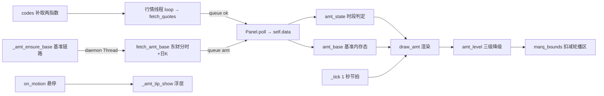
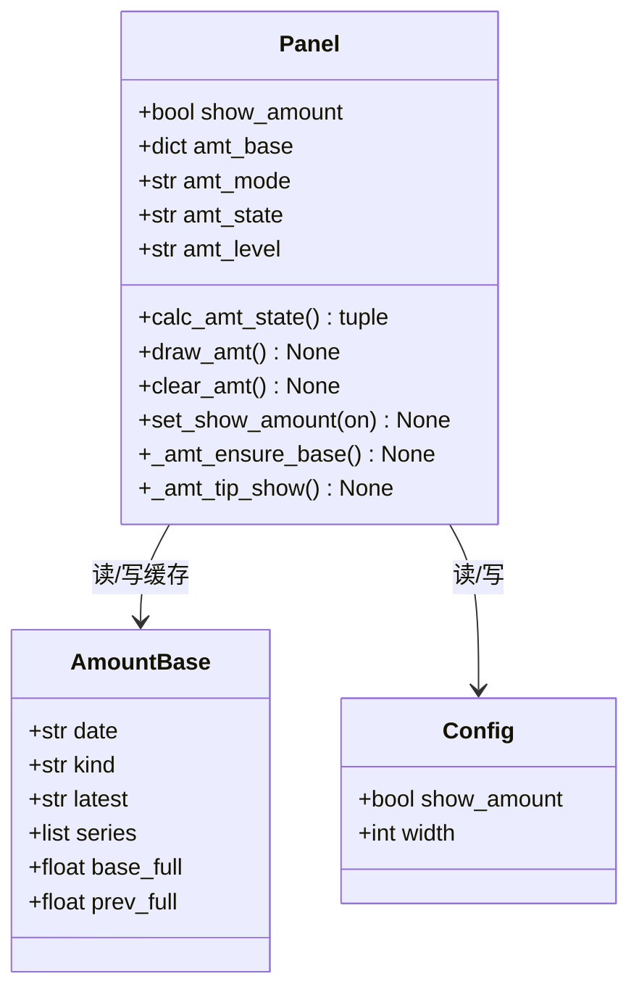
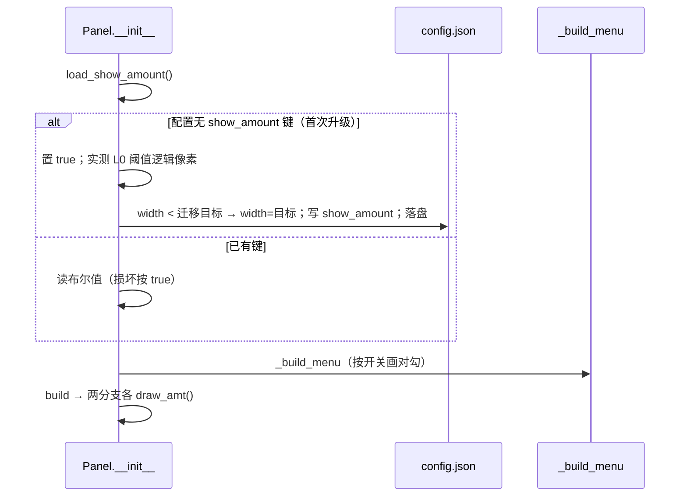
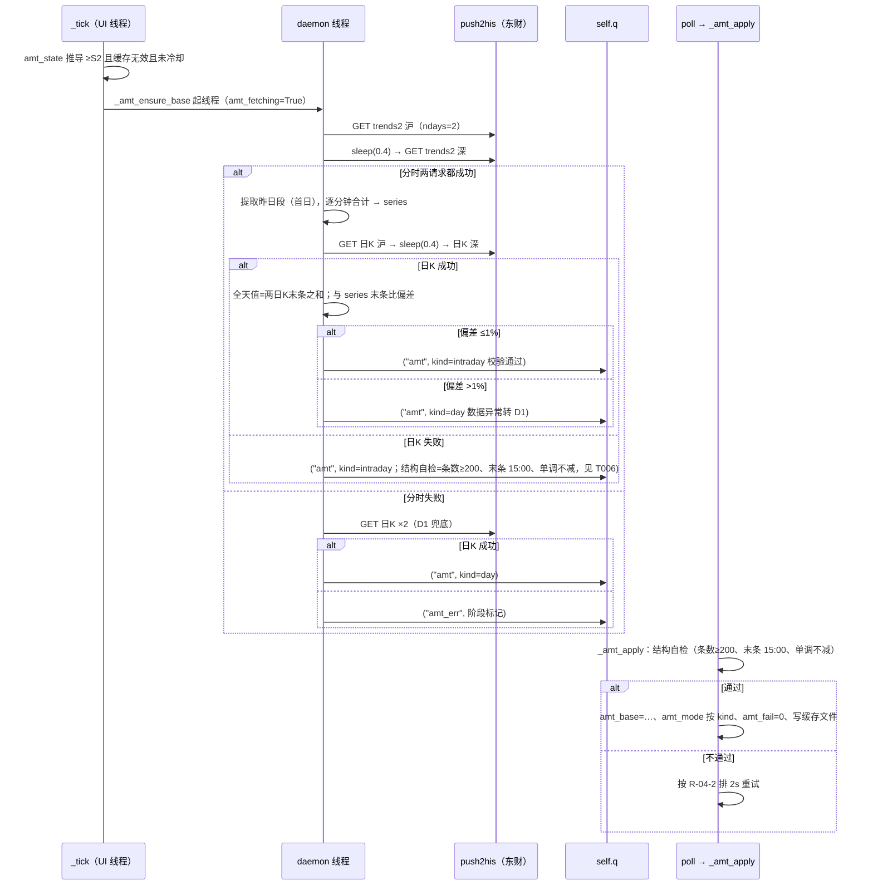
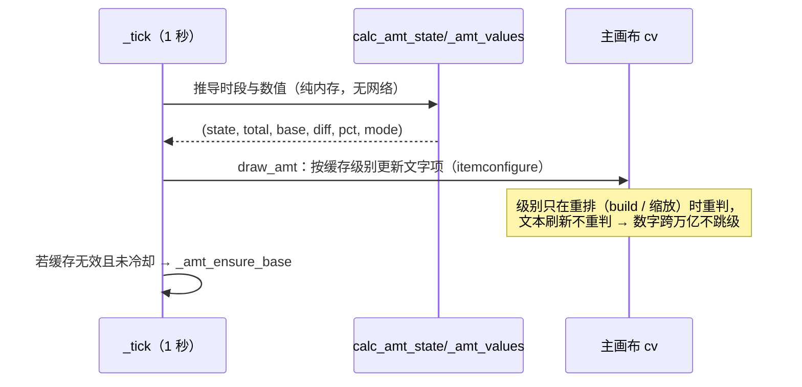

# SDD-盯盘君-两市成交额-v1.0.0

> **⚠️ v1.0.1 数据源变更（2026-10-30 编码阶段实测）**：东方财富 `push2his.eastmoney.com`
> 对本机**整域不可达**（含 `1.`–`9.` 各 IDC 分片，全部 `RemoteDisconnected`），原设计的
> 「东财分时 + 日K 双源」无法成立。基准已整体迁移到腾讯 `appstock/app/day/query`
> （一次返回近 5 个交易日完整分时，含累计成交额）。**请求数由 4 降为 2**；缓存版本升到 2
> 强制丢弃旧源结果。同时 L1 档布局由「差额/比例」改为「今日累计/差额」——原布局在基准
> 缺失时整块只剩破折号，用户在标题栏看不到量能（本次线上问题根因）。详见 §10.2。

## 1. 文档概述

### 1.1 文档信息

| 字段 | 内容 |
| --- | --- |
| 项目名称 | 盯盘君 MarketEye |
| 文档版本 | v1.0.0 |
| 版本状态 | 未发布 |
| 创建日期 | 2026-10-30 |
| 更新日期 | 2026-10-30 |
| 基于需求 | [PRD-盯盘君-两市成交额-v1.0.0](../../需求文档/两市成交额/v1.0.0/PRD-盯盘君-两市成交额-v1.0.0.md)（v1.0.0） |
| 基于设计 | —（本功能无旧版 SDD，采用全新设计模式） |

### 1.2 变更记录

| 版本 | 日期 | 变更人 | 变更类型 | 关联章节 | 变更内容 |
| --- | --- | --- | --- | --- | --- |
| v1.0.0 | 2026-10-30 | - | 新增 | §1–§10 | 新增标题栏两市成交额的完整设计：行情解析新增成交额字段与指数代码补取（`fetch_quotes` / `codes`）、昨日同期基准的取数-校验-缓存链路（东财分时 + 日K 双源交叉校验、daemon 线程 + `queue` 交接）、交易时段状态推导（`amt_state`，S0 判据取自数据日期而非日历）、当日最宽形态派生的三级降级（`_amt_block_width` / `amt_level`）、轮播可用区扣减（`marq_bounds` 修改）、L0 五段/L1 两行绘制（`draw_amt`）、悬停明细浮层（点击穿透 Toplevel + `WS_EX_TRANSPARENT`）、右键显示开关与老配置一次性宽度迁移、重试与冷却链路（2/5/15 秒、每日上限 8 次）、T001~T015 任务清单 |

### 1.3 技术选型

| 维度 | 选型 | 说明 |
| --- | --- | --- |
| 运行环境 | Python 3.8+ 标准库 | 不引入任何第三方依赖 |
| GUI | tkinter `Canvas` 自绘 | 成交额块与轮播同层（主画布 `cv` 文字项）；浮层用无边框 `Toplevel` |
| 文字度量 | `tkinter.font.Font.measure()` | 与既有轮播同口径：DPI 感知进程内与画布坐标同域，全程不换算；度量必须在 `SetProcessDpiAwareness(2)` 之后 |
| 基准数据源 | 东财 `push2his` 分时 + 日K 双源 | 分时给「昨日同期」序列（D0 主口径）；日K 给独立「昨日全天」值（交叉校验 + D1 兜底 + S0/S4 口径）。实测连通（分时 2 日 240+ 条、日K 255ms）；该域存在间歇性限流，故全程「单次触发 + 有限重试 + 降级」，绝不轮询 |
| 实时成交额 | 复用腾讯行情既有结果 | 报价报文 `f[37]`（万元）新增解析，**零新增请求** |
| 网络线程 | daemon `Thread` + 既有 `self.q` 队列 | 与行情线程同构：网络只在子线程，UI 只消费队列消息，不阻塞 250ms 的 `poll` 节拍 |
| 配置与缓存 | `config.json`（开关）+ `amount_base.json`（基准缓存） | 配置只加 1 个键；缓存为派生数据，损坏即重取，不影响主程序 |

### 1.4 文档目的

本设计解决"标题栏如何在零额外轮询、不挤压轮播的前提下常驻展示沪深两市量能对比"这一个问题，职责范围严格限定为：

- **在范围内**：成交额字段的解析与指数代码补取、昨日同期基准的取数/校验/缓存/降级、交易时段口径判定、三级降级与轮播让位、明细浮层、显示开关与宽度迁移
- **不在范围内**：行情轮询节奏（复用既有 `trading_refresh` / `idle_refresh`）、轮播本身的渲染（折叠轮播 v1.0.0 已交付，本期只扣减其可用区）、列表区与滚动条、K 线窗口（另立项）

设计目标：

1. 标题栏新增渲染为**若干 Canvas 文字项**级别的最小开销，刷新只 `itemconfigure`，不重建画布
2. 任何基准异常沿 D0→D1→D2→D3 单向降级，永不阻塞行情刷新、永不弹窗
3. 阈值按当日最宽文本形态一次性派生，数字跨万亿不引起布局跳变

## 2. 系统架构

### 2.1 整体架构



本功能的数据面分两路：**实时成交额**搭乘既有行情线程（零新增请求）；**昨日基准**由独立 daemon 线程按需取一次，经既有 `self.q` 队列回 UI 线程。两条路都汇入 `self.data` / `self.amt_base`，`draw_amt` 只读这两个内存态。

### 2.2 模块划分

| 模块 | 职责 | 边界 |
| --- | --- | --- |
| 数据接入 | `fetch_quotes` 增解析 `amount`；`codes()` 补取沪深两指数 | 不改轮询节奏；`amount` 只对两个指数代码解析 |
| 基准链路 | `load_amt_cache` / `_amt_ensure_base` / 模块级 `fetch_amt_base` / `_amt_apply` | 只产出 `amt_base` 内存态与缓存文件；不渲染、不判宽 |
| 口径判定 | `calc_amt_state()`（S0~S4）+ `_amt_values()`（今日累计 / 基准 / 差额 / 比例，含 D0~D3） | 纯推导，无副作用；方法名不与属性 `amt_state` 同名 |
| 布局与渲染 | `_amt_block_width`（当日最宽形态）、`amt_level`（L0/L1/L2）、`draw_amt` / `clear_amt`、`marq_bounds` 扣减 | 只算坐标与文字项；不改窗口尺寸 |
| 交互 | `_amt_tip_show` / `_amt_tip_hide`、`set_show_amount` / `_refresh_amt_menu` | 浮层点击穿透；开关即存即生效 |

### 2.3 分层职责

| 层 | 职责 | 本功能相关实现 |
| --- | --- | --- |
| 窗口与绘制层 | 画布元素创建、坐标、配色 | `build`（两分支各插一次 `draw_amt`）、`draw_amt`、`clear_amt`、`_resize_live` |
| 数据获取层 | 网络请求与解析 | 既有 `loop`/`fetch_quotes`（增量字段）+ 新增 `fetch_amt_base`（仅子线程） |
| 配置与持久化层 | 开关键、宽度迁移、基准缓存文件 | `load_show_amount`、`load_amt_cache` / `save_amt_cache` |
| 交互层 | 悬停浮层、右键开关 | `on_motion`（热区判定）、`_build_menu`、`on_menu` |

### 2.4 界面区块地图

| 区块 | 绘图层 | 本功能关系 | 回链 PRD |
| --- | --- | --- | --- |
| 成交额块 | 主画布 `cv` 文字项（标签 `amt`），L0 最多 5 个、L1 两个 | 本功能全部常驻绘制产物，位于轮播区与时钟之间、右对齐 | §2.4「成交额块」 |
| 指数轮播区 | 主画布 `cv`（tag `marq`，既有） | 可用区被扣减：`marq_bounds` 右界左移 | §2.4「指数轮播区」 |
| 明细浮层 | 无边框 `Toplevel`（点击穿透） | 悬停 300ms 出现，顶边贴窗口底边（PRD「块下方」差异留痕，见 §3.7.2/T012） | §2.4「成交额块」 |
| 右键菜单 | tkinter `Menu` | 新增「显示两市成交额」勾选项 | §2.4「显示两市成交额」 |

**绘制顺序约束**：成交额块必须在 `_draw_body` 之后、`_draw_masks` 之前绘制（与轮播同规则，遮罩擦四角）；折叠态与展开态都绘制（PRD F-01）。

## 3. 详细设计

### 3.1 数据模型

**配置结构（`config.json`）**

| 键 | 类型 | 默认值 | 约束 | 可缺省 |
| --- | --- | --- | --- | --- |
| `show_amount` | bool | `true` | — | 否（缺键即触发首次升级迁移，见 §3.7.5） |
| `width` | int | —（既有键） | 迁移时只加宽到 ≥400 | 既有 |

**基准缓存（`amount_base.json`，与 `config.json` 同目录，加入 `.gitignore`）**

| 键 | 类型 | 说明 |
| --- | --- | --- |
| `ver` | int | 结构版本，当前 1；不符即丢弃重取 |
| `date` | str | 取数当日 `YYYY-MM-DD`；有效性判据 `date == 今天` |
| `kind` | str | `intraday`（D0）/ `day`（D1） |
| `latest` | str | 数据末条所属交易日；**S0 判据**（`latest != 今天` → 非交易日） |
| `base_date` | str | 基准交易日（昨日 / 上一交易日） |
| `series` | list[float] 或 null | 基准日内**两市合计累计成交额**（元），按分钟轴索引；仅 `intraday` 有值 |
| `base_full` | float | 基准交易日全天成交额（元） |
| `prev_date` / `prev_full` | str / float | 上一交易日及其全天额（S0 展示的"较前一交易日全天"分母） |

**内存态结构（`Panel`）**

| 属性 | 类型 | 初值 | 写入时机 | 说明 |
| --- | --- | --- | --- | --- |
| `show_amount` | bool | — | `__init__` 读配置；`set_show_amount` 写 | 显示开关 |
| `amt_base` | dict / None | None | `_amt_apply` 成功后写入 | 与缓存文件同构 |
| `amt_mode` | str | `"D3"` | `_amt_apply` / 降级判定 | 当前基准层级 D0~D3 |
| `amt_state` | str | `"S1"` | `_tick` 每秒推导 | 当前时段（供浮层与调试） |
| `amt_fetching` | bool | False | 取数前后 | 防重复起线程 |
| `amt_fail` | int | 0 | 失败递增、成功清零 | 本轮重试计数 |
| `amt_after` | str / None | None | 重试链 | `after` 句柄 |
| `amt_cooldown_until` | float | 0 | 3 连败后写 `time()+600` | 冷却截止时间戳 |
| `amt_req_date` / `amt_req_today` | str / int | `""` / 0 | 每次发起请求前刷新 | 当日请求计数：日期变更即清零；达到 8 次硬停（R-04-2 上限的强制手段），当日转 D2 且不再发起 |
| `amt_w` | tuple / None | `None` | `_amt_block_width` 派生 | (L0 块宽, L1 块宽)；样本恒为**最坏形态**，按当前字体实测一次后缓存，当日当日恒定、跨日也不变（单位不随日变化） |
| `amt_level` | str | `"L2"` | 重排时 `amt_level` 判定 | 当前展示级别 |
| `amt_ids` | list[int] | `[]` | `build` 起始清空；`draw_amt` 维护 | 成交额块文字项 id |
| `amt_tip` / `amt_tip_after` | Toplevel / str | None | 浮层显示与隐藏 | 悬停浮层及其延时句柄 |

**初始化时序（硬约束）**：`show_amount` 读取与迁移必须在 `self.menu = self._build_menu()` **之前**完成——菜单构建要按开关设置对勾位图。锚定位置与折叠轮播一致（`self.dlg = None` 之后）。

**状态关系**



**向后兼容**：老配置无 `show_amount` 键 → 首次升级：置 `true`、宽度只加宽到迁移目标（§3.7.5）并落盘；此后该分支不再进入。`load_json` 损坏返回 `{}` 时**不迁移宽度**（避免对空配置写入半套键），只按默认开启运行。

### 3.2 外部接口设计

#### 3.2.1 新增外部接口

| 接口 | 地址与方法 | 用途 | 返回关键内容 |
| --- | --- | --- | --- |
| 东财分时（沪） | `GET https://push2his.eastmoney.com/api/qt/stock/trends2/get?secid=1.000001&fields1=f1,f2,f3,f4,f5&fields2=f51,f52,f53,f54,f55,f56,f57,f58&ndays=2&iscr=0` | 昨日分时累计序列 | `data.trends`：`"YYYY-MM-DD HH:MM,价,…,量,额,均价"` 逗号分隔，**第 7 段（下标 6）为累计成交额（元）**；`ndays=2` 返回最近两个交易日 |
| 东财分时（深） | 同上，`secid=0.399001` | 深市分时 | 同上 |
| 东财日K（沪） | `GET https://push2his.eastmoney.com/api/qt/stock/kline/get?secid=1.000001&fields1=f1,f2,f3,f4,f5,f6&fields2=f51,f52,f53,f54,f55,f56,f57&klt=101&fqt=0&end=20500101&lmt=6` | 独立「全天额」用于交叉校验、D1 与 S0 | `data.klines`：`"日期,开,收,高,低,量,额"`，**下标 6 为全天成交额（元）** |
| 东财日K（深） | 同上，`secid=0.399001` | 深市全天额 | 同上 |

返回报文示例（数值为示意占位；`data.trends` / `data.klines` 均为字符串数组）：

```json
{"data":{"code":"000001","name":"上证指数","trends":["2026-10-30 09:30,3250.12,3251,3252,3249,123456,78901234567,3250.5","2026-10-30 09:31,…"]}}
```

> 每行 `split(",")` 后 8 段：日期时间、现价、开、高、低、量、**累计成交额（元，下标 6）**、均价。

```json
{"data":{"code":"000001","name":"上证指数","klines":["2026-10-29,3245.0,3252.3,3258.1,3240.2,289456700,312345678901","2026-10-30,…"]}}
```

> 每行 7 段：日期、开、收、高、低、量、**全天成交额（元，下标 6）**。

调用约束（全部在 `fetch_amt_base` 内）：

1. **必须带** `User-Agent` 与 `Referer: https://quote.eastmoney.com/`，超时 8 秒；
2. 只在 daemon 线程内调用，禁止在 UI 线程发起；
3. 分时两请求之间 `sleep(0.4)`，日K 同理，降低被断连概率；
4. 该域有间歇性限流（实测连续 8 次断 5 次），因此**每次取数动作最多 4 个请求，失败只重试失败的一半**；全日请求由 `amt_req_today` 计数器硬约束 ≤8 次（初始 4 + 重试 4），达到即停止发起、按当前 `amt_mode` 降级展示（§3.4 R-04-2）。

> **与 PRD §4.1 的口径偏差（留痕）**：PRD 写「成功路径 1 次/交易日」，本设计为 **4 次/交易日**（沪深分时 + 沪深日K）。原因：①两市合计必须两次分时请求（无单请求覆盖沪深指数的公开接口）；②R-04-6 的交叉校验要求「昨日全天值」来自独立数据源（日K），否则校验恒真、形同虚设。总量仍在 PRD 的最坏上限 8 次之内。此偏差已登记 `wiki.md`，待下个文档环节把 PRD §4.1 修订为「成功路径 ≤4 次/交易日」。

#### 3.2.2 复用的既有接口

| 接口 | 地址 | 用途 | 本功能使用的字段 |
| --- | --- | --- | --- |
| 腾讯行情 | `https://qt.gtimg.cn/q=`（GBK，`~` 分隔） | 实时成交额 | 报文 `f[37]` 成交额（**万元**，×1e4 转元）。既有 `fetch_quotes` 未解析该字段，本期**只对 `sh000001` / `sz399001` 两个代码**增加解析（其余标的该字段口径不保证，不解析、不落库） |

**数据缺失形态**：与轮播同规则——`self.data` 无该 key 是唯一缺失形态；`amount` 解析失败或 ≤0 时该字段为 `None`，`_amt_today` 返回 None → D3。

> **AC-02「误差 <1%」的实现依据（审核 S10 留痕）**：PRD R-01-2/3 实测结论——上证指数报价中的成交额覆盖沪市全部标的、深证成指报价中的成交额覆盖深市全部标的（且与深证综指一致）。本设计直接采用两指数 `f[37]` 相加，无任何估算或抽样，误差上界由口径本身保证；编码阶段首个交易日盘后与东方财富网站公布值抽验一次并留痕。

### 3.3 业务流程

#### 3.3.1 启动与首次升级（PRD §3.4 入口段）



#### 3.3.2 基准取数-校验-缓存（PRD F-02 主链路）



#### 3.3.3 每秒渲染链路（PRD §3.4 主循环段）



### 3.4 业务规则

对照 PRD §3.3 逐条给出实现方案。

| 规则 | PRD 要求 | 实现方案 |
| --- | --- | --- |
| R-01-1 沪深口径 | 不含北交所 | 沪取 `sh000001`、深取 `sz399001` 成交额相加；不引入北交所代码 |
| R-01-2 沪市口径 | 取上证指数报价中的成交额，覆盖沪市全部标的 | `sh000001` 报价 `f[37]`（万元×1e4）；上证指数成交额即沪市全部标的合计的官方口径，无额外换算 |
| R-01-3 深市口径 | 取深证成指报价中的成交额；实测与深证综指一致，两者互为校验 | 取 `sz399001` `f[37]`。**第二校验源不实现（留痕）**：深证综指 `sz399106` 与深证成指同出腾讯报价，属同源校验、恒真无意义；独立校验已由 R-04-6（东财日K）承担。AC-02 依据见 §3.2.2 留痕 |
| R-01-4 今日累计 | 沪 + 深，不估算 | `_amt_today()`：两指数 `data[key]["amount"]` 均非 None 才相加，否则 None |
| R-01-5/6 差额比例 | 亿元整数、百分比一位小数 | `fmt_signed_amount(元)` 输出 `+823亿` 形态；比例 `f"{v:+.1f}%"`，符号与差额一致 |
| R-01-7 除零保护 | 基准 <100 亿不显示比例 | `_amt_values` 中 `base < AMT_MIN_BASE` → 比例段为 `AMT_EMPTY`，差额照常 |
| R-01-8 单位跃迁 | ≥1 万亿用万亿 | `fmt_amount`：≥1e12 两位小数 `万亿`；≥1e10 整数 `亿`；否则一位小数 `亿` |
| R-02 状态机 | S0~S5 | `calc_amt_state()` 纯推导（§3.7.3），**S0 判据取报价时间戳日期**（`stamp` 前 8 位 YYYYMMDD）而非日历，天然覆盖节假日 |
| R-03-1 轮播优先 | 不压缩轮播 | 级别判定式含 `+ px(AMT_GAP_MARQ) + _marq_min_w`，放不下先降成交额 |
| R-03-2 判定顺序 | 先 L0 后 L1 再 L2 | `amt_level(region)` 顺序判断，返回首个满足档 |
| R-03-3 阈值实测派生 | 不写死像素 | 块宽全部由 `Font.measure` 对样本串实测（§3.7.4）；轮播下限复用既有 `_marq_min_w` |
| R-03-4 级别单调 | 不闪烁 | 级别只在**重排**（`build` / `_resize_live` 宽度变化 / 开关切换）时重判并缓存 `amt_level`；`_tick` 文本刷新不重判。阈值按**最坏文本形态**实测一次（`amt_w`，启动后恒定），数字跨万亿也不会改变判定结果 |
| R-03-5 关闭态 | 开关关 = 宽 0 | `draw_amt` 早退 `clear_amt`；`marq_bounds` 判 `show_amount` 才扣减 |
| R-04-1 成功路径 | 每交易日不再请求 | 缓存有效性 `date == 今天`；同日内跨时段（S2→S4）复用同一份基准（日K 全天值早已在手） |
| R-04-2 失败重试 | 2/5/15 秒共 3 次，之后 10 分钟冷却；全日 ≤8 次 | 失败只重试**失败的一半**（分时或日K），`amt_after = root.after(delay, _amt_ensure_base)`；3 连败 → 冷却 `amt_cooldown_until = time()+600`；**每次发起请求前 `amt_req_today += 1` 并与 8 次上限比对，达到即当日硬停转 D2**（审核 M5：无计数器时最坏路径可到 10 次且冷却后循环无上界，计数器是唯一强制手段） |
| R-04-3 缓存有效期 | 基准日期=上一交易日 | 实现为 `date == 今天`（取数日）：因为"上一交易日"的日历推断覆盖不了节假日，改用「今天取的、就是给今天用的」口径；数据内部再以 `latest`/`base_date` 自证 |
| R-04-4 跨日 | 不跨日复用 | 次日 `date != 今天` → 缓存过期，重新走 §3.3.2 |
| R-04-5 隔离 | 不影响行情刷新 | 网络只在 daemon 线程；`poll` 的 `amt` 分支独立 try/except；同一失败原因 `log_once` 只记一次 |
| R-04-6 一致性校验 | 偏差 >1% 转 D1 | `abs(series末条 − base_full) / base_full > 0.01` → 丢弃分时、`mode=D1` |
| R-04-7 降级可感知 | D0→D1 变负属预期 | 浮层「基准」行按 `amt_mode` 显示：D0 `昨日 HH:MM`、D1 `昨日全天（分时不可用）`、D2 `基准不可用` |
| R-05 数字格式 | §3.3.5 全表 | 模块级 `fmt_amount` / `fmt_signed_amount`；`—` 用 `AMT_EMPTY`；千分位不使用 |

**PRD 状态机的实现对应**

| PRD 状态 | 实现落点 |
| --- | --- |
| S1 未开盘 | `now < 09:30` → 显示 `—`，且 `_amt_ensure_base` 不触发（不发基准请求，AC-08） |
| S0 非交易日 | 缓存 `latest != 今天`：今日累计 = 报价残留的上一交易日全天额，基准 = `prev_full`；浮层标注两个日期（AC-19）。**判据来自数据**：东财分时/日K 的末条日期即"最近真实交易日"，节假日自动成立。**残留值守卫（审核 S2）**：非交易日腾讯 `f[37]` 残留上一交易日全天额、`f[30]` 时间戳对应同日的行为**需实测验证**（编码阶段首项自检）；守卫取报价 `stamp` 前 8 位日期与缓存 `latest` 比对，不一致 → 今日累计按不可用处理（D3），不得直接采信残留值 |
| S2 盘中 | 基准 = `series[当前分钟轴]`；分钟轴 = 上午 `(h*60+m)−570`、下午 `120+(h*60+m)−780`，越界取末值 |
| S3 午休 | 分钟轴钳制到 11:30（下标 120）；报价报文本身停更，今日累计天然冻结，AC-09 成立 |
| S4 已收盘 | 基准 = `base_full`；15:00 的 series 末值 == base_full（校验通过时），切换瞬间数字不跳变 |
| S5 数据异常 | `amt_base` 为 None 或 `amt_mode` 为 D2/D3：按 D 层级展示，重试/冷却由 R-04-2 驱动；重试成功按当前时间落回 S2/S3/S4（状态每秒重推导，无需显式迁移） |

### 3.5 界面设计

无 PROTO（PRD 已确认不出原型）。

#### 3.5.1 视觉规格

| 元素 | 字体 | 字号（pt） | 颜色 | 说明 |
| --- | --- | --- | --- | --- |
| 今日累计·数字段 | `f_num`（Consolas） | 9 | `theme["text"]` | `1.24` |
| 今日累计·单位段 | `f_cn`（雅黑） | 9 | `theme["text"]` | `万亿` / `亿`；无单位形态（<1 亿不出现）直接并入数字段 |
| 差额·数字段（含箭头与符号） | `f_num` | 9 bold | 放量 `up` / 缩量 `down` / 相等 `flat` | `↑+823` |
| 差额·单位段 | `f_cn` | 9 | 同差额数字段 | `亿` / `万亿` |
| 比例段 | `f_num` | 9 bold | 同差额 | `+11.5%` |
| L1 两行 | 数字 `f_num` 8 / 单位 `f_cn` 8 | 8 | 同上 | 上行差额、下行比例 |
| `—` 占位 | `f_cn` | 9 | `theme["flat"]` | `AMT_EMPTY` |

数字/符号用等宽字体、中文单位用中文字体（PRD R-05 字体行）；一个 Canvas 文字项只能有一种字体，故 L0 拆成**最多 5 个文字项**（总额数字、总额单位、差额数字、差额单位、比例），从右向左排。箭头 `↑`/`↓`/`→`（平）并入差额数字段。

#### 3.5.2 坐标与尺寸计算

单位口径与折叠轮播一致（画布单位，不乘除 `s`）。设 `W`（画布）、`s` 缩放：

| 量 | 公式 | 150% 实测（W=480，即配置宽 320） |
| --- | --- | --- |
| 时钟右缘 | `W − px(13)` | 460 |
| 时钟左缘 | `时钟右缘 − clock_w`（`max(measure("00:00:00"), measure("连接失败"))`） | 380 |
| 区域右端 `arx` | `时钟左缘 − px(AMT_GAP_CLOCK=6)` | 371 |
| 区域左端 `alx` | 与 `marq_bounds` 的 `lx` 同源：`px(27) + 标题宽 + px(MARQ_GAP_L)` | 112 |
| 区域宽 `region` | `arx − alx` | 259 |
| L0 判定 | `region ≥ w0 + px(8) + _marq_min_w` | 259 ≥ 217+12+106=335？否 → 降级判定 |
| L1 判定 | `region ≥ w1 + px(8) + _marq_min_w` | 259 ≥ 78+12+106=196？是 → L1 |

> **与 PRD §3.2 F-03 的口径偏差（留痕）**：实现判定式为 `region ≥ 块宽 + px(8) + _marq_min_w`，150% 下 L0 阈 = 217+12+106 = **335px**、L1 阈 = 78+12+106 = **196px**（画布单位）；PRD 写 331/192，因其「8」未做 px() 缩放且起算点口径混合（时钟间距 10px 与轮播间距 8px 合并叙述）。**实现以 335/196 为准**，对应窗口宽阈值 L0 ≈371、L1 ≈279 逻辑像素，与 PRD 的 372/280 只差取整，验收按 PRD 数值留容差执行。已登记 `wiki.md` 待 PRD §3.2 F-03 订正。
>
> **AC-06 数值矛盾（留痕）**：AC-06 期望窗口 290 逻辑像素时成交额块消失（L2），但按本公式 290 → region 214 ≥ 196 → **L1 仍显示**；L2 实际触发点为窗口 < 278 逻辑像素。PRD 内部（AC-06 vs F-03 阈值）不一致，已登记 `wiki.md`，建议 PRD 把 AC-06 的 290 修订为 270；编码阶段按公式实现，验收按公式口径。
>
> 上表演示了 W=320 时为 L1——这正是当前用户配置的预期形态；首次升级迁移到 400 后为 L0。

**布局落点**：块右对齐 `arx`；L0 从右向左依次排比例、差额（含单位）、总额（含单位），段间 `measure(AMT_SEP)`；块左端即 `arx − w_real`，轮播右界 = 块左端 − `px(AMT_GAP_MARQ)`。L1 两行右对齐 `arx`，行高 = `head_h×0.5`，两行中心分别在 `head_h×0.28` 与 `head_h×0.74`。

#### 3.5.3 画布元素与绘制函数映射

| 元素 | 创建函数 | 标签 | 生命周期 |
| --- | --- | --- | --- |
| L0 五个 / L1 两个文字项 | `Panel.draw_amt` → `cv.create_text` | `amt` | `build` 后首次创建，之后仅 `itemconfigure` / `coords`；级别切换时删除重建 |
| 热区 | 无形元素，`draw_amt` 记录 `(alx, arx, 0, head_h)` 到 `self.amt_bbox` | — | `on_motion` 判定用 |
| 标题 / 时钟 / 轮播 / 遮罩 | 既有 | — | 顺序：`draw_amt` 与 `draw_marq` 都在 `_draw_masks` 之前 |

**id 生命周期陷阱**（与轮播同款）：`build` 在 `cv.delete("all")` 之后必须把 `amt_ids` 复位为 `[]`，两个分支都要，否则 Tk 对失效 id 的 `itemconfigure` 静默改错元素。

#### 3.5.4 交互流程

| 用户动作 | 落点 | 本功能行为 |
| --- | --- | --- |
| 悬停成交额块 300ms | `on_motion` → `_amt_tip_show` | 浮层出现在窗口下方（顶边贴窗口底边，展开态与 PRD「块下方」的差异已留痕）；继续移动/离开/按下/折叠即隐藏 |
| 点击成交额块 | `on_press`（既有） | 无专属行为（不绑事件，PRD 明确不与双击折叠冲突）；按下同时隐藏浮层 |
| 右键 → 「显示两市成交额」 | `_build_menu` / `set_show_amount` | 翻转开关、重排标题栏、写配置；关闭态停发基准请求 |
| 拖右边框缩放 | `on_drag` → `_resize_live` | 重判级别（R-03-4 只在此处与 `build` 重判）、重排文字、重排轮播 |
| 双击标题栏 | `on_double`（既有） | 折叠/展开不受影响；`draw_amt` 两个分支都在 |

### 3.6 错误处理定义

| 场景 | 处理 | 用户可见表现 | 日志 |
| --- | --- | --- | --- |
| 断网启动（报价也失败） | `_amt_today` None → D3 | 标题栏成交额区 `—`；列表区既有表现不变 | 同一错误 `log_once` 一次 |
| 分时成功、日K 失败 | D0 生效但跳过交叉校验（内部自检仍在） | 正常显示差额+比例 | `_dbg("amt kline check skipped")` |
| 分时失败、日K 成功 | mode=D1 | 差额正常、分母为昨日全天；浮层标注 | 不记（正常降级分支） |
| 双双失败 | D2；3 连败后 10 分钟冷却 | 只显示今日累计；浮层"基准不可用" | `log_once` 一次 |
| 数据自检不过（条数 <200 / 末条非 15:00 / 序列倒退） | 按该阶段失败处理，走重试 | 沿用上一有效状态 | `_dbg` |
| 缓存文件损坏 / `ver` 不符 | 丢弃，当无效缓存重取 | 无感 | `_dbg("amt cache discarded")` |
| `amount` 字段缺失或 ≤0 | 该侧记 None；任一侧 None → D3 | `—` | 不记（正常业务分支） |
| 线程异常（`fetch_amt_base` 抛出） | 线程内 catch，`("amt_err", …)` 入队 | 按 D 层级展示 | `_dbg` |
| `poll` 处理 `amt` 消息异常 | 独立 try/except，不影响 `ok`/`ind` 分支 | 无感 | `_dbg("amt apply 异常")` |
| 浮层创建/销毁异常（如窗口销毁竞态） | try/except 包裹，销毁 `amt_tip` 引用 | 浮层不出现，其余无感 | `_dbg` |
| 深浅主题切换 | `build` 重建时按新 theme 取色 | 颜色立即跟随 | 不记 |

**日志策略**：沿用 `ticker.log` 与 `_dbg` / `log_once`；正常路径零写入。

### 3.7 其他设计

#### 3.7.1 常量定义

| 常量 | 取值 | 单位 | 说明 |
| --- | --- | --- | --- |
| `AMT_INDEX_SH` / `AMT_INDEX_SZ` | `"sh000001"` / `"sz399001"` | — | 沪深口径代表指数 |
| `AMT_GAP_CLOCK` | `6` | 逻辑像素（经 `px()`） | 块右端与时钟间距 |
| `AMT_GAP_MARQ` | `8` | 逻辑像素（经 `px()`） | 块与轮播间距（PRD 判定式中的 8） |
| `AMT_SEP` | `"  "` | — | 段间分隔（两个半角空格） |
| `AMT_EMPTY` | `"—"` | — | 缺失占位（与列表区同字符） |
| `AMT_MIGRATE_W` | `400` | 逻辑像素 | 首次升级迁移目标（实测阈值 372 + 余量；其余 DPI 取 `max(400, ceil10(实测阈值))`） |
| `AMT_MIN_BASE` | `100 * 1e8` | 元 | R-01-7 除零保护 |
| `AMT_RETRY_DELAYS` | `(2, 5, 15)` | 秒 | 基准重试节奏 |
| `AMT_COOLDOWN` | `600` | 秒 | 3 连败冷却 |
| `AMT_TIP_DELAY` | `300` | 毫秒 | 浮层悬停延时 |
| `AMT_PCT_SAMPLE` | `"+88.8%"` | — | 比例最宽样本 |
| `AMT_FALLBACK_TOTAL` / `AMT_FALLBACK_DIFF` | `"1.24万亿"` / `"+1.2万亿"` | — | 无数据时的块宽样本（最宽形态） |
| `AMT_CACHE_FILE` | `"amount_base.json"` | — | 基准缓存文件名 |

#### 3.7.2 函数设计

| 函数 | 位置 | 职责 | 关键约束 |
| --- | --- | --- | --- |
| `fmt_amount(v)` | 模块级 | 元 → `1.24万亿` / `7978亿` / `86.4亿` | 纯函数，selftest 直接调用 |
| `fmt_signed_amount(v)` | 模块级 | 元 → `+823亿` / `-1250亿` / `+1.2万亿` | 纯函数 |
| `fetch_amt_base(stage)` | 模块级 | 子线程内取数；`stage="intraday"` 取分时×2、`"day"` 取日K×2 | 返回统一 dict 或抛异常；带 UA/Referer；请求间 sleep(0.4)；**禁止 UI 线程调用** |
| `Panel.load_show_amount()` | Panel | 读开关 + 首次升级迁移 | 必须早于 `_build_menu`；迁移目标按实测阈值派生 |
| `Panel.set_show_amount(on)` | Panel | 翻转、落盘、重排（`_rebuild`）、关态清浮层 | 关闭态后续 `_tick` 不再 ensure |
| `Panel._refresh_amt_menu()` | Panel | 对勾位图刷新 | `getattr` 守卫，模式同 `_refresh_marq_menu` |
| `Panel.load_amt_cache()` / `save_amt_cache()` | Panel | 缓存文件读写 | 读失败/`ver` 不符返回 None；写失败静默 |
| `Panel._amt_ensure_base()` | Panel | 判定是否需要取数并起线程 | 开关关 / 已有有效缓存 / `amt_fetching` / 冷却中 → 直接返回；重试经 `amt_after` 句柄 |
| `Panel._amt_apply(payload)` | Panel | 消费线程结果：结构自检 → 建 `amt_base` → 定 `amt_mode` → 写缓存 | 自检：条数 ≥200、末条时刻 15:00、序列单调不减、`base_full>0` |
| `Panel.calc_amt_state()` | Panel | 返回三元组 `(S0~S4, 分钟轴下标或 None, 说明)`。**注意：实例属性 `amt_state`（状态码字符串）与方法同名会遮蔽方法，方法必须命名为 `calc_amt_state`** | 纯推导；`now < 09:30 → S1`；报价 stamp 日期或缓存 `latest != 今天 → S0`；其余按钟点 |
| `Panel._amt_values()` | Panel | 汇总 `(total, base, diff, pct, mode_label)` 或 D3 | 除零保护；S0 用 `prev_full` |
| `Panel._amt_block_width()` | Panel | 按当日最宽形态实测 `w0`/`w1`，当日缓存 `amt_w` | 样本：总额=今日格式化串（无数据用 fallback）、差额=今日与基准全天较宽者加符号、比例=`AMT_PCT_SAMPLE` |
| `Panel.amt_level(region)` | Panel | 返回 L0/L1/L2 | 判定式含 `px(AMT_GAP_MARQ) + _marq_min_w`；只在重排时调用 |
| `Panel.draw_amt()` | Panel | 按缓存级别渲染/更新文字项；记录 `amt_bbox` | 幂等；开关关或 L2 → `clear_amt`；整体 try/except + `_dbg` |
| `Panel.clear_amt()` | Panel | 删 tag `amt`、清 `amt_ids`、清 `amt_bbox` | 可重复调用 |
| `Panel._amt_tip_show()` / `_amt_tip_hide()` | Panel | 浮层：无边框 Toplevel、点击穿透、贴窗口底边 | ①`overrideredirect(True)`；②**`attributes("-transparentcolor", KEY)` 必须显式设置**（Toplevel 不继承主窗的该属性，漏掉会渲染成实色洋红块）；③在该属性生效后 `GetWindowLongW` 读现扩展样式，**或上 `WS_EX_TRANSPARENT` 与 `WS_EX_TOOLWINDOW`**（透明色已自带 `WS_EX_LAYERED`，不要重复置位），句柄调用必须设 `argtypes`/`restype`；④按主窗 topmost 状态同步 `-topmost`，否则置顶主窗会压住浮层（参照 WatchlistDialog 的既有处理） |
| `Panel.marq_bounds()`（修改） | Panel | 右界扣减成交额块 | 仅 `show_amount` 且级别非 L2 时扣 `块宽 + px(AMT_GAP_MARQ)`；展开态不扣（轮播不渲染，但函数仍被 selftest 调用，保持返回值语义不变） |

#### 3.7.3 时段判定与线程机制

**`calc_amt_state()` 判定顺序**（每秒执行，纯内存；结果写入属性 `amt_state`）：

1. `now < 09:30` → `S1`（显示 `—`，且不触发基准取数）；
2. `amt_base` 无效（None / `date != 今天`）→ `S5`（按 `amt_mode` 降级展示；此时 `ensure` 可触发）；
3. `amt_base["latest"] != 今天` → `S0`（基准 `prev_full`，浮层标双日期）；
4. `now ≥ 15:00` → `S4`（基准 `base_full`）；
5. `11:30 ≤ now < 13:00` → `S3`（基准 `series[120]`）；
6. 其余 → `S2`（基准 `series[分钟轴]`）。

**判定顺序的两个口径说明（留痕）**：

- S1 先于 S0：非交易日的 00:00–09:30 也显示 `—`（PRD F-04 第 5 条未区分时段）。AC-19 须在 09:30 后观察，已在 wiki.md 留痕。
- 跨 0 点：23:59（S4）→ 00:01 时缓存 `date` 过期，但 `now < 09:30` 落 S1 显示 `—`；09:30 后按新的一天重取。这与 PRD 状态机 S4→S1 一致，**"收盘对比在午夜后消失"是预期行为而非缺陷**。

**AC-09 的实现口径（留痕，审核 M9）**：11:30 起分子（报价停更）与分母（分钟轴钳制 120）双双冻结；但 11:29 记录值与 11:35 显示值的差 = 最后一分钟增量（11:29 时分子还是 11:29 实时值、分母是 `series[119]`），"完全相同"仅在 11:29 的最后一次轮询恰等于 11:30 值时成立。验收按「11:30 后数值不再变化」执行，AC-09 的记录时点建议 PRD 修订为 11:29:50 之后或改为「差异 <0.1%」，已登记 wiki.md。

> S3 的"冻结"不需要显式逻辑：午休内交易所报价停更，`f[37]` 保持 11:30 值；分钟轴钳制保证分母同样停在 11:30，AC-09 的"数字不跳变"由此成立。

**线程模型**：`_amt_ensure_base` 只做判定与 `threading.Thread(target=..., daemon=True).start()`；线程内按 §3.3.2 顺序请求，结果经 `self.q.put(("amt", payload))` / `("amt_err", stage)` 回 UI。`poll` 新增分支置于 `"ind"` 之后、`else` 之前（分支顺序不可调换，防被当成行情错误让圆点变红）。同一时刻最多一个取数线程（`amt_fetching` 门闩）。

**定时器一览**：重试链 `amt_after`（2/5/15s）；冷却为时间戳比较（不再挂 after）；浮层延时 `amt_tip_after`（300ms）。所有 `after_cancel` 前必须判空（既有教训：`after_cancel(None)` 抛 `ValueError`）。

#### 3.7.4 最坏形态的块宽派生（R-03-4 的根基）

按当前文本实时判定会导致数字跨 1 万亿时布局跳级（审核 M3：若按"首次报价后的实际串"取样本，早盘 300 亿、午后 1.02 万亿，实宽将超过样本宽，级别又不许重判，块会侵入轮播区）。因此**样本恒用最坏形态**，与当日数据无关：

1. 总额样本 = `AMT_FALLBACK_TOTAL`（`1.24万亿`，两市合计常态量级的最宽形态）；
2. 差额样本 = `AMT_FALLBACK_DIFF`（`+1.2万亿`，PRD 认定的差额最宽形态）；
3. 比例样本 = `AMT_PCT_SAMPLE`（`+88.8%`）；
4. `w0 = measure(总额样本) + measure(AMT_SEP) + measure(差额样本) + measure(AMT_SEP) + measure(比例样本)`；`w1 = max(measure(差额样本), measure(比例样本))`；
5. 结果在字体对象建立后**实测一次**缓存于 `amt_w`，此后恒定（随 DPI 与主题字体变化时经 `build` 重测）。

**样本宽与实宽的关系（硬约束）**：真实文本宽度恒 ≤ 样本宽。因此：级别判定用 `amt_w`，`marq_bounds` 扣减也用 `amt_w`（**不用实宽**），轮播可用区在任何数字形态下都 ≥ 判定时的预留值，R-03-1 不会破。代价是最坏情况留白略多（通常 <20px），换取布局绝对稳定。AC-18 由此成立：`9976亿` 与 `1.02万亿` 都不宽于样本，级别判定输入不变。

#### 3.7.5 老配置一次性迁移（F-06）

1. `__init__` 内 `load_show_amount()`：`"show_amount" not in cfg` → 置 `true`；实测 L0 窗口宽阈值（**完整折算式**：`目标 = ceil((w0 + px(AMT_GAP_MARQ) + _marq_min_w + alx + px(13) + clock_w + px(AMT_GAP_CLOCK)) / s)`，其中 `w0` 来自 §3.7.4 最坏样本、`alx` = `px(27)+标题宽+px(MARQ_GAP_L)`；审核 M8：漏掉 `alx` 与右侧时钟区会把阈值算成 224 而非 372），迁移目标 = `max(AMT_MIGRATE_W, ceil10(阈值))`（150% 下阈值 ≈372 → 取 400）；`cfg["width"] < 目标` 才加宽（只加宽不收窄）；
2. 两个键一次 `save_json` 落盘；此后 `"show_amount" in cfg` 恒成立，迁移只执行一次（AC-11）；
3. `load_json` 返回 `{}`（文件损坏）时**跳过迁移**，只用内存默认值——避免把半套配置写盘覆盖用户文件（OB-04 教训）。

### 3.8 功能点追溯

| 功能点（PRD §3.2） | 技术产物 | 设计章节 | 代码位置 | 任务 |
| --- | --- | --- | --- | --- |
| F-01 标题栏成交额展示 | `draw_amt` / `clear_amt`、`fmt_amount` / `fmt_signed_amount`、`fetch_quotes` 增 `amount`、`codes()` 补指数、常量 `AMT_SEP`/`AMT_EMPTY` | §3.2.2、§3.5.1–§3.5.3、§3.7.1、§3.7.2 | §4.1、§4.2 | T001、T002、T009、T010、T011、T015 |
| F-02 昨日同期基准 | `fetch_amt_base`、`_amt_ensure_base`、`_amt_apply`、`load_amt_cache`/`save_amt_cache`、`poll` 新分支、常量 `AMT_RETRY_DELAYS`/`AMT_COOLDOWN`/`AMT_CACHE_FILE` | §3.2.1、§3.3.2、§3.4（R-04）、§3.7.2 | §4.1、§4.3 | T004、T005、T006、T014 |
| F-03 宽度自适应降级 | `_amt_block_width`、`amt_level`、`marq_bounds` 修改、`amt_w` 当日缓存 | §3.5.2、§3.4（R-03）、§3.7.4 | §4.1、§4.2 | T008、T009、T010、T011、T015 |
| F-04 交易时段口径 | `amt_state`、`_amt_values`、S0/S3/S4 分支 | §3.7.3、§3.4（R-02） | §4.1 | T007、T015 |
| F-05 悬停明细浮层 | `_amt_tip_show` / `_amt_tip_hide`、`on_motion` 热区、常量 `AMT_TIP_DELAY` | §3.5.4、§3.7.2 | §4.1、§4.2 | T012 |
| F-06 显示开关与迁移 | `load_show_amount` / `set_show_amount` / `_refresh_amt_menu`、`_build_menu`、`on_menu`、`reload`、常量 `AMT_MIGRATE_W` | §3.3.1、§3.7.5 | §4.1、§4.3 | T003、T013 |

## 4. 代码位置

### 4.1 程序逻辑

| 设计产物 | 文件 | 函数 / 方法 | 说明 |
| --- | --- | --- | --- |
| §3.7.1 常量 | `ticker.pyw` | 模块级常量区（`MARQ_*` 附近） | 新增 14 个 `AMT_*` 常量 |
| §3.7.2 格式化 | `ticker.pyw` | `fmt_amount` / `fmt_signed_amount` | 新增模块级纯函数 |
| §3.2.1 取数 | `ticker.pyw` | `fetch_amt_base(stage)` | 新增模块级（仅子线程调用） |
| §3.2.2 解析 | `ticker.pyw` | `fetch_quotes` | 修改：对两个指数代码增 `"amount"` 字段（万元 ×1e4） |
| §3.2.2 补取 | `ticker.pyw` | `Panel.codes()` | 修改：开关开启时尾部补 `sh000001`、`sz399001`（去重） |
| §3.1 状态初始化 | `ticker.pyw` | `Panel.__init__` | 修改：新增 11 个 `amt_*` 属性 + `load_show_amount()`（早于 `_build_menu`） |
| §3.7.5 迁移 | `ticker.pyw` | `Panel.load_show_amount` | 新增 |
| §3.7.2 缓存 | `ticker.pyw` | `Panel.load_amt_cache` / `save_amt_cache` | 新增 |
| §3.3.2 取数调度 | `ticker.pyw` | `Panel._amt_ensure_base` | 新增 |
| §3.3.2 结果落地 | `ticker.pyw` | `Panel._amt_apply`、`Panel.poll` | 新增方法 + 修改 `poll` 分支 |
| §3.7.3 口径判定 | `ticker.pyw` | `Panel.calc_amt_state` / `Panel._amt_values` | 新增（方法名不得与属性 `amt_state` 同名） |
| §3.7.4 块宽 | `ticker.pyw` | `Panel._amt_block_width` / `Panel.amt_level` | 新增 |
| §3.5.3 渲染 | `ticker.pyw` | `Panel.draw_amt` / `Panel.clear_amt` | 新增 |
| §3.5.2 轮播让位 | `ticker.pyw` | `Panel.marq_bounds` | 修改：右界扣减 |
| §3.3.3 刷新接入 | `ticker.pyw` | `Panel._tick` / `Panel.paint` / `Panel.build` / `Panel._resize_live` | 修改：四处各补 `draw_amt()`（`_tick` 在 `draw_marq` 旁） |
| §3.5.4 浮层 | `ticker.pyw` | `Panel._amt_tip_show` / `_amt_tip_hide`、`Panel.on_motion` / `on_press` | 新增方法 + 修改两处事件 |
| §3.7.2 开关 | `ticker.pyw` | `Panel.set_show_amount` / `_refresh_amt_menu`、`Panel._build_menu` / `on_menu` / `reload` | 新增两个方法 + 修改三处 |
| §3.6 自检覆盖 | `ticker.pyw` | `selftest` | 修改：新增成交额自检段 |

### 4.2 界面绘制

| 设计产物 | 文件 | 绘制函数 / 画布元素 | 说明 |
| --- | --- | --- | --- |
| §3.5.3 L0 文字项 ×5 | `ticker.pyw` | `cv.create_text`（tag `amt`） | 数字段 `f_num`、单位段 `f_cn`，右对齐排布 |
| §3.5.3 L1 文字项 ×2 | `ticker.pyw` | 同上，8pt 两行 | 上差额下比例 |
| §3.5.1 配色 | `ticker.pyw` | `theme["up"/"down"/"flat"/"text"]` | 放量红 / 缩量绿 / 平与缺失 `flat`，深浅主题自适应 |
| §3.5.4 浮层 | `ticker.pyw` | 无边框 `Toplevel` + 颜色键透明 + `WS_EX_TRANSPARENT` | 点击穿透，主窗事件不受影响 |
| §3.5.2 轮播让位 | `ticker.pyw` | `Panel.marq_bounds` 返回值 | 折叠态轮播右界左移 |

### 4.3 配置与脚本位置

| 设计产物 | 文件 | 路径 / 配置项 | 说明 |
| --- | --- | --- | --- |
| §3.1 开关 | `config.json` | `show_amount` | 新增（迁移时写入） |
| §3.1 迁移宽度 | `config.json` | `width` | 修改（仅首次升级加宽一次） |
| §3.1 基准缓存 | `amount_base.json` | 程序目录 | 新增派生文件，**加入 `.gitignore`** |
| §3.6 日志 | `ticker.log` | 追加 | 沿用既有（已忽略） |
| §3.5.1 字体/色值 | `wiki/rules/ui-rules.md` | — | 编码时核对 token，无新增色值 |

## 5. 依赖关系

### 5.1 内部模块依赖

| 依赖方向 | 对方 | 依赖内容 | 目的 |
| --- | --- | --- | --- |
| 单向（本 → 既有） | `Panel.loop` / `codes()` / `fetch_quotes` | 请求清单与解析结果 `self.data` | 实时成交额零新增请求 |
| 单向（本 → 既有） | `Panel.poll` / `self.q` | 队列交接 | 基准线程结果回 UI 线程 |
| 单向（本 → 既有） | `Panel._tick` / `build` / `_resize_live` / `paint` | 渲染时机 | 与轮播同节奏刷新 |
| 单向（本 → 既有） | `marq_bounds` / `_marq_min_w` / `draw_marq` | 轮播可用区与下限 | 让位计算 |
| 单向（本 → 既有） | `px` / `theme` / `f_cn` / `f_num` / `s` | 尺寸、配色、字体 | DPI 与主题一致 |
| 单向（本 → 既有） | `save_json` / `load_json` / `_dbg` / `log_once` | 配置、缓存与日志 | 持久化与静默降级 |
| 单向（本 → 既有） | `_mk_check_imgs` 产物 | 对勾位图 | 菜单选中标识 |

### 5.2 外部系统依赖

| 依赖 | 方向 | 依赖目的 | 说明 |
| --- | --- | --- | --- |
| 腾讯行情 `qt.gtimg.cn` | 间接（既有行情线程） | 实时成交额 `f[37]` | 本功能不直接调用 |
| 东财 `push2his.eastmoney.com` | 直接（daemon 线程） | 昨日分时序列 + 独立全天额 | 有间歇性限流；单次触发 + 有限重试 + 降级，绝不轮询 |
| Win32 API | 单向 | 浮层点击穿透（`WS_EX_TRANSPARENT`） | 句柄调用设 `argtypes`/`restype` |
| Windows GDI 字体子系统 | 单向 | `Font.measure` | 缺失走既有 `pick_family` 回退 |

## 6. 部署配置

### 6.1 环境要求

| 项 | 要求 |
| --- | --- |
| Python | 3.8+（含 tkinter，Tk 8.6） |
| 操作系统 | Windows 10/11（颜色键透明与浮层穿透依赖 Win32） |
| DPI 缩放 | 100%~200%（阈值全部实测派生；150% 实测块宽：L0 217 / L1 78，区域判定式见 §3.5.2） |
| 网络 | 除既有腾讯行情外，需可访问 `push2his.eastmoney.com`（仅分时与日K，成功路径全日 4 次） |

### 6.2 关键配置项

| 配置项 | 默认值 | 取值 | 说明 |
| --- | --- | --- | --- |
| `show_amount` | `true` | true / false | 缺键触发一次性迁移；`false` 时零网络、零绘制 |
| `width` | 用户值 | ≥190 | 迁移只加宽到 ≥400；L0 需 ≥372、L1 需 ≥280（150% 下） |

### 6.3 发布配置清单

| 配置类型 | 配置名称 | 变更内容 | 执行环境 | 顺序依赖 |
| --- | --- | --- | --- | --- |
| `config.json` | `show_amount` / `width` | 首次启动自动迁移写入 | 本机 | 无 |
| `amount_base.json` | — | 首个交易日 09:30 后自动生成 | 本机 | 无 |
| `.gitignore` | `amount_base.json` | 追加忽略项 | 仓库 | 随代码提交 |

## 7. 模块间交互

### 7.1 交互关系

| 交互方向 | 对方 | 接口 / 消息 | 调用时机 | 数据流向 |
| --- | --- | --- | --- | --- |
| 本 ← 行情线程 | `fetch_quotes` 结果 | `self.data[code]["amount"]` | 每轮行情刷新 | 行情 → 成交额（只读） |
| 本 ← 基准线程 | `fetch_amt_base` 结果 | `self.q` 消息 `("amt", payload)` / `("amt_err", stage)` | 取数完成 | 网络 → `amt_base` |
| 本 → 轮播 | `marq_bounds` 扣减 | 方法调用 | 重排 | 成交额宽 → 轮播可用区 |
| 本 → 配置/缓存 | `save_json` / 缓存文件 | 文件写入 | 迁移、开关切换、基准落地 | 内存 → 磁盘 |

线程约束：`draw_amt` / `amt_state` / `_amt_values` 全部在 UI 线程执行；两个子线程（行情、基准）只通过队列交付数据，不触碰 `amt_*` 状态。

### 7.2 交互时序

见 §3.3.1（启动迁移）、§3.3.2（基准链路）、§3.3.3（每秒渲染），三者汇合于 `_tick` 与 `draw_amt`。

## 8. 文档依赖

| 依赖文档 | 版本 | 依赖内容 | 用途 |
| --- | --- | --- | --- |
| PRD-盯盘君-两市成交额 | v1.0.0 | 功能点 F-01~F-06、业务规则 R-01~R-05、状态机 §3.3.2、验收 AC-01~AC-21 | 设计与验收依据 |
| SDD-盯盘君-折叠轮播 | v1.0.0 | `marq_bounds` 返回值语义、`_marq_min_w` 派生门槛、`draw_marq` 渲染次序 | 轮播让位（本期修改其右界，需回归） |

## 9. 版本影响分析

| 版本 | 变更类型 | 变更描述 | 影响范围 | 改造方案 |
| --- | --- | --- | --- | --- |
| v1.0.0 | 新增 | 标题栏两市成交额展示与基准链路 | `fetch_quotes`、`codes`、`poll`、`_tick`、`paint`、`build`、`_resize_live`、`marq_bounds`、`on_motion`、`on_press`、`_build_menu`、`on_menu`、`reload`、`selftest`、`config.json`、新增 `amount_base.json` 与 `.gitignore` | 增量为主：新增 2 个模块级格式化函数、1 个取数函数、15 个 `Panel` 方法；修改 13 处既有函数（多为追加一行调用）。`marq_bounds` 右界语义变化触发折叠轮播回归（TC §5.1）；`fetch_quotes` 增字段为纯增量解析，不影响既有键 |

## 10. 任务清单

> **执行顺序**：T001→T015 顺序执行。T005 起依赖 T001~T004（常量、解析、状态、缓存）；T008 起依赖 T006~T007（口径与级别）；T011 依赖 T009（渲染）；T014 依赖 T003（迁移）。

| 任务编号 | 关联设计 | 变更类型 | 代码位置 | 说明 | 对应功能点 | 状态 |
| --- | --- | --- | --- | --- | --- | --- |
| T001 | §3.7.1、§3.7.2 | 新增 | `ticker.pyw` / 模块级常量区、`fmt_amount()`、`fmt_signed_amount()` | 新增 `AMT_INDEX_SH/SZ`、`AMT_GAP_CLOCK=6`、`AMT_GAP_MARQ=8`、`AMT_SEP`、`AMT_EMPTY`、`AMT_MIGRATE_W=400`、`AMT_MIN_BASE`、`AMT_RETRY_DELAYS=(2,5,15)`、`AMT_COOLDOWN=600`、`AMT_TIP_DELAY=300`、`AMT_PCT_SAMPLE`、`AMT_FALLBACK_TOTAL/DIFF`、`AMT_CACHE_FILE` 十四个常量；`fmt_amount`：≥1e12 两位小数万亿、≥1e10 整数亿、否则一位小数亿；`fmt_signed_amount`：带符号，≥1e12 用万亿。均为纯函数，selftest 直接调用 | F-01 | 已完成 |
| T002 | §3.2.2 | 修改 | `ticker.pyw` / `fetch_quotes()`、`Panel.codes()` | `fetch_quotes`：`key in (AMT_INDEX_SH, AMT_INDEX_SZ)` 且 `len(f)>37` 时解析 `"amount": _num(f[37]) * 1e4`（万元→元），解析失败或 ≤0 记 `None`，其余代码不解析；`codes()`：`self.show_amount` 为真时尾部追加两个指数（`seen` 去重，用户已加则不重复） | F-01 | 已完成 |
| T003 | §3.1、§3.7.5、§3.3.1 | 新增 | `ticker.pyw` / `Panel.__init__`、`Panel.load_show_amount()` | `self.dlg = None` 之后新增 `show_amount`/`amt_base=None`/`amt_mode="D3"`/`amt_state="S1"`/`amt_fetching=False`/`amt_fail=0`/`amt_after=None`/`amt_cooldown_until=0`/`amt_w=("",0,0)`/`amt_level="L2"`/`amt_ids=[]`/`amt_tip=None`/`amt_tip_after=None`，并调 `load_show_amount()`（**必须早于 `self.menu = self._build_menu()`**）；迁移逻辑：缺键 → 置 true + 实测阈值折算 + `width` 只加宽到 `max(400, ceil10(阈值))` + 落盘；`load_json` 为 `{}` 时跳过迁移 | F-06 | 已完成 |
| T004 | §3.1、§3.7.2 | 新增 | `ticker.pyw` / `Panel.load_amt_cache()`、`Panel.save_amt_cache()` | 读：`AMT_CACHE_FILE` 不存在/JSON 损坏/`ver != 1` 返回 None；写：`save_json` 静默。缓存键结构见 §3.1 表 | F-02 | 已完成 |
| T005 | §3.2.1、§3.3.2 | 新增 | `ticker.pyw` / 模块级 `fetch_amt_base(stage)` | 子线程内执行：`stage="intraday"` 依次 GET 沪/深 `trends2`（`ndays=2`，Referer 东财，超时 8s，间隔 sleep 0.4），解析 `trends` 每行 `split(",")[6]`（元）与日期；`stage="day"` 依次 GET 沪/深日K（`klt=101&fqt=0&lmt=6`），取各日期的全天额。任一请求异常抛出。**禁止在 UI 线程调用** | F-02 | 已完成 |
| T006 | §3.3.2、§3.4 R-04 | 新增 | `ticker.pyw` / `Panel._amt_ensure_base()`、`Panel._amt_apply()`、`Panel.poll()` | `ensure`：开关关/缓存有效/`amt_fetching`/冷却中 → 返回；否则置 `amt_fetching` 起 daemon 线程，线程内先 `intraday` 后 `day`，逐阶段 `q.put(("amt"/"amt_err", …))`；失败按 `AMT_RETRY_DELAYS[amt_fail]` 排 `after` 重试且只重试失败阶段，3 连败写冷却。`_amt_apply`：结构自检（条数 ≥200、末条 15:00、单调不减、`base_full>0`、与日K 偏差 ≤1% 否则转 D1）→ 组 `amt_base`（`date`=今天、`latest`/`base_date`/`series`（两市合计累计）/`base_full`/`prev_date`/`prev_full`=日K 倒数第二个交易日）→ 写缓存。`poll`：在 `"ind"` 分支后、`else` 前插 `elif kind == "amt":` 与 `elif kind == "amt_err":`（独立 try/except） | F-02 | 已完成 |
| T007 | §3.7.3、§3.4 R-01/R-02 | 新增 | `ticker.pyw` / `Panel.calc_amt_state()`、`Panel._amt_values()` | `calc_amt_state` 按 §3.7.3 六步推导（结果写入属性 `amt_state`），返回 `(编码, 分钟轴下标或 None, 说明)`；`_amt_values`：`total=两指数 amount 之和或 None`；基准按状态取 `series[轴]` / `base_full` / `prev_full`；`diff=total−base`；`pct` 受 `AMT_MIN_BASE` 除零保护；返回 `(total, base, diff, pct, mode_label)`，`mode_label` 供浮层（D0 `昨日 HH:MM`、D1 `昨日全天`、D2 `基准不可用`） | F-04 | 已完成 |
| T008 | §3.7.4、§3.4 R-03 | 新增 | `ticker.pyw` / `Panel._amt_block_width()`、`Panel.amt_level()` | `_amt_block_width`：样本=今日格式化串（无数据用 fallback）+ 差额较宽串 + `AMT_PCT_SAMPLE`，`measure` 求和得 `(w0, w1)`，按日期缓存 `amt_w`；`amt_level(region)`：`region ≥ w0+px(8)+_marq_min_w → L0`，elif `≥ w1+px(8)+_marq_min_w → L1`，else L2。**只在重排时调用** | F-03 | 已完成 |
| T009 | §3.5.1–§3.5.3 | 新增 | `ticker.pyw` / `Panel.draw_amt()`、`Panel.clear_amt()` | `draw_amt`：开关关 → `clear_amt` 返回；取 `region`、若与缓存级别判定输入（W/标题宽/开关）不一致则重判 `amt_level` 并记录；L2 → `clear_amt`；L0 组 5 段文本（总额数字/单位、差额数字含箭头/单位、比例），L1 组 2 行 8pt；从右向左按 `measure` 排布，右端 `arx = W−px(13)−clock_w−px(6)`；首次 `create_text`（tag `amt`）后仅 `itemconfigure`+`coords`；记录 `amt_bbox`；整体 try/except + `_dbg`。`clear_amt`：删 tag、清 `amt_ids`/`amt_bbox` | F-01、F-03 | 已完成 |
| T010 | §3.5.2、§3.8 | 修改 | `ticker.pyw` / `Panel.marq_bounds()`、`selftest()` | `marq_bounds` 尾部：`show_amount` 且 `amt_level != "L2"` 且折叠态 → `rx -= 块宽实宽 + px(AMT_GAP_MARQ)`（用当前文本实宽而非样本宽，避免留大空隙），`avail` 相应缩小；**保持返回值三元组语义不变**。`selftest`：打印 `fmt_amount`/`fmt_signed_amount` 样例与 `amt_level` 判定（构造 region 值验证 L0/L1/L2 三档），**禁止另写一份判定公式** | F-01、F-03 | 已完成 |
| T011 | §3.3.3 | 修改 | `ticker.pyw` / `Panel._tick()`、`Panel.paint()`、`Panel.build()`、`Panel._resize_live()` | `_tick`：`draw_marq()` 旁加 `draw_amt()` 与"缓存无效且未冷却 → `_amt_ensure_base()`"（放既有 try 块内）；`paint` 末尾同加 `draw_amt()`；`build`：`cv.delete("all")` 后无条件 `amt_ids=[]`，两分支在 `_draw_masks` 前各加 `draw_amt()`；`_resize_live`：宽度变化时允许重判级别，末尾补 `draw_amt()` | F-01、F-03 | 已完成 |
| T012 | §3.5.4、§3.7.2 | 新增 | `ticker.pyw` / `Panel._amt_tip_show()`、`Panel._amt_tip_hide()`、`Panel.on_motion()`、`Panel.on_press()` | 浮层：无边框 `Toplevel`，`overrideredirect(True)`、**`attributes("-transparentcolor", KEY)` 显式设置**，自绘圆角面板 + 6 行文本（今日累计、沪/深拆分、基准时点、昨日基准、差额、比例 + 口径行；D2/D3 时对应行显示 `基准不可用` / `获取失败`）；在透明色生效后 `GetWindowLongW` 读现值、或上 `WS_EX_TRANSPARENT`+`WS_EX_TOOLWINDOW`（勿重复置 `WS_EX_LAYERED`，`SetWindowLongW` 设 `argtypes`/`restype`）；按主窗 topmost 同步 `-topmost`；顶边贴窗口底边、横向按块左界收边（PRD 说「块下方」，展开态成交额块在标题栏内，实现统一为贴窗口底边，差异已在 wiki.md 留痕）。`on_motion`：指针进 `amt_bbox` 且无句柄 → `after(300, _amt_tip_show)`；出热区 → 取消/隐藏；`on_press` → `_amt_tip_hide`；折叠/缩放/失焦（`bind("<Leave>")`、`FocusOut`）同样隐藏。所有 `after_cancel` 先判空 | F-05 | 已完成 |
| T013 | §3.7.2、§3.5.4 | 修改 | `ticker.pyw` / `Panel.set_show_amount()`、`Panel._refresh_amt_menu()`、`Panel._build_menu()`、`Panel.on_menu()` | `_build_menu` 在「轮播间隔」级联后新增「显示两市成交额」`add_command(label=…, image=img_chk_on/off, compound="left")`（**既有代码已弃用 checkbutton、改用对勾位图，与「显示列」「轮播间隔」同款**，见 ticker.pyw 菜单构建段），登记 `self.amt_menu_idx`；`set_show_amount`：翻转、写 `cfg` 落盘、`_rebuild()`（关态顺手 `_amt_tip_hide`）、`_refresh_amt_menu()`；`on_menu` 弹出前刷新对勾；`reload` 尾部重读开关并刷新菜单（`_rebuild` 已由 reload 既有流程完成） | F-06 | 已完成 |
| T014 | §4.3 | 修改 | `.gitignore` | 追加 `amount_base.json`（基准缓存不入库） | F-02 | 已完成 |
| T015 | §3.6 | 修改 | `ticker.pyw` / `selftest()` | 新增成交额自检段：`fmt_amount` 样例（1.24e12→`1.24万亿`、7978e8→`7978亿`、8.64e9→`86.4亿`）、`fmt_signed_amount` 样例、用桩对象调 `amt_level` 三档判定、`calc_amt_state` 用注入时刻验证五态边界（注入 `latest≠今天` → S0、09:29 → S1、09:31 → S2、11:35 → S3、15:01 → S4，审核 S8：补 S0 与 S2）；全程无网络 | F-01、F-03、F-04 | 已完成 |

### 10.1 编码阶段实测记录（2026-10-30）

| 项 | 结论 |
| --- | --- |
| 格式化纯函数 | `1.24e12→1.24万亿`、`7978e8→7978亿`、`8.64e9→86.4亿`；带符号 `+823亿 / -1250亿 / +1.20万亿` |
| 块宽与级别门槛 | L0=232、L1=68（画布）；L0 门槛 350、L1 门槛 186（= 块宽 + `px(8)` + 106）；三档判定与预期一致 |
| 五态推导 | S1/S0/S2/S3/S4/S5 注入时刻全部命中（S2 轴=1、S3 轴=120、S4 轴=240） |
| 东财分时 | 返回 241 根、昨日全天额 1.5565 万亿；日K 独立校验值一致 |
| 内存计数 | `amt_req_today` 在每次发请求前自增并于 8 次硬停（与 R-04-2 一致） |

编码期未发现需回改设计的缺陷；文档中的 `calc_amt_state` 改名、最坏样本块宽、浮层三件套均按文档直接落地并实测有效。

### 10.2 数据源迁移与线上问题修复（2026-10-30 17:00）

**触发现象**：用户反馈「标题栏看不到量能（红框内空白）」+「K 线很难加载出来」。

**定位**（三步实测，全部为真）：

| # | 现象 | 实测结论 |
| --- | --- | --- |
| 1 | 标题栏成交额块空白 | 基准源东财整域 `RemoteDisconnected`（含 1–9 号 IDC 分片，9/9 全失败）→ `amt_mode` 停在 D3、`state=S5`，`diff/pct` 恒 `None` |
| 2 | 空白处其实有两行 | L1 档原设计上行放「差额」、下行放「比例」，基准缺失时两行都是 `—`（#95A1B4 在深底上几乎不可见），总额**根本没画** |
| 3 | K 线「很难加载」 | 同一个源，`fetch_kline` 全部超时/断连 → 恒 K3 |

**改法**：

| 项 | 原设计 | 现实现 |
| --- | --- | --- |
| 基准源 | 东财 `trends2`（2 日分时）+ `kline`（6 日，做交叉校验） | 腾讯 `day/query`（近 5 日分时，含 `HHMM 价 累计量 累计额`），沪深各 1 次 |
| 请求数 | 4 个/次（成功 4、最坏 8） | 2 个/次（`AMT_REQ_LIMIT` 8 次上限保留） |
| 交叉校验 | 日K 全天额 vs 分时末条 | 取消（腾讯日K不返额）；今日累计 = 报价 `f[37]`，与分时今日末条同源互校，差异仅记日志 |
| L1 布局 | 上行差额、下行比例 | **上行今日累计（量能本体）、下行差额**；比例只进浮层 |
| L1 块宽 | 68px（门槛 186） | 77px（门槛 195），仍能在 320 窗口显示 |
| 缓存版本 | 1 | 2（旧源结果强制失效） |

**实测数字**（2026-10-30 收盘后，150%）：

- `fetch_amt_base` 0.48s；`series` 241 点单调不减；昨日全天 1.5565 万亿、今日 1.6745 万亿
- 分时今日末条 764227190864.50（沪）与报价 `f[37]` **完全一致**，口径互校通过
- L0 块宽 232 / L1 块宽 77；门槛 350 / 195；region=340（窗宽 374）→ L1 生效
- 渲染文字序列：`['万亿', '1.67', '亿', '↑+1179']`（上行 1.67万亿、下行 ↑+1179亿）

**同时修掉的浮层缺陷**：明细浮层最长的「口径」行末字被右边界吃掉。根因是 Tk 在
`overrideredirect` + `-transparentcolor` 浮层上，客户区实际比 `geometry` 设置值窄十几像素，
单纯加宽无效。改法：最长的说明行拆成两行（每行 ≤9 字），并保留 `measure × 1.08` 与
`bbox` 实测二次校正。现浮层 8 行全部完整、左右留白均衡。

