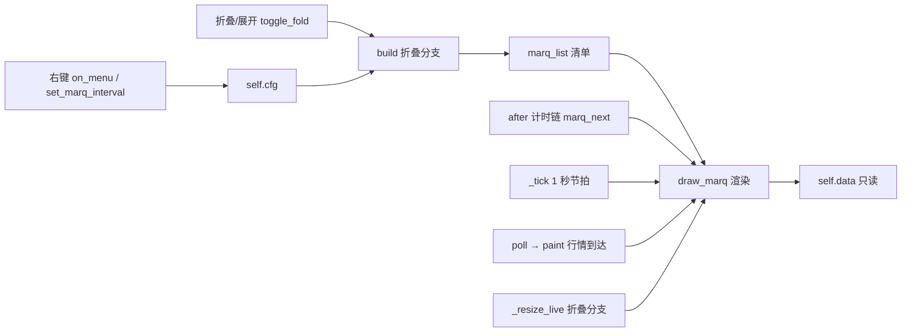
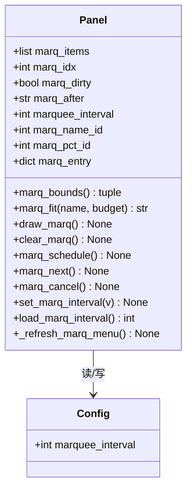
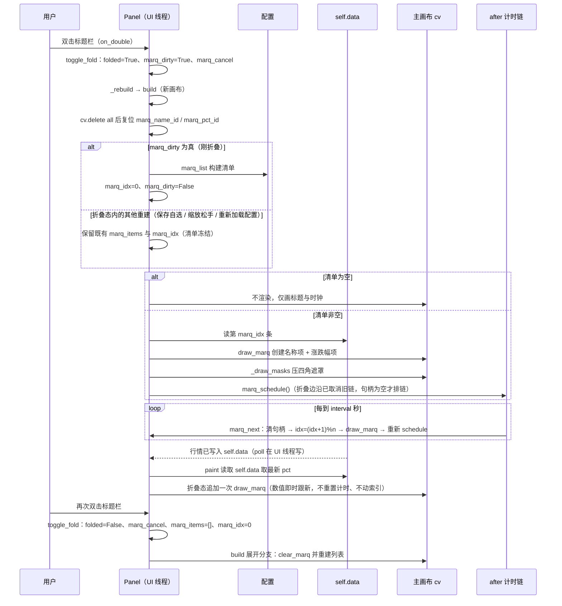
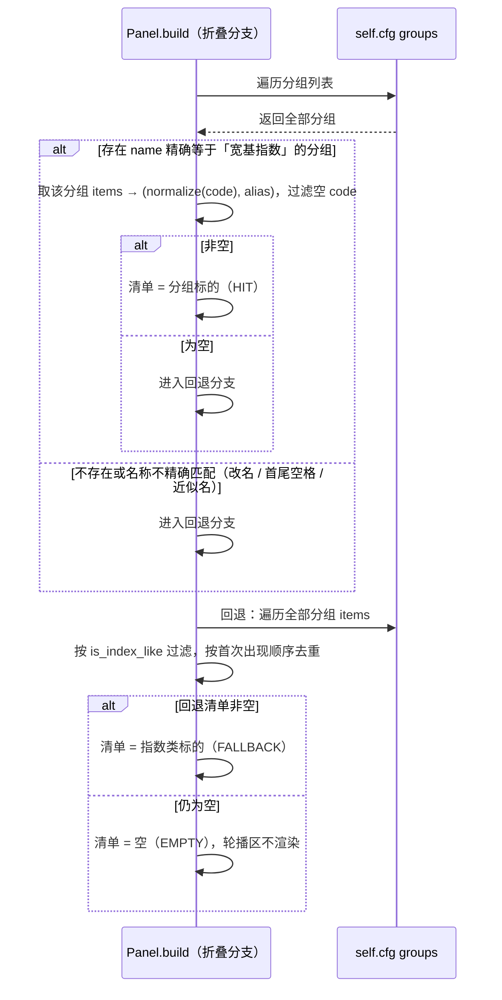
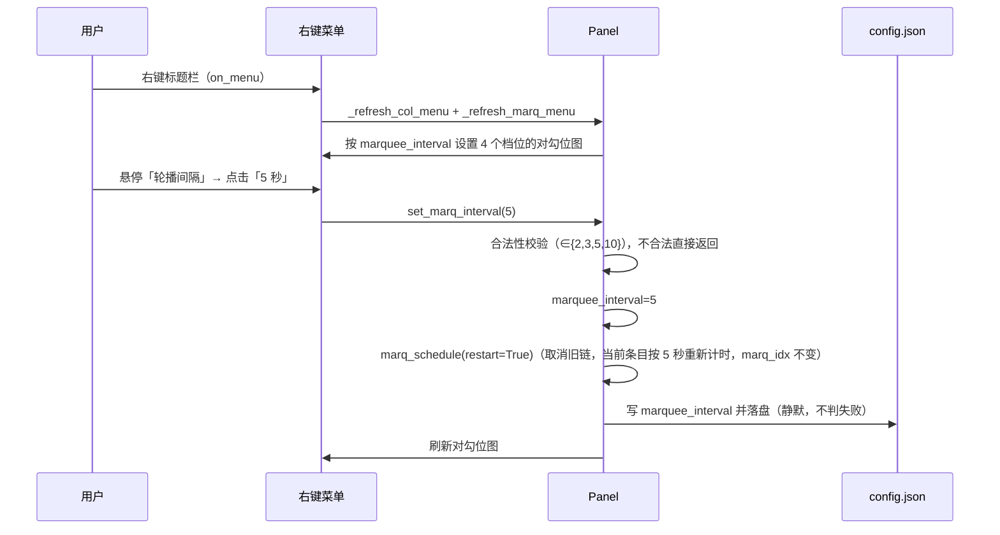

# SDD-盯盘君-折叠轮播-v1.0.0

## 1. 文档概述

### 1.1 文档信息

| 字段 | 内容 |
| --- | --- |
| 项目名称 | 盯盘君 MarketEye |
| 文档版本 | v1.0.0 |
| 版本状态 | 未发布 |
| 创建日期 | 2026-10-21 |
| 更新日期 | 2026-10-21 |
| 基于需求 | [PRD-盯盘君-折叠轮播-v1.0.0](../../需求文档/折叠轮播/v1.0.0/PRD-盯盘君-折叠轮播-v1.0.0.md)（v1.0.0） |
| 基于设计 | —（本功能无旧版 SDD，采用全新设计模式） |

### 1.2 变更记录

| 版本 | 日期 | 变更人 | 变更类型 | 关联章节 | 变更内容 |
| --- | --- | --- | --- | --- | --- |
| v1.0.0 | 2026-10-21 | - | 新增 | §1–§10 | 新增折叠态标题栏轮播的完整设计：清单构建与指数类判定（模块级 `marq_list` / `is_index_like`）、标题栏可用区与画布单位截断（`marq_bounds` / `marq_fit`）、独立 `after` 计时链（`marq_schedule` / `marq_next` / `marq_cancel`，精度优于 1 秒节拍）、折叠边沿触发的清单冻结（`marq_dirty`）、画布重建后的文字项 id 复位、折叠态横向重排与纵向缩放禁用、右键「轮播间隔」级联与配置持久化（含重载配置）、错误降级与日志、T001~T013 任务清单。编码审核（修订后通过，5 主要 + 7 次要已合并）：渲染门槛改字体实测派生、涨跌幅改等宽字体、折叠态内重建不打断计时、`marq_list` 防畸形配置、吞异常补日志、超窄不排链 |

### 1.3 技术选型

| 维度 | 选型 | 说明 |
| --- | --- | --- |
| 运行环境 | Python 3.8+ 标准库 | 不引入任何第三方依赖 |
| GUI | tkinter `Canvas` 自绘 | 与既有悬浮窗一致：主画布 `cv` + 颜色键透明圆角 |
| 文字度量 | `tkinter.font.Font.measure()` | **与画布坐标同域**（DPI 感知进程内实测：`tk scaling = 1.998`，`measure("指数君盯盘") = 100`，同字体文本项 `bbox` 宽 102，同为画布单位），故全程不换算；度量必须在调用 `SetProcessDpiAwareness(2)` 之后进行，否则落到 96 DPI 虚拟化空间（`tk scaling = 1.332`，同串仅 65） |
| 定时器 | 本功能独立 `root.after(interval*1000)` 链 | 换条精度为毫秒级，满足 PRD 200ms 要求；既有 1 秒 `_tick` 仅用于数值刷新 |
| 数据来源 | 复用腾讯行情 `qt.gtimg.cn` 既有结果 | 本功能零新增网络请求 |
| 配置存储 | `config.json` | 新增 1 个配置键，旧配置缺键自动兜底 |

### 1.4 文档目的

本设计解决"折叠态标题栏中部空白区如何在零额外网络开销下展示大盘温度"这一个问题，职责范围严格限定为：

- **在范围内**：折叠态一条轮播文字的选源、布局、截断、配色、切换节奏，以及轮播间隔的选档与持久化
- **不在范围内**：折叠/展开行为本身（既有功能）、行情获取与解析（复用既有 `fetch_quotes`）、列表区与滚动条（既有）、展开态的任何渲染变化

设计目标：

1. 折叠态渲染为**两个 Canvas 文字项**级别的最小开销，不引入子画布、不引入线程
2. 尺寸与文字度量同单位（画布单位，即物理像素），DPI 100%~200% 下截断阈值自动跟随
3. 任何异常（清单空、数据缺失、配置损坏、字体缺失）都不得影响标题、时钟与既有交互

## 2. 系统架构

### 2.1 整体架构

本功能完全运行在 UI 线程内，**不新增线程**：行情数据由既有 `poll` 在 UI 线程写入 `self.data`，轮播只读取该字典，因此不存在跨线程共享问题。

### 2.2 模块划分

| 模块 | 职责 | 边界 |
| --- | --- | --- |
| 清单构建 | 模块级 `marq_list(cfg)` 依据配置与品种判定产出有序 `(code, alias)` 清单；`is_index_like()` 提供指数类判定 | 只接收 `cfg` 入参（便于自测直接调用），不读行情、不做渲染 |
| 布局与截断 | `marq_bounds()` 计算可用横向区间；`marq_fit()` 在预算内截断名称 | 只算坐标与文字，不碰数据 |
| 渲染 | `draw_marq()` 创建/更新两个文字项（名称、涨跌幅） | 只改画布 item，不读配置 |
| 驱动 | `marq_schedule()` / `marq_next()` / `marq_cancel()` 独立计时链 | 只推进索引与触发渲染 |
| 配置 | `load_marq_interval()` / `set_marq_interval()` / `_refresh_marq_menu()` | 只碰 `config.json` 与菜单勾选态 |

### 2.3 分层职责

| 层 | 职责 | 本功能相关实现 |
| --- | --- | --- |
| 窗口与绘制层 | 画布元素创建、坐标计算、配色 | `build`（折叠分支）、`draw_marq`、`_resize_live`（折叠分支）、`_draw_masks` |
| 行情获取层 | 定时拉取与解析（本功能不触碰） | 复用 `fetch_quotes` / `poll` 产出的 `self.data[code]` |
| 配置与持久化层 | 读配置、校验、落盘 | `load_marq_interval`、`set_marq_interval`、`save_json` |
| 交互层 | 鼠标事件与右键菜单 | `on_menu`（弹出前刷新勾选态）、`on_drag`（折叠态禁纵向缩放） |

### 2.4 界面区块地图

| 区块 | 绘图层 | 本功能关系 | 回链 PRD |
| --- | --- | --- | --- |
| 标题栏（`cv` 顶部 `head_h` 条带） | 主画布 `cv`，不滚动 | **承载轮播区**：位于标题文字右侧、时钟左侧 | §2.4「轮播显示区」 |
| 轮播区（标题与时钟之间） | 主画布 `cv` 的两个 text item（标签 `marq`） | 本功能全部绘制产物 | §2.4「轮播显示区」 |
| 列表区 / 表头 / 滚动条 | 主画布 + 内容子画布 `cc` | 与本功能无关；展开态轮播项被清空 | — |
| 右键菜单 | tkinter `Menu` | 新增「轮播间隔」级联子菜单 | §2.4「轮播间隔」及 4 个档位项 |

**绘制顺序约束**：折叠态只有 `cv`（无 `cc`），轮播项与标题、时钟同层，必须在 `_draw_body` 之后、`_draw_masks` 之前绘制——遮罩会把四角擦成颜色键，顺序颠倒会留下文字残角。当前边界（`lx = 152`、`rx = W - 115`）位于遮罩区（横向 24 以内）之外，正常情况下不会被裁切，但顺序仍须固定以防窗口宽度或圆角半径变化。

## 3. 详细设计

### 3.1 数据模型

**配置结构（`config.json`）**

| 键 | 类型 | 默认值 | 约束 | 可缺省 |
| --- | --- | --- | --- | --- |
| `marquee_interval` | int | `3` | ∈ {2, 3, 5, 10}，单位秒 | 是（缺省按 3 运行，**不回写**；有值但非法才回写 3） |

其余既有键（`width` / `height` / `groups` / `columns` / `theme` / `alpha` / `topmost`）本功能只读，不改语义。

**内存态结构（`Panel`）**

| 属性 | 类型 | 初值 | 写入时机 | 说明 |
| --- | --- | --- | --- | --- |
| `marq_items` | `list[tuple[str, str]]` | `[]` | `build` 折叠分支（仅当 `marq_dirty`） | 轮播清单 `(code, alias)`；展开态恒为空 |
| `marq_idx` | int | `0` | 折叠建单时归零；`marq_next` 递增取模 | 当前条目下标 |
| `marq_dirty` | bool | `True` | `toggle_fold` 折叠时置真；建单后置假 | 边沿标记：决定本轮折叠是否重建清单 |
| `marq_after` | str / None | `None` | `marq_schedule` 写入；`marq_cancel` / `marq_next` 清空 | 计时链句柄 |
| `marquee_interval` | int | `3` | `__init__` 读配置；`set_marq_interval` 写入 | 已校验的档位 |
| `marq_name_id` | int / None | `None` | `build` 起始复位；`draw_marq` 创建后写入 | 名称文字项 id |
| `marq_pct_id` | int / None | `None` | `build` 起始复位；`draw_marq` 创建后写入 | 涨跌幅文字项 id |
| `marq_entry` | `dict[int, int]` | `{}` | `__init__` 建空表；`_build_menu` 填充 | 档位秒数 → 「轮播间隔」子菜单内的项索引（取 `menu_marq.index("end")`，**不是父菜单**） |
| `menu_marq` | `tk.Menu` / None | `None` | `_build_menu` 创建 | 「轮播间隔」子菜单对象；`_refresh_marq_menu` 用 `getattr` 守卫 |

**初始化时序（硬约束）**：`marquee_interval` / `marq_entry` / `marq_dirty` / `menu_marq` 必须在 `self.menu = self._build_menu()` **之前**建立（菜单构建过程中会读档位以设置对勾位图、并填充 `marq_entry`）。当前代码中该语句位于 `self.dlg = None` 之后若干行，故新状态锚定在 `self.dlg` 之后即可满足。

**折叠态入口唯一性（不变式）**：`folded` 只能由 `__init__`（False）与 `toggle_fold` 写入。若将来新增"记忆折叠态启动""托盘一键折叠"等入口，必须同时置 `marq_dirty = True`，否则会停在"折叠但清单为空"的空白态（`build` 的判据 `marq_dirty or not marq_items` 已对此兜底，见 T006）。

**状态关系**

**向后兼容**：旧配置无 `marquee_interval` 键时按默认 3 运行，**不触发回写**（避免首启动就把配置文件整体重写；`load_json` 在文件损坏时返回 `{}`，此时回写会清空用户配置）。仅当键存在但取值不在枚举内时才回写 3。`columns` 等既有键不受影响。

### 3.2 外部接口设计

#### 3.2.1 新增外部接口

无。本功能不发起任何网络请求（PRD R-07）。

#### 3.2.2 复用的既有接口

| 接口 | 地址 | 用途 | 本功能使用的字段 |
| --- | --- | --- | --- |
| 腾讯行情 | `https://qt.gtimg.cn/q=`（GBK，`~` 分隔） | 取名称与涨跌幅 | `f[1]` 名称、`f[32]` 涨跌幅（既有 `fetch_quotes` 已解析为 `data[code]["name"]` / `["pct"]`） |

调用方仍为既有行情线程，轮播只读其结果，**不感知请求细节**。

**数据缺失形态（关键）**：`fetch_quotes` 对停牌/未开盘（`f[3] <= 0`）与解析失败（字段数不足、数值异常）的标的**不写入结果字典**，因此 `self.data` 中"无该 key"是唯一的缺失形态；只要 key 存在，`pct` 必为 `float`，不会是 `None`。轮播的缺失判断一律用 `self.data.get(code) is None`。

### 3.3 业务流程

#### 3.3.1 折叠 → 轮播 → 展开（PRD §3.4 主链路）

#### 3.3.2 清单构建与回退（PRD §3.4 判定节点）

#### 3.3.3 轮播间隔选档（PRD §3.4 配置链路）

### 3.4 业务规则

对照 PRD §3.3 逐条给出实现方案。

| 规则 | PRD 要求 | 实现方案 |
| --- | --- | --- |
| R-01 涨跌配色 | 涨红、跌绿、平次要色；名称主文字色 | `draw_marq` 内按 `pct` 符号取 `theme["up"]` / `theme["down"]` / `theme["flat"]`；名称恒 `theme["text"]`；文字统一 `f"{pct:+.2f}%"`，零值为 `+0.00%`（与列表区 `paint` 同格式，PRD AC-07 已对齐） |
| R-02 空间截断 | 先保涨跌幅完整，名称截断加省略号 | `marq_bounds` 给出可用宽度（画布单位）；`marq_fit` 在 `avail - MARQ_SEP 宽 - 涨跌幅宽` 预算内逐字累加 `measure`，超出则回退一字并追加 `…`；预算不足返回空串（只显示涨跌幅） |
| R-03 数据缺失 | 无涨跌幅显示 `—`，照常轮播 | `d = self.data.get(code)`，`d is None` 时涨跌幅取 `MARQ_EMPTY`、颜色取 `theme["flat"]`、名称回退 `alias or code`；索引照常推进。**注意**：行情整体失败时 `poll` 只置 `self.err` 而**不清空 `self.data`**，故界面沿用上一轮数值（与列表区一致），"缺数据"仅指 `data` 中确实没有该 key |
| R-04 展开即停 | 展开清空、再折叠从首条开始 | `toggle_fold` 展开时 `marq_cancel()` + `marq_items=[]` + `marq_idx=0`；再折叠置 `marq_dirty=True`，`build` 从第 0 条开始 |
| R-05 来源优先级 | 分组优先，缺失回退，皆空留空 | `marq_list(cfg)` 三段式：精确匹配 → 指数类回退 → 空清单 |
| R-06 清单冻结 | 折叠态内自选变更不影响本轮播 | **边沿触发**：`marq_dirty` 由 `toggle_fold` 折叠时置真，`build` 仅在其为真**或清单为空**时重建，随后置假；`build` 因保存自选、缩放松手、重新加载配置等路径再次执行时，清单与 `marq_idx` 原样保留。若被删标的行情消失，按 R-03 占位 |
| R-07 零网络请求 | 不得发起请求 | 全链路只读 `self.data`；`draw_marq` 无网络调用 |
| R-08 档位枚举 | 仅 2/3/5/10，非法回退 3 | `load_marq_interval`：键缺失 → 3 且不写盘；有值但非法 → 3 并回写 + `log_once`；`set_marq_interval` 入参不合法直接返回 |
| R-09 即时生效 | 选档立即按新间隔计时，不跳条 | `set_marq_interval` 只调 `marq_schedule(restart=True)`（重建计时链），不改 `marq_idx`、不重绘文字 |
| R-10 持久化 | 重启沿用 | 写 `cfg["marquee_interval"]` 后 `save_json`。既有 `save_json` 内部吞异常且无返回值，故**失败静默**（与主题、透明度等既有配置项行为一致），不做额外的失败日志——内存档位在本次会话内照常生效 |

**PRD §3.3 约束落地**

| PRD 约束 | 实现 |
| --- | --- |
| 仅折叠态渲染 | `draw_marq` 首行判 `not self.folded` 即 `clear_marq()` 返回；展开分支不创建轮播项 |
| 轮播区不拦截鼠标事件 | 轮播项仅 `cv.create_text`，**不绑定任何事件**；`cv` 上的既有绑定（拖动/双击/右键）照常生效 |
| 名称+涨跌幅不得遮挡标题与时钟 | 左界由标题实测宽决定、右界由时钟预留宽决定，文字物理上不可能越界；放不下时按派生门槛（`_marq_min_w`，两字名称 + 分隔 + 一条涨跌幅按当前字体实测）整体不渲染 |
| 分组名精确匹配 | `g.get("name") == "宽基指数"`，不做 `strip()`、不忽略大小写 |
| 指数类不含个股与 ETF/LOF | `is_index_like`：`sh` 前缀取 `000` 段、`sz` 前缀取 `399` 段、`hk` 前缀取代码含字母者；ETF（`51`/`15`/`159` 等）与个股天然排除 |
| 清单折叠态内不可变 | 见 R-06（`marq_dirty` 边沿触发） |
| 档位变更必须持久化（失败不阻断） | `save_json` 内部吞异常；失败仅写日志，内存档位照常生效 |
| 折叠态纵向不可缩放 | `on_drag` 折叠时强制 `h = head_h`、`y = _ry`。**归因修正**：真实原因是既有 `minh = px(MIN_H) = 144`（画布单位）大于折叠态高度 `head_h = 51`，纵向拖动会把窗口撑出 93px 空白区；不是"不遮挡"的引申 |

**PRD 状态机的实现对应**

| PRD 状态 | 实现落点 |
| --- | --- |
| STOPPED（M-01） | `folded=False` 或 `marq_items` 为空；无计时链、无轮播项 |
| RUNNING（M-01） | `folded=True` 且 `marq_items` 非空；`marq_after` 存活，`marq_next` 逐拍推进 |
| HIT / FALLBACK / EMPTY（M-02） | `marq_list(cfg)` 的三个返回分支，仅在 `marq_dirty` 为真时判定一次 |
| DEFAULT / CUSTOM（M-03） | `marquee_interval == 3` 视为 DEFAULT；缺键与非法值两条路径都落到 DEFAULT |

### 3.5 界面设计

无 PROTO（PRD 已确认本期不出原型），此处完整描述布局、坐标与视觉状态。

#### 3.5.1 视觉规格

| 元素 | 字体 | 字号（pt） | 颜色（dark / light） | 对齐 |
| --- | --- | --- | --- | --- |
| 指数名称 | `f_cn`（雅黑 UI） | 9 | `text` `#EAEFF8` / `#1A2233` | 左（`anchor="w"`） |
| 分隔符 | — | — | 不渲染，仅占位两个半角空格 | — |
| 涨跌幅 | `f_num`（Consolas 9 bold，编码审核修订以符合 ui-rules §2.2） | 9 | 涨 `up` `#FF4D4F` / `#E5484D`；跌 `down` `#12B76A` / `#0E9F5E`；平/缺失 `flat` `#95A1B4` / `#7A8699` | 左，紧接名称 |
| 垂直位置 | — | — | 标题栏中心 `y = head_h / 2`（本机 25.5） | 居中 |

字号取正数点数（9），避免 Tk 在 150% 缩放下的负值像素解释问题。

#### 3.5.2 坐标与尺寸计算

**单位口径**：`px(v)` 与 `Font.measure()` 输出**同一单位**（画布坐标，即 DPI 感知进程下的设备像素），全程不乘除缩放比。裁决依据：同字体文本项的 `bbox` 宽与 `measure` 仅差 2px（字形外扩），而 `px()` 与窗口 `geometry` 同域。**度量前提**：必须先 `SetProcessDpiAwareness(2)` 再建 `tk.Tk()`；非感知进程下 `tk scaling` 为 1.332、同一串宽度只剩 65，会得到整表偏小 1/3 的错误布局。

设窗口宽 `W`（画布单位）、`s = 1.5`、`px(v) = round(v * s)`：

| 量 | 公式 | 本机实测（`W = 500`，即配置宽 333） |
| --- | --- | --- |
| 标题文字宽 | `measure(cfg["title"], f_cn 10 bold)` | 100 |
| 左界 `lx` | `px(27) + 标题宽 + px(MARQ_GAP_L)` | `40 + 100 + 12 = 152` |
| 时钟预留宽 | `max(measure("00:00:00", f_num 9), measure("连接失败", f_num 9))` | `max(80, 72) = 80` |
| 右界 `rx` | `W - px(13) - 时钟预留宽 - px(MARQ_GAP_R)` | `500 - 20 - 80 - 15 = 385` |
| 可用宽 `avail` | `rx - lx` | 233 |
| 名称预算 | `avail - measure("  ") - measure(涨跌幅)` | `233 - 10 - 66 = 157`（约容 8.7 个中文字） |

**渲染门槛**：`avail < _marq_min_w` 时不渲染轮播，直接留空。门槛不设常量，由 `marq_bounds` 首次建字体时按当前 DPI 实测派生：两字名称 + `MARQ_SEP` + 一条涨跌幅（等宽字体下 `+0.00%`）的 measure 之和；低于此值只剩半条信息，不如不显示。编码审核修订（原设计写死 150% 下的 112，DPI 100%/200% 失准）：150% 下实测门槛 **106**（名称 36 + 分隔 10 + 涨跌幅 60），`W < 152 + 106 + 115 = 373`（约 **249 逻辑像素**）时留空；`avail ≥ 142`（约 **273 逻辑像素**）时四字名称可完整显示。

#### 3.5.3 画布元素与绘制函数映射

| 元素 | 创建函数 | 标签 | 生命周期 |
| --- | --- | --- | --- |
| 名称文字项 | `Panel.draw_marq` → `cv.create_text` | `marq` | 折叠态首次绘制时创建，之后仅 `itemconfigure` / `coords` |
| 涨跌幅文字项 | `Panel.draw_marq` → `cv.create_text` | `marq` | 同上 |
| 标题 / 时钟 | `Panel.build`（既有） | — | 每次 `_rebuild` 重建 |
| 四角遮罩 | `Panel._draw_masks`（既有） | `mask` | 每次重绘后 `tag_raise("mask")`，压在轮播之上 |

**id 生命周期陷阱**：`_rebuild` 会 `cv.destroy()` 并新建画布，新画布的 item id 从 1 重新计数，旧 id 极可能指向标题、时钟或圆角图元；而 Tk 对失效/错指向的 id 执行 `itemconfigure` / `coords` **不报错**。因此 `build` 在 `cv.delete("all")` 之后必须无条件把 `marq_name_id` / `marq_pct_id` 复位为 `None`，两个分支都要复位，否则会静默改错元素（轮播文字覆盖标题、圆角矩形被挪位）。

#### 3.5.4 交互流程

| 用户动作 | 落点 | 本功能行为 |
| --- | --- | --- |
| 在轮播文字上按下左键拖动 | `on_press` / `on_drag` | 正常移动窗口（文字项无绑定，事件穿透到 `cv`） |
| 双击标题栏（含轮播区） | `on_double` | 折叠/展开；`e.y <= head_h` 判定不受影响 |
| 右键标题栏（含轮播区） | `on_menu` | 弹出菜单，含「轮播间隔」 |
| 拖右边框加宽/缩窄 | `on_drag` → `_resize_live` | 折叠态重算 `lx/rx` 并重绘，名称截断随之变化 |
| 拖上下边框 | `on_drag` | 折叠态忽略纵向缩放，`H` 恒为 `head_h`；光标仍显示纵向缩放样式（可接受的交互降级） |

### 3.6 错误处理定义

| 场景 | 处理 | 用户可见表现 | 日志 |
| --- | --- | --- | --- |
| 轮播清单为空 | `draw_marq` 早退 | 标题栏只显示标题与时钟 | 不记录（正常业务分支） |
| 可用宽度 < 派生门槛 `_marq_min_w` | 早退留空 | 同上 | 不记录（正常边界） |
| 当前条目行情缺失（`data` 无该 key） | 涨跌幅段显示 `—` | `上证指数  —` | 不记录 |
| 配置键缺失 | 按 3 运行，不写盘 | 子菜单标识落在 3 秒 | 不记录 |
| 配置值非法（非 2/3/5/10） | 置 3 并回写 | 子菜单标识落在 3 秒 | `log_once("marq interval repaired")` |
| 配置写入失败 | 静默（既有 `save_json` 吞异常且无返回值），内存档位照常 | 本次会话生效，重启回旧值 | 不记录（与既有配置项一致） |
| 分组配置结构异常（缺 `items` / `items` 非列表） | 视为空分组继续 | 走回退分支或留空 | 不记录 |
| 字体族缺失 | 既有 `pick_family` 已兜底 | 使用后备字体，度量随实际字体计算 | 不记录 |
| 绘制异常（`draw_marq` 抛出） | `try/except` 包裹，仅记日志 | 轮播不显示，标题、时钟、交互不受影响 | `_dbg("marq 异常: …")` |
| 计时回调异常（`marq_next` 抛出） | `try/finally` 中先重排下一次计时再记日志 | 轮播停在该条，但不会永久停摆 | `_dbg("marq next 异常: …")` |
| 行情整体失败（`self.err` 非空） | 沿用上一轮数值（`data` 不被清空），不特殊处理 | 轮播显示陈旧涨跌幅；时钟显示"连接失败"（既有），圆点变红（既有） | 不记录 |

**日志策略**：沿用既有 `ticker.log` 与 `_dbg` / `log_once` 去重机制，正常路径零写入。

### 3.7 其他设计

#### 3.7.1 常量定义

| 常量 | 取值 | 单位 | 说明 |
| --- | --- | --- | --- |
| `MARQ_GROUP_NAME` | `"宽基指数"` | — | 轮播源分组名，精确匹配 |
| `MARQ_INTERVAL_CHOICES` | `(2, 3, 5, 10)` | 秒 | 可选档位 |
| `MARQ_INTERVAL_DEFAULT` | `3` | 秒 | 默认档位 |
| `MARQ_FONT_SIZE` | `9` | pt | 轮播字号（正数点数） |
| `MARQ_GAP_L` | `8` | 逻辑像素（经 `px()`） | 标题右侧间距 |
| `MARQ_GAP_R` | `10` | 逻辑像素（经 `px()`） | 时钟左侧间距 |
| `MARQ_SEP` | `"  "` | — | 名称与涨跌幅之间的分隔（两个半角空格） |
| （已删除 `MARQ_MIN_W`） | — | — | 编码审核修订：门槛改为 `marq_bounds` 内按字体实测派生的 `self._marq_min_w`（150% 下实测 106），DPI 100%~200% 自动跟随 |
| `MARQ_EMPTY` | `"—"` | — | 涨跌幅缺失占位符（与列表区 `PLACEHOLDER_NA` 同字符） |
| `MARQ_ELLIPSIS` | `"…"` | — | 名称截断后缀 |

#### 3.7.2 函数设计

| 函数 | 位置 | 职责 | 关键约束 |
| --- | --- | --- | --- |
| `is_index_like(code)` | 模块级 | 判定是否为指数类标的（`sh`+`000` 段 / `sz`+`399` 段 / `hk`+含字母） | 纯函数；**不改**既有 `is_index_code`（后者服务于浏览器跳转的 `zs/gp` 判定，把全部港股都算指数，语义不同） |
| `marq_list(cfg)` | 模块级 | 构建轮播清单（HIT/FALLBACK/EMPTY 三段） | 只接收 `cfg`，不依赖 `Panel` 实例，便于 `--selftest` 直接调用 |
| `Panel.load_marq_interval()` | Panel | 读配置并校验 | 缺键 → 3 不写盘；非法 → 3 回写 + 日志 |
| `Panel.marq_bounds()` | Panel | 返回 `(lx, rx, avail)`（画布单位） | 依赖 `W`、`head_h`、标题实测宽、时钟预留宽；字体对象缓存在实例上 |
| `Panel.marq_fit(name, budget)` | Panel | 在预算内截断名称 | 预算不足返回空串；逐字累加 `measure` |
| `Panel.draw_marq()` | Panel | 计算当前条目文本与颜色并创建/更新两个文字项 | 幂等；非折叠或清单空或超窄时调 `clear_marq()`；整体 `try/except` |
| `Panel.clear_marq()` | Panel | 删除 tag `marq` 并复位两个 id | 可重复调用 |
| `Panel.marq_schedule(restart=False)` | Panel | 按当前档位排下一次 `marq_next` | 默认**不打断**进行中的计时（`marq_after` 非空则直接返回）；`restart=True` 先取消再排（仅改档用）；非折叠、清单空或可用宽低于门槛时不排 |
| `Panel.marq_next()` | Panel | 推进索引、重绘、再排下一次 | 首行置 `marq_after = None`；`try: 推进+绘制 except: _dbg finally: marq_schedule()` |
| `Panel.marq_cancel()` | Panel | 取消挂起的计时链并清句柄 | **首行必须 `if self.marq_after is None: return`**——`after_cancel(None)` 抛 `ValueError`（实测），会穿透 `finally` 中断 `build` 的后续绘制 |
| `Panel.set_marq_interval(v)` | Panel | 校验、置档、重排计时、落盘、刷新菜单 | 不改 `marq_idx`、不重绘（不跳条） |
| `Panel._refresh_marq_menu()` | Panel | 按当前档位刷新 4 项的对勾位图 | 复用 `img_chk_on` / `img_chk_off` |

#### 3.7.3 定时器机制

**为什么不用既有 1 秒 `_tick`**：`_tick` 以 1 秒为量化单位，首条停留时长会落在 `(interval-1, interval+1)` 区间，最大偏差 1000ms，是 PRD §4.1「每条停留误差 < 200ms」的 5 倍。故换条使用独立 `after(interval*1000)` 链，毫秒级精度；`_tick` 只承担"数值跟新"（不推进索引）。

| 事件 | 计时链动作 |
| --- | --- |
| 折叠且清单非空 | `marq_schedule()`：折叠边沿已 `marq_cancel`，句柄为空故正常排链 `after(interval*1000, marq_next)` |
| `marq_next` 触发 | 首行清句柄 → 索引 +1 取模 → `draw_marq()` → `marq_schedule()`（此时句柄为空，正常排下一次） |
| 展开 | `marq_cancel()` |
| 改档 | `marq_schedule(restart=True)`（当前条目重新计时，索引不变） |
| 折叠态内 `_rebuild` | `marq_schedule()`（默认不打断进行中的计时，索引保留；句柄为空时才补排） |
| 清单为空 / 超窄 | 不排链（`marq_schedule` 直接返回；变宽后由 `_resize_live` 折叠分支补排） |
| 退出 | 进程结束即失效；`after` 句柄无需额外清理 |

**异常安全**：`marq_next` 的结构为"清句柄 → `try: 推进+绘制 except: _dbg` → `finally: marq_schedule()`"，保证任何绘制异常都不会让轮播永久停摆。**前提**：`marq_cancel` 必须判空（`after_cancel(None)` 抛 `ValueError`，会从 `finally` 穿透出去，反而中断调用方的后续绘制）。

**已知偏差（用户干预场景）**：折叠态下每次"保存自选 / 缩放松手 / 重新加载配置"都会 `_rebuild`。由于默认不打断进行中的计时，正常缩放与保存不会延长当前条目停留；只有改档与重新折叠会重启计时，属刻意行为。PRD §4.1 的 200ms 指标约束的是无用户干预的连续轮播。

#### 3.7.4 折叠态缩放处理

| 行为 | 现状（读代码确认） | 设计 |
| --- | --- | --- |
| 横向缩放 | 折叠态下 `_resize_live` **不会抛异常**（`self.cc is not None` 有守卫，`rows` 已清空，失效 item id 的 `coords` 被 Tk 静默忽略），但轮播区不按新宽度重排，且 `_draw_body` 会用被撑大的 `H` 重绘 | `_resize_live` 首部增加折叠分支：`H = head_h`、更新时钟坐标、`draw_marq()`、`_draw_body()`、`_draw_masks()` 后返回 |
| 纵向缩放 | `on_drag` 的 `minh = px(MIN_H) = 144` 会把折叠态 `H`（51）撑大到 ≥144，出现 93px 空白区；这是"静默错"，不报错也不记日志 | `on_drag` 在 `self.folded` 时强制 `h = self.head_h`、`y = self._ry`，纵向拖动视为无操作 |

### 3.8 功能点追溯

| 功能点（PRD §3.2） | 技术产物 | 设计章节 | 代码位置 | 任务 |
| --- | --- | --- | --- | --- |
| F-01 折叠态轮播展示 | `Panel.draw_marq`、`Panel.clear_marq`、`Panel.marq_bounds`、`Panel.marq_fit`、`Panel.marq_schedule`、`Panel.marq_next`、`Panel.marq_cancel`、`Panel.build`（折叠分支）、`Panel.toggle_fold`、`Panel._tick`、`Panel.paint`、`Panel._resize_live`、`Panel.on_drag`、常量 `MARQ_FONT_SIZE`/`MARQ_GAP_L`/`MARQ_GAP_R`/`MARQ_SEP`/`MARQ_MIN_W`/`MARQ_EMPTY`/`MARQ_ELLIPSIS` | §3.3.1、§3.5.1–§3.5.4、§3.7.1、§3.7.3、§3.7.4 | §4.1、§4.2 | T003、T004、T005、T006、T007、T008、T009 |
| F-02 轮播数据来源 | `marq_list(cfg)`、`is_index_like`、常量 `MARQ_GROUP_NAME`、`Panel.build`（折叠分支调用清单构建）、`Panel.toggle_fold`（`marq_dirty` 边沿） | §3.3.2、§3.4（R-05/R-06）、§3.7.1、§3.7.2 | §4.1、§4.3 | T001、T006、T007 |
| F-03 轮播间隔设置 | `Panel.load_marq_interval`、`Panel.set_marq_interval`、`Panel._refresh_marq_menu`、`Panel._build_menu`、`Panel.on_menu`、`Panel.reload`、常量 `MARQ_INTERVAL_CHOICES`/`MARQ_INTERVAL_DEFAULT` | §3.3.3、§3.4（R-08/R-09/R-10）、§3.7.1、§3.7.2 | §4.1、§4.3 | T002、T010、T011、T012、T013 |

## 4. 代码位置

### 4.1 程序逻辑

| 设计产物 | 文件 | 函数 / 方法 | 说明 |
| --- | --- | --- | --- |
| §3.7.1 常量 | `ticker.pyw` | 模块级常量区（`COL_*` 常量附近） | 新增 10 个 `MARQ_*` 常量 |
| §3.7.2 指数判定 | `ticker.pyw` | `is_index_like` | 新增模块级函数 |
| §3.3.2 清单构建 | `ticker.pyw` | `marq_list` | 新增模块级函数（入参 `cfg`） |
| §3.7.2 配置读取 | `ticker.pyw` | `Panel.load_marq_interval` | 新增 |
| §3.5.2 可用区计算 | `ticker.pyw` | `Panel.marq_bounds` | 新增 |
| §3.5.2 截断算法 | `ticker.pyw` | `Panel.marq_fit` | 新增 |
| §3.5.3 渲染 | `ticker.pyw` | `Panel.draw_marq` / `Panel.clear_marq` | 新增 |
| §3.7.3 计时链 | `ticker.pyw` | `Panel.marq_schedule` / `Panel.marq_next` / `Panel.marq_cancel` | 新增 |
| §3.3.3 档位写入 | `ticker.pyw` | `Panel.set_marq_interval` | 新增 |
| §3.3.3 菜单刷新 | `ticker.pyw` | `Panel._refresh_marq_menu` | 新增 |
| §3.1 状态初始化 | `ticker.pyw` | `Panel.__init__` | 修改：新增 7 个轮播状态属性 + 读档（必须早于 `_build_menu`） |
| §3.3.1 首帧渲染 | `ticker.pyw` | `Panel.build` | 修改：`cv.delete("all")` 后复位两个 id；折叠分支按 `marq_dirty` 建单并绘制；展开分支清空 |
| §3.3.1 折叠边沿 | `ticker.pyw` | `Panel.toggle_fold` | 修改：折叠置 `marq_dirty` 并 `marq_cancel`；展开清清单、清索引、`marq_cancel` |
| §3.3.1 数值跟新 | `ticker.pyw` | `Panel._tick` / `Panel.paint` | 修改：折叠态各补一次 `draw_marq`（不推进索引、不重置计时） |
| §3.7.4 缩放 | `ticker.pyw` | `Panel._resize_live` | 修改：首部折叠分支 |
| §3.7.4 纵向禁用 | `ticker.pyw` | `Panel.on_drag` | 修改：折叠态强制 `h`/`y` |
| §3.3.3 菜单入口 | `ticker.pyw` | `Panel._build_menu` | 修改：新增「轮播间隔」级联（4 个 command + 对勾位图） |
| §3.3.3 弹出刷新 | `ticker.pyw` | `Panel.on_menu` | 修改：追加 `_refresh_marq_menu()` |
| §3.3.3 配置重载 | `ticker.pyw` | `Panel.reload` | 修改：重载后重新 `load_marq_interval()` 并 `_refresh_marq_menu()`（否则"编辑配置文件 → 重新加载"档位不生效） |
| §3.6 自检覆盖 | `ticker.pyw` | `selftest` | 修改：新增轮播自检段（直接调用模块级 `marq_list(cfg)`、`is_index_like`） |

### 4.2 界面绘制

| 设计产物 | 文件 | 绘制函数 / 画布元素 | 说明 |
| --- | --- | --- | --- |
| §3.5.3 名称项 | `ticker.pyw` | `cv.create_text`（`marq_name_id`，tag `marq`） | 折叠态标题栏中部，`anchor="w"` |
| §3.5.3 涨跌幅项 | `ticker.pyw` | `cv.create_text`（`marq_pct_id`，tag `marq`） | 紧接名称右侧 |
| §3.5.1 配色 | `ticker.pyw` | `theme["up"/"down"/"flat"/"text"]` | 跟随深浅主题 |
| §3.5.2 左界 | `ticker.pyw` | `Panel.marq_bounds` + 标题 `create_text` 实测宽 | 与 `build` 中标题绘制同源 |
| §3.5.2 右界 | `ticker.pyw` | `Panel.marq_bounds` + 时钟项（`self.clock`） | 时钟 `anchor="e"` 在 `W - px(13)` |
| §3.5.4 事件穿透 | `ticker.pyw` | 轮播项不绑定事件 | 交互全部落在 `cv` 既有绑定 |
| §3.5.3 遮罩层级 | `ticker.pyw` | `Panel._draw_masks`（tag `mask`） | 必须在 `draw_marq` 之后执行 |

### 4.3 配置与脚本位置

| 设计产物 | 文件 | 路径 / 配置项 | 说明 |
| --- | --- | --- | --- |
| §3.1 档位配置 | `config.json` | `marquee_interval` | 新增（首次改档时写入；缺省按 3 且不写盘） |
| §3.1 清单来源 | `config.json` | `groups[].name` / `groups[].items` | 只读；「宽基指数」分组由用户既有维护 |
| §3.6 日志 | `ticker.log` | 追加 | 沿用既有（已 `.gitignore`） |

## 5. 依赖关系

### 5.1 内部模块依赖

| 依赖方向 | 对方 | 依赖内容 | 目的 |
| --- | --- | --- | --- |
| 单向（本 → 既有） | `Panel.build` | 折叠分支的执行时机、`W` / `head_h` / `body_r` | 在正确的布局阶段插入轮播首帧 |
| 单向（本 → 既有） | `Panel.toggle_fold` | 折叠边沿 | 触发清单重建与时计启停 |
| 单向（本 → 既有） | `Panel._tick` / `paint` | `self.data`、刷新回调 | 数值跟新 |
| 单向（本 → 既有） | `Panel._rebuild` / `_draw_masks` | 画布重建与遮罩 | 折叠、换肤、配置重载后的正确重绘 |
| 单向（本 → 既有） | `Panel.px` / `theme` / `f_cn` / `f_num` / `s` | 尺寸换算、配色、字体 | DPI 与主题一致 |
| 单向（本 → 既有） | `_mk_check_imgs` 产出的 `img_chk_on/off` | 对勾位图 | 菜单选中标识与「显示列」一致 |
| 单向（本 → 既有） | `save_json` / `load_json` / `_dbg` / `log_once` | 配置与日志 | 持久化与错误记录 |
| 单向（本 → 既有） | `normalize` | 代码归一化 | 清单构建时统一代码格式 |

### 5.2 外部系统依赖

| 依赖 | 方向 | 依赖目的 | 说明 |
| --- | --- | --- | --- |
| 腾讯行情 `qt.gtimg.cn` | 间接（经既有行情线程） | 提供名称与涨跌幅 | 本功能不直接调用 |
| Win32 API（颜色键透明 / 置顶） | 单向 | 窗口形态 | 与既有实现共用，本功能不新增调用 |
| Windows GDI 字体子系统 | 单向 | `Font.measure` 取字形宽度 | 字体缺失时走既有 `pick_family` 回退链 |

## 6. 部署配置

### 6.1 环境要求

| 项 | 要求 |
| --- | --- |
| Python | 3.8+（含 tkinter，Tk 8.6） |
| 操作系统 | Windows 10/11（依赖 `-transparentcolor` 颜色键） |
| DPI 缩放 | 100%~200%（150% 实测于 DPI 感知进程：`tk scaling = 1.998`、`winfo_fpixels("1i") = 143.9`；标题 100 / 名称 72 / 涨跌幅 66 / 时钟 80 / 两空格 10，均为画布单位） |
| 屏幕分辨率 | 1366×768 及以上 |

### 6.2 关键配置项

| 配置项 | 默认值 | 取值 | 说明 |
| --- | --- | --- | --- |
| `marquee_interval` | `3` | 2 / 3 / 5 / 10 | 轮播每条停留秒数；缺省按 3，非法值回退 3 |
| `width` | `268`（内置默认，用户值优先） | 整数（逻辑像素） | 决定轮播可用区宽度：约 ≤253 时轮播区留空，约 ≥277 时四字名称可完整显示 |
| `groups[].name` | — | 字符串 | 值等于「宽基指数」的分组决定轮播源 |

### 6.3 发布配置清单

| 配置类型 | 配置名称 | 变更内容 | 执行环境 | 顺序依赖 |
| --- | --- | --- | --- | --- |
| `config.json` | `marquee_interval` | 新增键，可缺省（缺省按 3，不写盘） | 本机 | 无（首次改档自动写入） |
| 启动脚本 | `启动盯盘.bat` | 无变更 | 本机 | 无 |

## 7. 模块间交互

### 7.1 交互关系

| 交互方向 | 对方 | 接口 / 消息 | 调用时机 | 数据流向 |
| --- | --- | --- | --- | --- |
| 本 ← 行情线程 | `fetch_quotes` 结果 | `self.data` 字典（键 `code`） | 行情刷新后由 `poll` 在 UI 线程写入 | 行情 → 轮播（只读） |
| 本 → 配置层 | `save_json` | `cfg["marquee_interval"]` | 用户选档 | 轮播 → 磁盘 |
| 既有 → 本 | `toggle_fold` / `build` / `_tick` / `paint` / `_resize_live` | 直接方法调用 | 折叠、重建、每秒、刷新、缩放 | 事件 → 渲染 |

线程约束：轮播所有读写均发生在 UI 线程；行情线程只通过 `queue` 投递，不触碰 `marq_*` 状态。

### 7.2 交互时序

见 §3.3.1（折叠 → 轮播 → 展开）与 §3.3.3（选档链路），二者在"重排计时链"处汇合。

## 8. 文档依赖

| 依赖文档 | 版本 | 依赖内容 | 用途 |
| --- | --- | --- | --- |
| PRD-盯盘君-折叠轮播 | v1.0.0 | 功能点 F-01~F-03、业务规则 R-01~R-10、界面入口 §2.4、验收 AC-01~AC-16 | 设计与验收依据 |

## 9. 版本影响分析

| 版本 | 变更类型 | 变更描述 | 影响范围 | 改造方案 |
| --- | --- | --- | --- | --- |
| v1.0.0 | 新增 | 折叠态标题栏轮播与间隔配置 | 折叠态标题栏绘制、`toggle_fold`、`build`、`_tick`、`paint`、`_resize_live`、`on_drag`、右键菜单、`on_menu`、`reload`、`selftest`、`config.json` 新增键 | 全部为增量：新增 12 个函数/方法（2 个模块级 + 10 个 `Panel` 方法），修改 11 处既有函数；展开态渲染路径零改动，既有列体系、行业缓存、滚动逻辑不受影响 |

## 10. 任务清单

> **执行顺序**：按 T001→T013 顺序执行，后项依赖前项已落地（T003 起依赖 T001~T002 的常量、状态与字体；T005 起依赖 T004 的渲染；T006 依赖 T003~T005；T010~T011、T013 依赖 T002 的状态初始化）。

| 任务编号 | 关联设计 | 变更类型 | 代码位置 | 说明 | 对应功能点 | 状态 |
| --- | --- | --- | --- | --- | --- | --- |
| T001 | §3.7.1、§3.7.2 | 新增 | `ticker.pyw` / 模块级常量区、`is_index_like()`、`marq_list(cfg)` | 新增 `MARQ_GROUP_NAME`、`MARQ_INTERVAL_CHOICES`、`MARQ_INTERVAL_DEFAULT`、`MARQ_FONT_SIZE`、`MARQ_GAP_L`、`MARQ_GAP_R`、`MARQ_SEP`、`MARQ_EMPTY`、`MARQ_ELLIPSIS` 九个常量（门槛 `MARQ_MIN_W` 经编码审核改为运行时派生，见 §3.5.2）；`is_index_like()` 按 `sh`+`000` / `sz`+`399` / `hk`+含字母判定；`marq_list(cfg)` 三段式（精确匹配 → 指数类回退 → 空）。**注意**：`marq_list` 为模块级函数、入参 `cfg`，不得写成 `Panel` 方法（自测需直接调用）；**不改**既有 `is_index_code` | F-02 | 已完成 |
| T002 | §3.1、§3.7.2 | 新增 | `ticker.pyw` / `Panel.__init__`、`Panel.load_marq_interval()` | 在 `self.dlg = None` 之后新增 `marq_items=[]`、`marq_idx=0`、`marq_dirty=True`、`marq_after=None`、`marq_name_id=None`、`marq_pct_id=None`、`marq_entry={}`、`menu_marq=None`，并调 `load_marq_interval()` 得 `marquee_interval`。**必须早于 `self.menu = self._build_menu()`**（菜单构建会读档位设置对勾、并向 `marq_entry` 填索引，缺表会 `AttributeError` 启动即崩）；`load_marq_interval()`：缺键 → 返回 3 且**不写盘**；有值但不在 {2,3,5,10} → 返回 3 并回写 + `log_once` | F-03 | 已完成 |
| T003 | §3.5.2、§3.7.2 | 新增 | `ticker.pyw` / `Panel.marq_bounds()`、`Panel.marq_fit()` | `marq_bounds()` 返回 `(lx, rx, avail)`（**画布单位，不除 `s`**）：`lx = px(27) + measure(title, f_cn 10 bold) + px(MARQ_GAP_L)`；时钟宽 `= max(measure("00:00:00", f_num 9), measure("连接失败", f_num 9))`；`rx = W - px(13) - 时钟宽 - px(MARQ_GAP_R)`。字体对象 `tkfont.Font(family=f_cn, size=MARQ_FONT_SIZE)` 首次调用时创建并缓存；`marq_fit(name, budget)` 逐字累加 `measure`，超出回退一字加 `MARQ_ELLIPSIS`，预算不足返回 `""`。**度量必须在 DPI 感知进程内**（见 §1.3），否则整表偏小 1/3 | F-01 | 已完成 |
| T004 | §3.5.1、§3.5.3 | 新增 | `ticker.pyw` / `Panel.draw_marq()`、`Panel.clear_marq()` | `draw_marq()`：非折叠 / `marq_items` 空 / `avail < _marq_min_w`（派生门槛）→ `clear_marq()` 返回；否则 `code, alias = marq_items[marq_idx % len(...)]`，`d = self.data.get(code)`，名称 `alias or (d["name"] if d else code)`，`pct_text = f"{d['pct']:+.2f}%"` 或 `MARQ_EMPTY`，颜色按符号取 `up/down/flat`（`d is None` 取 `flat`），名称按预算 `marq_fit`；名称项 `anchor="w"` 在 `(lx, head_h/2)`，涨跌幅项（等宽字体 `(f_num, 9, "bold")`，ui-rules §2.2）在 `(lx + 名称宽 + measure(MARQ_SEP), head_h/2)`；首次 `create_text`（tag `marq`）后仅 `itemconfigure` + `coords`；整体 `try/except` + `_dbg`。`clear_marq()` 删 tag `marq` 并复位两 id | F-01 | 已完成 |
| T005 | §3.7.3 | 新增 | `ticker.pyw` / `Panel.marq_schedule()`、`Panel.marq_next()`、`Panel.marq_cancel()` | `marq_cancel()`：**首行 `if self.marq_after is None: return`**（`after_cancel(None)` 抛 `ValueError`，实测），否则 `after_cancel` 后置 `None`；`marq_schedule(restart=False)`：`restart` 为真或句柄为 `None` 时，若 `folded` 且清单非空则 `marq_after = root.after(marquee_interval*1000, marq_next)`，否则直接返回（**不打断进行中的计时**）；`marq_next()`：`marq_after=None` → `try: idx=(idx+1)%len; draw_marq() except: _dbg finally: marq_schedule()`。**换条不用 1 秒 `_tick`**（量化误差 1000ms 超 PRD 200ms） | F-01 | 已完成 |
| T006 | §3.3.1、§3.1 | 修改 | `ticker.pyw` / `Panel.build()` | `cv.delete("all")` 之后**无条件** `marq_name_id = marq_pct_id = None`（新画布 id 会重号，Tk 对错指向 id 不报错）；折叠分支：若 `marq_dirty or not marq_items` 则 `marq_items = marq_list(self.cfg)`、`marq_idx = 0`、`marq_dirty = False`（否则保留清单与索引），随后 `draw_marq()` 置于 `_draw_masks()` 之前，再 `marq_schedule()`（编码审核修订：不用 restart——折叠边沿已先 `marq_cancel`，句柄为空自然会排链；折叠态内其他重建不打断进行中的计时）；展开分支：`marq_items = []`、`marq_idx = 0`、`marq_cancel()` | F-01、F-02 | 已完成 |
| T007 | §3.3.1、§3.4 R-06 | 修改 | `ticker.pyw` / `Panel.toggle_fold()` | 折叠方向：`marq_dirty = True`、`marq_cancel()`；展开方向：`marq_items = []`、`marq_idx = 0`、`marq_cancel()`。然后照旧 `_rebuild()`。**这是清单冻结的唯一入口**：`build` 被保存自选、缩放松手、重新加载配置等路径再次调用时不会重置索引 | F-01、F-02 | 已完成 |
| T008 | §3.3.1 | 修改 | `ticker.pyw` / `Panel._tick()`、`Panel.paint()` | `_tick`：在**既有 `try` 块内**（时钟更新之后、`except` 之前）加 `if self.folded: self.draw_marq()`——只刷新数值，不推进索引、不重排计时；不要放到 `after` 续约之外；`paint` 末尾同样追加 `if self.folded: self.draw_marq()` | F-01 | 已完成 |
| T009 | §3.7.4 | 修改 | `ticker.pyw` / `Panel._resize_live()`、`Panel.on_drag()` | `_resize_live` 首部：`if self.folded:` → `self.H = self.head_h`、`self.cv.coords(self.clock, self.W - px(13), self.head_h/2)`、`draw_marq()`、`_draw_body()`、`_draw_masks()`、`return`；`on_drag` 在 `self.W, self.H = int(w), int(h)` 之前：`if self.folded: h, y = self.head_h, self._ry`（否则 `minh = px(MIN_H) = 144` 会把折叠态撑出 93px 空白） | F-01 | 已完成 |
| T010 | §3.3.3、§3.5.4 | 修改 | `ticker.pyw` / `Panel._build_menu()`、`Panel.set_marq_interval()`、`Panel._refresh_marq_menu()` | 在「显示列」级联之后新增 `self.menu_marq = tk.Menu(...)`，4 个 `add_command`（`2 秒`/`3 秒`/`5 秒`/`10 秒`）带 `img_chk_on/off` + `compound="left"`，`self.marq_entry[s] = self.menu_marq.index("end")`（**子菜单对象，不是父菜单 `m`**），`m.add_cascade(label="轮播间隔", menu=self.menu_marq)`；`set_marq_interval(v)`：不在枚举内直接 `return`，否则置 `marquee_interval`、`marq_schedule(restart=True)`、写 `cfg` + `save_json`（静默，不判失败）、`_refresh_marq_menu()`；`_refresh_marq_menu()` 用 `getattr(self, "menu_marq", None)` 守卫后按档位 `entryconfigure` 两个图片 | F-03 | 已完成 |
| T011 | §3.3.3 | 修改 | `ticker.pyw` / `Panel.on_menu()` | 在 `_refresh_col_menu()` 之后追加 `self._refresh_marq_menu()`，保证弹出前对勾态与实际档位一致 | F-03 | 已完成 |
| T012 | §4.1 | 修改 | `ticker.pyw` / `selftest()` | 新增轮播自检段：**创建 `tk.Tk()`（`withdraw`）与 `tkfont.Font`**，用桩对象（补 `s`/`px`/`head_h`/`f_cn`/`f_num`/`W`）调用 `Panel.marq_bounds` 打印 `(lx, rx, avail)`，**禁止在 selftest 里另写一份坐标公式**（会形成第二份真值）；打印 `marq_list(cfg)` 清单（名称 + 代码 + 条数）；`is_index_like` 对 `sh000001`/`sz399001`/`sh510500`/`sz159865`/`hkHSTECH` 判定（预期 真/真/假/假/真） | F-01、F-02、F-03 | 已完成 |
| T013 | §3.3.3、§4.1 | 修改 | `ticker.pyw` / `Panel.reload()` | 重载配置后重新执行 `self.marquee_interval = self.load_marq_interval()` 并 `self._refresh_marq_menu()`，使"编辑配置文件 → 重新加载配置"对档位生效（菜单对象在 `reload` 中不重建，只需刷新勾选态） | F-03 | 已完成 |
