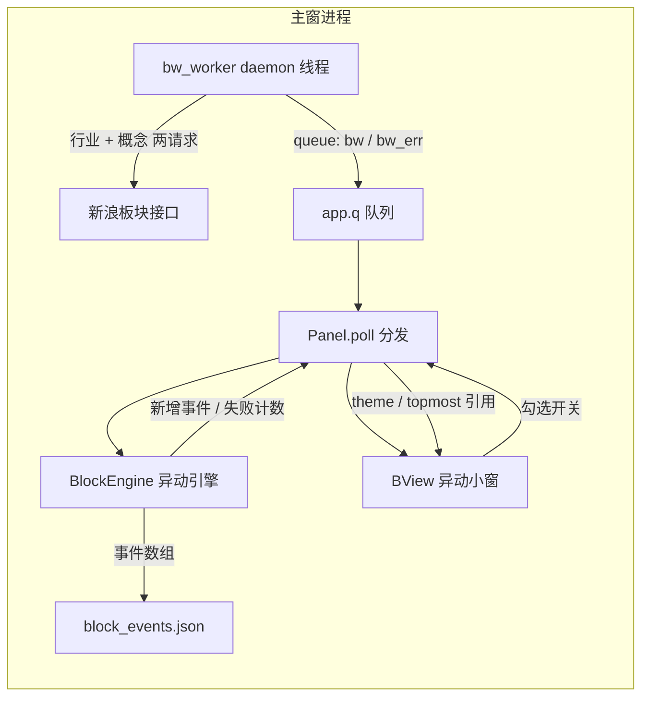
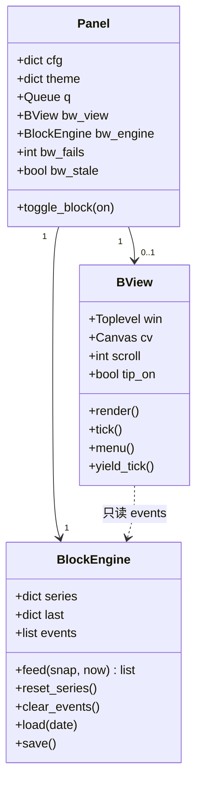
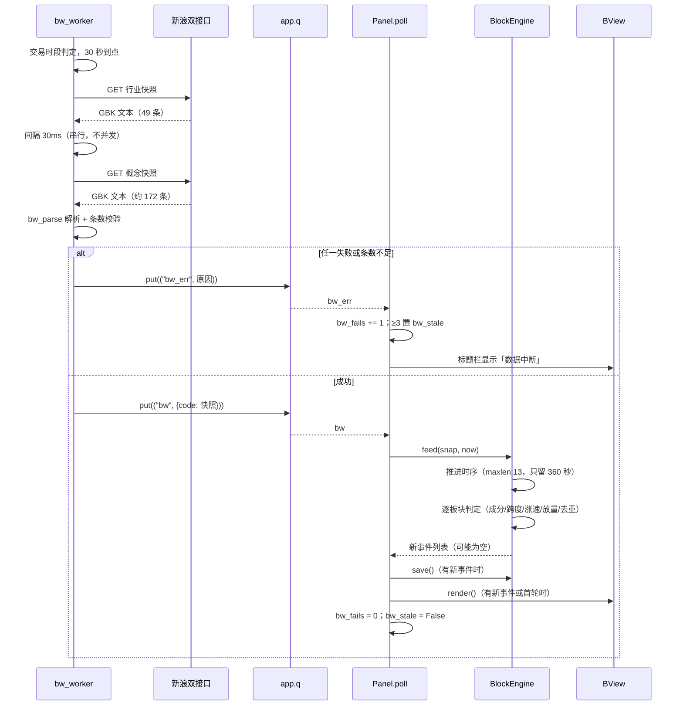
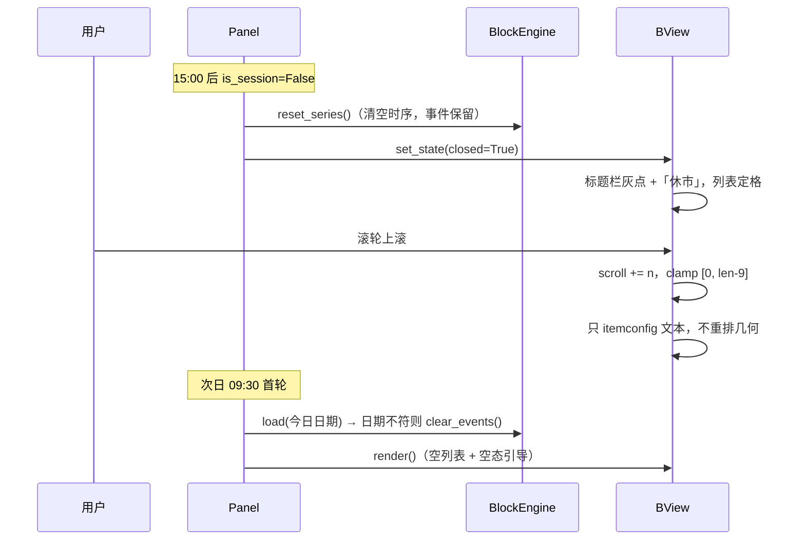
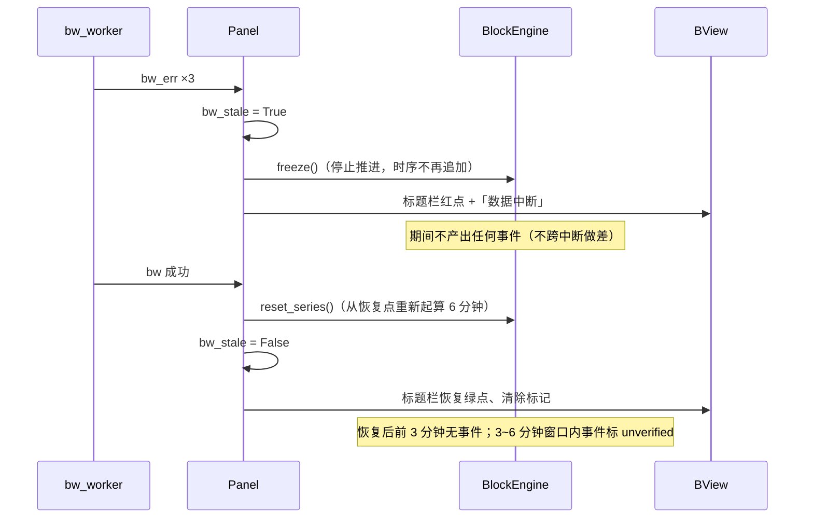

# SDD-盯盘君-板块异动-v1.0.0

## 1. 文档概述

### 1.1 文档信息

| 项 | 内容 |
| --- | --- |
| 项目名称 | 盯盘君 MarketEye |
| 文档版本 | v1.0.0 |
| 版本状态 | 未发布 |
| 创建日期 | 2026-11-16 |
| 更新日期 | 2026-11-16 |
| 基于需求 | [PRD-盯盘君-板块异动-v1.0.2](../../../需求文档/板块异动/v1.0.0/PRD-盯盘君-板块异动-v1.0.0.md) |
| 基于设计 | 无（全新模块，无旧版 SDD） |
| 基于原型 | [PROTO-盯盘君-板块异动-v1.0.0](../../../需求文档/板块异动/v1.0.0/PROTO-盯盘君-板块异动-v1.0.0.html)（用户已评审，具约束力） |

### 1.2 变更记录

| 版本 | 日期 | 变更人 | 变更类型 | 关联章节 | 变更内容 |
| --- | --- | --- | --- | --- | --- |
| v1.0.0 | 2026-11-16 | - | 新增 | — | 全新功能设计：新浪板块快照双接口采集（行业 + 概念）、本地 6 分钟滚动时序与 3 分钟窗口判定、去重与升档、事件落盘与跨日清空、无边框圆角小窗（340×420）与固定 9 行复用渲染、悬停指标说明、截图让位、右键菜单与位置记忆 |

### 1.3 技术选型

| 项 | 选择 | 理由 |
| --- | --- | --- |
| 语言与运行时 | Python 3.11（系统解释器，带 tkinter） | 与主窗一致，无新运行时 |
| 第三方依赖 | 无 | 项目铁律：仅标准库（`tkinter`/`urllib`/`json`/`re`/`collections`/`ctypes`） |
| GUI | tkinter `Toplevel` + 单 `Canvas` 自绘 | 与主窗、`SView` 同构 |
| 数据源 | 新浪板块快照双接口（行业 + 概念），GBK | 单轮 0.4 秒、无 key、无分页；东财需 12 页且并发即被断连（§3.2.1 取证） |
| 时序存储 | 内存 `deque(maxlen=13)`，不落盘 | 6 分钟窗口 13 点，重启后重新累积即可，落盘无收益 |
| 配置存储 | `config.json` 新增 `block_on`/`block_x`/`block_y` 三键；事件另存 `block_events.json`（当日覆盖） | 沿用 `load_json`/`save_json`；PRD M-03 约束：高频写配置会损坏配置，故事件与配置分离 |
| 窗口形状 | 颜色键透明 `-transparentcolor` + Canvas 自绘圆角 | 与主窗同款成熟方案；不用 `SetWindowRgn`（README 实现备注） |

### 1.4 文档目的

把 PRD 的「板块异动时间线」落成可编码的部件级设计，重点解决四件事：

1. **口径可算**：新浪不给涨速字段，3 分钟涨幅与两窗口成交额增量必须由本地时序算出，且窗口、跨度、抖动都要有明确判定。
2. **数据可信**：板块数随接口浮动（实测 221），解析要能扛字段错位、单接口失效、盘中停更。
3. **渲染不抖**：9 行列表每秒可见、每 30 秒可能整体位移，必须固定 item 复用，禁止 delete/create。
4. **生命周期收敛**：显隐、午休、跨日、断连四类状态与小窗标题标记一一对应，不留悬挂线程与残留存档。

模块职责范围：只做「板块级异动的识别与展示」，不做个股异动、不做板块下钻、不做多日回看（PRD 边界）。

## 2. 系统架构

### 2.1 整体架构



### 2.2 模块划分

| 模块 | 职责 | 边界 |
| --- | --- | --- |
| 解析层（模块级纯函数） | `bw_parse`（GBK 文本 → 板块字典）、`bw_lvl`（涨幅 → 档位）、`bw_dedup_key`（去重键） | 无 IO、无状态，selftest 直测 |
| 引擎层 `BlockEngine` | 维护 221 个板块的滚动时序、算 3 分钟窗口、判定放量、分级、去重升档、容量裁剪、事件落盘与跨日清空 | 不碰 tkinter、不发请求；输入是快照字典 + 时刻，输出是事件列表 |
| 取数层 `bw_worker` | 30 秒一轮拉取两个接口、时段感知、失败退避 | 只 put 队列，不触碰 UI 与引擎 |
| 窗口层 `BView` | 圆角小窗、9 行固定槽位渲染、滚动、拖动、右键菜单、悬停指标说明、截图让位、位置记忆 | 只读 `Panel.theme` 与引擎事件，不改主窗渲染路径 |
| 接线层（Panel 侧） | 菜单开关、poll 分支、失败计数、状态标记传递、退出联动 | 复用 `app.q`，不建第二条队列 |

### 2.3 分层职责

- **窗口与绘制层**：`BView` 单 Canvas 自绘。首次 `_layout` 建全部 item（标题栏 6 + 9 行 × 11 + 滚动条 2 = 107 个，行 item 已含各自分隔线，不另计），之后只 `itemconfig`/`coords`/`state`，**永不 delete/create 行 item**（闪烁主因）。仅两处例外：`_draw_body`（主题切换时整块重建 body 并 `tag_lower`）与指标说明浮层（tag `tip`，显隐即建删，不进列表区）。
- **行情获取层**：唯一新增网络活动，daemon 线程内两请求串行（间隔 30ms），异常全捕获，绝不进 tkinter 主线程。
- **配置与持久化层**：`config.json` 新增 `block_on`/`block_x`/`block_y`；事件单独写 `block_events.json`；沿用 `load_json`/`save_json` 与「缺键不写盘」纪律，存档写入 `os.replace` 原子替换（半截文件会导致当日记录全丢）。
- **交互层**：整窗拖动（Button-1/B1-Motion/ButtonRelease-1）、滚轮（`<MouseWheel>`）、问号悬停（`<Motion>`/`<Leave>`）、右键菜单三项、主窗菜单勾选开关。

### 2.4 界面区块地图

回链 PRD §2.4。小窗自上而下三个区块：

| 区块 | 元素 | 绘制函数 | 备注 |
| --- | --- | --- | --- |
| 标题栏（34） | 状态圆点 / 标题「板块异动」/ 问号入口 / 状态标记（休市·数据中断）/ 今日条数 | `_draw_header` | 圆点语义沿用主窗：绿=采集中、灰=休市、红=中断 |
| 时间线区（可变，可视 9 行） | 事件行 ×9（主行 + 副行）、行分隔线、滚动条轨道与滑块 | `_draw_rows`/`_draw_scrollbar` | 事件行不可点（PRD 明确纯展示） |
| 浮层（覆盖层） | 指标说明面板（标题 + 4 行口径 + 1 行注） | `_tip_show`/`_tip_hide` | 覆盖在时间线区之上，不占布局 |
| 小窗右键菜单（弹出层） | 清空今日记录 / 隐藏 / 重置位置 | `_mk_menu` + `menu()` | 走 ui-rules 强制规范：`_mk_menu` 建菜单、`_menu_cmd` 加项（每项挂透明占位图） |

主窗侧入口只有一处：右键菜单「板块异动」勾选行，位于「盘面速览」之后。小窗右键三项的行为见 §3.5「右键菜单」小节。

## 3. 详细设计

### 3.1 数据模型

`config.json` 新增键（其余键不动）：

```json
{
  "block_on": false,
  "block_x": null,
  "block_y": null
}
```

| 键 | 类型 | 默认 | 约束 | 说明 |
| --- | --- | --- | --- | --- |
| `block_on` | 布尔 | false | 仅 true/false | 小窗显隐，与菜单勾选态恒一致 |
| `block_x` | 整数 / null | null | 屏幕坐标 | null = 未拖动过，用默认位（主窗右侧，空间不足则左侧） |
| `block_y` | 整数 / null | null | 屏幕坐标 | 同上 |

事件存档 `block_events.json`（独立文件，当日覆盖）：

```json
{
  "date": "2026-11-16",
  "events": [
    {
      "ts": 1763260320.0, "t": "10:32", "code": "gn_bandaoti", "name": "半导体",
      "dir": "up", "pct": 1.8, "lvl": 2, "mult": 1.9, "unverified": false,
      "cur": 2.4, "lead": "中芯国际", "lead_pct": 5.2, "upgrade": false
    }
  ]
}
```

| 字段 | 类型 | 说明 |
| --- | --- | --- |
| `date` | 字符串 | 交易日 `YYYY-MM-DD`，与系统日期比对决定是否清空（R-19） |
| `ts` | 浮点 | 事件发生时刻（本地 `time.time()`），用于去重窗口与排序 |
| `t` | 字符串 | 展示用 `HH:MM`（落盘时固化，重启后不随格式化规则变化） |
| `code` | 字符串 | 板块代码（新浪 `new_xxx`/`gn_xxx`），去重键的一半 |
| `name` | 字符串 | 板块名 |
| `dir` | 字符串 | `up` / `down` |
| `pct` | 浮点 | 3 分钟涨幅（%），带符号 |
| `lvl` | 整数 | 档位下标 0/1/2 = 弱/中/强 |
| `mult` | 浮点 / null | 放量倍数；`null` 表示放量豁免（R-04） |
| `unverified` | 布尔 | 是否「未校验」（放量豁免产生的事件） |
| `cur` | 浮点 | 事件时刻该板块当前涨跌幅（%） |
| `lead` | 字符串 | 领涨股名 |
| `lead_pct` | 浮点 | 领涨股涨幅（%） |
| `upgrade` | 布尔 | 是否升档追加事件（R-06） |

内存状态：

| 位置 | 属性 | 类型 | 说明 |
| --- | --- | --- | --- |
| `Panel` | `bw_view` | `BView / None` | 小窗实例；隐藏即销毁（与 `SView` 同纪律） |
| `Panel` | `bw_engine` | `BlockEngine` | 常驻（即便小窗隐藏也保留已载入的当日事件，避免重复读盘） |
| `Panel` | `bw_thread` | `Thread / None` | 轮询 daemon，随开启创建、隐藏即止 |
| `Panel` | `bw_fails` | 整数 | 连续失败轮数，成功清零；≥3 转 STALE |
| `Panel` | `bw_stale` | 布尔 | 中断标记，供标题栏显示 |
| `BlockEngine` | `series` | `dict[str, deque]` | `code → deque[(ts, pct, amt)]`，`maxlen=13` |
| `BlockEngine` | `last` | `dict[str, tuple]` | `code → (ts, dir, lvl)`，去重窗口依据 |
| `BlockEngine` | `events` | `list[dict]` | 当日事件，索引 0 为最新（倒序） |
| `BView` | `scroll` | 整数 | 视口顶部对应的事件下标，0 = 最新 |
| `BView` | `tip_on` | 布尔 | 指标说明浮层是否展开 |
| `BView` | `_yielded` | 布尔 | 截图让位中 |



### 3.2 外部接口设计

#### 3.2.1 新浪板块快照（新增，两个 URL）

- **接口地址**：

| 类别 | 地址 | 变量名前缀 |
| --- | --- | --- |
| 行业 | `https://vip.stock.finance.sina.com.cn/q/view/newSinaHy.php` | `var S_Finance_bankuai_sinaindustry = ` |
| 概念 | `https://money.finance.sina.com.cn/q/view/newFLJK.php?param=class` | `var S_Finance_bankuai_class = ` |

- **请求方式**：GET，无参数（概念接口固定 `param=class`）；`User-Agent: Mozilla/5.0`、`Referer: https://finance.sina.com.cn/`。
- **返回报文**：JS 赋值语句，GBK 编码，形如 `var S_Finance_bankuai_sinaindustry = {"new_blhy":"new_blhy,玻璃行业,19,...","new_dzxx":"..."};`。不是 JSON，用正则取键值对，**不 eval、不 exec**。
- **单值字段（13 段，逗号分隔）**：

| 索引 | 含义 | 单位 | 本模块用法 |
| --- | --- | --- | --- |
| 0 | 板块代码 | — | 主键（`new_*` / `gn_*`） |
| 1 | 板块名 | — | 展示 |
| 2 | 成分股数 | 只 | `< 5` 跳过判定（PRD M-01 约束） |
| 3 | 均价 | 元 | 忽略 |
| 4 | 涨跌额 | 元 | 忽略 |
| 5 | **涨跌幅** | % | 涨速计算基准（本地做差） |
| 6 | 成交量 | 股 | 忽略 |
| 7 | **成交额** | 元（当日累计） | 放量判定（本地做差） |
| 8 | 领涨股代码 | — | 忽略 |
| 9 | 领涨股涨幅 | % | 展示 |
| 10 | 领涨股价 | 元 | 忽略 |
| 11 | 领涨股涨跌额 | 元 | 忽略 |
| 12 | 领涨股名 | — | 展示 |

- **解析约定**：`text.split(",")`；`len(f) > 13` 时把尾部用 `,` 合并回第 12 段（防股票名含英文逗号导致错位）；`len(f) < 13` 丢弃该条；`f[2]` 非整数或 `f[5]`/`f[7]` 非浮点丢弃该条。
- **实测基线（2026-11-16 10:28~10:33 盘中）**：

| 项 | 数值 |
| --- | --- |
| 行业条数 | 49（稳定） |
| 概念条数 | 172（**会浮动**，11-16 早间实测 161→172；数量以接口返回为准，实现不得写死） |
| 合计 | 221 |
| 单轮耗时 | 0.37~0.41 秒（两请求） |
| 35 秒成交额增量分位 | P50 0.096 亿 / P75 0.185 亿 / P90 0.338 亿 / max 2.38 亿（折算 3 分钟：P50 约 0.49 亿） |
| 35 秒涨跌幅变化 > 0.1% 的板块 | 13 / 221 |
| 成分股 < 5 的板块 | 1 个 |

- **阈值校准结论**：3 分钟增量 P50 约 0.49 亿，故 PRD 的 5000 万绝对下限落在中位偏上，作用是滤掉小板块与冷门概念，不会阻断主流板块；35 秒内仅 13 个板块涨幅变动超过 0.1%，印证 ±0.8%/3 分钟属「真异动」量级。
- **异常约定**：单请求超时 10 秒；任一请求失败、HTTP 非 200、解码失败、条数不达标（行业 < 40 或概念 < 120）一律**整轮失败**（不取半截数据，与 `SV` 的整轮作废同语义）；只许 daemon 线程调用。

#### 3.2.2 腾讯行情接口

零新增请求。异动小窗不读主窗行情数据（板块涨幅来自新浪自带字段），主窗与该功能唯一共享的是 `theme` 与 `topmost`。

### 3.3 业务流程

#### 3.3.1 主链路：采集到展示



#### 3.3.2 复盘链路：盘后回看



#### 3.3.3 边界链路：断连与恢复



### 3.4 业务规则

| PRD 规则 | 实现方案 |
| --- | --- |
| R-01 时序维护 | `BlockEngine.feed` 对每个板块 `series[code].append((ts, pct, amt))`；`deque(maxlen=BW_KEEP_N=13)` 自动淘汰，另在取窗口时按 `ts < now - BW_KEEP` 剔除（防 30 秒轮次抖动导致的点位错位）；同 code 同 ts 不重复追加（`ts` 相同直接覆盖最后一条） |
| R-02 涨速判定 | `diff = pct_now − pct_then`；`abs(diff) < BW_TH_PCT(0.8)` 直接返回；`span` 必须落在 `[BW_SPAN_MIN=165, BW_SPAN_MAX=195]` 秒（180 ± 15，容差半个采集周期，与 PRD F-01 输入字段口径一致）；超限即视为丢轮，本轮跳过该板块——丢轮时实际跨度为 210 秒，会把 3.5 分钟的涨幅当成 3 分钟报出去，宁可少报 |
| R-03 放量判定 | `inc1 = amt_now − amt_then`；再向历史找 `ts ≤ ts_then − 180` 的最近点算 `inc0 = amt_then − amt_then2`；该点同样要满足 `ts_then − ts_then2 ∈ [165, 195]`（前后窗对称校验，否则前窗跨度过大导致 inc0 偏大、比值偏低而漏报）；条件 `inc1 ≥ BW_TH_AMT(5e7)` 且 `inc1 / inc0 ≥ BW_TH_VOL(1.3)`；`mult` 保留 1 位小数展示。任一增量为负（数据抖动/接口回退）→ 本轮跳过该板块 |
| R-04 放量豁免 | `inc0` 不可用（时序不足 6 分钟、`inc0 ≤ 0`、前窗跨度越界、成交额回退）→ 放量视为满足，`mult=None`、`unverified=True`；展示为「放量 — 未校验」。**涨速仍必须有满 3 分钟跨度**，故开盘/复牌前 3 分钟不出事件。`inc0 ≤ 0` 属 PRD 未覆盖的外延，按不可用处理（D11）。**预期量级**：开盘或复牌后第 3~6 分钟，凡 3 分钟涨幅 ≥ 0.8% 的板块都会产出 unverified 条，去重只拦同板块，故首波可能成批出现数十条——这是 PRD R-04 的既定行为，不是缺陷；若实测刷屏影响可用性，后续再议收紧（不在本次范围） |
| R-05 强度分级 | `bw_lvl(pct)` 纯函数：`a=abs(pct)`；`a < 1.5` → 0（弱）、`a < 2.5` → 1（中）、否则 2（强）。左闭右开，2.5 归强 |
| R-06 去重与升档 | `last[code] = (ts, dir, lvl)`；同 `dir` 且 `now − ts < BW_DEDUP(600)`：当前 `lvl > 上次 lvl` → 产出 `upgrade=True` 事件并刷新 `last`；`lvl ≤ 上次` → 丢弃。方向反转：不受窗口约束，直接产出并刷新 `last`。存档事件同样参与去重（重启后不清 `last`：由 `load` 从事件列表重建最近一条） |
| R-07 方向定义 | `dir = "up" if diff > 0 else "down"`；涨速绝对值 ≥ 0.8% 保证不会为 0，无需额外分支 |
| R-08 列表容量 | 新增后 `if len(events) > BW_MAX(200): del events[200:]`；计数显示 `len(events)`（实际保留条数），不显示累计产出数 |
| R-09 排序 | 新事件 `events.insert(0, ev)`；同一轮多板块触发时**按 `abs(pct)` 升序**逐条 `insert(0, …)`（倒插后首行为最强者，时刻相同故用强度作次级序；若按降序遍历会得到反向结果，编码时注意） |
| R-10 位置记忆 | `drop` 落盘 `block_x/block_y`（`save_json`）；创建时读回并钳制 `max(0, min(x, sw−W))`、`max(0, min(y, sh−H))` |
| R-11 置顶与主题跟随 | `BView.tick`（1 秒）比对 `cfg["topmost"]` 与 `Panel.theme` 对象引用，变化即 `attributes("-topmost")` / 全量重绘（含 `_draw_body`） |
| R-12 截图让位 | 复用模块级 `foreign_fullscreen()`（已含 Shell 类名排除，BUG-12 修复），独立 250ms `_yield_tick` 链；命中即 `withdraw()`，退出后 `deiconify()` + 显式重设 geometry/topmost；拖动中不让位 |
| R-13 标题栏状态标记 | 三段状态由 Panel 单向驱动：`bw_stale` → 红点 +「数据中断」；`not is_session` → 灰点 +「休市」；否则绿点 + 无标记。中断优先于休市 |
| R-14 清空记录 | 菜单项 → `engine.clear_events()` + 存档写空数组 + `render()`；**不清时序、不清 `last`**（PRD 明确：避免清空后立刻重报同一次异动） |
| R-15 失败降级 | `bw_fails += 1`（成功清零）；`≥ BW_FAIL_LIMIT(3)` 置 `bw_stale` 并 `freeze()`（时序停推），列表保持不动 |
| R-16 恢复重建 | 三种情形共用 `reset_series()`：① `bw_stale` 为真且本轮成功（中断恢复）；② `toggle_block(True)` 重新显示（PRD 状态机 HIDDEN→LIVE 明确要求清时序）；③ 跨日/复牌（见 R-17、R-19）。**②不可省**：盘中取消勾选 4 分钟再勾选，`series` 里仍是隐藏前的旧点，取到 span≈240 秒的点会被误当成 3 分钟窗口，把跨隐藏间隙的涨幅报成一次异动 |
| R-17 收盘冻结 | worker 以 `is_session` 门控（采集与时序推进**同一个函数**）；非时段定格最后状态、清时序、不发请求；`bw_engine.events` 原样保留 |
| R-18 事件落盘 | poll 分支内同步写（文件 < 60KB，耗时 < 2ms），写临时文件再 `os.replace` 原子替换；失败仅记日志不阻断展示 |
| R-19 跨日清空 | 启动时由 `Panel.__init__` 调 `engine.load(today)`；运行期跃变由 `bw_worker` 检测（函数内局部变量 `_last_day`，`is_session` 首次为真且日期与 `_last_day` 不同时 put `("bw_day", today)`），`Panel.poll` 收到 `bw_day` 后调 `load/clear` 并 `render()`。`date` 不符 → `clear_events()` 并覆盖存档；同 `date` → 恢复列表与计数 |
| R-20 指标说明 | 问号命中判定用矩形热区（`self.hot["qi"]`）；展开时在 Canvas 内以 tag `tip` 绘制面板（矩形 + 边框 + 6 个 text），`tag_raise` 到顶层；`<Leave>`、拖动、让位、滚轮一律 `tip_hide()`；内容取常量 `BW_TIP_ROWS`，与 R-02/R-03/R-05/R-06 同源，改阈值只动常量 |
| M-01 全量约束 | 两个接口都必须成功且条数达标，否则整轮失败；不按成交额截断 |
| M-02 小窗约束 | 位置/显隐落盘失败静默；出屏收回双处钳制；显隐以实际状态回写菜单勾选 |
| M-03 数据约束 | 请求串行 + 30ms 间隔；收盘零请求；中断/休市不跨做差（`reset_series`）；存档不写 `config.json` |

### 3.5 界面设计

PROTO 为准：[PROTO-盯盘君-板块异动-v1.0.0](../../../需求文档/板块异动/v1.0.0/PROTO-盯盘君-板块异动-v1.0.0.html)。本节只写技术层：元素树、槽位坐标、状态变量、与绘制函数的映射。

**窗口骨架**

- `Toplevel(app.root)` + `overrideredirect(True)` + `attributes("-transparentcolor", KEY)`：KEY 取主窗同款色键常量。Toplevel **不继承**主窗的透明色，必须显式设置（项目既有踩坑记录）。
- `Canvas(bg=KEY, highlightthickness=0)` 铺满；所有可见内容自绘。
- 尺寸：`W = px(340)`、`H = px(420)`、`head = px(34)`、`row = px(39)`、`vis = 9`、圆角 `r = px(16)`。
- 圆角：沿用主窗 `_draw_body` 手法——竖中带 + 横中带 + 四个 1/4 `pieslice` 拼出圆角矩形（bg），标题栏另叠一条带 + 两个 1/4 圆盘（head），全部 `tag="body"` 后 `tag_lower("body")`。禁用 `SetWindowRgn`。
- 默认位置：`x = 主窗 x + 主窗宽 + px(8)`；若 `x + W > 屏宽` 则改放主窗左侧 `x = 主窗 x − W − px(8)`；再出界则落到 `屏宽 − W − px(8)`。`y` 与主窗顶端对齐。

**槽位坐标（逻辑像素，`px()` 换算后取整）**

> 表中 y 为文字中心线的设计值，编码时按实际字体 ascent/descent 微调 ±1~2px；x 为定值，不随内容变化（列对齐靠固定槽位，不靠逐项测量累加）。

| 元素 | 锚点 | x | y | 字体/色 |
| --- | --- | --- | --- | --- |
| 状态圆点 | 圆心 | `14 + 3` | `head/2` | 直径 6，绿/灰/红 |
| 标题 | w | `27` | `head/2` | `f_cn` 9 粗，`text` |
| 问号圆环 | 左上 | `27 + 标题宽 + 7` | `head/2 − 6.5` | 13×13 圆环，`line` 描边，`sub` 字 |
| 状态标记 | e | `W − 14 − 条数宽 − 9` | `head/2` | `f_s` 8，`sub`（中断时 `fail` 色） |
| 今日条数 | e | `W − 14` | `head/2` | `f_num` 8，`sub` |
| 行时刻 | w | `14` | 行首 + 8 | `f_num` 8，`sub`（宽 44 定槽） |
| 行箭头 | w | `58` | 同上 | `f_cn` 9，`up`/`down` |
| 行板块名 | w | `74` | 同上 | `f_cn` 10，`name`；超宽按 `measure` 截断加 `…` |
| 升级标签 | 板块名右侧 +4 | 动态 | 行首 + 6 | 矩形描边 `line` + `f_s` 7 字「升级」 |
| 行涨幅 | e | `W − 14` | 行首 + 8 | `f_num` 10 粗，`up`/`down` |
| 副行·档位 | w | `74` | 行首 + 24 | `f_cn` 8，`sub`（宽 13 定槽，仅「弱/中/强」） |
| 副行·放量 | w | `74 + 13 + 9` | 同上 | `f_cn` 8，`sub`（宽按「放量 9.9x」测） |
| 副行·当前/未校验 | w | 放量列右侧 +9 | 同上 | `f_cn` 8，`sub` |
| 副行·领涨股 | e | `W − 14` | 同上 | `f_cn` 8，`sub`；超宽从左侧截断（保涨幅） |
| 行分隔线 | — | `14 → W − 14` | 行尾 | 1px `line` |
| 滚动条轨道 | — | `W − 9` | `head` | 宽 8，`line` 圆角矩形 |
| 滚动条滑块 | — | `W − 9` | 动态 | 宽 8，`bar` 色，高度按 `vis/len` 比例，最小 20 |

**行内 item 复用表**

每行固定 11 个 item，`self.rows[i]` 存 id 字典：`t/arw/name/tag_box/tag_txt/pct/lvl/amt/cur/lead/sep`。渲染时逐行取事件 `ev = events[scroll + i]`，越界则整行 `state="hidden"`（含分隔线），不 delete。

**状态变量**

| 变量 | 含义 | 何时变 |
| --- | --- | --- |
| `scroll` | 视口顶部事件下标 | 滚轮、新增事件 |
| `tip_on` | 指标说明浮层展开 | 悬停问号、离开、拖动、让位 |
| `_dragging` | 拖动中 | Button-1 / ButtonRelease-1 |
| `_yielded` | 截图让位中 | `_yield_tick` |
| `closed` / `stale` | 状态标记来源 | Panel 单向驱动 |

**新增事件与滚动位置的交互（PRD M-02 约束）**

`render()` 前比对 `len(events)` 增量：

- `scroll == 0`（视口在顶部）→ 保持 0，新事件自然出现在首行。
- `scroll > 0`（用户在看历史）→ `scroll += 增量`，再钳制 `scroll = min(scroll, max(0, len(events) − BW_VIS))`。**钳制不可省**：事件达 200 条上限后尾部持续裁剪，若只加不减，滚到最老处再新增会导致 `scroll > len − 9`，视口下半整行空白、内容跳变（违反 PRD M-02）。滚轮路径同样按此区间 clamp。

**右键菜单（R-10/R-14）**

`<Button-3>` 弹菜单（`_mk_menu(self.win)` + `_menu_cmd` 三项，配色取自 THEMES），三点行为：

| 菜单项 | 行为 | 落点 |
| --- | --- | --- |
| 清空今日记录 | `Panel.bw_clear()`：引擎清事件 + 存档写空数组 + `render()`；**不清时序、不清 `last`** | R-14 |
| 隐藏 | `Panel.toggle_block(False)`：写 `block_on=false`、停 worker、销毁窗口、回写主窗菜单勾选态 | M-02（显隐与勾选态恒一致） |
| 重置位置 | 从 `cfg` 删 `block_x`/`block_y` → `save_json` → 按默认位重算 `geometry`（不动 `block_on`） | R-10 |

**悬停指标说明（R-20）**

热区 `self.hot["qi"] = (x1, x2, y1, y2)`，`<Motion>` 命中且 `not tip_on` 时展开（无延时，与 `SView` 的 300ms 防误触不同：问号是明确的可点元素，延时反而迟钝）。浮层内容固定 5 行（标题 + 4 项 + 注），宽度 `W − 2 × 14`，高度按 5 行 `measure` 实测；圆角矩形 `r = px(8)` 同样用拼圆角手法。

**截图让位（R-12）**

`_yield_tick` 250ms 独立链，`foreign_fullscreen()` 为真 → `win.withdraw()`；退出 → `deiconify()` + 重设 `geometry(f"{W}x{H}+{x}+{y}")`。让位期间 `tip_hide()`。

**视觉 token**

全部取自 `THEMES`（`bg`/`head`/`line`/`text`/`sub`/`name`/`up`/`down`/`flat`/`bar`/`fail`）。红涨绿跌不反置。档位不着涨跌色（PRD R-20 明确）。

### 3.6 错误处理定义

| 场景 | 处理 | 提示方式 | 日志 |
| --- | --- | --- | --- |
| 单请求超时/非 200/解码失败 | 整轮失败 | `bw_fails += 1`；≥3 标题栏红点 +「数据中断」 | `_dbg("bw {kind} 失败: {ex!r}")` |
| 条数不达标（行业 <40 / 概念 <120） | 按整轮失败处理 | 同上 | `_dbg("bw 条数可疑 hy={a} gn={b}")` |
| 单条解析失败（段数不足/数值非法） | 丢弃该条，其余照常 | 静默（不降级整轮） | 累计超 20 条记一次 |
| 成交额回退（本轮 amt < 上轮） | 该板块本轮跳过判定，不追加时序 | 静默 | 无 |
| 存档读取失败/JSON 坏 | 视为无存档，从空列表开始 | 静默 | `log_once("block_events 读取失败")` |
| 存档写入失败 | 展示照常，不阻断 | 静默 | `log_once("block_events 写入失败")` |
| 位置落盘失败 | 显隐照常 | 静默 | `log_once("block save 失败")` |
| worker 线程异常逃逸 | 函数级 try/except 全包，不中断循环 | 静默 | `_dbg("bw worker {ex!r}")` |
| 渲染时事件字段缺失（旧存档格式升级） | `ev.get(k, 默认值)` 兜底，缺 `upgrade` 按 False | 静默 | 无 |

### 3.7 其他设计

#### 3.7.1 常量定义

| 名称 | 取值 | 说明 |
| --- | --- | --- |
| `BW_URL_HY` | `https://vip.stock.finance.sina.com.cn/q/view/newSinaHy.php` | 行业快照 |
| `BW_URL_GN` | `https://money.finance.sina.com.cn/q/view/newFLJK.php?param=class` | 概念快照 |
| `BW_INTERVAL` | `30` | 采集周期（秒，系统内定，不暴露配置） |
| `BW_IDLE_CHECK` | `5` | 非交易时段状态自检间隔（秒） |
| `BW_REQ_GAP` | `0.03` | 两请求间隔（秒，串行防限流） |
| `BW_TIMEOUT` | `10` | 单请求超时（秒） |
| `BW_MIN_HY` | `40` | 行业条数下限（实测 49） |
| `BW_MIN_GN` | `120` | 概念条数下限（实测 172，留足浮动余量） |
| `BW_KEEP` | `360` | 时序保留（秒，6 分钟） |
| `BW_KEEP_N` | `13` | 时序最大点数（360/30 + 1） |
| `BW_WIN` | `180` | 判定窗口（秒，3 分钟） |
| `BW_SPAN_MIN` | `165` | 窗口跨度下限（秒，180 − 15，容差半个采集周期，PRD F-01） |
| `BW_SPAN_MAX` | `195` | 窗口跨度上限（秒，180 + 15，同上；超上限即视为丢轮，本轮跳过该板块） |
| `BW_TH_PCT` | `0.8` | 涨速阈值（%，PRD R-02） |
| `BW_TH_VOL` | `1.3` | 放量倍数阈值（PRD R-03） |
| `BW_TH_AMT` | `5e7` | 放量绝对下限（元，5000 万，PRD R-03） |
| `BW_LVL_MID` | `1.5` | 中档下限（%，PRD R-05） |
| `BW_LVL_STRONG` | `2.5` | 强档下限（%，PRD R-05） |
| `BW_DEDUP` | `600` | 同向去重窗口（秒，10 分钟） |
| `BW_MAX` | `200` | 当日事件上限（PRD R-08） |
| `BW_MIN_MEMBERS` | `5` | 板块最小成分股数（PRD M-01） |
| `BW_FAIL_LIMIT` | `3` | 连续失败转中断（PRD R-15） |
| `BW_W` | `340` | 窗口宽（逻辑像素） |
| `BW_H` | `420` | 窗口高 |
| `BW_HEAD` | `34` | 标题栏高 |
| `BW_ROW` | `39` | 单行高（主行 16 + 间隔 1 + 副行 13 + 留白 9） |
| `BW_VIS` | `9` | 可视行数 |
| `BW_R` | `16` | 窗口圆角半径 |
| `BW_TIP_ROWS` | tuple | 指标说明 4 行口径文本（与 R-02/03/05/06 同源） |

#### 3.7.2 纯函数与设计期裁决

| 名称 | 签名 | 行为描述 |
| --- | --- | --- |
| `bw_parse` | `(text, kind) -> dict / None` | GBK 文本 → `{code: {"name","members","pct","amt","lead","lead_pct"}}`；条数不足返回 None；单条非法丢弃 |
| `bw_lvl` | `(pct) -> int` | `abs(pct) < 1.5` → 0；`< 2.5` → 1；否则 2 |
| `bw_window` | `(series, now, win) -> tuple / None` | 在 deque 中定位 `ts ≤ now − win` 的最近点，返回 `(pct_then, amt_then, span)`；无满足点返回 None |
| `bw_verdict` | `(diff, pct_now, inc1, inc0) -> tuple` | 单板块判定：返回 `(hit, lvl, mult, unverified)`；`hit=False` 表示不构成事件 |
| `is_session` | `(now=None) -> bool` | 新增：`9:30 ≤ t ≤ 11:30` 或 `13:00 ≤ t ≤ 15:00` 且非周末。与既有 `is_trading`（551）并列，互不替代（D8） |

| 裁决 | 内容 | 理由 |
| --- | --- | --- |
| D1 选新浪作唯一主源 | 东财 `push2` 覆盖更全（496+554）但需 12 页串行约 4 秒，且 11 线程并发直接被 `RemoteDisconnected` | 30 秒一轮、两请求 0.4 秒是硬需求；东财仅在注释中记为备选，不实现 |
| D2 圆角用颜色键 + 自绘 | 与主窗同款（竖中带 ∪ 横中带 ∪ 四角 pieslice），全程不用 `SetWindowRgn` | 项目圆角血泪史明确：设过窗口区域后缩放露出的区域永不重绘 |
| D3 判定引擎独立成 `BlockEngine` | 不写进 `BView`，不写进 `Panel.tick` | 221 板块 × 13 点的判定是可纯测逻辑，塞进 UI 类后无法 selftest |
| D4 时序用 `deque(maxlen=13)` | 不做列表切片裁剪 | 221 个 deque 追加是 O(1)；列表裁剪每轮 221 次 O(n) 无必要 |
| D5 事件落盘独立文件 | `block_events.json`，不写 `config.json` | 每产生一条事件就写盘，配置承受不起；PRD M-03 明确约束 |
| D6 固定 9 行 item 复用 | 首次建 99 个行 item，之后只 `itemconfig`/`state` | 删除重建会整块闪白，且每秒可见的窗口闪一下极刺眼 |
| D7 指标说明画在 Canvas 内 | 不开第二个 Toplevel | 浮层完全在小窗内部，无越界；省掉穿透、置顶、让位三套联动 |
| D8 采集与时序统一用新增 `is_session`，**不复用** `is_trading` | `is_trading`（既有，9:15~11:35 / 12:55~15:10）含集合竞价缓冲，是为主窗「竞价时也能显示行情」设计的；`is_session`（**新增**，9:30~11:30 / 13:00~15:00）只认连续竞价 | 若沿用 `is_trading`，9:15~9:30 的竞价快照会进时序，9:30 开盘瞬间拿竞价价当 3 分钟基准，一次刷出几十条假异动。两者只差 15 分钟，但对本功能是致命的 |
| D9 概念板块数量不写死 | 以接口返回为准，仅做下限校验（≥120） | 实测 11-16 早间从 161 变 172，写死会让校验与验收一起错 |
| D10 涨速必须有满窗跨度 | `span` 不在 [165,195] 秒（180 ± 15）一律跳过该板块 | 丢轮/卡顿会让"3 分钟"变成"8 分钟"，宁可少报不可错报 |
| D11 `inc0 ≤ 0` 按不可用处理 | 前窗成交额增量为 0 或负时，倍数无定义，走 R-04 豁免（unverified） | PRD R-04 只写「时序不足 6 分钟」，未覆盖除零与数据回退；两者都不能算出一个可信的倍数，归入豁免比强行判「不放量」更符合「未校验」的语义 |

#### 3.7.3 线程与定时器

| 机制 | 节奏 | 说明 |
| --- | --- | --- |
| `bw_worker` daemon | `is_session` 为真时 30 秒/轮；为假时 5 秒自检、**不发任何请求**（采集与时序推进同一门控，D8） | 循环条件 `not Panel.stop and Panel.bw_view 存在`；异常全包不退出 |
| `BView.tick` | 1 秒 | 只比对主题引用与 topmost，变化才重绘；不读网络、不重算判定 |
| `BView._yield_tick` | 250ms | 截图让位检测；只做一次 `GetForegroundWindow` + `GetWindowRect` |
| `Panel.poll` 新分支 | 250ms 既有循环 | `bw`/`bw_err`/`bw_day` 三个 kind，独立 try，只写状态与触发渲染（`bw_day` 见 R-19） |
| 存档写入 | 事件驱动（新增/清空时） | 同步写 + `os.replace`，文件小、频率低（最坏一天 200 次） |

#### 3.7.4 selftest 扩展

- `bw_parse`：构造含 13 段/14 段（股票名带逗号）/12 段（残缺）的样本，断言解析条数、名称合并、非法条丢弃；条数低于下限返回 None。
- `bw_lvl`：边界断言 0.79→0、0.8→0、1.49→0、1.5→1、2.49→1、2.5→2、−2.6→2（绝对值）。
- `is_session`：9:29→False、9:30→True、11:30→True、11:31→False、12:59→False、13:00→True、15:00→True、15:01→False、周六任意时刻→False。
- `bw_window`：构造 13 点、10 点、4 点序列，断言 3 分钟取点位置、`span` 计算、时序不足返回 None。
- `bw_verdict`：四组断言——涨速不够（不中）、涨速够但放量不足（不中）、双条件满足（中，mult 正确）、前窗不可用（中，`unverified=True`）。
- `BlockEngine.feed`：三连场景断言——首次达标产出 1 条；10 分钟内同向不重复；升档产出 `upgrade=True`；方向反转立记；跨 10 分钟可再记。
- `BlockEngine` 容量：构造 210 条断言裁剪到 200 且保留最新。
- 存档往返：`save` → `load` 同日期恢复条数与字段；异日期清空。

### 3.8 功能点追溯

| PRD 功能点 | 技术产物 |
| --- | --- |
| F-01 异动识别 | `bw_parse`/`bw_lvl`/`bw_window`/`bw_verdict`（§3.7.2）、`BlockEngine.feed`（§3.4 R-01~R-09）、时序结构（§3.1）、常量（§3.7.1）、`is_session`（§3.7.2）、T002/T004/T012 |
| F-02 异动小窗 | `BView`（§3.5）、`block_on/x/y`（§3.1）、`Panel.toggle_block` + 菜单项（§3.3.1/§2.4）、R-10~R-14/R-20（§3.4）、T005/T008/T010/T011 |
| F-03 数据刷新与容错 | `bw_worker`（§3.2.1/§3.7.3）、poll `bw`/`bw_err`/`bw_day` 分支（§3.3.3/§3.4 R-19）、失败计数与 freeze（§3.4 R-15~R-19）、T003/T007/T009 |

## 4. 代码位置

行号基于 `ticker.pyw` 当前版本（8465 行），编码时以符号检索为准。

### 4.1 程序逻辑

| 代码位置 | 对应设计 |
| --- | --- |
| `ticker.pyw:179`（`SV_H` 一带的常量块）后 | 新增 `BW_*` 常量（T001） |
| `ticker.pyw:551`（`is_trading`）后 | 新增 `is_session`（T002） |
| `ticker.pyw:503`（`sv_amt_diff_text`）后的模块级函数区 | 新增 `bw_parse`/`bw_lvl`/`bw_window`/`bw_verdict`（T002） |
| `ticker.pyw:1075`（`fetch_sina_hs`）附近取数区 | 新增 `bw_worker`（T003） |
| `ticker.pyw:4209`（`SView` 类）前 | 新增 `BlockEngine` 类（T004） |
| `ticker.pyw:1578` 附近（`__init__` 状态区） | `bw_*` 状态初始化（T005） |
| `ticker.pyw:3391`（`Panel.poll`） | 新增 `bw`/`bw_err` 分支 + `_bw_apply`（T009） |
| `ticker.pyw:3903`（`toggle_sview`）后 | 新增 `Panel.toggle_block`/`_refresh_block_menu`（T008） |
| `ticker.pyw:4045`（`reload`） | `block_on` 重读并重建小窗与线程（T008） |
| `ticker.pyw:8071`（`selftest`） | 断言段扩展（T012） |

### 4.2 界面绘制

| 代码位置 | 对应设计 |
| --- | --- |
| `ticker.pyw:4872`（`KlineWin`）前、`SView` 类之后 | 新增 `BView` 类整段（T006/T010/T011） |
| `ticker.pyw:2830`（`_build_menu` 的「盘面速览」块）之后 | 新增「板块异动」勾选行（T008） |
| `ticker.pyw:3470`（`Panel._tick`） | 不改动（小窗自身 1 秒 tick 负责主题/置顶比对） |

### 4.3 配置与脚本位置

| 代码位置 | 对应设计 |
| --- | --- |
| `config.json` | 新增 `block_on`/`block_x`/`block_y`（§3.1，T001/T008） |
| `block_events.json`（程序目录，运行时生成） | 当日事件存档（§3.1，T004） |
| `启动盯盘.bat` | 不变 |

## 5. 依赖关系

| 既有模块 | 影响 | 说明 |
| --- | --- | --- |
| 主窗行情刷新 | 无 | 不读主窗 `data`，板块涨幅来自新浪快照 |
| 盘面速览 `SView` | 无（仅复用探测函数） | 复用模块级 `foreign_fullscreen()`；窗口类互不相干 |
| 两市成交额块 | 无 | 不共用基准 |
| 自选分页 / 折叠轮播 | 无 | 独立 Toplevel，不触主窗几何 |
| 主题切换 | 正向跟随 | `BView.tick` 读 `Panel.theme` 引用，主窗换主题后自动跟随 |
| 主窗退出 | 联动退出 | Toplevel 随 root 销毁；worker 循环条件含 `Panel.stop` |
| `is_trading`（551） | **不复用** | 其 9:15 起的竞价缓冲会污染 3 分钟基准，本功能另建 `is_session`（新增，见 §3.7.2/D8）；不改动原函数，主窗行为不受影响 |

## 6. 部署配置

### 6.1 环境要求

Windows 10/11、Python 3.11（tkinter 内置）、可访问 `vip.stock.finance.sina.com.cn` 与 `money.finance.sina.com.cn`；DPI 缩放 100%~200%（沿用 `px()` 体系）。

### 6.2 关键配置项

`config.json` 新增三键：`block_on`（默认 false，升级用户零感知）、`block_x`/`block_y`（默认 null = 主窗右侧）。无环境变量、无命令行参数（沿用 `--selftest`）。

### 6.3 发布配置清单

发布包无需新增文件（存档运行时生成）；README 功能清单补「板块异动」一行；示例 `config.json` 可选补三键。

## 7. 模块间交互

`Panel` 持有 `BlockEngine`（常驻）与 `BView`（可销毁）。数据单向：`bw_worker` → `app.q` → `Panel.poll` → `BlockEngine.feed` → `Panel` 触发 `BView.render()`。`BView` 只读 `engine.events` 与 `app.theme`，不回写引擎状态；唯一反向依赖是小窗右键「清空今日记录」调 `Panel` 提供的回调（由 Panel 转调引擎，保持单向）。

风险缓解：接口不可用 → 沿用旧快照 + 3 轮后转中断（不影响主窗）；概念板块数量浮动 → 只做下限校验不写死；小窗常驻 30 秒一轮的网络开销约 30KB/轮，全天不到 30MB，对主窗刷新无影响。

## 8. 文档依赖

- [PRD-盯盘君-板块异动-v1.0.2](../../../需求文档/板块异动/v1.0.0/PRD-盯盘君-板块异动-v1.0.0.md)（需求基线）
- [PROTO-盯盘君-板块异动-v1.0.0](../../../需求文档/板块异动/v1.0.0/PROTO-盯盘君-板块异动-v1.0.0.html)（视觉基线，具约束力）
- [doc-templates.md](../../../rules/doc-templates.md) §5.2（骨架）
- [ui-rules.md](../../../rules/ui-rules.md)（配色 token、右键菜单必须走 `_mk_menu`/`_menu_cmd`）
- [SDD-盯盘君-盘面速览-v1.0.0](../盘面速览/v1.0.0/SDD-盯盘君-盘面速览-v1.0.0.md)（`foreign_fullscreen`、Toplevel 透明色、颜色键圆角三处先例）
- README「实现备注」（圆角与 `SetWindowRgn` 教训）

## 9. 版本影响分析

改动文件仅 `ticker.pyw`（常量 + 4 个纯函数 + `BlockEngine` 类 + `BView` 类 + worker + Panel 接线，预估 +780 行）与 `config.json`（3 新键）；运行时新增 `block_events.json`。无依赖变更、无破坏性变更（`block_on` 缺省 false，升级用户行为不变）。风险与缓解：新浪板块接口改版 → 条数下限 + 单条丢弃双保险；概念数继续浮动 → 不写死、只做下限；30 秒轮询被限流 → 两请求串行 + 30ms 间隔，失败静默降级；圆角重绘闪烁 → 固定 item 复用 + body 单独 tag。

## 10. 任务清单

| 编号 | 关联设计 | 变更类型 | 代码位置 | 说明 | 对应功能点 | 状态 |
| --- | --- | --- | --- | --- | --- | --- |
| T001 | §3.7.1/§3.1 | 新增 | 常量区（179 后） | `BW_*` 常量 29 项 + `block_*` 三键读写（缺键不写盘）；`is_session` 归 T002 | F-01/F-02 | 待编码 |
| T002 | §3.7.2 | 新增 | `is_trading`（551）后、模块级函数区（503 后） | `is_session` + `bw_parse`/`bw_lvl`/`bw_window`/`bw_verdict` 纯函数 | F-01/F-03 | 待编码 |
| T003 | §3.2.1/§3.3.1 | 新增 | 取数区（1075 附近） | `bw_worker`：30 秒轮询、双请求串行、整轮失败语义、`is_session` 时段门控、`_last_day` 局部变量跃变检测并上报 `bw_day` | F-03 | 待编码 |
| T004 | §3.4/§3.1 | 新增 | `SView`（4209）前 | `BlockEngine`：时序/判定/去重升档/容量/落盘/跨日 | F-01/F-03 | 待编码 |
| T005 | §3.1 | 新增 | `__init__`（1578 区段） | `bw_*` 状态初始化 + 启动装载存档 | F-02/F-03 | 待编码 |
| T006 | §3.5 | 新增 | `SView` 类后 | `BView` 骨架：圆角窗口、槽位布局、9 行 item、滚动、拖动、右键 | F-02 | 待编码 |
| T007 | §3.4 R-18/R-19 | 新增 | `BlockEngine` 内 | 存档原子写、按日期装载与清空 | F-03 | 待编码 |
| T008 | §2.4/§3.4 R-10~R-14 | 新增 | `_build_menu`（2830 后）、`toggle_sview`（3903 后）、`reload`（4045） | 菜单勾选行 + `toggle_block` + 置顶/重载接线 | F-02 | 待编码 |
| T009 | §3.3.1/§3.3.3 | 新增 | `Panel.poll`（3391） | `bw`/`bw_err`/`bw_day` 三分支 + `_bw_apply` 失败计数与 freeze + 跨日装载清空 | F-03 | 待编码 |
| T010 | §3.5 | 新增 | `BView` 内 | 事件行渲染（主行/副行/升级标签/未校验）+ 滚动位置保持 | F-02 | 待编码 |
| T011 | §3.5/§3.4 R-20 | 新增 | `BView` 内 | 指标说明浮层（Canvas 内 tag `tip`）+ 问号热区 | F-02 | 待编码 |
| T012 | §3.7.4 | 修改 | `selftest`（8071） | 6 组纯函数与引擎断言 | F-01/F-03 | 待编码 |
| T013 | §5/§8 | 验证 | — | 回归：主窗/盘面速览 selftest + 界面实测 AC-01~36 | F-01/F-02/F-03 | 待测试 |
| T014 | §9 | 修改 | `README.md` | 功能清单补「板块异动」 | F-02 | 待编码 |
