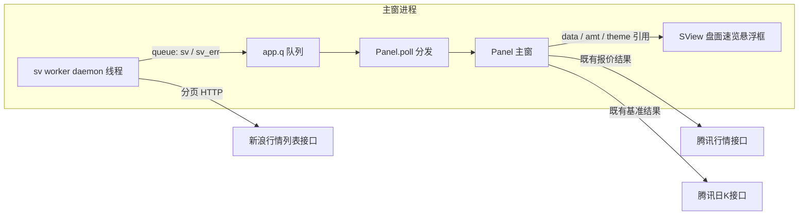
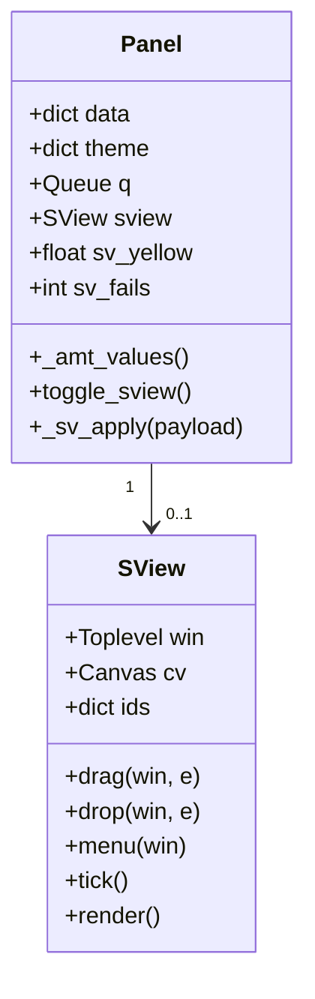
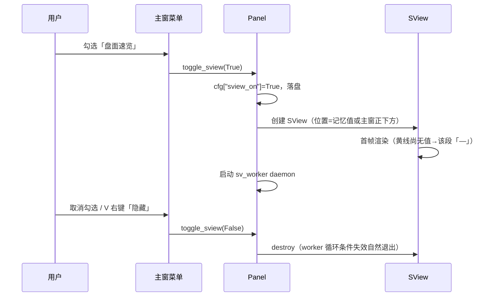
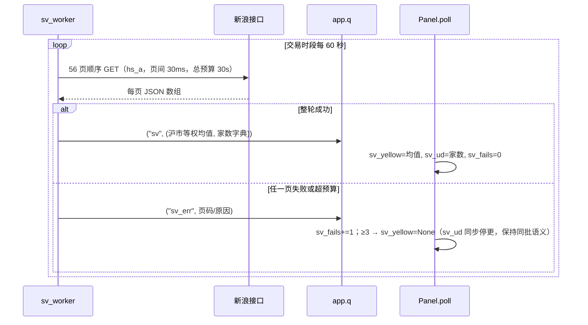
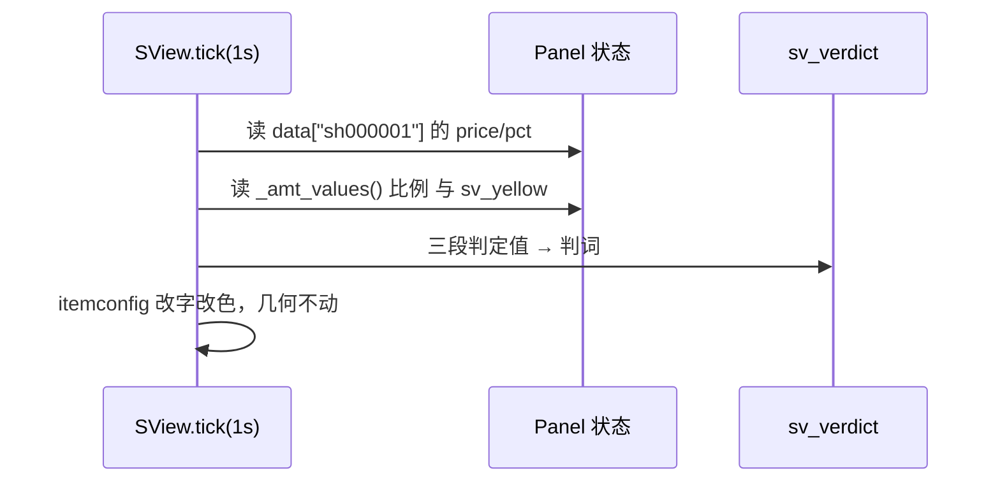
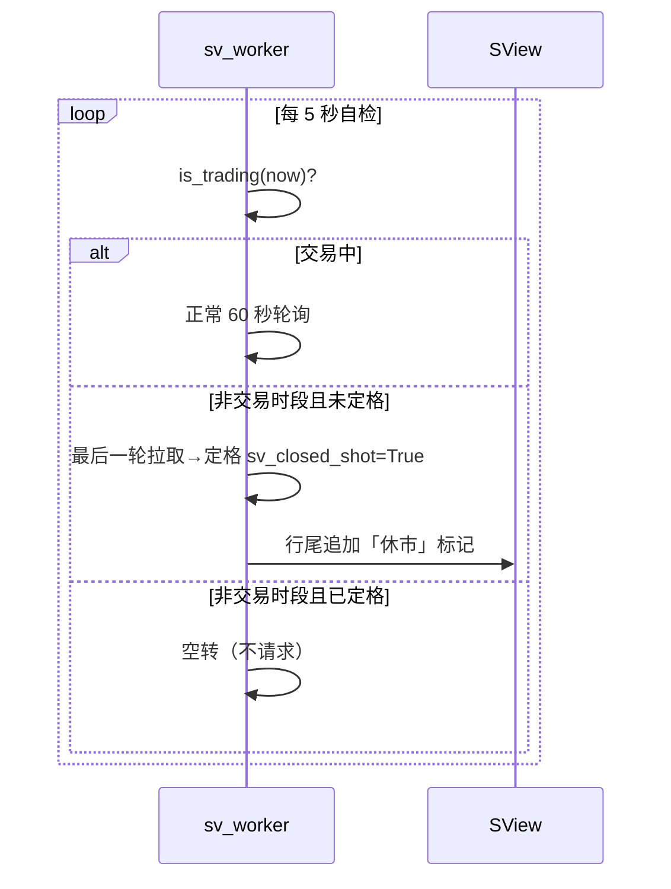

# SDD-盯盘君-盘面速览-v1.0.0

## 1. 文档概述

### 1.1 文档信息

| 项 | 内容 |
| --- | --- |
| 项目名称 | 盯盘君 MarketEye |
| 文档版本 | v1.0.0 |
| 版本状态 | 未发布 |
| 创建日期 | 2026-11-10 |
| 更新日期 | 2026-11-10 |
| 基于需求 | [PRD-盯盘君-盘面速览-v1.0.0](../../需求文档/盘面速览/v1.0.0/PRD-盯盘君-盘面速览-v1.0.0.md) |
| 基于设计 | 无（全新模块） |

### 1.2 变更记录

| 版本 | 日期 | 变更人 | 变更类型 | 关联章节 | 变更内容 |
| --- | --- | --- | --- | --- | --- |
| v1.0.0 | 2026-11-10 | - | 新增 | 全文 | 盘面速览悬浮框完整设计：新增新浪行情列表分页接口（§3.2）与 `SView` 窗口类；黄线独立 daemon 轮询（60 秒/轮、连续 3 轮失败降级）经主窗队列分发；上证段与量能段零新增请求（复用主窗行情与两市成交额基准推导）；综合判词为封闭枚举纯函数；数据刷新单一链（`SView.tick` 统一读主窗状态）；六项设计期裁决（样本口径 A 股化、矩形边框不圆角、判词封闭枚举、量能词复用既有基准、隐藏即销毁、worker 复用主窗队列）；T001~T011 任务清单 |
| v1.0.1 | 2026-11-11 | - | 增量 | §3.4/§3.5/§3.7.3/§4.1/§10 | BUG-10 截图遮挡：新增 R-11 截图让位与 T012。`foreign_fullscreen()` 只按几何探测（前台窗口非本进程且四边覆盖虚拟屏），不认进程名；`SView._yield_tick` 250ms 独立链，隐藏用 `withdraw`（实测 overrideredirect/位置/topmost 全保持），恢复时显式重设 geometry + topmost + lift |
| v1.1.0 | 2026-11-11 | - | 增量 | §3.2.1/§3.4/§3.5/§3.7/§4.1/§10 | 用户三项反馈落地：①量能段改为「箭头 + 带符号金额」（R-12/T015，定宽样本改 `↓-1.20万亿`）；②悬停量能段弹明细、悬停白黄线段弹沪深涨跌家数（R-13/T016，单 Toplevel 复用 + 鼠标穿透）；③数据源由 `sh_a` 改 `hs_a`（D8：一次 8.0 秒 vs 两次 12.6 秒，沪市样本仍 2318 只），新增 `sv_updown`/`sv_amt_diff_text` 与整轮 30 秒总预算（T013/T014，家数不含北交所 D9）；事件载荷由 `("sv", mean)` 改为 `("sv", (mean, stats))` |
| v1.1.2 | 2026-11-11 | - | 增量 | §3.4/§3.5/§5 | BUG-12 返修 R-11：点击桌面空白时前台切成 Progman（矩形铺满整屏、pid 非本进程），被误判为遮罩致悬浮框消失、点回悬浮框又恢复。`foreign_fullscreen` 增加 Shell 类名排除（Progman/WorkerW/Shell_TrayWnd/Shell_SecondaryTrayWnd） |
| v1.1.1 | 2026-11-11 | - | 增量 | §3.5 | 家数浮层行内分色：行内容升级为「str 或片段表」，上涨数字 `theme["up"]` 红、下跌数字 `theme["down"]` 绿，标签与平盘/合计/时点保持基色；宽度与落笔均改为按片段累加（避免整行量宽与分段落笔混用导致右侧截字） |

### 1.3 技术选型

- Python 3.11 标准库：tkinter（Canvas/Menu/Toplevel）、urllib（HTTP）、json、threading、queue——与主程序一致，零第三方依赖。
- 数据来源：腾讯行情接口（主窗既有，本模块只读其结果）+ 新浪行情列表接口（黄线，本模块新增）。
- 配置存储：`config.json`（新增 3 键）、`position.json` 不动。

### 1.4 文档目的

设计独立悬浮框「盘面速览」的技术实现：四段单行信息（白黄线、上证、量能、综合判词）的数据获取、判定、渲染与窗口行为，边界为不改动主窗既有渲染路径、不为量能与上证新增任何网络请求。

## 2. 系统架构

### 2.1 整体架构



### 2.2 模块划分

| 模块 | 职责 | 边界 |
| --- | --- | --- |
| 纯函数层（模块级） | `sv_yellow_mean`（等权均值）、`sv_verdict`（判词矩阵） | 无副作用、无 IO，selftest 直测 |
| 取数层 | `fetch_sina_sh`（沪市全量分页拉取，daemon 线程专用）、`sv_worker`（轮询节奏与时段状态机） | 只发新浪请求；腾讯数据一律读主窗结果 |
| 窗口层 | `SView` 类：无边框窗、单行四段渲染、拖动、右键菜单、显隐、位置记忆、1 秒统一数据刷新 | 不改主窗渲染路径；只被 Panel 创建与销毁 |
| 接线层（Panel 侧） | 菜单开关、poll 新分支、失败计数、退出联动 | 复用 `app.q`，不建第二条队列 |

### 2.3 分层职责

- **窗口与绘制层**：`SView` 单 Canvas，1 秒 tick 只做 `itemconfigure` 改字改色（同成交额块轻量刷新模式），不重排几何；数据刷新统一由 `SView.tick` 读主窗状态完成，`Panel._tick` 不直接调悬浮框渲染（单一数据链，裁决 D6）。
- **行情获取层**：黄线为唯一新增网络活动——`threading.Thread(daemon=True)` 顺序分页拉取；网络异常一律捕获、绝不进 tkinter 主线程。
- **配置与持久化层**：`config.json` 新增 `sview_on` / `sview_x` / `sview_y`；沿用 `load_json`/`save_json` 与「缺键不写盘」纪律。
- **交互层**：拖动（Button-1/B1-Motion/ButtonRelease-1）、右键菜单（隐藏/重置位置）、主窗菜单勾选开关。

### 2.4 界面区块地图

回链 PRD §2.4：悬浮框整窗 = 无边框 Toplevel（单区块「速览区」），区块内四段文字 + 收盘态追加的「休市」小字 + 整窗拖动热区 + 右键菜单两项（隐藏/重置位置）。主窗侧入口为主窗右键菜单「盘面速览」勾选行。无滚动条、无表头、无列体系。

## 3. 详细设计

### 3.1 数据模型

`config.json` 新增键（其余键不动）：

```json
{
  "sview_on": false,
  "sview_x": 1800,
  "sview_y": 900
}
```

| 键 | 类型 | 默认 | 约束 | 说明 |
| --- | --- | --- | --- | --- |
| `sview_on` | 布尔 | false | 仅 true/false | 悬浮框显隐，与菜单勾选态恒一致 |
| `sview_x` | 整数 | 缺省=主窗正下方 | 屏幕坐标 | 拖动松手落盘；恢复时出屏自动收回 |
| `sview_y` | 整数 | 缺省=主窗正下方 | 屏幕坐标 | 同上 |

内存状态（Panel 侧新增）：

| 属性 | 类型 | 说明 |
| --- | --- | --- |
| `self.sview` | `SView / None` | 悬浮框实例；隐藏即销毁（与浮层/面板生命周期一致） |
| `self.sv_yellow` | `float / None` | 最近一轮黄线等权平均涨幅（%） |
| `self.sv_ud`（v1.1.0） | `dict / None` | 最近一轮涨跌家数：`up/dn/flat/up_sh/dn_sh/up_sz/dn_sz/at`（`at` 为取数时刻 `HH:MM`）；与 `sv_yellow` 同轮写入，失败一并保留旧值 |
| `self.sv_fails` | 整数 | 连续失败轮数，成功清零；≥3 置 `sv_yellow=None` |
| `self.sv_thread` | Thread/None | 黄线轮询 daemon，随开启创建、退出即止 |
| `self.sv_closed_shot` | 布尔 | 收盘态是否已完成定格快照 |



### 3.2 外部接口设计

#### 3.2.1 新浪沪深 A 股行情列表（新增；v1.1.0 由 `sh_a` 改为 `hs_a`）

- **接口地址**：`https://vip.stock.finance.sina.com.cn/quotes_service/api/json_v2.php/Market_Center.getHQNodeData`
- **请求方式**：GET，`page`（1 起）、`num`（≤100）、`sort=symbol`、`asc=1`、`node=hs_a`
- **返回报文**：JSON 数组（ASCII 转义，UTF-8 解码后 `json.loads` 直解）：

```json
[{"symbol": "sh600000", "name": "浦发银行", "trade": "10.200",
  "changepercent": "0.99", "ticktime": "15:34:59", "...": "其余字段忽略"}]
```

| 字段 | 含义 | 本模块用法 |
| --- | --- | --- |
| `symbol` | 代码（`sh`/`sz`/`bj` 前缀） | 分市场：`sh` 前缀进黄线样本，`sh`+`sz` 进家数统计（`bj` 只计数不入任何口径，PRD R-14） |
| `changepercent` | 当日涨跌幅（%） | 黄线均值样本值（空串/非法按 0 计，与领先指数口径一致）；家数按 `>0` / `<0` / 其余（=0 或空）三分类 |
| 其余字段 | — | 全部忽略 |

- **分页约定**：`num=100` 顺序拉取，直到返回数组长度 < 100 或为空；实测全量 **5579 只**（沪 2318 / 深 2906 / 北 355）→ 56 页。
- **耗时预算**：实测整轮 **8.0 秒**（2026-11-11 盘中，页间无 sleep）；页间加 30ms 节流（56 页 ≈ +1.7 秒）降低被限流概率，整轮 ≤12 秒。**新增整轮总预算 `SV_TOTAL_BUDGET=30` 秒**：超预算立即整轮作废（页数翻倍后，单页 8 秒超时的最坏叠加从 192 秒升到 448 秒，必须有总闸）。
- **编码与异常约定**：超时 8 秒/页；任一页失败或总预算耗尽一律整轮作废（部分样本不得冒充全量，PRD M-01 约束）；HTTP 非 200 / JSON 解析失败同作废。只许 daemon 线程调用。
- **市场选择取证（2026-11-11）**：同轮实测 —— `sh_a` 2318 只 5.9 秒、`sz_a` 2906 只 6.7 秒（两次拉取合计 12.6 秒）；`hs_a` 一次 5579 只 8.0 秒且沪市样本数与 `sh_a` 完全一致（2318）。东财 `push2.eastmoney.com/api/qt/stock/get?fields=f104,f105,f106` 实测返回 `0/0/100`（非涨跌家数），不采用。故选 `hs_a`。
- **实测基线（2026-11-10 / 2026-11-11）**：`sh_a` 24 页约 0.9MB、`hs_a` 56 页约 2.0MB；腾讯排行接口同场景空返回，故不选。

#### 3.2.2 腾讯行情与日 K（既有，零新增请求）

上证段读主窗 `self.data["sh000001"]`（`price`/`pct`，两市成交额模块已强制该代码进取数清单，见 `codes()` 3316-3322；**前置条件：`show_amount` 开启**——用户关闭成交额块后该代码不再被取到，上证段与判词将按 §3.6 降级「—」，此为可接受的取舍）；量能段读 `self._amt_values()`（复用既有基准与今日累计推导，含 S0~S5/D0~D3 全部降级语义）。

### 3.3 业务流程

**链路 1：开启与显隐（PRD §3.4 主链路）**



**链路 2：黄线轮询（PRD §3.4 数据链路 C）**



**链路 3：四段联动刷新（上证/量能/判词，单一数据链）**



注：`Panel._tick`（主窗既有 1 秒循环）不直接调悬浮框渲染，四段刷新统一由 `SView.tick` 完成（裁决 D6，消除双重刷新）。

**链路 4：交易时段切换（收盘态）**



收盘态下 `SView.tick` 仍保留 1 秒节拍但只比对主题/置顶状态，数值重绘跳过（数值已定格，避免无谓 CPU；满足 PRD §4.1「非交易时段 CPU 接近 0」的工程口径——两个 5 秒/1 秒级轻量定时器的开销远低于一次行情请求）。

### 3.4 业务规则

| PRD 规则 | 实现方案 |
| --- | --- |
| R-01 白黄线判定 | `sv_verdict` 内：`diff = pct_sh − sv_yellow`；`>+0.05%` 表示白在上、`<−0.05%` 表示黄在上、其间粘合不显差值。展示口径（`SView._fill`）：文字顺序固定「黄→白」，显示差值 `d = sv_yellow − pct_sh`，`d>+0.05%` → `黄▲白`（红，小票强于权重）、`d<−0.05%` → `黄▼白`（绿，二八行情）、其间 `黄≈白`（灰）。两处 diff 符号相反但同构，判定结果一一对应。阈值常量 `SV_TH_STICK=0.05` |
| R-02 量能判定 | `_amt_values()` 比例 p：`p>=5` 放量、`p<=−5` 缩量、其间平量；p 为 None（基准不可用/除零保护）段「—」。阈值常量 `SV_AMT_TH=5.0` |
| R-03 颜色语义 | 上证/量能按正负用 `theme["up"]/["down"]`；平盘/粘合/判词段与「休市」用 `theme["flat"]`（平盘 token，与成交额块惯例一致） |
| R-04 数据完整性 | 三段各自独立取值判 None，段级「—」；判词依赖三段，任一 None 即「—」 |
| R-05 收盘态优先 | worker 以 `is_trading(now)` 门控；非交易时段定格最后一轮 + 「休市」后缀，不发请求。`set_closed` 置位时补一次 `_fill`：worker 把 `("sv", …)` 与 `("sv_closed", True)` 紧挨着压队列，poll 同批消费后 `closed` 已置位，而 tick 在收盘态跳过 `_fill` —— 不补这一下，终值（黄线与判词）永远渲不出来（实现期实测判词段恒「—」，BUG-11） |
| R-06 位置记忆 | drop 落盘 `sview_x/y`；创建时读回并做屏幕内收回（`max(0, min(x, sw−w))`） |
| R-07 置顶与主题跟随 | tick 每秒比对 cfg 置顶态与 `Panel.theme` 引用，变化即 `attributes("-topmost")` / 换色重渲 |
| R-08 失效降级 | `sv_fails>=3` → `sv_yellow=None`；恢复成功清零续显 |
| R-09 自动恢复 | 同上（成功轮自然清零） |
| R-10 综合判词 | `sv_verdict(pct_sh, yellow, amt_pct)` 纯函数按 PRD 矩阵拼接，封闭枚举 21 组合 |
| R-11 截图让位 | `_yield_tick`（250ms 链）：`foreign_fullscreen()` 为真即 `withdraw()`，为假且处于让位态则 `deiconify()` + 重设 geometry/topmost/lift。探测只认几何（前台窗口非本进程且四边覆盖虚拟屏，1px 容差），不认进程名——截图工具各版本进程名不一（`SnippingTool`／`ScreenClippingHost`／`Snipaste`／微信），认名必漏；Shell 系统窗口按固定类名排除（`Progman`/`WorkerW`/`Shell_TrayWnd`/`Shell_SecondaryTrayWnd`，BUG-12，见 §3.5）。拖动中（`_dragging`）不隐藏，避免用户按住时窗口消失 |
| R-12 量能差额展示 | `_fill` 取 `_amt_values(st, ax)[2]`（diff）→ `sv_amt_diff_text(diff)`：`↑`/`↓`/`→` + `fmt_signed_amount(diff)`；`diff is None` → 「—」。配色沿用主窗 `c_diff` 口径（正红负绿零灰）。**判词仍用 `pct`**，展示与判定分离 |
| R-13 悬停明细 | `<Motion>` 命中槽位即启 300ms 延时 `after`（`SV_TIP_DELAY`），`<Leave>`／`<Button-1>`／`_yield_tick` 让位时取消并销毁浮层；浮层为独立 `Toplevel`（overrideredirect + topmost + `WS_EX_TRANSPARENT` 穿透），矩形+边框（延续裁决 D2，不做圆角色键）。位置：默认悬浮框正上方；上方空间不足则放下方 |
| R-14 涨跌家数 | 纯函数 `sv_updown(rows)` → `(up, dn, flat, up_sh, dn_sh, up_sz, dn_sz)`：按 `symbol` 前缀取 `sh`/`sz`，`changepercent>0` 升、`<0` 跌、其余（0/空/停牌）平；`bj` 前缀忽略。家数与黄线同轮同批产出，失败一并沿用上一轮（PRD R-14） |
| M-01 约束（全量） | worker 任一页失败整轮作废，不用部分样本 |
| M-02 约束（复用基准） | 量能只读 `_amt_values`，不另起基准 |
| M-03 约束（出屏收回） | 创建与 drop 双处钳制屏幕内 |

### 3.5 界面设计（无 PROTO）

- **窗口**：`Toplevel(Panel.root)` + `overrideredirect(True)`，`bg=t["head"]`，`highlightthickness=1, highlightbackground=t["line"]`（沿用「均线面板」先例 5594-5633：geometry 必须带尺寸 `f"{w}x{h}+{x}+{y}"`——overrideredirect 只给 `+x+y` 不生效的踩坑结论直接复用）。
- **尺寸**：单行，高 `px(30)`；**定宽按最坏样本测量**，测量式含全部五段（白黄线段、上证段、量能段、综合判词段、**收盘态追加的「休市」小字**）+ 4×段间距 + 左右内边距（审核 M6：休市段必须计入，否则收盘态溢出定宽窗口）；构建时 `font.measure` 求和，窗口宽=测量值，不随内容伸缩。
- **四段渲染**：每段一个 `create_text`（上证段为「沪 + 数值」双 text，词与数值异色；量能段 v1.1.0 起为单 text，见下条），段间 `px(10)`；全部 id 存 `self.ids`，tick 只 `itemconfig`。
- **拖动**：`<Button-1>` 记 `(e.x, e.y)` 偏移，`<B1-Motion>` 按偏移 `geometry` 移动，`<ButtonRelease-1>` 落盘；整窗即热区（四段文字不单独绑事件）。
- **右键**：`<Button-3>` 弹 `Menu`（深色配色同主窗菜单）：「隐藏」→ `Panel.toggle_sview(False)`；「重置位置」→ 删 `sview_x/y` 落盘并回主窗正下方。
- **收盘标记**：行尾追加 `flat` 色「休市」小字（仅收盘态显示，id 常驻、收盘态置文本其余态置空串）。
- **截图让位（R-11）**：独立 250ms 检测链 `_yield_tick`，与 1 秒数据 tick 解耦（数据链不因显隐改变节奏）。隐藏用 `withdraw()` 而非 `lower()`：实测 overrideredirect 窗口 withdraw→deiconify 后 `overrideredirect`／位置／`-topmost` 三者均保持；`lower()` 只能把窗口降回 topmost 带内底部，压不住「非 topmost 的全屏遮罩」，等于白降。窗口宽度 `W` 与高度 `H` 为定值，恢复时用缓存位置显式重设 geometry，避免 deiconify 后落到 (0,0)。**Shell 排除（BUG-12）**：只按几何判定会把「点击桌面空白」误判成遮罩——点击桌面后前台切成 `Progman`（explorer.exe），其窗口矩形恰好铺满整屏且 pid 必非本进程，两条件全中。修复：`GetClassNameW` 命中固定类名表（`Progman`/`WorkerW`/`Shell_TrayWnd`/`Shell_SecondaryTrayWnd`）直接返回 False。类名是系统契约，不会像截图工具进程名那样随版本漂移。
- **量能段（R-12）**：单 `text` 项（原「词 + 数值」两个 text 合并为一个），文案 `sv_amt_diff_text(diff)`＝箭头 + `fmt_signed_amount`，如 `↑+388亿`／`↓-388亿`／`→0.0亿`。定宽样本由「缩量 -99%」改为 **`↓-1.20万亿`**（箭头 + 负号 + 4 位数字 + 2 位小数 + 单位，最坏形态）。该段热区随 `_layout` 记录 `self.hot["amt"] = (x, x + w)`。
- **悬停浮层（R-13）**：`self.tip` 单个 `Toplevel` 复用两个内容模板（按 `kind` 重填），`overrideredirect(True)` + `bg=t["head"]` + `highlightthickness=1`，矩形四角（裁决 D2：SView 家族不做圆角色键，规避圆角血泪史）。内容用 `create_text` 多行排版，宽高由 `font.measure` 实测后 `geometry(f"{w}x{h}+{x}+{y}")`（overrideredirect 必须带尺寸）。位置：`y = sview_y - h - px(6)`；若 `y < 0` 则改放下方 `sview_y + H + px(6)`。鼠标穿透补 `WS_EX_TRANSPARENT | WS_EX_TOOLWINDOW`（沿用 `Panel._amt_tip_click_through` 的 argtypes 写法，项目铁律）。
- **两段浮层内容**：
  - 量能段：`今日累计 / 沪 x 深 y / 基准时点 / 昨日基准 / 差额 / 比例 / 口径`（与主窗 `_amt_tip_show` 同文案，SView 侧独立生成，不依赖 Panel 私有方法）。
  - 白黄线段：`沪深上涨 x 下跌 y` / `平盘 z 合计 n` / `沪 up/dn · 深 up/dn` / 数据时点。家数为 `None` 时整块显示「—（家数暂不可用）」。
  - **行内分色**：行内容为 `str`（整行基色）或片段表 `[(文本, 颜色), ...]`。家数行的上涨数字用 `theme["up"]`（红）、下跌数字用 `theme["down"]`（绿），标签、平盘、合计、沪/深前缀与 `/` 分隔符沿用行基色；绘制按片段累加 `font.measure` 定位，宽度亦按片段求和——与单 `create_text` 整行落笔会有微米级字距差，故不可混用两种宽度算法（否则右侧截字）。行内容参与 `_tip_rows` 相等比较，涨跌翻转即重绘。
- **颜色键透明**：不使用（裁决 D2，矩形+边框）。

### 3.6 错误处理定义

| 场景 | 处理 | 提示方式 | 日志 |
| --- | --- | --- | --- |
| 新浪单页超时/非 200/JSON 坏 | 整轮作废 | 白黄线段沿用旧值；连续 3 轮转「—」 | `_dbg("sv page {n} 失败")` |
| 新浪返回样本数异常（<1000 视为可疑） | 按整轮失败处理 | 同上 | `_dbg("sv 样本数 {n} 可疑")` |
| `sh000001` 报价缺失/停牌/`show_amount` 关闭 | 上证段「—」、判词「—」 | 静默降级 | 无（主窗已有连接失败态） |
| 量能比例 None（基准不可用） | 量能段「—」、判词「—」 | 静默降级 | 复用 amt 模块日志 |
| 配置落盘失败 | 显隐照常，不阻断 | 静默 | `log_once("sview save 失败")` |
| worker 线程异常逃逸 | 函数级 try/except 全包，不中断循环 | 静默 | `_dbg("sv worker {ex!r}")` |

### 3.7 其他设计

#### 3.7.1 常量定义

| 名称 | 取值 | 说明 |
| --- | --- | --- |
| `SV_SINA_URL` | `.../Market_Center.getHQNodeData`（完整地址见 §3.2.1） | 新浪行情列表接口 |
| `SV_NODE` | `"hs_a"` | 沪深 A 股全量节点（v1.1.0 / D8；沪市按 `symbol` 前缀过滤） |
| `SV_PAGE_NUM` | `100` | 每页条数上限（接口约定；hs_a 实测 56 页 5579 只） |
| `SV_PAGE_CAP` | `90` | 翻页硬上限（防接口改版死循环；实测 56 页） |
| `SV_PAGE_GAP` | `0.03` | 页间节流（秒；56 页 ≈ +1.7 秒，降低被限流概率） |
| `SV_TOTAL_BUDGET` | `30` | 整轮总预算（秒），超预算整轮作废（§3.7.3） |
| `SV_MIN_ROWS` | `1000` | 全量样本数下限（低于视为可疑整轮作废） |
| `SV_INTERVAL` | `60` | 黄线轮询间隔（秒） |
| `SV_IDLE_CHECK` | `5` | 非交易时段状态自检间隔（秒） |
| `SV_FAIL_LIMIT` | `3` | 连续失败轮数上限（PRD R-08） |
| `SV_TH_STICK` | `0.05` | 白黄粘合阈值（%，PRD R-01，可调） |
| `SV_TH_SH` | `0.05` | 上证涨/平/跌子判定阈值（%，PRD R-10，可调） |
| `SV_AMT_TH` | `5.0` | 量能放缩阈值（%，PRD R-02） |
| `SV_AMT_ZERO` | `5e6` | 量能差额噪声钳制（元）：绝对值 < 0.05 亿显「→0.0亿」（R-12） |
| `SV_TIP_DELAY` | `300` | 悬停明细浮层延时（毫秒，R-13） |
| `SV_H` | `30` | 悬浮框高度（逻辑像素） |
| `SV_GAP` | `10` | 段间距（逻辑像素） |
| `SV_WORST` | dict | 各段最宽样本：`黄▼白 −9.9%` / `沪 39999.99 +9.99%` / `缩量 −99%` / `缩量·权重领跌` / `休市`（定宽测量用） |

#### 3.7.2 纯函数与设计期裁决

| 名称 | 签名 | 行为描述 |
| --- | --- | --- |
| `sv_yellow_mean` | `(rows) -> float / None` | 分页全量涨跌幅列表 → 等权平均（%）；空列表返回 None |
| `sv_verdict` | `(pct_sh, yellow, amt_pct) -> str / None` | 三段判定值 → 判词短语：量能词（放量/平量/缩量，amt_pct None → 整体 None）·结构词（PRD R-10 矩阵）；任一入参 None → None |
| `sv_updown`（v1.1.0） | `(rows) -> dict / None` | 全量 rows → `{"up","dn","flat","up_sh","dn_sh","up_sz","dn_sz"}`：按 `symbol` 前缀取 `sh`/`sz`（`bj` 忽略），`changepercent>0` 升、`<0` 跌、其余平；空 rows → None |
| `sv_amt_diff_text`（v1.1.0） | `(diff) -> str` | 差额 → `↑+388亿`／`↓-388亿`／`→0.0亿`；`None` → 「—」。箭头语义与主窗 `_amt_diff_parts` 一致 |

| 裁决 | 内容 | 理由 |
| --- | --- | --- |
| D1 黄线样本口径 | 取**沪市全部 A 股**（sh_a 节点）而非综指全样本（另含 40 余只 B 股）：偏差 <0.01%，且「一股一票平均涨幅」对 A 股持股体感更贴切；写死 sh_a 不做配置。（v1.1.0 更新：节点改 `hs_a`，沪市口径不变——按 `symbol` 前缀 `sh` 过滤，实测样本仍为 2318 只，见 D8） | 口径透明化、免维护两套节点；PRD M-01「沪市全部 A 股」字面即此 |
| D2 矩形+边框，不做圆角色键 | 悬浮框高仅 30 逻辑像素，圆角需 KEY 遮罩四件套；项目圆角有过重绘血泪史（README 实现备注） | 小窗收益趋零、风险实打实 |
| D3 黄线走独立 daemon + 复用 `app.q` | 与 amt/kline 同构：线程只 put，poll 单点分发落地 tkinter 主线程 | 不新建队列/不新增 after 链分发层；`kind="sv"/"sv_err"` 与既有分支互斥 |
| D4 判词封闭枚举纯函数 | `sv_verdict` 无 IO 无状态，词表写死 | selftest 可全组合断言；杜绝自由文本生成 |
| D5 量能词复用 `_amt_values` | 不另算基准、不新增请求 | 与主窗成交额块口径天然一致（PRD M-02 约束） |
| D6 数据刷新单一链 | 四段数值刷新统一由 `SView.tick` 完成，`Panel._tick` 不调悬浮框渲染；worker 结果经 poll 落到 Panel 状态后由下一拍 tick 呈现 | 消除两条 1 秒链的双重刷新歧义；tick 内读状态是纯内存操作，无时序风险 |
| D7 隐藏即销毁 | 不做 withdraw 常驻 | 与浮层/面板生命周期一致；显隐频率低，重建成本可忽略 |
| D8 节点改 hs_a（v1.1.0） | 一次拉沪深全量，`symbol` 前缀 `sh` 过滤出沪市样本求黄线，全量算家数：单轮 8.0 秒；改拉 `sh_a`+`sz_a` 要 12.6 秒且两次失败面；东财 `f104/f105/f106` 实测返回 `0/0/100` 不可用 | 省一半时间、黄线与家数天然同批（PRD 约束「不得单独另取一份」）；沪市样本数与 `sh_a` 完全一致（实测 2318） |
| D9 家数不含北交所（v1.1.0） | `hs_a` 含 355 只 `bj`，一律不计入沪深合计与涨跌分类 | 用户口径为「沪深全市场」；北交所体量小且涨跌幅规则不同，混入会污染口径 |
| D10 浮层复用单个 Toplevel（v1.1.0） | 两段浮层共用一个窗口，按 `kind` 重填内容，不做两个窗口 | 同屏只可能有一个浮层（鼠标只能在一处）；单窗口免去并发显示与销毁竞态 |

#### 3.7.3 线程与定时器

| 机制 | 节奏 | 说明 |
| --- | --- | --- |
| `sv_worker` daemon | 交易时段 60 秒/轮；非交易时段 5 秒自检、定格后空转 | 循环条件 `not Panel.stop and sview 可见`；异常全包不退出 |
| `SView.tick` | 1 秒 | 数据/主题/置顶统一刷新入口；收盘定格后只比对主题置顶、跳过数值重绘；随窗口销毁终止 |
| `SView._yield_tick` | 250ms | 截图让位检测（R-11）；只做一次 `GetForegroundWindow`+`GetWindowRect`，与数据链解耦；让位期间数据 tick 照常跑（对隐藏窗口 `itemconfig` 无副作用），恢复即最新值，无补帧逻辑 |
| `SView` 悬停延时 | 单次 300ms（`SV_TIP_DELAY`） | 进入热区启 `after`，离开/拖动/让位即 `after_cancel`；不常驻轮询，无指针时零开销 |
| `Panel.poll` 新分支 | 250ms 既有循环 | `sv`/`sv_err` 两个 kind，独立 try 包裹，只写状态不渲染 |
| `sv_worker` 整轮预算 | 每轮 ≤30 秒（`SV_TOTAL_BUDGET`） | 56 页 × 8 秒单页超时的最坏叠加 448 秒，必须有总闸；超预算整轮作废并计入失败轮次 |

#### 3.7.4 selftest 扩展

- `sv_yellow_mean`：构造 4 页样本（含空页、含非法涨跌幅按 0 计）断言均值与分页截断。
- `sv_verdict`：矩阵 9 个结构词逐格断言 + 21 组合抽查 + None 入参返回 None。
- 阈值边界：diff=±0.05、pct_sh=±0.05、amt=±5.0 的边界归属断言。
- `sv_updown`（v1.1.0）：构造含 `sh`/`sz`/`bj` 前缀与空值的样本，断言沪/深分别计数、`bj` 不入合计、空值计平盘。
- `sv_amt_diff_text`（v1.1.0）：正/负/零/None 四态与单位跃迁（亿 / 万亿）断言。

### 3.8 功能点追溯

| PRD 功能点 | 技术产物 |
| --- | --- |
| F-01 三维度快照展示 | `sv_yellow_mean`/`sv_verdict`（§3.7.2）、`SView.render` 四段渲染与定宽测量（§3.5）、上证/量能数据接入（§3.2.2/链路 3）、R-01~R-04/R-10（§3.4）、T002/T004/T008 |
| F-02 悬浮框窗口行为 | `SView` 窗口类拖动/右键/位置记忆（§3.5）、`sview_on/x/y` 配置键（§3.1）、`Panel.toggle_sview`+菜单勾选行（§3.3 链路 1）、R-06/R-07（§3.4）、T004/T005 |
| F-03 数据刷新与容错 | `fetch_sina_sh`/`sv_worker`（§3.2.1/§3.7.3）、poll `sv`/`sv_err` 分支与失败计数（§3.3 链路 2）、收盘态门控与定格（§3.3 链路 4）、R-05/R-08/R-09（§3.4）、T003/T006/T007 |

## 4. 代码位置

行号基于 `ticker.pyw` 当前版本（约 7478 行），编码时以符号检索为准。

### 4.1 程序逻辑

| 代码位置 | 对应设计 |
| --- | --- |
| `ticker.pyw:154`（AMT 块尾）后 | 新增 `SV_*` 常量（T001） |
| `ticker.pyw:416`（`page_slice`）后的模块级函数区 | 新增 `sv_yellow_mean`/`sv_verdict`（T002） |
| `ticker.pyw:451`（`sv_yellow_mean` 旁） | 新增 `sv_updown`/`sv_amt_diff_text`（T013，v1.1.0） |
| `ticker.pyw:903`（`fetch_minute`）附近的取数函数区 | 新增 `fetch_sina_sh`（T003） |
| `ticker.pyw:4024`（`SView` 类定义）前 | 新增 `_ff_make`/`foreign_fullscreen` 模块级探测函数（T012，R-11） |
| `ticker.pyw:3188`（`Panel.poll`） | 新增 `sv`/`sv_err` 分支 + `_sv_apply`（T006） |
| `ticker.pyw:1386` 附近（`__init__` 状态区） | `sv_*` 状态初始化（T005） |
| `ticker.pyw:3668`（`toggle_top`）/`3513`（`reload`） | 置顶联动与配置重读（T005） |
| `ticker.pyw:7153`（`selftest`） | 断言段扩展（T010） |

### 4.2 界面绘制

| 代码位置 | 对应设计 |
| --- | --- |
| `ticker.pyw:3954`（`KlineWin` 类定义）前 | 新增 `SView` 类整段（T004/T007） |
| `ticker.pyw:2564`（`_build_menu`）内 2639-2643 区段（`var_top`/折叠展开行附近） | 「盘面速览」勾选行（T005） |
| `ticker.pyw:3245`（`_tick`） | 不改动（裁决 D6：四段刷新走 `SView.tick`，此处仅确认不新增调用） |

### 4.3 配置与脚本位置

| 代码位置 | 对应设计 |
| --- | --- |
| `config.json` | 新增 `sview_on`/`sview_x`/`sview_y` 三键（§3.1/§6.2，T001/T005） |
| `config.json` 的读写 | 沿用 `load_json`/`save_json`（242/250），缺键不写盘纪律与 `load_page_size` 同款 |

## 5. 依赖关系

| 既有模块 | 影响 | 说明 |
| --- | --- | --- |
| 两市成交额块 | 无（只读） | `_amt_values` 为纯推导；不写其状态 |
| 主窗行情刷新 | 无（只读） | `data["sh000001"]` 只读；AMT 指数本就在取数清单，零新增请求；**前置条件 `show_amount` 开启**（关闭则上证段/判词降级「—」，见 §3.2.2/§3.6） |
| 自选分页/折叠轮播 | 无 | 悬浮框独立窗口，不触主窗几何 |
| K 线窗口（`KlineWin`） | 无 | 生命周期互不相干 |
| 主题切换 | 正向跟随 | tick 读 `Panel.theme` 引用，主窗换主题对象重建后自动跟随 |
| 主窗退出 | 联动退出 | Toplevel 随 root 销毁；worker 循环条件含 `Panel.stop` |

## 6. 部署配置

### 6.1 环境要求

Windows 10/11、Python 3.11（tkinter 内置）、可访问新浪与腾讯行情域名的网络；DPI 缩放 100%~200%（沿用主窗 `px()` 缩放体系）。

### 6.2 关键配置项

`config.json` 新增三键（默认值与约束见 §3.1 表）：`sview_on`（默认 false，升级用户零感知）、`sview_x`/`sview_y`（缺省=主窗正下方）。无环境变量、无命令行参数（沿用 `--selftest`）。

### 6.3 发布配置清单

发布包（zip）无需新增文件；示例 `config.json` 可选补三键注释行；README 功能清单补一行。

## 7. 模块间交互

`Panel` 与 `SView` 为创建/持有关系：Panel 只负责创建、销毁、菜单开关、队列落地（`_sv_apply` 写 `sv_yellow`/`sv_fails`）；SView 通过 app 引用只读 `data`/`theme`/`_amt_values()`。`sv_worker` 与 `poll` 为生产者/消费者（队列三 kind 互斥），与既有 amt/kline 线程同构、互不阻塞。错误降级与风险缓解汇总：接口不可用 → 段级「—」（§3.6 全表）；新浪长期不可用 → 功能退化为「上证+量能」两段，主功能无损；样本数守卫防接口改版投毒。

## 8. 文档依赖

- [PRD-盯盘君-盘面速览-v1.0.0](../../需求文档/盘面速览/v1.0.0/PRD-盯盘君-盘面速览-v1.0.0.md)（需求基线）
- [doc-templates.md](../../../rules/doc-templates.md) §5.2（骨架）
- [ui-rules.md](../../../rules/ui-rules.md)（配色 token：`head`/`line`/`text`/`up`/`down`/`flat`）
- README「实现备注」圆角教训（裁决 D2 依据）
- [SDD-盯盘君-两市成交额-v1.0.0](../两市成交额/v1.0.0/SDD-盯盘君-两市成交额-v1.0.0.md)（`_amt_values` 语义与降级链参照基线）

## 9. 版本影响分析

改动文件仅 `ticker.pyw`（+常量/纯函数/取数/SView 类/Panel 接线，预估 +530 行）与 `config.json`（3 新键）；无新文件、无依赖变更、无破坏性变更（升级用户 `sview_on` 缺省 false，行为不变）；tag v1.0.0 不动，功能随下一版本发布。风险与缓解：新浪限频/封禁 → 60 秒一轮属低频且整轮失败静默降级（§3.6）；接口改版 → 样本数下限守卫 + 失败降级路径已有；判词语感偏差 → 词表封闭、常量集中，改词只动一处。

## 10. 任务清单

| 编号 | 关联设计 | 变更类型 | 代码位置 | 说明 | 对应功能点 | 状态 |
| --- | --- | --- | --- | --- | --- | --- |
| T001 | §3.7.1/§3.1 | 新增 | 常量区（154 后）、`load_sview_cfg` 于 `load_marq_interval`（2197）旁 | `SV_*` 常量 13 项 + `sview_*` 三键读写（缺键不写盘） | F-01/F-02 | 待编码 |
| T002 | §3.7.2/§3.8 | 新增 | 模块级函数区（`page_slice` 416 后） | `sv_yellow_mean`/`sv_verdict` 纯函数 | F-01 | 已完成 |
| T003 | §3.2.1 | 新增 | `fetch_minute`（903）旁 | `fetch_sina_sh` 分页拉取（daemon 专用、整轮作废语义） | F-03 | 已完成 |
| T004 | §3.5 | 新增 | `KlineWin`（3954）前新类 | `SView`：窗口/定宽渲染/拖动/右键/位置记忆/出屏钳制 | F-01/F-02 | 待编码 |
| T005 | §3.3 链路 1 | 新增 | `_build_menu`（2564）2639 区段、`toggle_top`（3668）、`reload`（3513）、`__init__`（1386 区段） | `Panel.toggle_sview` + 菜单勾选行 + 置顶/重载接线 + 状态初始化 | F-02 | 已完成 |
| T006 | §3.3 链路 2/§3.4 R-08 | 新增 | `Panel.poll`（3188） | `sv`/`sv_err` 分支 + `_sv_apply` 失败计数 | F-03 | 已完成 |
| T007 | §3.7.3/§3.3 链路 4 | 新增 | `SView` 类内 | `sv_worker` 线程：60s 轮询/5s 自检/收盘定格 | F-03 | 已完成 |
| T008 | §3.3 链路 3 | 新增 | `SView.tick`/`render` | 四段数据填充 + 判词 + 收盘标记 + 主题置顶比对 | F-01 | 已完成 |
| T009 | §3.7.4 | 修改 | `selftest`（7153） | 纯函数断言段（均值/矩阵 21 组合/阈值边界） | F-01/F-03 | 待编码 |
| T010 | §9 | 修改 | `README.md` 功能清单 | 补盘面速览一行 | F-01/F-02/F-03 | 待编码 |
| T011 | §5/§8 | 验证 | — | 回归：主窗行情/成交额/分页/K线 selftest 段 + 界面实测 AC-01~22 | F-01/F-02/F-03 | 待测试 |
| T012 | §3.4/§3.5/§3.7.3 | 新增 | `foreign_fullscreen` + `SView._yield_tick`/`_dragging`/`_yielded` | 截图/录屏/全屏播放时自动让位，退出后恢复位置与置顶（BUG-10，R-11） | F-02 | 已完成 |
| T013 | §3.2.1/§3.4 | 修改 | `fetch_sina_sh` → `fetch_sina_hs`（node=hs_a、页间 30ms、总预算）；新增 `sv_updown`/`sv_amt_diff_text` | 数据源改沪深全量，一次拉取同时产出黄线与家数（D8/R-14） | F-01/F-03 | 待编码 |
| T014 | §3.3/§3.4 | 修改 | worker 事件载荷 `("sv", (mean, stats))`；`_sv_apply` 兼容单值；Panel 状态 `sv_ud`（含 `at`） | 家数与黄线同轮落地（AC-29） | F-03 | 已完成 |
| T015 | §3.5 | 修改 | `SView._layout` 量能段单 text + `sv_amt_diff_text`；`self.hot` 槽位表；定宽样本改 `↓-1.20万亿` | 量能段差额展示（R-12，AC-25/26） | F-01 | 已完成 |
| T016 | §3.5/§3.7.3 | 新增 | `SView` 悬停：`<Motion>`/`<Leave>`、`_tip_show`/`_tip_fill`/`_tip_place`/`_tip_cancel`/`_leave_check`、单 Toplevel + 穿透 | 两处悬停明细浮层（R-13，AC-27/28/30） | F-02 | 已完成 |
