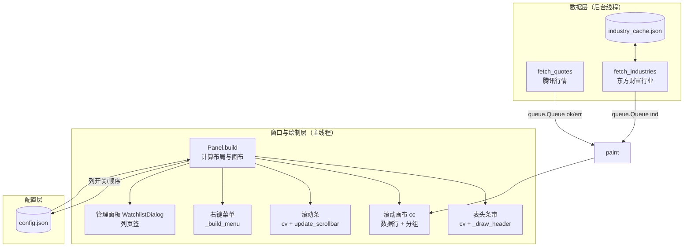
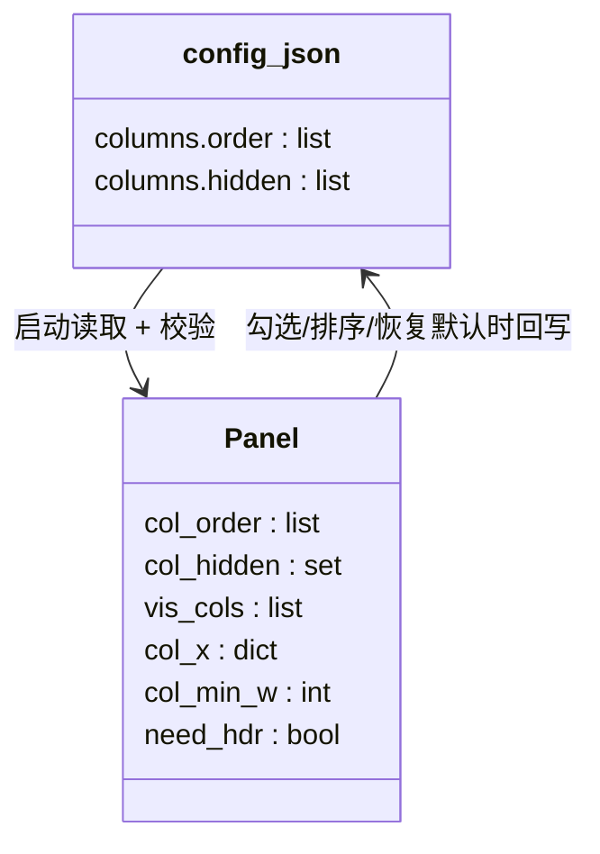
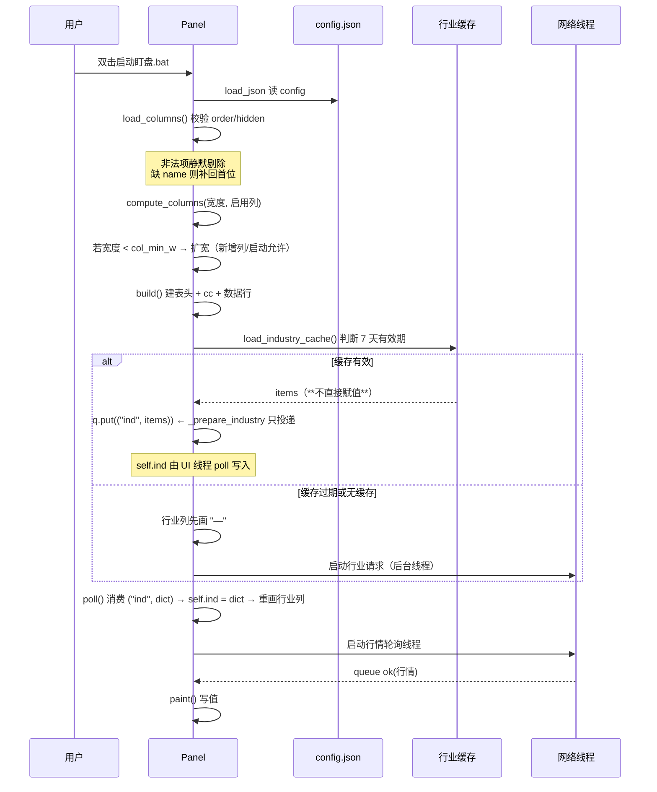
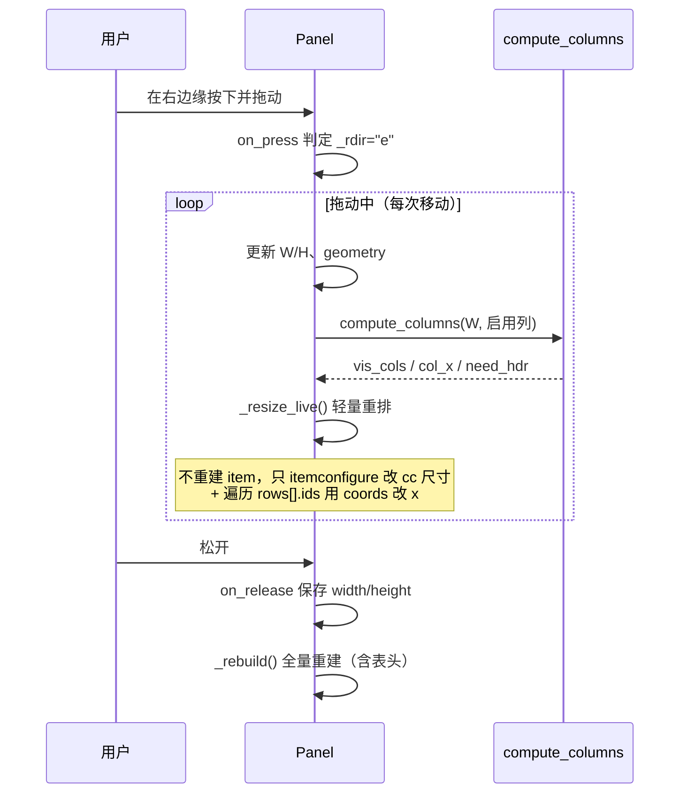
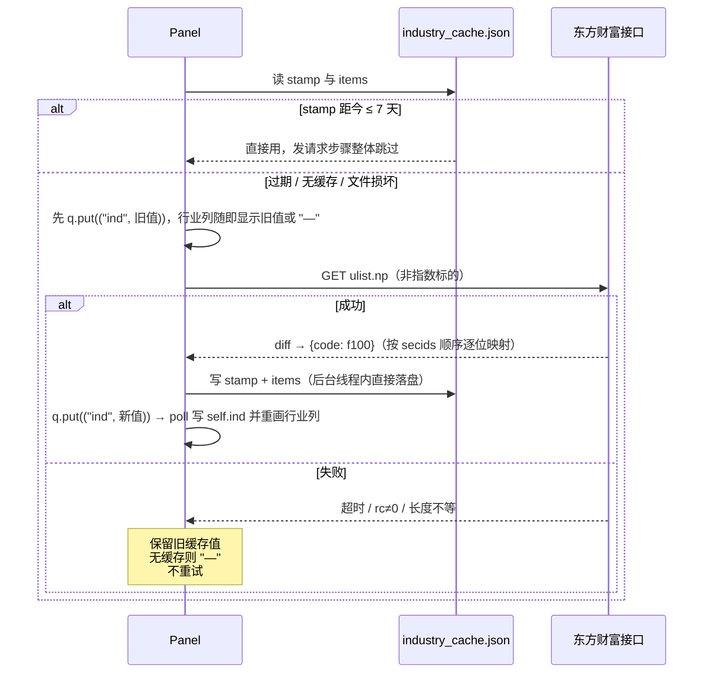
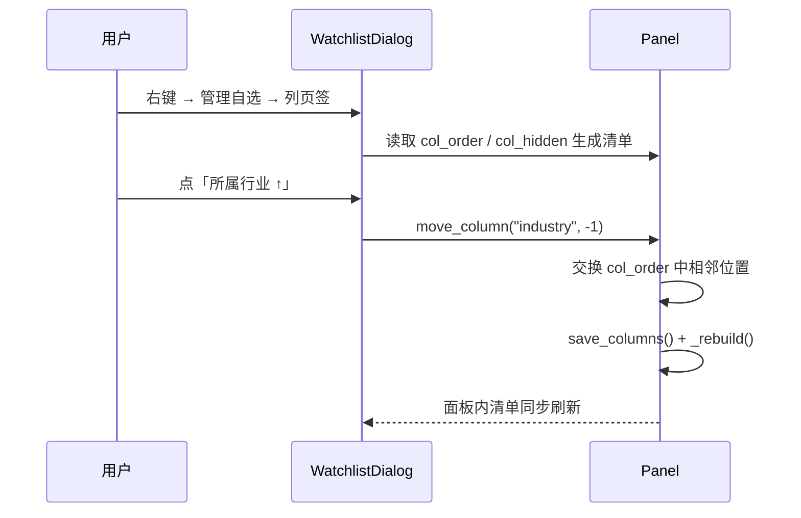

# SDD-盯盘君-自定义列-v1.0.0

## 1. 文档概述

### 1.1 文档信息

| 字段 | 内容 |
| --- | --- |
| 项目名称 | 盯盘君 MarketEye |
| 文档版本 | v1.0.0 |
| 版本状态 | 未发布 |
| 创建日期 | 2026-10-19 |
| 更新日期 | 2026-10-19 |
| 基于需求 | [PRD-盯盘君-自定义列-v1.0.0](../需求文档/自定义列/v1.0.0/PRD-盯盘君-自定义列-v1.0.0.md)，对应 PRD 文档版本 **v1.0.1**（含 F-11 固定表头与 AC-40~AC-48） |
| 基于原型 | [PROTO-盯盘君-自定义列-v1.0.0](../需求文档/自定义列/v1.0.0/PROTO-盯盘君-自定义列-v1.0.0.html) |
| 基于设计 | —（本功能为首个进入 SDLC 流程的设计，无旧版 SDD） |

### 1.2 变更记录

| 版本 | 日期 | 变更人 | 变更类型 | 关联章节 | 变更内容 |
| --- | --- | --- | --- | --- | --- |
| v1.0.0 | 2026-10-19 | - | 新增 | §1.1–§10 | 首版设计，覆盖 PRD v1.0.1 全部 F-01~F-11。**列与布局**：列键枚举与列宽表（价格 82 / 涨跌幅 64 / 量比 44 / 换手 52 / 行业 56，逻辑像素）、`col_x` / `col_min_w` 算法（六列 420，`CW = W − SB_W`，名称列取 `max(60, 余量)`）、**固定表头**画在 `cv` 固定条带并与数据区共用同一份 `col_x`、降级隐藏 `HIDE_ORDER`、`MIN_H` 96（= 34+25+16+18，取 96 使 `px()` 在各缩放档下均为整数）。**数据与接口**：`f[38]` 换手率 / `f[49]` 量比解析，`quote_kind()` 按品种分流（港股 78 字段、指数不取值）、占位口径（`—` 字段无数据 / `--` 整行无行情）与行内列色判定表、东方财富行业接口（按 `secids` 顺序逐位映射，不反查 `f12`/`f13`，长度不等整批丢弃）、7 天缓存与后台线程、`self.ind` 由 UI 线程 `poll` 唯一写入、北交所本版不请求行业。**交互**：扩宽开关 `_widen_ok` 单次消费语义、右键「显示列」子菜单（对勾用主题色 `PhotoImage` + `compound="left"`，弹出前按 `col_hidden` 重刷；不用 `checkbutton` 与文本符号 `√`/`✓`——勾选标记默认黑色、符号字符在 label 中被按暗色渲染，深色菜单上均不可见）、拖动缩放中绝不 `_rebuild`（列集合变化沿用旧列重排，松手后统一降级）、管理面板「列」页签（两套控件一次创建、只隐藏不销毁）、表头与菜单两套文案。**交付**：T001~T017 任务清单 |

### 1.3 技术选型

| 项 | 选型 | 说明 |
| --- | --- | --- |
| 语言版本 | Python 3.8+ | 只用标准库，不引入任何第三方包（详见 [coding-rules.md §5](../rules/coding-rules.md)） |
| GUI 框架 | tkinter 8.6（Tk Canvas 自绘） | 列表区全部由 Canvas `create_text` 绘制，不使用 ttk 控件 |
| 行情数据源 | 腾讯行情 `https://qt.gtimg.cn/q=` | 沿用现有接口，新增读取 `f[38]` 换手率、`f[49]` 量比两个字段 |
| 行业数据源 | 东方财富 `https://push2.eastmoney.com/api/qt/ulist.np/get` | **本次新增的唯一外部接口**，批量取 `f100` 行业名 |
| 配置存储 | `config.json`（`json` 模块读写） | 新增 `columns` 节点；读取失败回落默认值 |
| 缓存存储 | `industry_cache.json`（新增文件） | 行业名本地缓存，有效期 7 天；写入失败不影响主流程 |
| 网络 | `urllib.request` + `threading.Thread` + `queue.Queue` | 与现有行情线程同构，UI 线程不阻塞 |
| Win32 | `ctypes` 调 `shcore` / `user32` | 仅用于 DPI 感知与重绘失效，不新增调用点 |

### 1.4 文档目的

把 PRD 中「列集合可配置 + 三列新增 + 固定表头」的业务要求落成可实现的技术方案，重点解决四件事：

1. **列宽从"写死两列"变成"常量表 + 布局算法"**：布局由 `columns` 配置驱动，名称列弹性、其余固定，一次计算得出全部列的 x 区间，表头与数据行共用同一份结果，杜绝两处各算各的导致错位。
2. **新增两类外部数据**：腾讯行情的换手率/量比（同一次请求内解决，零新增网络开销）与东方财富行业名（独立请求 + 7 天缓存，失败不阻断行情）。
3. **固定表头**：表头不落在滚动画布 `cc` 内，而是画在 `cv` 的固定条带上，因此天然不随滚动移动。
4. **降级与扩宽的两条硬规则**：新增列才扩宽窗口、关闭列绝不改宽度；降级只影响绘制不写配置。

## 2. 系统架构

### 2.1 整体架构



### 2.2 模块划分

| 模块 | 现有类/函数 | 本次职责变化 | 边界 |
| --- | --- | --- | --- |
| 布局计算 | `Panel.build` | **重构**：由列配置算出 `col_x`（每列左右边界）、`min_w`、`vis_cols`；据此决定窗口默认宽度与表头是否显示 | 只算布局与创建画布元素，不做数据格式化 |
| 列渲染 | `Panel.paint` | **重构**：按 `vis_cols` 逐列写值，价格/涨跌幅/量比/换手随涨跌色，行业用次要色 | 只做"内存数据 → 画布文字"，不发请求 |
| 表头 | 新增 `Panel._draw_header` | 新增：在 `cv` 固定条带画列名，随布局结果重画 | 不参与滚动、不接收点击 |
| 列配置 | 新增 `Panel.load_columns` / `Panel.save_columns` | 新增：读写 `config.json` 的 `columns` 节点，非法项静默修正 | 只管配置存取与校验，不管绘制 |
| 降级判定 | 新增 `Panel.compute_columns` | 新增：宽度不足时按固定优先级裁列 | 纯函数式计算，无副作用，不写配置 |
| 行情 | `fetch_quotes` | **修改**：多解析 `f[38]`、`f[49]` 两个字段 | 只管网络与解析，缓存无状态 |
| 行业 | 新增 `fetch_industries` / `load_industry_cache` / `save_industry_cache` | 新增：批量取行业名并落盘缓存 | 失败静默降级，不重试 |
| 菜单 | `Panel._build_menu` | **修改**：新增「显示列」级联子菜单 | 只做勾选状态与回调绑定 |
| 管理面板 | `WatchlistDialog` | **修改**：新增「列」页签（仅排序与恢复默认） | 不提供列开关入口 |

### 2.3 分层职责

| 层 | 实现位置 | 职责 | 不做什么 |
| --- | --- | --- | --- |
| 窗口与绘制层 | `Panel.build` / `paint` / `_draw_header` / `_draw_body` / `_draw_masks` / `update_scrollbar` | 布局、画布元素创建与刷新、圆角与遮罩 | 不访问网络，不写配置文件 |
| 数据获取层 | `fetch_quotes` / `fetch_industries` / `Panel.loop` / `Panel.poll` | 后台请求、结果投递队列、UI 线程消费 | 不直接改画布（只在 `poll` 里触发 `paint`） |
| 配置与持久化层 | `load_json` / `save_json` / `load_columns` / `save_columns` / 行业缓存读写 | 配置与缓存的读写、非法值兜底 | 不参与布局判定 |
| 交互层 | `on_press` / `on_drag` / `on_wheel` / `on_menu` / `toggle_column` / `move_column` | 鼠标事件、菜单回调、尺寸拖动 | 不改行情数据 |

### 2.4 界面区块地图

| 区块 | 对应画布/控件 | 绘制方式 | 回链 PRD §2.4 |
| --- | --- | --- | --- |
| 标题栏 | `cv`（`_draw_body` 画圆角标题栏 + `dot` + 标题文字 + `clock`） | Canvas 自绘 | 悬浮窗 → 标题栏 |
| **表头条带**（新增） | `cv` / 标签 `hdr` | Canvas 自绘，位于 `head_h` 之下、`cc` 之上方条带 | 行情列表 → 表头行 |
| 列表区 | 子画布 `cc`（`cc_win` 窗口项），含分组标签与数据行 | 真实子窗口 Canvas | 行情列表 → 名称列 / 数值列组 |
| 滚动条 | `cv` / `track_id` + `sb_id` | Canvas 自绘，轨道起点下移到表头之下 | 行情列表 → 滚动条 |
| 窗口边缘热区 | `cv` + `cc` 的鼠标事件（`_edge_hit`） | 事件判定，无绘制 | 窗口 → 尺寸调整 |
| 右键菜单 | `tk.Menu` / `menu`，含新增 `menu_cols` 级联 | Tk 原生菜单 | 右键菜单 → 显示列 |
| 管理面板 | `WatchlistDialog`（Toplevel + Canvas） | Canvas + 原生控件 | 管理自选 → 列页签 |

> 层级关系（自下而上）：`cv` 背景 → 圆角主体 `body` → 表头 `hdr` → 子画布 `cc` → 滚动条 → 四角遮罩 `mask`。`cc` 是真实子窗口，永远盖在 `cv` 之上，所以**表头必须放在 `cc` 之外的条带里**，不能画进 `cv` 的 `cc` 覆盖区。

## 3. 详细设计

### 3.1 数据模型

#### 3.1.1 `config.json` 新增节点

| 键 | 类型 | 必填 | 默认值 | 约束 | 说明 |
| --- | --- | --- | --- | --- | --- |
| `columns` | object | 否 | 缺省即视为 `{"order":[...默认顺序],"hidden":[]}` | 见下 | 列配置根节点；缺省时按默认六列全开运行并回写 |
| `columns.order` | array\<string\> | 否 | `["name","price","pct","vr","turnover","industry"]` | 元素取自列键枚举；`name` 必须存在且位于首位；重复项只保留首个 | 展示顺序（含已关闭列，便于重新打开时归位） |
| `columns.hidden` | array\<string\> | 否 | `[]` | 元素属于 `order` 且不含 `name` | 被用户关闭的列键集合 |

**列键枚举**（固定，不随版本变化）：

| 列键 | 列名 | 可关闭 | 表头文字 | 默认宽度（逻辑像素） | 对齐 |
| --- | --- | --- | --- | --- | --- |
| `name` | 名称 | 否 | 空串 | 弹性，最小 60 | 左 |
| `price` | 价格 | 是 | 价格 | 82 | 右 |
| `pct` | 涨跌幅 | 是 | 涨跌幅 | 64 | 右 |
| `vr` | 量比 | 是 | 量比 | 44 | 右 |
| `turnover` | 换手率 | 是 | 换手 | 52 | 右 |
| `industry` | 所属行业 | 是 | 行业 | 56 | 右 |

> **宽度取值的实测依据（Tk `font.measure()`）**：
>
> 行文字为 `(f_num, 9, "bold")`（Consolas），实测每个字符约 10 个单位。**关键约定**：`measure()` 的返回值就是**逻辑像素**（Tk 内部已按 `tk scaling` 折算，本机 `tk scaling ≈ 1.998`）；`px(x)` 的实现是 `int(round(x * s))`，`s` 取自 `get_scale()`（本机 150%，即 `s = 1.5`）。因此表格中一律用 `×1.5` 做"逻辑 → 物理"的换算，与 `measure()` 的 1.998 缩放**不是同一件事**，两者不可混代 —— `measure()` 已经折过一次，再乘 `s` 才是物理像素。
>
> | 样例 | 所属列 | `measure()` 逻辑值 | `px()` 后物理值（×1.5） | 列宽物理值 | 余量 |
> | --- | --- | --- | --- | --- | --- |
> | `12180.45` | 价格（最长 A 股指数） | 80 | 120 | 82×1.5 = 123 | 3 |
> | `1324.97` | 价格 | 70 | 105 | 123 | 18 |
> | `-3.60%` / `+0.39%` | 涨跌幅（带符号两位小数） | 60 | 90 | 64×1.5 = 96 | 6 |
> | `1.12`（`4.21` 同宽） | 量比 | 40 | 60 | 44×1.5 = 66 | 6 |
> | `4.21%` / `0.32%` | 换手率 | 50 | 75 | 52×1.5 = 78 | 3 |
>
> 表头字号 `(f_cn, 8)`，`涨跌幅` 实测 48 逻辑像素 < 64×1.5 = 96，不需要缩字。
>
> **与 PROTO 的差异（需 TC 以本表为准）**：PROTO 的列宽为 价格 56 / 涨跌幅 54 / 量比 40 / 换手 48 / 行业 52（`flex-basis`，逻辑像素）。实测表明 **价格 56 会把 `12180.45` 裁掉 24 逻辑像素（= 36 物理像素）、涨跌幅 54 会裁掉 `-3.60%` 的 6 逻辑像素、换手 48 会裁掉 3 逻辑像素**（均为逻辑像素，物理值乘 1.5）。本设计按实测放大到上表取值：布局结构、对齐方式、表头文案、降级顺序与 PROTO 完全一致，仅列宽数值不同。TC 校验时以本表与 §3.4.1 公式为准，不以 PROTO 像素数为准。
>
> **行业列由 52 放大到 56 的原因**：PROTO 用 `text-overflow:ellipsis` 截断长行业名（如「国有大型银行Ⅱ」），所以 52 够看；Tk 的 `create_text` **没有 ellipsis**，超宽只能直接裁掉半个字，观感更差。因此行业列取 56，并按 `trunc()` 的规则在超长时补「…」（见 §3.4.4）。若实测发现 56 仍不足以容纳常见行业名，可在不改公式的前提下把该值提到 60（`col_min_w` 相应 +4），不影响其他列。
>
> **六列全开所需最小宽度**（§3.4.1 公式）：`PAD_L 14 + (82+64+44+52+56) + GAP 6×5 + 名称 60 + SB_W 10 + PAD_R 8 = 420` 逻辑像素（150% 下 630 物理像素）。启动时若配置宽度小于 420，自动扩宽到 420。
>
> **PROTO 的 390 与本设计的 420 差在哪**（两者不是矛盾，是名称列口径与列宽实测值不同）：
>
> | 构成 | PROTO | 本设计 | 差值原因 |
> | --- | --- | --- | --- |
> | 左边距 | 14 | 14 | 一致 |
> | 五个固定列 | 56+54+40+48+52 = 250 | 82+64+44+52+56 = 298 | +48：按实测放大，避免裁字 |
> | 列间距 ×5 | 30 | 30 | 一致 |
> | 名称列 | 78 | 60 | −18：78 是"名称尽量长"的理想值，60 是"放得下"的下限（`NAME_MIN_W`） |
> | 滚动条条带 | 10（`.sb{flex:0 0 10px}`，在 `.body` 内参与布局） | 10 | 一致 |
> | 右边距 | 8 | 8 | 一致 |
> | **合计** | **390** | **420** | **+30** |
>
> 也就是说：**两者的差额只有两项，与滚动条无关**——`14 + 250 + 30 + 78 + 10 + 8 = 390`（PROTO），`14 + 298 + 30 + 60 + 10 + 8 = 420`（本设计）。差 30 = ① 五个数值列按实测放大 +48；② 名称列 78 → 60（`NAME_MIN_W`）−18。所以 PROTO 的 390 前提是「名称列给到 78、数值列用未放大的宽度」，本设计则把空间从名称列挪给了数值列——**实现以 420 为准**，因为裁字是用户可见的缺陷，而名称列 60 足够放下 `trunc()` 后的前几位。
>
> **注意 `col_min_w` 与 `CW` 是两个不同的量，不要混用**：
> - `col_min_w`（含 `SB_W`）是**窗口宽度**的下限，因为滚动条条带 `SB_W` 是窗口内的一部分，算窗口要多宽时必须把它加进去。
> - `CW = W − SB_W`（**已扣** `SB_W`）是**内容区**宽度，用它在内部给各列分空间。因此名称列宽公式里的 `PAD_R` 是内容区右内边距，**不再重复扣 `SB_W`**。
> - 两者换算：`col_min_w = CW + SB_W`。代入 §3.4.1 的名称列公式，`CW = 410` 时名称列 = `410 − 14 − 8 − 298 − 30 = 60`，`col_min_w = 410 + 10 = 420`，与上式一致。
>
> **`columns.order` 与 `hidden` 的关系**：`order` 记录"用户排好的位置"，含已被关闭的列；渲染时先按 `order` 过滤掉 `hidden`，得到"启用列集合"。这样「关掉量比 → 再打开」时量比会回到原位置，而不是掉到末尾。

#### 3.1.2 内存结构（`Panel` 实例属性）

| 属性 | 类型 | 生命周期 | 说明 |
| --- | --- | --- | --- |
| `self.col_order` | list\<str\> | 启动读取，配置变更时更新 | 已校验的 `columns.order` |
| `self.col_hidden` | set\<str\> | 同上 | 已校验的 `columns.hidden` |
| `self.vis_cols` | list\<str\> | 每次 `build` 重算 | **本次布局实际绘制的列**（已扣掉关闭列与降级隐藏列） |
| `self.col_x` | dict\<str, (int,int)\> | 每次 `build` 重算 | 每列左/右边界（物理像素，相对 `cc` 左边缘） |
| `self.col_min_w` | int | 每次 `build` 重算 | 当前启用列所需的窗口最小宽度（物理像素），用于恢复阈值 |
| `self.need_hdr` | bool | 每次 `build` 重算 | 是否绘制表头（完整展示且未折叠） |
| `self.rows` | list\<tuple\> | 每次 `build` 重建 | **现状为 5 元组** `(code, name_id, price_id, pct_id, alias)`（`ticker.pyw` 的 `build` 追加、`paint` 解包均为 5 位）。本次改为 `(code, alias, ids)` 三元组，`ids` 为 `{列键: item_id}`；`paint` 的 `for code, nid, pid, cid, alias in self.rows` 必须同步改为 `for code, alias, ids in self.rows` |
| `self.ind` | dict\<str,str\> | 随行业缓存加载/刷新 | 代码 → 行业名；缺失即无该键 |
| `self.ind_ready` | bool | 行业请求返回后置真 | 用于区分"未就绪"与"已就绪但为空"（两者展示都是 `—`，仅为日志与去重用） |
| `self._widen_ok` | bool | 启动置真、启用列置真，`build` 取出即复位 | 扩宽许可，单次消费（时序见 §3.4.1） |
| `self._logged` | set\<str\> | 进程内累积 | 日志去重集合：同类消息（`ind fail`、`columns repaired` 等）每进程最多写一条（§3.6）。**不要另建 `_ind_logged` 之类的单用途布尔**，统一走这个集合 |
| `self.col_entry` | dict\<str, int\> | `_build_menu` 创建 | 右键「显示列」5 个菜单项的 entry 序号，供 `_refresh_col_menu` 按 `col_hidden` 重写 label 与 image（§3.7.1、T013） |
| `self.img_chk_on` / `self.img_chk_off` | `tk.PhotoImage` | `_mk_check_imgs` 创建 | 16x16 白色对勾 / 全透明占位图，颜色取 `theme["text"]`（换主题随 `reload` 重建菜单一起重画） |
| `self.menu_cols` | `tk.Menu` | `_build_menu` 创建 | 「显示列」级联子菜单本体 |
| `self._tab_items` | dict\<str, list\<int\>\> | `WatchlistDialog.build` 创建 | 页签 → 该页签所有画布 item id 的列表，供 `on_tab` 批量切 `state`（§3.5.4、T015） |

> `cc_top` 由 `head_h + (HDR_H if need_hdr else 0)` 算出，**写入时机只有两处**：`build` 与 `_resize_live`，且都在算出同一轮的 `need_hdr` 之后紧接着写，两者永远同批更新。之所以落成实例属性（而不是各函数各算一遍），是因为 `update_scrollbar` / `sb_drag` / `on_wheel` / `_ev_y` 四处都要用，逐处重算会有漏改的风险（尤其 `_ev_y` 一处不算就会表现为"鼠标与滑块脱节"）。**读侧一律只读 `self.cc_top`，不得再自行用 `self.head_h + px(HDR_H)` 拼**，避免出现第二套口径。

`columns` 与内存态的映射：



#### 3.1.3 行业缓存 `industry_cache.json`

| 键 | 类型 | 示例值 | 说明 |
| --- | --- | --- | --- |
| `stamp` | string | `2026-10-19 16:40:00` | 写入时间，`YYYY-MM-DD HH:MM:SS`；用于 7 天有效期判定，不用文件 mtime（受拷贝影响） |
| `items` | object | `{"sh600519": "白酒Ⅱ", "sz300750": "电池", "sh510300": ""}` | 键为标的代码，值为行业名；空串表示已确认"该标的无行业"，同样缓存，避免每次重查 |

> 结构说明：顶层为单层对象，只有 `stamp` 与 `items` 两个键，不设嵌套分组；`items` 的键集合随用户自选变化，不做清理（旧键留在此文件内无副作用，仅为体积）。

### 3.2 外部接口设计

#### 3.2.1 腾讯行情接口（沿用，字段扩展）

| 项 | 内容 |
| --- | --- |
| 地址 | `https://qt.gtimg.cn/q={code1},{code2},...` |
| 方式 | GET，一次请求取全部标的 |
| 请求头 | `User-Agent: Mozilla/5.0 (Windows NT 10.0; Win64; x64)`、`Referer: https://gu.qq.com/` |
| 超时 | 8 秒 |
| 编码 | **GBK**，按 `errors="ignore"` 解码 |
| 返回格式 | 每标的 `v_{code}="字段~字段~...";`，字段以 `~` 分隔 |
| 本次新增字段 | `f[38]` 换手率（百分数值，不带 `%`）、`f[49]` 量比 |

**字段解析结果示例**（`sh600519` 实测报文解析后的内部结构，非接口原始格式）：

| 内部键 | 取自 | 示例值 | 说明 |
| --- | --- | --- | --- |
| `code` | `v_` 之后的键名 | `sh600519` | 请求时用的腾讯代码 |
| `name` | `f[1]` | `贵州茅台` | 未设别名时作显示名 |
| `price` | `f[3]` | `1324.97` | ≤ 0 视为停牌 |
| `prev` | `f[4]` | `1329.00` | 昨收 |
| `stamp` | `f[30]` | `20261019161457` | 更新时间戳 |
| `chg` | `f[31]` | `-4.03` | 涨跌额 |
| `pct` | `f[32]` | `-0.30` | 涨跌幅百分数 |
| `turnover` | `f[38]`（**本次新增**） | `0.32` | 换手率，不带 `%` |
| `vr` | `f[49]`（**本次新增**） | `1.12` | 量比 |

> 接口原始报文是 `v_sh600519="1~贵州茅台~600519~1324.97~...";` 这种 `~` 分隔的**单行字符串**，GBK 编码，不是 JSON。上表只是"解析后存进 `self.data` 的样子"，便于理解字段映射。

**按报文的字段数区分品种**（实测，决定了 `f[38]`/`f[49]` 是否可信）：

| 品种 | 实测字段数 | `f[38]` | `f[49]` | 结论 |
| --- | --- | --- | --- | --- |
| 沪深 A 股（`sh600519`） | 88 | `0.32` = 换手率 | `1.12` = 量比 | 都可信，直接取 |
| 深市 ETF（`sz159865`） | 88 | `1.64` = 换手率 | `0.75` = 量比 | 都可信 |
| 沪市 ETF（`sh510300`） | 88 | `4.24` = 换手率 | `0.75` = 量比 | 都可信 |
| 沪市指数（`sh000001`） | 88 | `0.86` | `0.88` | 数值存在但语义为"无换手率概念"→ 一律 `—` |
| 北交所（`bj920001`） | 87 | `1.09` | `0.78` | 都可信（字段少 1 个，但两索引未移位） |
| **港股（`hk00700`）** | **78** | `0` | **`411.000`** | **两者都不可信**：`f[49]` 在港股报文里是价位类字段，`411.00` 与腾讯控股当日价 417.80 同量级，**不是量比** |

> **关键结论**：`hk` 前缀的标的一律不解析 `f[38]`/`f[49]`，直接置 `None` → 列上显示 `—`。仅靠"字段数 < 50"无法拦住宿主，因为港股有 78 个字段，会一路走到数值解析并把 `411.000` 显示成量比。

**品种判定规则**（`quote_kind(code)`）：

| 判定顺序 | 条件 | 返回 | 换手率/量比 | 行业 |
| --- | --- | --- | --- | --- |
| 1 | `code.startswith("hk")` | `"hk"` | `None` / `None` | 非指数（`hk00700`）可请求，指数（`hkHSTECH`/`hkHSI`）不请求 |
| 2 | 沪市指数：`sh` 前缀且 6 位代码以 `000` 开头 | `"idx"` | 有值但按无效处理 → `—` | 不请求 |
| 3 | 深市指数：`sz` 前缀且以 `399` 开头 | `"idx"` | 同上 | 不请求 |
| 4 | 其他（A 股 / ETF / 北交所） | `"stock"` | 解析 `f[38]` / `f[49]` | 请求 |

**异常处理**：

| 场景 | 判定 | 处理 |
| --- | --- | --- |
| `f[3]` 价格 ≤ 0 | 停牌/未开盘 | 该标的**不进入结果字典**（沿用现有 `fetch_quotes` 的 `continue` 行为，不改）；渲染层按 §3.4.4「停牌行」规则处理 |
| 字段数 < 33 | 报文残缺 | 整条丢弃（沿用现有行为） |
| `quote_kind` 为 `hk` | 港股 | `turnover = None`、`vr = None`，其余字段照常解析，**不整条丢弃** |
| `quote_kind` 为 `idx` | 指数 | `turnover = None`、`vr = None`，其余照常 |
| `f[38]`/`f[49]` 为空串、非数字、负值 | 无效值 | 该单元格 `—` |
| 解码乱码 | GBK 解不出 | `errors="ignore"` 丢弃坏字节，名称可能缺字但不断言失败 |

#### 3.2.2 东方财富行业接口（新增）

| 项 | 内容 |
| --- | --- |
| 地址 | `https://push2.eastmoney.com/api/qt/ulist.np/get` |
| 方式 | GET |
| 查询参数 | `fltt=2`、`fields=f12,f13,f14,f100`、`secids={市场}.{代码},...` |
| 请求头 | `User-Agent: Mozilla/5.0 ...`、`Referer: https://quote.eastmoney.com/` |
| 超时 | 6 秒 |
| 编码 | **UTF-8**（与腾讯接口不同，不可混用解码方式） |
| 返回格式 | JSON，`data.diff` 为数组 |

**`secids` 的拼装规则**（腾讯代码 → 东财市场号）：

| 腾讯前缀 | 东财市场号 | `secids` 片段 | 适用 | 验证状态 |
| --- | --- | --- | --- | --- |
| `sh` | `1` | `1.{6位代码}` | 沪市个股、沪市 ETF | **实测通过**（`1.600519` → 白酒Ⅱ） |
| `sz` | `0` | `0.{6位代码}` | 深市个股、深市 ETF | **实测通过**（`0.300750` → 电池） |
| `hk` | `116` | `116.{5位代码}` | 港股个股 | **实测通过**（`116.00700` → 软件服务） |
| `bj` | — | **本版不请求** | 北交所个股 | **不做推测映射**：北交所的东财市场号未经实测确认，若按 `0` 拼（与深市同号）则依赖东财自己按代码段区分，无法验证；为免"看起来有行业、实际是别的票"这类静默错值，`to_secid("bj...")` 一律返回 `None`，行业列显示 `—`，其余列与行情完全正常。后续如确需支持，须先实测拿到可验证的市场号再开 |
| 指数（`sh000xxx`、`sz399xxx`、`hk*` 指数） | — | **不请求** | 指数无行业归属 | 设计约定 |

> **指数与港股个股的区分不要复用 `is_index_code`**：现有 `is_index_code()` 的语义是"打开浏览器时用 `zs` 还是 `gp` 页面"，它把所有 `hk*` 都判为指数，会把港股个股也挡掉。行业请求的判定统一走 `need_industry(code)`，其规则见 §3.4.4。

**API 响应示例**（`ulist.np` 实测原始返回，仅保留 `f100` 相关字段）：

```json
{"rc":0,"data":{"total":5,"diff":[
  {"f12":"600519","f13":1,"f14":"贵州茅台","f100":"白酒Ⅱ"},
  {"f12":"300750","f13":0,"f14":"宁德时代","f100":"电池"},
  {"f12":"00700","f13":116,"f14":"腾讯控股","f100":"软件服务"},
  {"f12":"510300","f13":1,"f14":"沪深300ETF华泰柏瑞","f100":""}
]}}
```

> **`f12`/`f13` 不做反查**：响应里虽带 `f12`（代码）与 `f13`（市场号），但它们与原请求的 `secids` 顺序**不保证一一对应**（东财可能丢弃未命中的代码）。因此解析时**不使用** `f12`+`f13` 拼回腾讯代码，而是依赖「一个请求批次内的 `secids` 顺序 ↔ `diff` 顺序」逐位映射；若 `diff` 长度与请求数量不等，则该批**整批丢弃**（返回 `None`），宁可不显示行业也不串行。这一约定同时写进 §3.2.2 的错误处理（`rc≠0`、长度不等、超时、解码失败 → 全部视为失败）。

**异常处理**：

| 场景 | 处理 |
| --- | --- |
| `rc != 0` 或 `data` 为 null | 本次放弃，保留旧缓存；无缓存则全部 `—` |
| `diff` 为空 | 同上报错处理（不逐标的记为"无行业"，避免把一次失败写成 7 天缓存） |
| `len(diff) != len(本批 secids)` | **整批丢弃**（返回 `None`），不按位置猜映射；理由见上「`f12`/`f13` 不做反查」 |
| 某标的 `f100` 为空串 | 视为"该标的无行业"，写入缓存（值 `""`）。ETF 属常见情况，实测 `510300` 的 `f100` 即空串 |
| 超时 / 断网 | 单次失败后**不重试**，等下次启动或缓存过期 |
| 请求标的多于 100 个 | 按 80 个一批分次请求，批间不 sleep（当前自选量远小于此，仅作保护） |

> `f100` 为空串与「该标的在 `diff` 中缺失」是**两种语义**：前者是东财明确回了该标的但无行业（写入缓存 `""`，7 天内不再问）；后者意味着无法确定映射关系，已被上面的「整批丢弃」规则拦掉，不会走到逐标的写缓存这一步。

### 3.3 业务流程

#### 链路 1 — 启动与列配置恢复（PRD §3.4 起点）



#### 链路 2 — 勾选/取消列（PRD F-06）

```mermaid
sequenceDiagram
    participant U as 用户
    participant M as menu_cols
    participant P as Panel
    participant F as config.json
    U->>P: 右键 → 显示列 → 量比
    P->>P: toggle_column("vr")
    alt 当前为启用态（关闭）
        P->>P: col_hidden.add("vr")
        P->>P: 不修改窗口宽度
    else 当前为关闭态（启用）
        P->>P: col_hidden.discard("vr")
        P->>P: self._widen_ok = True
    end
    P->>F: save_columns() 落盘
    P->>P: _rebuild() → build()
    P->>P: build 开头取出即复位：widen = _widen_ok; _widen_ok = False
    P->>P: _need_width(启用列) → 所需宽度（不是降级后的 col_min_w）
    alt widen 为真 且 W < 所需宽度
        P->>P: W 扩到所需宽度（左边界不变），并把新宽度落盘
    else 关闭列 / 普通重建（widen 为假）
        P->>P: 保持 W，多余宽度给名称列
    end
    P->>P: 重画表头 + 数据 + 滚动条
```

#### 链路 3 — 拖动窗口边缘（缩放 + 降级）



#### 链路 4 — 行业数据获取与缓存



> **线程边界（唯一口径）**：`self.ind` **只在 UI 线程（`poll`）被赋值**。后台线程与 `_prepare_industry` 一律通过 `q.put(("ind", dict))` 投递，绝不直接写共享字典。`industry_cache.json` 的读写由后台线程完成（文件 IO 不占 UI 线程），UI 线程不碰文件。

#### 链路 5 — 管理面板调整列顺序（PRD F-07）



### 3.4 业务规则

#### 3.4.1 列宽自适应（PRD F-04）

| PRD 规则 | 技术实现 |
| --- | --- |
| 最小宽度 = 左边距 + Σ列宽 + 列间距 + 滚动条条带 + 右边距 | `_need_width(cols) = px(PAD_L) + Σ(px(w)) + px(GAP)×(n-1) + px(NAME_MIN_W) + px(SB_W) + px(PAD_R)`；名称列按最小值 60 计入 |
| **仅新增列或启动**时自动扩宽 | `toggle_column` 的"启用"分支置 `self._widen_ok = True`；启动时 `__init__` 置 `True`。`build` 开头 `widen = self._widen_ok; self._widen_ok = False`（**取出即复位，只生效一次**），仅 `widen` 为真时执行 `W = max(W, _need_width(enabled))`。**判据必须是启用列全集的 `_need_width(enabled)`，绝不能用 `compute_columns` 返回的 `col_min_w`** —— 后者是"降级之后"那几列的宽度，天然 `<= W`（降级就是因为放不下才发生的），拿它比较会让扩宽分支永远不触发，表现为"右键勾选列完全没反应" |
| 关闭列不改宽度，空间给名称列 | 关闭分支不置 `_widen_ok`；`build` 里 `widen=False` → 不扩宽。名称列宽 = `max(NAME_MIN_W, CW - PAD_L - PAD_R - Σfix - GAP×k)`，**永不为负**；若算出小于 60，说明放不下，交由降级逻辑继续隐藏列 |
| 拖动边缘不触发扩宽 | `on_drag` 只改 `W`；`on_release` 调 `_rebuild` 前显式 `self._widen_ok = False`（与"取出即复位"双保险） |
| 多余宽度全给名称列 | 名称列是唯一弹性列，吃掉 `CW` 减去固定列与间距后的全部余量 |
| 数值列右对齐、小数点纵向成列 | 数值列一律 `anchor="e"`，x 取该列右边界；列宽按实测最宽数字反推（§3.1.1） |

**公式核对（150% DPI 下用逻辑像素计算）**：

| 项 | 计算 | 结果 |
| --- | --- | --- |
| 固定列合计 | 82 + 64 + 44 + 52 + 56 | 298 |
| 六列时 `col_min_w` | 14 + 298 + 6×5 + 60 + 10 + 8 | **420** |
| 六列、`W = 420` 时名称列宽 | `420 − 10 − 14 − 8 − 298 − 30` | 60（正好等于下限） |
| 四列（关掉量比、换手）时 `col_min_w` | `14 + (82+64+56) + 6×3 + 60 + 10 + 8` = 14 + 202 + 18 + 60 + 10 + 8 | **312** |
| 仅名称 + 价格时 `col_min_w` | 14 + 82 + 6 + 60 + 10 + 8 | 180（< `MIN_W` 190，故钳制在 190） |

**扩宽开关的时序（避免"拖窄后被弹回"）**：

| 时机 | `_widen_ok`（进入 `build` 前的值） | 效果 |
| --- | --- | --- |
| `__init__` 末尾的**首次** `build()`（启动） | `True` | 把配置里的旧宽度（如 263）扩到 `col_min_w`，随后复位为 `False`。**启动只扩宽这一次**，之后折叠/换肤/重载都不会再动宽度 |
| 用户在右键勾选**启用**某列 | `True`（`toggle_column` 内显式置真） | 新列放不下时扩宽；放得下则无变化。**这是启动之后唯一能把标志重新置真的入口** |
| 用户在右键**关闭**某列 | `False` | 绝不改 `W` |
| 拖动缩放松手（`on_release` → `_rebuild`） | 显式置 `False` | 用户拖多宽就是多宽，不会被拉回 |
| 其它任何 `_rebuild`（换肤、折叠、重载配置、面板保存） | 保持 `False` | 不改宽度 |

> **`_rebuild` 与 `_widen_ok` 的关系（唯一口径）**：`_rebuild()` 只做"置 `self.cc = None` → 销毁 `cv` → 新建 `cv` → `_bind_canvas` → `build()`"，**它本身从不修改 `_widen_ok`**，能否扩宽完全取决于进入前该标志的取值：
>
> - **启动路径**：`__init__` 里置 `True`，然后**直接调用 `build()`**（现有 `ticker.pyw:317` 就是 `self.build()`，不经过 `_rebuild`）。首次 `build` 消费并复位 → 之后任何 `_rebuild` 都是 `False`。**注意：这里不存在"首次 `_rebuild`"**——不要把它写成"首次 `_rebuild`/`build` 消费"，那会让实现者误以为 `_rebuild` 需要特殊处理。
> - **启用列路径**：`toggle_column` 先置真 → 紧接着 `_rebuild` → 其中 `build` 消费。所以每次勾选都能扩宽（这正是需要的）。
> - **其余路径**：标志本来就是假，`_rebuild` 自然不扩宽。
>
> `build` 采用"取出即复位"（`widen = self._widen_ok; self._widen_ok = False`），因此即使某条路径忘了复位，本次 `build` 消费后也会自动归零，不会污染下一次重建。

#### 3.4.2 降级隐藏（PRD F-05）

`compute_columns(win_w, enabled)` 的判定顺序（纯函数，无副作用）：

1. `vis = list(enabled)`（已按 `order` 排好序）。
2. 若 `_need_width(vis) <= win_w` → 完整展示，`need_hdr = True`，结束。注意 `_need_width` 已含名称列最小值 60，因此"名称列被压到 60 以下"这种情况会自然判为放不下。
3. 否则按 `HIDE_ORDER = ["industry", "turnover", "vr", "pct", "price"]` 依次移除仍在 `vis` 中的列，每移除一个重新判定；`name` 永不进入此列表。
4. 全部可隐藏列移除后仍放不下（`_need_width(["name"]) > win_w`），`vis = ["name"]`；此时名称列宽取 `max(NAME_MIN_W, CW - PAD_L - PAD_R)`。负值不可能出现：`_need_width(["name"]) = 14 + 60 + 10 + 8 = 92`，而 `W` 有两道钳制——拖动时 `on_drag` 钳在 `MIN_W = 190`，**加载时**按 §6.2 的 `width` 下限钳制同样不小于 `MIN_W`——故 `W ≥ 190 > 92`，`CW ≥ 180 > PAD_L + PAD_R = 22`。
5. 降级后 `need_hdr = False`（表头整行隐藏，把高度还给内容）。

> **关闭列后仍需重算**：关闭列走的是同一条 `compute_columns`，只是 `widen=False`。若关闭后 `W ≥ _need_width(vis)`，则 `vis` 自动恢复为完整集合，原本因宽度不足被隐藏的列随之回来 —— 这就是 PRD AC-29「关闭列后若宽度已够，被隐藏的列自动恢复」的技术落点。

> **关于表头隐藏的取舍**：PRD F-11 规定表头只在完整展示下显示。技术上的副作用是进入降级那一下可视高度多出 `HDR_H`，内容区随之变高——这是**期望行为**（窄窗优先保内容），不是布局抖动。

#### 3.4.3 表头（PRD F-11）

| PRD 规则 | 技术实现 |
| --- | --- |
| 表头不随滚动 | 表头元素建在 `cv` 上（`create_text(..., tags="hdr")`），**不在 `cc` 里**；`cc` 的 `yview` 只影响 `cc` 内部，与 `cv` 无关 |
| 与列同宽同序 | `_draw_header` 直接复用 `self.vis_cols` 与 `self.col_x`，与数据行同一份结果 |
| 文字统一右对齐 | 列名 `anchor="e"`，x = `col_x[key][1]`（右边界）；名称列不画 |
| 次要色、字号不大于行文字 | `fill=theme["sub"]`，字体 `(f_cn, 8)`（行文字为 9） |
| 列变更同帧重排 | 表头在 `build` 里紧跟 `compute_columns` 之后绘制，与数据行同一次 `build` 完成，无异步 |
| 降级时整行隐藏 | `need_hdr=False` → `cc_top = head_h`；`vis_cc = vis_h - body_r`（`vis_h` 恒为 `H - head_h`，**本身从不含表头**，故降级后高度自动还给内容区） |
| 折起时隐藏 | `folded=True` 时 `build` 直接返回，不创建表头 |
| 高度计入最小高度 | `MIN_H` 由 90 调整为 **96**（= `min_h_base` 75 + `HDR_H` 18 = 93，取 96 以保证各缩放档整数像素），详见下方推导 |

> **最小高度推导**（口径统一，改常量时以此为准）：
>
> 1. `min_h_base` = 标题栏 34 + 1 行数据 25 + 底部圆角条 16 = **75**
> 2. `MIN_H = min_h_base + HDR_H = 75 + 18 = 93`
> 3. 取整规则：**向上取整到 96**。选 96 的依据是让它能被 100%（×1）、125%（×1.25）、150%（×1.5）、200%（×2）四种缩放比整除：`96×1.25 = 120`、`96×1.5 = 144`、`96×2 = 192`，`px()` 在四档下均为整数，不产生半像素累积，避免 TC 逐像素测量时出现 1px 以内的抖动（93 在 125% 下会得 116.25，不整除）。
>
> 改常量时 `on_drag` 的 `px(MIN_H)` 钳制自动生效，无需额外代码。`build` 中 `vis_cc = max(row_h, vis_h - (HDR_H if need_hdr else 0) - body_r)` 的 `max` 兜底可保证极端情况下仍有一行可见（`row_h = px(25)`）。

#### 3.4.4 数据可用性（PRD §3.3.3）

| 规则 | 技术实现 |
| --- | --- |
| 占位符口径唯一 | 新增 `PLACEHOLDER_NA = "—"`（字段**有行情但该字段无数据**）与沿用 `"--"`（**整行无行情**：停牌/未开盘/请求失败） |
| 停牌行：名称不动、其余五列 `--` | 判据沿用现有 `paint` 的 `code not in self.data and self.data`（`self.data` 非空才说明是单只缺数据，而非整体连接失败）。命中时：名称列**保持原文字与 `theme["name"]` 色**，`price` / `pct` / `vr` / `turnover` / `industry` **五列全部写 `--`**（含行业列，不写 `—`，因为此时问的是"这只票现在有没有行情"，而非"行业取不到"）。**与 PROTO 有意不同**：PROTO 停牌行的行业列是 `—`，本设计统一为 `--`，TC 比对截图时以本条为准 |
| 整体无数据（`self.data` 为空） | 全表名称保留、其余五列 `--`，与停牌行一致；`tip`（连接失败/休市）**只写标题栏 `clock`**，不进任何列 |
| 连接失败时全列 `--` | 现有 `paint` 里 `cid` 用 `tip or "--"`（`tip` 可能是「连接失败」「休市」），会把长文案塞进涨跌幅列。本次统一改为：数值列一律 `--`，`tip` 只写进标题栏 `clock`（现有 `_tick` 已如此），不在列内显示文字。**落地要求**：`paint` 内不再出现 `tip or ...` 这类把 `tip` 当显示值的写法；`tip` 仅用于 `clock` 文本，数值列只从 `self.data` 取数 |
| 行业缺失不阻断行情 | 行业值来自独立字典 `self.ind`，`paint` 取值时 `self.ind.get(code) or PLACEHOLDER_NA`，与 `self.data` 无耦合 |
| 行业失败不连试 | 请求函数内 `try/except` 包住，投递 `("ind", None)` 后本进程不再发起；缓存过期检查只在启动时做 |
| 指数/ETF 无行业 | 由 `need_industry(code)` 判定：`to_secid(code)` 非 `None` 才请求。`to_secid` 对 `sh000xxx`、`sz399xxx`、`hkHSTECH`、`hkHSI`、**`bj*`** 均返回 `None`；对 `hk00700` 这类港股个股返回 `116.00700`。**不复用 `is_index_code`**（它把 `hk*` 全判为指数） |
| 行业列关闭时不发起首次请求 | 启动时若 `industry in self.col_hidden`，**不读缓存、不起线程**（省一次网络与写盘）。理由：行业是唯一需要额外请求的列，用户关掉它就不该产生流量 |
| 关闭后又勾选则补发一次 | `toggle_column("industry")` 的**启用**分支里：若 `"ind_requested" not in self._logged` 且 `self.ind` 为空，则置标记并调一次 `_prepare_industry()`（走与启动相同的路径：先试缓存，无效再起线程）。**每个进程最多补发一次**，由 `self._logged` 集合去重。这样「先关行业 → 后来想看了」不会永久停在 `—`，与 PRD F-09「启用后可能短暂显示 `—`，数据返回自动填充」一致 |

**行内列色判定（`paint` 的唯一分支表，T010 按此实现）**：

| 行状态 | 判据 | `name` | `price` / `pct` / `vr` / `turnover` | `industry` |
| --- | --- | --- | --- | --- |
| 正常行 | `code in self.data` | `theme["name"]` | 按该标的 `pct` 正负：`>0` → `theme["up"]`，`<0` → `theme["down"]`，`=0` → `theme["flat"]`。量比/换手无自身涨跌，**一律跟随该行 `pct` 的颜色**，保证一行只出现一种红绿 | `theme["sub"]`，**永不随涨跌变色** |
| 单只缺数据（停牌/未开盘） | `code not in self.data and self.data` | `theme["name"]` | 文本 `--`，色 `theme["flat"]` | 文本 `--`，色 `theme["sub"]`（列色不因缺数据而变，保持"这列是次要信息"的视觉语义） |
| 整体无数据（连接失败/休市） | `not self.data` | `theme["name"]` | 文本 `--`，色 `theme["flat"]` | 文本 `--`，色 `theme["sub"]` |

> 三档的共同点：**名称列永远是 `theme["name"]`**（现状即如此，不改）；**行业列永远是 `theme["sub"]`**；`--` 一律用 `theme["flat"]`。区别只在四个数值列的取值与配色。这样 `paint` 里只需一次 `if/elif/else` 分三档，每档内部按列写，不会出现"某列忘了着色"。

#### 3.4.5 列配置状态机（PRD §3.3.1）

| PRD 流转 | 技术落点 |
| --- | --- |
| 初始化 → DEFAULT/CUSTOM | `load_columns()` 返回 `(order, hidden)`；与默认值比对决定展示，不单独存状态变量（无必要，配置即真值） |
| CUSTOM ↔ DEFAULT | `toggle_column` / `move_column` 后与默认值比对 |
| → REPAIRED | `load_columns()` 内的 `_sanitize()`：剔除未知键、去重、补 `name` 到首位；修正过则 `save_columns()` 回写 |
| REPAIRED → CUSTOM/DEFAULT | 回写后再比对一次，逻辑同上，界面不提示 |

### 3.5 界面设计

**原型引用**：[PROTO-盯盘君-自定义列-v1.0.0.html](../需求文档/自定义列/v1.0.0/PROTO-盯盘君-自定义列-v1.0.0.html)（布局、配色、菜单与面板形态以其为准，本节省略重复描述，只写技术映射）。

#### 3.5.1 坐标计算

| 量 | 计算式（均为物理像素） | 说明 |
| --- | --- | --- |
| `HDR_H` | `px(18)` | 表头条带高度 |
| `cc_top` | `head_h + (HDR_H if need_hdr else 0)` | **滚动内容画布的顶部 y**，也是 `_ev_y()` 的换算基准 |
| `col_x[key]` 左边界累加起点 | `x = px(PAD_L)` | `PAD_L = 14`；**该坐标系的原点是 `cc` 的左边缘，也是 `cv` 的左边缘（两者 x 均为 0）** |
| 各列左边界 | 依次累加 `px(GAP)` + 列宽 | `GAP = 6`，与现有行内间距一致 |
| 各列右边界 | `col_x[key][1] = col_x[key][0] + px(w)` | 表头与数据都用它做右对齐锚点 |
| `CW` | `W - px(SB_W)` | `SB_W = 10`，右侧滚动条条带；**这是 `cc` 的宽度（已扣 `SB_W`）**，`cc` 内的一切尺寸都以它为右界 |
| 名称列宽 | `max(NAME_MIN_W, CW - px(PAD_L) - px(PAD_R) - Σ(其余列宽 + GAP))` | 永不为负。**`CW` 已扣过 `SB_W`，此处不得再扣** |
| `vis_h` | `H - head_h` | **永远不含表头**：标题栏以下的全部高度 |
| `vis_cc`（`cc` 高度） | `vis_h - (HDR_H if need_hdr else 0) - body_r` | `body_r = px(16)`，保留底部圆角条；表头隐藏时只减 `body_r`，高度自然还给内容区 |
| 滚动条轨道 | `y1 = cc_top + px(3)`，`y2 = cc_top + vis_cc − px(3)` | 从表头下方开始，不再从标题栏下方开始 |

> **表头与数据为什么天然对齐**：`col_x` 只用一套坐标（原点 = `cc` 左边缘 = `cv` 左边缘），`CW` 已扣掉 `SB_W`，因此右侧列边界统一停在 `W − SB_W − PAD_R`。表头画在 `cv` 上时直接用同一份 `col_x` **不需要任何额外偏移**；数据画在 `cc` 内容坐标里（内容不横向滚动，`xview` 恒为 0），也用同一份 `col_x`。这就是 PROTO 里"表头 `padding-right: 28px`"要解决的问题在实现层的等价答案——不是加 padding，而是两边共用同一个 `CW`。
>
> **`vis_h` / `H` / `need` 三者的关系**：`H = head_h + vis_h`，即 `vis_h` 是标题栏以下的全部高度，表头占用 `vis_h` 顶部的 `HDR_H`。因此 `cc` 的可用高度为 `vis_cc = vis_h − (HDR_H if need_hdr else 0) − body_r`。`need`（内容总高）不随表头变化，滚动判定为 `need > vis_cc` —— 表头出现时 `vis_cc` 变小，滚动条更早出现，这是符合预期的（表头占了地方）。
>
> **`_ev_y()` 必须同步改基准**：现有 `_ev_y()` 把 `cc` 上的鼠标 y 加 `self.head_h` 换算成主画布坐标。表头出现后 `cc` 的偏移变成 `cc_top = head_h + HDR_H`，若不同步修改，拖动滚动条滑块会固定偏移 `HDR_H`（150% 下 27 物理像素），表现为"鼠标与滑块脱节"。`_ev_y()` 一律改用 `cc_top`。
>
> **`need` 不含表头，表头的高度已在 `vis_cc` 里扣掉**：`need` 是"数据行 + 分组标签"的总高（现有 `build` 里按行数累加得出），**不因表头出现而增加**。表头占的是 `vis_cc` 的上部 `HDR_H`，所以：
> - 滚动判定 `scrollable = need > vis_cc` —— 表头出现 → `vis_cc` 变小 → 更早出现滚动条，符合预期。
> - PRD AC-48「表头完整显示，下方至少 1 行」由 `MIN_H = 96` 保证：最小时 `vis_cc = px(96) − px(34) − px(18) − px(16) = px(28) ≥ px(25)`（`row_h`），恰好还能看见 1 行（含 `max(row_h, ...)` 兜底更不会为 0）。
> - **分组标签紧贴表头下方**，不需要额外留白：`cc` 从 `cc_top` 开始画，第一个分组标签的 y 就是 `cc` 内容坐标的 0，与表头的 1px 分隔线直接相接，这正是 PROTO 的观感。

#### 3.5.2 画布元素与绘制函数映射

| 元素 | 绘制函数 | 标签/item | 说明 |
| --- | --- | --- | --- |
| 圆角主体与标题栏 | `_draw_body` | `body` | 不变 |
| 表头文字（每列一个） | `_draw_header` | `hdr` | 新增；右对齐到 `col_x[key][1]` |
| 表头下分隔线 | `_draw_header` | `hdr` | 1px `theme["line"]`，横贯 `0 → CW`（与数据区同宽，与 PROTO 的 `border-bottom` 行为一致） |
| 分组标签与横线 | `build` | 无（直接 item id） | 不变 |
| 名称/价格/涨跌幅/量比/换手/行业文字 | `build` 创建，`paint` 更新 | 存入 `rows[i]["ids"][key]` | 行业列 `fill=theme["sub"]` |
| 滚动条轨道与滑块 | `build` / `update_scrollbar` | `track_id` / `sb_id` | 轨道 y 起点改到 `cc_top` |
| 四角遮罩 | `_draw_masks` | `mask` | 不变，最后 raise |

#### 3.5.3 状态变量

| 变量 | 取值 | 影响 |
| --- | --- | --- |
| `folded` | bool | 折起时不建表头与 `cc` |
| `need_hdr` | bool | 表头显示与否、`cc_top` 计算 |
| `scrollable` | bool | `need > vis_cc` 时为真；表头隐藏与否都会重算 |
| `_rdir` | `None` / 方向串 | 拖动缩放中；此时只走 `_resize_live` |
| `_sbdrag` | bool | 拖滚动条滑块中；优先级高于移动与缩放 |
| `_widen_ok` | bool | 单次消费标志：仅"新增列"与"启动"置真，`build` 读取后立即复位（时序见 §3.4.1） |

#### 3.5.4 管理面板「列」页签的页签机制

现有 `WatchlistDialog` 是一次性 `build()` 把标题栏、搜索行、结果列表、自选列表、底部按钮全部 `create_window` 到同一个 Canvas 上，没有页签概念。新增页签不能靠"重建窗口"实现，否则会丢掉用户搜到一半的输入与列表选中项。

| 策略 | 做法 |
| --- | --- |
| 控件创建 | 两套页签的控件在 `build()` 时**一次全部创建**，位置按各自页签的坐标系固定（不重叠），可见性由 `on_tab()` 控制 |
| 页签栏 | 在标题栏下方 `y=40..72` 增加「标的 / 列」两个页签按钮（`create_text` + 点击绑定），当前页签用 `accent` 色下划线标记 |
| 切换（**唯一做法**） | 面板内所有控件都是 `cv.create_window(...)` 嵌进来的（`ticker.pyw:1189/1198/1205/1245`），**不是** `place`/`pack` 管理，因此 `place_forget()` / `pack_forget()` 对它们**无效**。统一做法：`build()` 时把每个 `create_window` 返回的 item id 记进 `self._tab_items = {"watch": [...], "cols": [...]}`；`on_tab(name)` 遍历两组，对非当前组调 `self.cv.itemconfigure(iid, state="hidden")`，对当前组调 `state="normal"`。画布上的纯文字元素（`create_text`）同样按组记 id，一并切 `state`。**全程不 destroy、不 `window=""`**，输入框内容与列表选中项天然保留 |
| 标的页偏移 | 原页面整体下移 `px(32)` 给页签栏让位；面板高度由 `522` 调整为 `600`（PROTO 取值） |
| 居中补偿 | 现有 `place()` 用 `y = max(px(8), (sh - H) // 2 - px(30))` 定位。`H` 由 522 增到 600 后，`(sh - H)//2` 会减少 `px(39)`，而 `- px(30)` 是**固定的向上偏置**（让面板略高于视觉居中），与 `H` 无关，因此**保持 `px(30)` 不变**，无需按新高度重算；净效果是面板整体上移约 39 逻辑像素，仍在屏幕内（`max(px(8), ...)` 保底） |
| 列页签控件清单 | 6 行文本（序号 + 列名 + 「固定首位」/「最先被降级隐藏」等小字）+ 10 个 ↑↓ 按钮（`name` 行无按钮）+ 「恢复默认」按钮 + 底部「当前 N 列启用」文本 + 一行提示文案 |
| 按钮禁用 | 首行 ↑ 与末行 ↓ 用 `state="disabled"` 且点击回调直接 `return`（PRD AC-31 要求点击无任何效果） |
| 回调方式 | 面板持有 `self.app`（现有风格），直接调 `self.app.move_column()` / `self.app.reset_columns()`，随后 `self.refresh_cols()` 刷新自身清单，**不做回调注入** |

#### 3.5.5 表头文字与菜单文字是两套文案

| 位置 | 文案 | 依据 |
| --- | --- | --- |
| 表头 | `价格` / `涨跌幅` / `量比` / `换手` / `行业` | PRD 列总览「表头文字」列，取值受列宽约束（40~56），故用短式 |
| 右键「显示列」子菜单 | `价格` / `涨跌幅` / `量比` / `换手率` / `所属行业` | PRD F-06 输入字段表，菜单有足够宽度，用全称 |
| 管理面板列清单 | 同菜单，用全称 | PRD F-07 |

> TC 校验时注意：菜单文案与表头文案**故意不同**，不是错别字。
>
> 状态变量统一见 §3.5.3，本节不再重复。

### 3.6 错误处理定义

| 场景 | 表现 | 记录 |
| --- | --- | --- |
| 行情请求失败 | 标题栏圆点变红、时钟位显示「连接失败」、数值列 `--` | 现有行为不变 |
| 行业请求失败 | 无任何用户可见提示；行业列显示缓存旧值或 `—` | 写 `ticker.log`：`ind fail: <原因>` |
| 行业缓存文件损坏（JSON 解析失败） | 视为无缓存，发一次请求 | 写 `ticker.log` |
| 行业缓存写入失败（只读目录/占用） | 忽略，本次进程内 `self.ind` 仍可用 | 写 `ticker.log` |
| `config.json` 的 `columns` 非法 | 静默修正并回写，界面不提示 | 写 `ticker.log`：`columns repaired: <原值>` |
| `config.json` 整体损坏 | 回落空配置 + 默认六列全开（现有 `load_json` 行为） | 无 |
| 布局计算异常（如 `W` 为 0） | `build` 外层 `try/except` 兜底到最小宽度，避免窗口消失 | `_dbg` |
| 表头文字超出列宽 | 不改列宽（PRD 约束），必要时由设计降字号：当前实测均不超 | 无 |

日志落点统一为项目根 `ticker.log`，由现有 `Panel._dbg()` 写入，格式 `MM-DD HH:MM:SS 消息`。

**日志去重**：`_dbg` 增加 `self._logged` 集合（`set`），同类消息（如 `ind fail`、`columns repaired`）每进程最多写一条，避免每 250ms 的 `poll` 或每次 `build` 都追加一行。这与现有注释「仅异常时写入，正常情况零开销」一致。

### 3.7 其他设计

#### 3.7.1 类与方法

| 类/函数 | 变更 | 职责 |
| --- | --- | --- |
| `fetch_quotes(codes)` | 修改 | 增加 `f[38]`→`turnover`、`f[49]`→`vr` 解析；按 `quote_kind()` 决定是否解析（`hk`/`idx` 置 `None`） |
| `quote_kind(code)` | 新增 | 判定 `"hk"` / `"idx"` / `"stock"`，决定换手率、量比是否可信（§3.2.1） |
| `fetch_industries(codes)` | 新增 | 组装 `secids`、请求东财、返回 `{code: name}`；异常返回 `None` 区分"失败"与"成功但为空" |
| `load_industry_cache()` | 新增 | 读缓存，校验 `stamp` 在 7 天内，返回 `{code: name}` 或 `None` |
| `save_industry_cache(items)` | 新增 | 写 `industry_cache.json`，失败静默 |
| `to_secid(code)` | 新增 | 腾讯代码 → 东财 `secid`；指数返回 `None` |
| `need_industry(code)` | 新增 | 是否需要请求行业：`to_secid()` 非 `None` 即为真（**不复用 `is_index_code`**，见 §3.2.2） |
| `Panel.load_columns()` | 新增 | 读 `columns`，调 `_sanitize_cols` 校验，必要时 `save_columns()` 回写；返回 `(order, hidden)` |
| `Panel._sanitize_cols(order, hidden)` | 新增 | 纯函数：剔除未知键、去重、补 `name` 到首位、剔除 `name` 的 hidden 项；返回 `(order, hidden, repaired)` |
| `Panel.save_columns()` | 新增 | 落盘 `config.json` 的 `columns` |
| `Panel.enabled_cols()` | 新增 | `order` 过滤 `hidden` 后的启用列 |
| `Panel._need_width(cols)` | 新增 | 纯函数：按 §3.4.1 公式算所需窗口宽度（含名称列最小值） |
| `Panel.compute_columns(win_w, enabled)` | 新增 | 布局计算：返回 `(vis_cols, col_x, col_min_w, need_hdr)`；内部调 `_need_width` 与 `HIDE_ORDER` |
| `Panel._draw_header()` | 新增 | 画表头文字与分隔线（标签 `hdr`） |
| `Panel.toggle_column(key)` | 新增 | 右键勾选回调；启用分支置 `_widen_ok`，落盘后 `_rebuild` |
| `Panel.move_column(key, delta)` | 新增 | 列顺序调整（供面板调用） |
| `Panel.reset_columns()` | 新增 | 恢复默认六列 + 默认顺序 |
| `Panel._prepare_industry()` | 新增 | 启动时读缓存；有效则入队，否则起后台线程请求一次；**只读配置，不改 `self.ind`** |
| `Panel._build_menu()` | 修改 | 新增「显示列」级联子菜单 `menu_cols`：5 个 `command` 项，**对勾用 16x16 白色 `PhotoImage`**（`_mk_check_imgs()` 按主题文字色逐像素画勾，隐藏项挂同尺寸全透明占位图保证文字对齐），`compound="left"` 使勾与文字并排（默认 `compound=none` 会用 image 替换文字）；`_refresh_col_menu()` 每次弹出前按 `col_hidden` 重写 label 与 image。**不用 `checkbutton`**——其勾选标记颜色跟随 `selectcolor`（默认黑），深色菜单下看不见；**也不用文本符号 `√`/`✓`**——实测 label 里的符号字符被按暗色渲染，且 `✓`(U+2713) 在雅黑中本就无字形；菜单里唯一逐像素颜色可控的只有 image |
| `Panel.build()` | 重构 | 接入 `compute_columns`、建表头、扩展 `rows` 结构 |
| `Panel.paint()` | 重构 | 按 `vis_cols` 逐列写值 |
| `Panel._ev_y()` | 修改 | 偏移基准由 `head_h` 改为 `cc_top` |
| `Panel._resize_live()` | 修改 | 用新 `cc_top` 重排视口与滚动条；**不重建 item**。宽度变化时遍历 `rows[].ids` 与表头 item，逐列 `cv.coords`/`cc.coords` 改 x（与现有"只动视口/圆角/滚动条"的注释一致：改坐标不是重建）；`need_hdr` 翻转时不在此处处理，松手后由 `on_release → _rebuild` 全量重建。**列集合变化同样不在此处重建**：沿用当前 `vis_cols` 调 `_layout_of(vis, W)` 重排，松手后再统一降级——拖动中调 `_rebuild` 会销毁正在接收 `B1-Motion` 的 canvas（拖拽当场断掉），且 `build` 会按配置里的旧 `width/height` 重算尺寸，窗口一跨列降级阈值就弹回原大小，表现为"窗口不能自由缩放" |
| `Panel.on_wheel/sb_drag/update_scrollbar` | 修改 | 轨道起点改为 `cc_top` |
| `Panel.loop()` | 修改 | 首轮前调用一次 `_prepare_industry()` |
| `Panel.poll()` | 修改 | 消费 `("ind", items)` 并重画行业列；**分支顺序见下** |
| `WatchlistDialog.build` | 修改 | 增加页签切换与两套控件的显隐 |
| `WatchlistDialog.on_tab(name)` | 新增 | 切换页签：隐藏非当前页签的画布元素与窗口控件，不做销毁 |
| `WatchlistDialog.draw_cols_tab()` | 新增 | 绘制列清单（6 行）、↑↓ 按钮、恢复默认按钮 |
| `WatchlistDialog.refresh_cols()` | 新增 | 刷新列清单文字与按钮可用状态 |

**`poll` 的分支顺序（必须按此顺序，否则行业数据会被误判为行情失败）**：

| 顺序 | `kind` | 处理 | 是否触碰 `self.err` |
| --- | --- | --- | --- |
| 1 | `"ok"` | `self.data = payload`；`self.err = None` | 是（清空） |
| 2 | `"ind"` | `self.ind = payload`；`self.ind_ready = True`；只重画行业列 | **否**（绝不设 `self.err`） |
| 3 | 其他（`"err"`） | `self.err = payload` | 是（置错） |

> 现有 `poll` 是 `if kind == "ok": ... else: self.err = payload` 形式。若不显式插入 `ind` 分支，行业字典会被写进 `self.err`，导致标题栏圆点变红、`paint` 走"连接失败"分支 —— 这是必须改死的点。

#### 3.7.2 线程与刷新

- 行情线程沿用：`Panel.loop` 每轮 `fetch_quotes` → `q.put(("ok", data)|("err", msg))`。
- 行业线程：`Panel.loop` 首轮前调 `_prepare_industry()`。该方法**只读** `self.cfg` 与缓存文件，**不写** `self.ind`；缓存有效则直接 `q.put(("ind", items))`，否则起独立线程请求一次后 `q.put`。写回 `self.ind` 由 UI 线程的 `poll` 完成，避免跨线程改共享字典。**行业不进入轮询循环**（PRD：不随 5 秒刷新）。
- UI 线程 `Panel.poll` 每 250ms 消费队列并 `paint()`；行业消息走独立分支（顺序见 §3.7.1 表），只重画行业列。

#### 3.7.3 常量定义

| 常量 | 取值（逻辑像素） | 说明 |
| --- | --- | --- |
| `COL_KEYS` | `("name","price","pct","vr","turnover","industry")` | 列键顺序即默认 `order` |
| `COL_DEF` | 见 §3.1.1 表 | `{key: {"title","w","anchor","closable"}}` |
| `PAD_L` / `PAD_R` | 14 / 8 | 左右内边距 |
| `GAP` | 6 | 列间距 |
| `SB_W` | 10 | 滚动条条带 |
| `HDR_H` | 18 | 表头高度 |
| `HDR_FONT_SIZE` | 8 | 表头字号 |
| `NAME_MIN_W` | 60 | 名称列最小宽 |
| `HIDE_ORDER` | `("industry","turnover","vr","pct","price")` | 降级顺序 |
| `IND_TTL_DAYS` | 7 | 行业缓存有效期 |
| `IND_BATCH` | 80 | 行业请求分批大小 |
| `IND_CACHE_FILE` | `industry_cache.json` | 行业缓存文件名（与 `CONFIG_FILE` 同级拼接） |
| `MIN_H` | 96（由 90 调整） | 窗口最小高度 = `min_h_base` 75（标题栏 34 + 1 行 25 + 圆角条 16）+ `HDR_H` 18 = 93，取 96（能被 1 / 1.25 / 1.5 / 2 整除，各缩放档 `px()` 均为整数）；推导见 §3.4.3 |

### 3.8 功能点追溯

| 功能点 | 名称 | 技术产物 |
| --- | --- | --- |
| F-01 | 量比列展示 | §3.2.1 `f[49]` 解析；§3.4.4 占位规则；`Panel.paint` 量比列写入 |
| F-02 | 换手率列展示 | §3.2.1 `f[38]` 解析；`Panel.paint` 换手列写入 |
| F-03 | 所属行业列展示 | §3.2.2 接口；§3.1.3 缓存；`Panel.paint` 行业列写入（`sub` 色） |
| F-04 | 列宽自适应与窗口最小宽度 | §3.1.1 列宽表；§3.4.1 算法；`Panel.compute_columns` |
| F-05 | 宽度不足时的降级隐藏 | §3.4.2 `HIDE_ORDER` 与判定；`Panel.compute_columns` |
| F-06 | 右键菜单「显示列」勾选 | §3.7.1 `_build_menu` / `toggle_column`；§3.4.1 扩宽开关 |
| F-07 | 管理面板「列」页签 | §3.3 链路 5；`WatchlistDialog` 列页签与 `move_column` / `reset_columns` |
| F-08 | 配置持久化与旧配置兼容 | §3.1.1 `columns` 节点；`load_columns` / `save_columns` / `_sanitize` |
| F-09 | 行业数据获取与缓存 | §3.2.2 接口；§3.1.3 缓存文件；§3.3 链路 4；§3.7.2 线程 |
| F-10 | 行业缺失处理 | §3.2.2 异常表；§3.4.4 占位口径；`need_industry` 排除指数 |
| F-11 | 固定表头 | §3.4.3；§3.5.2 `_draw_header` 与 `hdr` 标签；§3.5.1 `cc_top` |

## 4. 代码位置

### 4.1 程序逻辑

| 编号 | 设计产物 | 文件 | 函数·方法 | 说明 |
| --- | --- | --- | --- | --- |
| 4.1.1 | §3.1.1 / §3.1.3 / §3.7.3 | `ticker.pyw` | `COL_KEYS` / `COL_DEF` / `PAD_L` / `PAD_R` / `GAP` / `SB_W` / `HDR_H` / `HDR_FONT_SIZE` / `NAME_MIN_W` / `HIDE_ORDER` / `IND_TTL_DAYS` / `IND_BATCH` / `IND_CACHE_FILE` / `PLACEHOLDER_NA` | 模块级常量，紧邻 `THEMES` 定义；`Panel.MIN_H` 单独改在类内 |
| 4.1.2 | §3.2.1 | `ticker.pyw` | `quote_kind` / `fetch_quotes` | 新增 `quote_kind` 品种判定；`fetch_quotes` 扩展 `turnover` / `vr` |
| 4.1.3 | §3.2.2 | `ticker.pyw` | `to_secid` / `need_industry` / `fetch_industries` | 新增 |
| 4.1.4 | §3.1.3 | `ticker.pyw` | `load_industry_cache` / `save_industry_cache` | 新增 |
| 4.1.5 | §3.1.1 | `ticker.pyw` | `Panel.load_columns` / `_sanitize_cols` / `save_columns` / `enabled_cols` | 新增 |
| 4.1.6 | §3.4.1 / §3.4.2 / §3.4.3 | `ticker.pyw` | `Panel.compute_columns` / `Panel._need_width` | 新增，纯计算 |
| 4.1.7 | §3.3 链路 4 / §3.7.2 | `ticker.pyw` | `Panel._prepare_industry` / `Panel.loop` / `Panel.poll` | 修改 |
| 4.1.8 | §3.3 链路 2 / 链路 5 | `ticker.pyw` | `Panel.toggle_column` / `Panel.move_column` / `Panel.reset_columns` | 新增 |
| 4.1.9 | §3.4.4 | `ticker.pyw` | `Panel.paint` | 按列写值与占位（含 `rows` 三元组解包） |

> **`_draw_header` 只登记在 §4.2（界面绘制）**：它是纯绘制函数，不参与业务逻辑，属性与 §4.2 的映射粒度一致，故不再在 §4.1 重复登记。查找时以 §4.2.2 为准。

### 4.2 界面绘制

| 编号 | 设计产物 | 文件 | 绘制函数·画布元素 | 说明 |
| --- | --- | --- | --- | --- |
| 4.2.1 | §3.5.1 / §3.5.2 | `ticker.pyw` | `Panel.build` | 布局重写：`compute_columns` → 表头 → `cc` → 滚动条 |
| 4.2.2 | §3.4.3 / §3.5.2 | `ticker.pyw` | `Panel._draw_header`，标签 `hdr` | 新增 |
| 4.2.3 | §3.5.1 | `ticker.pyw` | `Panel._ev_y` / `_resize_live` / `update_scrollbar` / `sb_drag` / `on_wheel` | `_ev_y` 偏移基准改 `cc_top`；轨道与内容区坐标同步 |
| 4.2.4 | §3.7.1 | `ticker.pyw` | `Panel._build_menu` + 子菜单 `menu_cols` | 新增级联 |
| 4.2.5 | §3.3 链路 5 | `ticker.pyw` | `WatchlistDialog.build` / `draw_cols_tab` / `on_tab` | 新增列页签与页签切换 |

### 4.3 配置与脚本位置

| 编号 | 设计产物 | 文件 | 路径·配置项 | 说明 |
| --- | --- | --- | --- | --- |
| 4.3.1 | §3.1.1 | `config.json` | `columns.order` / `columns.hidden` | 新增；缺失时由程序首次写入（修改） |
| 4.3.2 | §3.1.3 | `industry_cache.json` | 根文件 | 新增文件（本地缓存，不入库） |
| 4.3.3 | §3.6 | `ticker.log` | — | 沿用，新增行业与配置修正日志 |
| 4.3.4 | §3.6 | `.gitignore` | `industry_cache.json` | 新增一行，避免本地缓存入库 |

## 5. 依赖关系

### 5.1 内部模块依赖

| 依赖方 | 被依赖方 | 方向 | 目的 |
| --- | --- | --- | --- |
| `Panel.build` | `compute_columns` / `load_columns` | 单向 | 取布局结果建画布 |
| `Panel.compute_columns` | `COL_DEF` / `enabled_cols` | 单向 | 纯计算，无反向依赖 |
| `Panel._draw_header` | `col_x` / `vis_cols` / `need_hdr` | 单向 | 复用布局结果，不自行计算 |
| `Panel.paint` | `self.data` / `self.ind` / `rows[].ids` | 单向 | 只读内存态写画布 |
| `Panel.poll` | `paint` / `update_scrollbar` | 单向 | 队列消费后刷新 |
| `WatchlistDialog` | `Panel.move_column` / `reset_columns` / `_rebuild` | 双向（面板持有 `app` 引用直接调用，非回调注入） | 面板改配置 → 主窗重绘 → 面板 `refresh_cols()` 刷新自身清单 |
| `toggle_column` / `move_column` | `save_columns` | 单向 | 变更即落盘 |

### 5.2 外部系统依赖

| 外部系统 | 地址 | 依赖目的 | 失败影响 |
| --- | --- | --- | --- |
| 腾讯行情 | `https://qt.gtimg.cn/q=` | 价格、涨跌幅、量比、换手率 | 数值列 `--`，圆点变红（现有） |
| 东方财富行情 | `https://push2.eastmoney.com/api/qt/ulist.np/get` | 行业名 | 行业列 `—` 或旧缓存，行情不受影响 |
| 腾讯智能搜索 | `https://smartbox.gtimg.cn/s3/` | 管理面板搜索标的 | 与本次功能无关，沿用 |
| Windows `shcore` / `user32` | `ctypes` | DPI 感知、重绘失效 | 取不到缩放时按 1.0 处理（现有） |
| 本地文件系统 | `config.json` / `industry_cache.json` / `position.json` / `ticker.log` | 配置与缓存持久化 | 写失败静默，内存态仍可用 |

## 6. 部署配置

### 6.1 环境要求

| 项 | 要求 |
| --- | --- |
| 操作系统 | Windows 10 / 11（依赖 `-transparentcolor` 与 `shcore`） |
| Python | 3.8+，含 tkinter；无第三方包 |
| DPI | 100% ~ 200% 缩放，列宽与高度一律经 `px()` 随缩放等比放大。`MIN_H = 96` 可被 1 / 1.25 / 1.5 / 2 四种缩放比整除，使 `px()` 在 100% / 125% / 150% / 200% 四档下均为整数（96 / 120 / 144 / 192），不产生半像素累积 |
| 分辨率 | 1366×768 起。六列全开 `col_min_w = 420` 逻辑像素：100% 下 420 物理像素，150% 下 630，200% 下 840，均小于 1366，任何缩放档都能完整展示 |
| 网络 | 可访问 `qt.gtimg.cn` 与 `push2.eastmoney.com`；内网需放行或走系统代理 |

### 6.2 关键配置项

| 配置项 | 默认值 | 说明 |
| --- | --- | --- |
| `columns.order` | `["name","price","pct","vr","turnover","industry"]` | 展示顺序 |
| `columns.hidden` | `[]` | 关闭的列 |
| `width` | 代码缺省 268（`ticker.pyw` 的 `cfg.get("width", 268)`），当前 `config.json` 为 263 | 启动时若小于 `col_min_w` 自动扩宽；以 `col_min_w` 为唯一判定依据。**另需下限钳制**：读取后立即 `W = max(px(MIN_W), min(px(W), 屏幕可用宽))`，防止用户手改 `config.json` 传入 50 或 9999 这类值（现有代码无此校验，`build` 直接使用 `cfg.get("width")`） |
| `max_height` | 460（现有） | 内容超高触发滚动 |
| `trading_refresh` / `idle_refresh` | 5 / 60 | 行情刷新间隔，未变 |

### 6.3 发布配置清单

| 配置类型 | 配置名称 | 变更内容 | 执行环境 | 顺序依赖 |
| --- | --- | --- | --- | --- |
| config.json | `columns` | 首次启动自动写入默认六列 | 用户本机 | 无（缺失即默认） |
| 文件 | `industry_cache.json` | 首次请求成功后自动生成 | 用户本机 | 依赖东财接口可访问 |
| .gitignore | `industry_cache.json` | 加入忽略列表 | 仓库 | 无 |
| 启动脚本 | `启动盯盘.bat` | 不变 | 用户本机 | 无 |

## 7. 模块间交互

### 7.1 交互关系

| 交互方向 | 对方模块 | 接口/消息 | 调用时机 | 数据流向 |
| --- | --- | --- | --- | --- |
| Panel → 行情线程 | `fetch_quotes` | `queue.put(("ok"/"err", payload))` | 每 5s（交易中）/ 60s | 网络 → 内存 |
| Panel → 行业线程 | `fetch_industries` | `queue.put(("ind", dict))` | 启动一次 | 网络 → 内存 → 缓存文件 |
| Panel → 配置 | `save_columns` | `json.dump` | 勾选/排序/恢复默认 | 内存 → `config.json` |
| Panel → 管理面板 | `WatchlistDialog` 回调 | 方法调用 | 面板操作列顺序 | 面板 → 主窗 |
| 行情线程 → Panel | `q` | `("ok", data)` | 每次刷新 | 内存 → 画布 |

### 7.2 交互时序

见 §3.3 链路 1~5（同一批时序图，此处不重复）。

## 8. 文档依赖

| 依赖文档 | 版本 | 依赖内容 | 用途 |
| --- | --- | --- | --- |
| PRD-盯盘君-自定义列 | v1.0.1 | 全部功能点与验收标准 | 需求依据 |
| PROTO-盯盘君-自定义列 | v1.0.0 | 布局、配色、菜单与面板形态 | 界面依据 |
| ui-rules.md | — | 配色 Token、字号、圆角、绘制层级 | 视觉取值 |
| coding-rules.md §5 | — | 纯标准库、ctypes 声明、禁用 SetWindowRgn、`px()` 换算 | 编码约束 |

## 9. 版本影响分析

| 版本 | 变更类型 | 变更描述 | 影响范围 | 改造方案 |
| --- | --- | --- | --- | --- |
| v1.0.0 | 新增 | 列集合可配置 + 三列 + 固定表头 + 行业缓存 | `Panel.build` / `paint` / `_resize_live` / `update_scrollbar` / `_build_menu` / `fetch_quotes` / `WatchlistDialog`；`config.json` 结构；新增 `industry_cache.json` | 首版实现，无存量兼容问题；`config.json` 缺 `columns` 按默认六列全开并回写 |

## 10. 任务清单

| 任务编号 | 关联设计 | 变更类型 | 代码位置 | 说明 | 对应功能点 | 状态 |
| --- | --- | --- | --- | --- | --- | --- |
| T001 | §3.1.1 / §3.7.3 | 新增 | `ticker.pyw` / 模块常量 `COL_KEYS` `COL_DEF` `HIDE_ORDER` `PAD_L` `PAD_R` `GAP` `HDR_H` `HDR_FONT_SIZE` `NAME_MIN_W` `IND_TTL_DAYS` `IND_BATCH` `PLACEHOLDER_NA` | 按 §3.1.1 与 §3.7.3 定义列键枚举、列宽/表头文字/对齐、降级顺序与边距常量 | F-01、F-02、F-03、F-04、F-05、F-11 | 待实现 |
| T002 | §3.2.1 | 修改 | `ticker.pyw` / `quote_kind`、`fetch_quotes` | 新增 `quote_kind(code)` 按前缀判 `hk`/`idx`/`stock`；`hk`/`idx` 的 `turnover`/`vr` 直接置 `None`；`stock` 解析 `f[38]`→`turnover`、`f[49]`→`vr`（空串/非数字/负值 → `None`）；`len(f) < 50` 仅作兜底跳过，**不作为品种判据** | F-01、F-02 | 待实现 |
| T003 | §3.2.2 | 新增 | `ticker.pyw` / `to_secid`、`need_industry` | 腾讯代码 → 东财 `secid`（`sh→1`、`sz→0`、`hk→116`）；**`bj` 与各类指数一律返回 `None`**（不推测北交所市场号）；`need_industry(code)` 即 `to_secid(code) is not None` | F-09、F-10 | 待实现 |
| T004 | §3.2.2 | 新增 | `ticker.pyw` / `fetch_industries` | 按 80 一批请求 `ulist.np`，UTF-8 解码，返回 `{code: name}`（代码取**本批请求顺序**，不用 `f12`/`f13` 反查）；`rc≠0`/`diff` 为空/长度不等/异常 → 返回 `None` | F-09 | 待实现 |
| T005 | §3.1.3 | 新增 | `ticker.pyw` / `load_industry_cache`、`save_industry_cache` | 读写 `industry_cache.json`（文件名常量 `IND_CACHE_FILE` 见 T001，本任务只引用不定义），`stamp` 校验 7 天；损坏视为无缓存；写失败静默并记 `ticker.log` | F-09 | 待实现 |
| T006 | §3.1.1 / §3.4.5 | 新增 | `ticker.pyw` / `Panel.load_columns`、`Panel._sanitize_cols`、`Panel.save_columns`、`Panel.enabled_cols` | 读取并校验 `columns.order/hidden`：剔除未知键、去重、补 `name` 首位；修正后回写 | F-08 | 待实现 |
| T007 | §3.4.1 / §3.4.2 | 新增 | `ticker.pyw` / `Panel.compute_columns`、`Panel._need_width` | 计算 `col_x`、`col_min_w`、`vis_cols`、`need_hdr`；按 `HIDE_ORDER` 依次降级；纯函数无副作用 | F-04、F-05 | 待实现 |
| T008 | §3.4.3 / §3.5.1 | 新增 | `ticker.pyw` / `Panel._draw_header` | 在 `cv` 画表头文字（`anchor="e"`、`sub` 色、字号 8）与下方 1px 分隔线，标签 `hdr` | F-11 | 待实现 |
| T009 | §3.5.1 / §3.5.2 | 修改 | `ticker.pyw` / `Panel.build` | 接入 `compute_columns`；`HDR_H` 计入 `cc_top`；`rows` 结构改为 `(code, alias, ids)`；按 `vis_cols` 创建各列文字；**重建前先 `self.rows.clear()`**（旧 item 随 `cv.delete("all")` 失效，`hdr` 标签同销毁）；末尾 `_draw_masks` 后确保遮罩 `tag_raise` 在最上层 | F-04、F-05、F-11、F-01、F-02、F-03 | 待实现 |
| T010 | §3.4.4 / §3.5.2 | 修改 | `ticker.pyw` / `Panel.paint` | **先把解包改为** `for code, alias, ids in self.rows`（原 5 元组）；按 §3.4.4 的**行内列色判定表**三档实现（正常行 / 单只缺数据 / 整体无数据）；字段无值 `—`；删除 `tip or "--"` 写法 | F-01、F-02、F-03、F-10 | 待实现 |
| T011 | §3.3 链路 4 / §3.7.2 / §3.4.4 | 修改 | `ticker.pyw` / `Panel._prepare_industry`、`Panel.loop`、`Panel.poll` | `_prepare_industry` 只读缓存并 `q.put(("ind", items))`，**不写 `self.ind`**；启动时行业列未启用则整体跳过；`poll` 的 `ind` 分支必须置于 `ok` 之后、默认（`err`）分支之前，且**绝不触碰 `self.err`** | F-09、F-10 | 待实现 |
| T012 | §3.3 链路 2 / §3.4.4 | 新增 | `ticker.pyw` / `Panel.toggle_column` | 切换 `col_hidden`；启用分支置 `_widen_ok=True`；**启用 `industry` 且 `self.ind` 为空、`"ind_requested" not in self._logged` 时补发一次 `_prepare_industry()`**；关闭分支不改宽度；落盘后 `_rebuild` | F-06、F-04、F-09 | 待实现 |
| T013 | §3.7.1 | 修改 | `ticker.pyw` / `Panel._build_menu` + `_mk_check_imgs` / `_refresh_col_menu` + `self.col_entry`、`img_chk_on/off` | 新增「显示列」级联子菜单，5 个 `command` 项（价格/涨跌幅/量比/换手率/所属行业）；对勾用 16x16 白色 `PhotoImage`（`compound="left"`，隐藏项挂全透明占位图对齐）；`_refresh_col_menu()` 在 `on_menu` 弹出前按 `col_hidden` 重写 label 与 image。**不用 `checkbutton`**（勾选标记颜色跟随 `selectcolor` 默认黑）与 **不用文本符号 `√`/`✓`**（label 里的符号字符被按暗色渲染；`✓` 在雅黑中无字形） | F-06 | 待实现 |
| T014 | §3.5.1 | 修改 | `ticker.pyw` / `Panel._resize_live`、`Panel.update_scrollbar`、`Panel.sb_drag`、`Panel.on_wheel`、`Panel.MIN_H` | 用 `cc_top` 替代 `head_h` 计算内容区与滚动条轨道；`vis_cc` 改按 `vis_h - (HDR_H if need_hdr else 0) - body_r`；`MIN_H` 90→96；`_resize_live` 内遍历 `rows[].ids` 仅改 `coords` 的 x（不重建 item）；**宽度跨过阈值导致 `vis_cols` 增减时，新列 `item_id` 尚不存在** → 只更新已有列的 x，缺列与多列待 `on_release → _rebuild` 处理，拖动过程允许该列短暂错位（不闪退、不报错）；末尾 `_draw_masks` 保持遮罩最上层 | F-04、F-05、F-11 | 待实现 |
| T015 | §3.3 链路 5 / §3.5.4 | 修改 | `ticker.pyw` / `WatchlistDialog`（新增 `TABS`、`_build_headers`、`on_tab`、`self._tab_items`）、`WatchlistDialog.build` | 面板加「标的 / 列」两套控件：`build()` 时一次全部 `create_window` 并登记 item id 到 `self._tab_items`；`on_tab` 只对两组 item 切 `state="hidden"/"normal"`（**不用 `place_forget`**）；`H` 522→600；居中偏置 `px(30)` 不变 | F-07 | 待实现 |
| T016 | §3.5.4 / §3.3 链路 5 | 修改 | `ticker.pyw` / `WatchlistDialog.draw_cols_tab`、`Panel.move_column`、`Panel.reset_columns` | 列页签内容：6 行清单（序号 + 列名 + ↑↓）、首行 ↑ 与末行 ↓ 禁用、「恢复默认」；移动/恢复后刷新主窗重绘 | F-07 | 待实现 |
| T017 | §3.6 | 修改 | `.gitignore` | 追加 `industry_cache.json`（由 T005 的 `save_industry_cache` 在首次取到行业后生成，属本机运行时数据，不进仓库）。**顺序依赖：须在 T005 完成后落地**，否则 TC 首次跑 T005 时会把缓存文件误提交 | F-09 | 待实现 |
