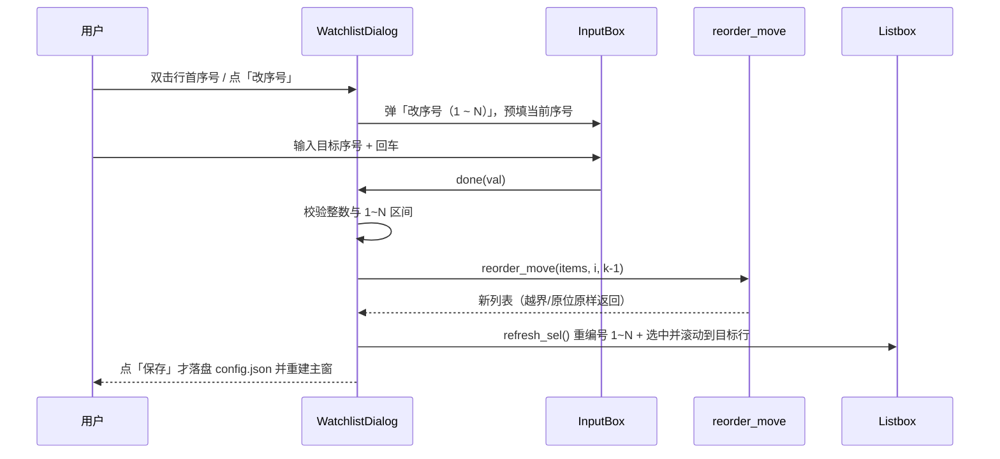

# SDD-盯盘君-自选排序-v1.0.0

## 1. 文档概述

### 1.1 文档信息

| 字段 | 内容 |
| --- | --- |
| 项目名称 | 盯盘君 MarketEye |
| 文档版本 | v1.0.0 |
| 版本状态 | 未发布 |
| 创建日期 | 2026-11-18 |
| 更新日期 | 2026-11-18 |
| 基于需求 | PRD-盯盘君-自选排序-v1.0.0（R-01~R-05，AC-01~AC-08） |

### 1.2 变更记录

| 版本 | 日期 | 变更人 | 变更类型 | 关联章节 | 变更内容 |
| --- | --- | --- | --- | --- | --- |
| v1.0.0 | 2026-11-18 | - | 新增 | — | 「管理自选 → 标的」页新增改序号调序：`reorder_move` 纯函数负责搬位、`WatchlistDialog.edit_no` 负责入口与校验、`on_sel_double` 按横坐标分流双击手势、`refresh_sel` 动态位数编号；↑↓ 按钮改走同一搬位函数。D01/D02、T01~T04 |

## 2. 设计概述

### 2.1 设计目标

- 一次操作把任意标的搬到任意位次，替代「点 N 下 ↑↓」。
- 不新增持久化字段：**数组下标即序号**，改完顺序立即重编，天然不会出现空号/重号。
- 双击手势与既有「双击改别名」共存，互不抢占。

### 2.2 不在范围内

- 「列」页签的列顺序（列只有 6 项，↑↓ 已够用，仍走 `Panel.move_column`）。
- 多选批量调序、拖拽排序、按名称/涨跌幅自动排序。

### 2.3 数据流

## 3. 详细设计

### 3.1 数据模型

不新增配置键。自选顺序仍是 `config.json → groups[].items[]` 的数组顺序：

| 字段 | 类型 | 说明 |
| --- | --- | --- |
| `groups[].items[]` | 数组 | 顺序即显示顺序，下标 +1 即「序号」 |
| `groups[].items[].code` | 字符串 | 标的代码 |
| `groups[].items[].alias` | 字符串 | 显示名称 |

序号不落盘：打开面板时由 `enumerate` 现算，所以任何时刻都满足 1~N 连续升序（R-04）。

### 3.2 纯函数

| 函数 | 签名 | 说明 |
| --- | --- | --- |
| `reorder_move`（新增） | `(seq, i, k) -> list` | 复制后把 `seq[i]` 搬到第 k 位（0 基），其余顺次挪位；`i`/`k` 越界或相等时返回等值副本。**不改入参**，调用方 `self.items = reorder_move(...)` |

### 3.3 关键实现

- **入口分流（R-01）**：`_listbox` 的 `<Double-Button-1>` 统一绑到 `on_sel_double(e)`，用 `e.x <= self._no_px` 判断落点——序号区进 `edit_no()`，右侧进 `rename()`。`_no_px` 在 `refresh_sel` 里按当前序号位数实测：`f_lb.measure("0"*nw + ".  ") + px(8)`（`f_lb` 为与 Listbox 同族同号的 `tkfont.Font`，只用于量宽）。
- **位数自适应（R-04）**：`nw = max(2, len(str(len(items))))`，编号右对齐；≥100 项自动变 3 位，`_no_px` 同步变宽，双击命中区跟着走。
- **校验（R-03）**：`done(val)` 里 `int()` 失败提示「序号请填数字」；不在 `1~n` 提示「序号需在 1 ~ n 之间」。**不做自动钳制**——钳到边界会让用户以为已经搬到位，实际没搬。
- **提示通道**：`_flash(msg)` 复用列表标题行（`tip_sel`）显示红字，`after(1400, refresh_sel)` 恢复，不碰搜索结果列表。
- **选中跟随（R-05）**：搬位后 `selection_set(k)` + `see(k)`，便于连续调整。
- **↑↓ 复用同一函数**：`move(d)` 改为 `self._place(i, i + d)`，`_place` 只是 `reorder_move` + 重建 + 选中，两条入口行为天然一致。
- **保存语义不变**：改序号只改面板内存，点「保存」才 `save_json` 并 `app._rebuild()`；「取消」丢弃（AC-05）。

### 3.4 踩坑记录

- **测试脚本会写真实 config.json**：`WatchlistDialog.save()` 直接 `save_json(CONFIG_FILE, ...)`，用桩 app 跑测试时若不重定向 `ticker.CONFIG_FILE`，一次 `save()` 就把用户 40+ 自选覆盖成假数据（**本次实测真踩了一次，已 `git checkout -- config.json` 还原**）。今后凡构造 `WatchlistDialog` 的测试，必须先改 `m.CONFIG_FILE` 到临时路径。
- **Listbox 没有「单元格」**：无法只给序号加绑定，双击分流只能靠横坐标；因此 `_no_px` 必须随位数变化，不能写死 40px。
- **`bbox()` 宽度 ≠ 序号区宽度**：`bbox` 返回整行文本宽度，判断阈值要用字体实测的前缀宽度。

## 4. 验收对照

| AC | 自检 / 测试手段 |
| --- | --- |
| AC-01 末位→首位 | 桩实例 41 项，`selection_set(40)` + `edit_no` + `done("1")`：`items[0]` 变为原末项、原首项后移、编号 1~41 |
| AC-02 首位→末位 | 同上反方向，`selection_set(0)` + `done("41")` |
| AC-03 非法输入 | `"0"/"42"/"abc"/""/"  "` 五种：顺序不变、标题红字含范围或「数字」、1.55s 后恢复原文与副色 |
| AC-04 填当前序号 | `selection_set(4)` + `done("5")`：顺序不变、仍选中第 5 行 |
| AC-05 未保存即取消 | 代码路径审查：`close()` 不写 `items`，不改 `watch_group()` |
| AC-06 保存后主窗一致 | `save()` 后断言 `app.cfg["groups"][0]["items"]` 与面板 `items` 完全一致 |
| AC-07 未选中双击 | `selection_clear` 后 `on_sel_double(x=3)`：两个回调都不触发 |
| AC-08 名称区双击 | `on_sel_double(x=_no_px+40)` 走 `rename` |
| `selftest` | 新增 `[order]` 段：`reorder_move` 末→首 / 首→末 / 中间 / 原位 / 越界 五例 + 不丢项不重项 |
