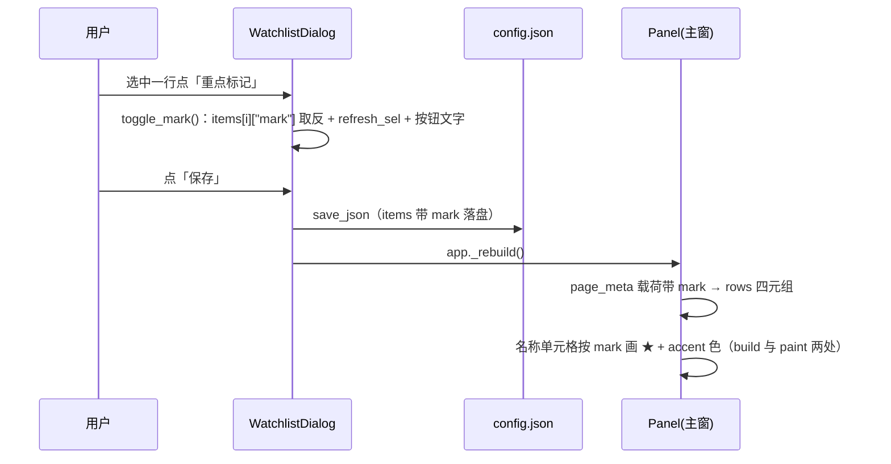

# SDD-盯盘君-重点标记-v1.0.0

## 1. 文档概述

### 1.1 文档信息

| 字段 | 内容 |
| --- | --- |
| 项目名称 | 盯盘君 MarketEye |
| 文档版本 | v1.0.0 |
| 版本状态 | 未发布 |
| 创建日期 | 2026-11-19 |
| 更新日期 | 2026-11-19 |
| 基于需求 | PRD-盯盘君-重点标记-v1.0.0（R-01~R-05，AC-01~AC-08） |

### 1.2 变更记录

| 版本 | 日期 | 变更人 | 变更类型 | 关联章节 | 变更内容 |
| --- | --- | --- | --- | --- | --- |
| v1.0.0 | 2026-11-19 | - | 新增 | — | 自选标的重点标记：`groups[].items[].mark` 持久化字段（缺省 false 向后兼容）；`page_meta` 载荷与主窗 rows 元组带上 mark；主窗名称单元格按 mark 加 ★ 前缀并切强调色（`THEMES accent` 新键）；管理面板底部按钮行重排插入「重点标记」toggle 按钮，`<<ListboxSelect>>` 同步按钮文字；selftest 新增 `[mark]` 段。**轮播 ★ 不做**：轮播源固定为「宽基指数」分组（`MARQ_GROUP_NAME`），与自选标记范围不相交，编码期经用户确认移除（`marq_list`/`draw_marq` 保持二元不变）。D01~D05、T001~T005 |

## 2. 设计概述

### 2.1 设计目标

- 标记是标的的一个布尔属性，**跟 item 走、随配置落盘**，不改排序、不改既有交互。
- 主窗与面板两处渲染共用同一份 mark 数据，不另设状态。
- 旧配置（无 `mark` 键）零迁移成本加载。

### 2.2 不在范围内

- 批量标记、标记级别（只有开/关）。
- 按标记置顶或过滤（排序仍由编号决定，PRD R-05）。
- 「列」页签、板块异动小窗等其他视图的标记显示。

### 2.3 数据流

## 3. 详细设计

### 3.1 数据模型（D01）

新增一个持久化字段，其余不动：

| 字段 | 类型 | 说明 |
| --- | --- | --- |
| `groups[].items[].mark` | 布尔，**可缺省** | 重点标记；缺省 / 非真均视为未标记（`bool(it.get("mark"))`） |

标记只在「自选」分组上由管理面板写入；`save()` 把面板 `items` 整体替换回 `watch_group()`，mark 作为 dict 键自然随行（`ticker.pyw / WatchlistDialog.save()`），保存流零改动。

### 3.2 纯函数与载荷（D02）

| 函数 | 变更 | 说明 |
| --- | --- | --- |
| `page_meta`（`ticker.pyw:466`） | 行载荷改 `(code, alias, mark)` | `("r", (code, alias, mark), gidx)` |
| `name_cell_text`（新增模块级纯函数） | `(mark, s) -> str` | `("★ " if mark else "") + trunc(s)`；★ 前缀拼在 **trunc 之后**，避免截断把 ★ 之后的名称吃掉一个字；build 与 paint 两个名称渲染点共用，selftest 直测 |

**rows 元组升级（D03）**：主窗行结构从 `(code, alias, ids)` 升为 `(code, alias, mark, ids)`——mark 跟行走而不是跟代码走，同一代码出现在多个分组时只给被标记的那一行加 ★。同步更新三处解包：`Panel.paint`（ticker.pyw:3637）、折行刷新处（ticker.pyw:3700）、自定义列刷新处（ticker.pyw:4123），及 `self.rows` 注释（ticker.pyw:1818）。

### 3.3 渲染（D04）

**主题**：`THEMES` 两套各加 `"accent"` 键——dark `#F5A623`（琥珀，`#151A24` 上对比度足）、light `#B7791F`（深琥珀，白底可读）。只用于重点行的名称文字与 ★；价格 / 涨跌幅 / 量比 / 换手仍走既有涨红跌绿 / flat 配色，**不被覆盖**（AC-06）。

**主窗名称单元格**（build：ticker.pyw:3365；paint 有数据分支：ticker.pyw:3644、缺数据分支：ticker.pyw:3666）：

- 文本：`name_cell_text(mark, alias or code)`（有数据且无别名时用 `trunc(d["name"])`）。
- 填色：`t["accent"] if mark else t["name"]`，★ 与名称同色（PRD R-03）。
- 名称列是动态宽列（自适应剩余宽度），★ 前缀挤占的十来个像素由列宽兜住，不做二次截断。

**面板清单**（`refresh_sel`：ticker.pyw:9898）：标记行名字前缀 `"★ "`，未标记行用两个空格占位保持后续列大致对齐（`pad_to` 本就是近似对齐，★ 按 `disp_width` 记 1 宽的偏差可接受）。

### 3.4 管理面板交互（D05）

**底部按钮行重排**（ticker.pyw:9694）：原 6 钮占满 16~414，插入第 5 钮须重排（逻辑像素，`_button` 内部自乘缩放）：

| 按钮 | x | w | 说明 |
| --- | --- | --- | --- |
| ↑ / ↓ | 16 / 50 | 30 / 30 | 行为不变 |
| 删除 | 84 | 54 | danger，行为不变 |
| 改序号 | 142 | 78 | ghost，行为不变 |
| **重点标记**（新增） | 224 | 78 | kind="ghost"，`toggle_mark` |
| 取消 | 306 | 46 | 行为不变 |
| 保存 | 356 | 58 | primary，行为不变 |

间距 4px，末钮右缘 414 与原版对齐。`_button` 文字居中，4 字（约 48px）在 78 宽内余量充足。

**toggle_mark()**：无选中 → `_flash("先选中一行再标记")`（复用既有提示通道，R-02）；有选中 → `it["mark"] = not it.get("mark")` → `refresh_sel()` → 保持选中该行 → `_sync_mark_btn()`。

**按钮文字同步（`_sync_mark_btn`）**：读当前选中行 mark——已标记显示「取消重点」、未标记或未选中显示「重点标记」。绑定 `lb_sel` 的 `<<ListboxSelect>>`（换选即同步）并在 `toggle_mark` / `refresh_sel` 后调用；保存 `_button` 返回的 Button 引用（`self.btn_mark`）供 `config(text=...)`。

**tip 文案**（ticker.pyw:9910）补一段「底部按钮设重点」，提示新入口。

### 3.5 踩坑与约束

- **CONFIG_FILE 铁律**（继承自选排序 SDD §3.4）：凡构造 `WatchlistDialog` 的 selftest/桩测试，必须先把 `ticker.CONFIG_FILE` 重定向到临时文件，否则 `save()` 会覆盖真实配置。
- **★ 的宽度认知差**：`disp_width` 把 ★（U+2605）记 1 宽，Tk 渲染实际接近全宽——只影响面板 `pad_to` 近似对齐，不影响主窗（动态列宽兜住）。
- **rows 元组升级必须三处解包同轮改**：漏改任一处运行时 `ValueError`，按 T002 一次改齐。
- 标记改动不引入新 `except` 吞异常点；渲染异常仍走 `_dbg`。

## 4. 任务清单

| 编号 | 任务 | 验证 |
| --- | --- | --- |
| T001 | `THEMES` 加 `accent` 键（dark/light） | 深浅主题截图名称色对比 |
| T002 | 载荷链路：`page_meta` 三元载荷、rows 四元组 + 三处解包 + 注释 | selftest `[mark]` 载荷断言 + 程序启动无异常 |
| T003 | `name_cell_text` 纯函数 + 主窗名称单元格 build/paint 三处接入 | selftest 直测；主窗截图 ★ + accent |
| T004 | 面板按钮行重排 + `toggle_mark` + `_sync_mark_btn` + `refresh_sel` ★ + tip 文案 | 桩面板操作冒烟 + 按钮文字切换 |
| T005 | selftest `[mark]` 段（CONFIG_FILE 重定向下构造桩面板） | `--selftest` 全过 |

## 5. 验收对照

| AC | 自检 / 测试手段 |
| --- | --- |
| AC-01 标记切换 | 桩面板 `selection_set(i)` + `toggle_mark()`：`items[i]["mark"]` 为真、行文本含 ★、按钮文字「取消重点」 |
| AC-02 取消标记 | 同一桩再点：`mark` 复位、★ 消失、按钮文字恢复 |
| AC-03 未选中提示 | `selection_clear` 后 `toggle_mark()`：标题红字「先选中一行再标记」，1.55s 后恢复 |
| AC-04 取消丢弃 | 代码路径审查：面板操作只改 `self.items` 拷贝，`close()` 不回写 `watch_group()` |
| AC-05 保存后主窗一致 | `save()` 后断言 cfg 中对应 item `mark` 为真；`_rebuild` 后 rows 四元组带 mark |
| AC-06 涨跌幅不被覆盖 | paint 分支审查 + 截图：标记行 pct 列仍涨红跌绿 |
| AC-07 重启保留 / 旧配置兼容 | `mark` 缺省 item 经 `page_meta` 载荷为 False；重启装载走既有 cfg 路径 |
| `selftest` | 新增 `[mark]` 段：`name_cell_text` 有/无标记两例（含长名截断）、`page_meta` 载荷、旧配置缺键兼容 |
