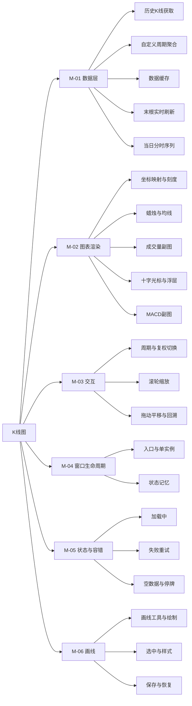
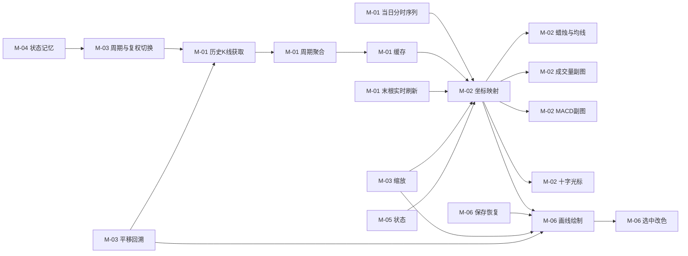
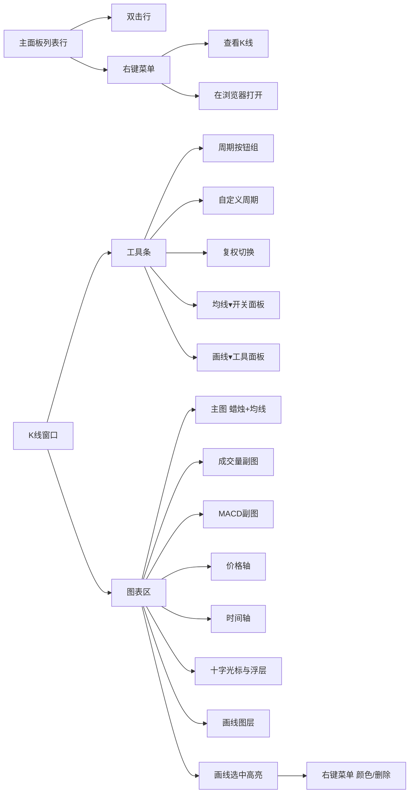
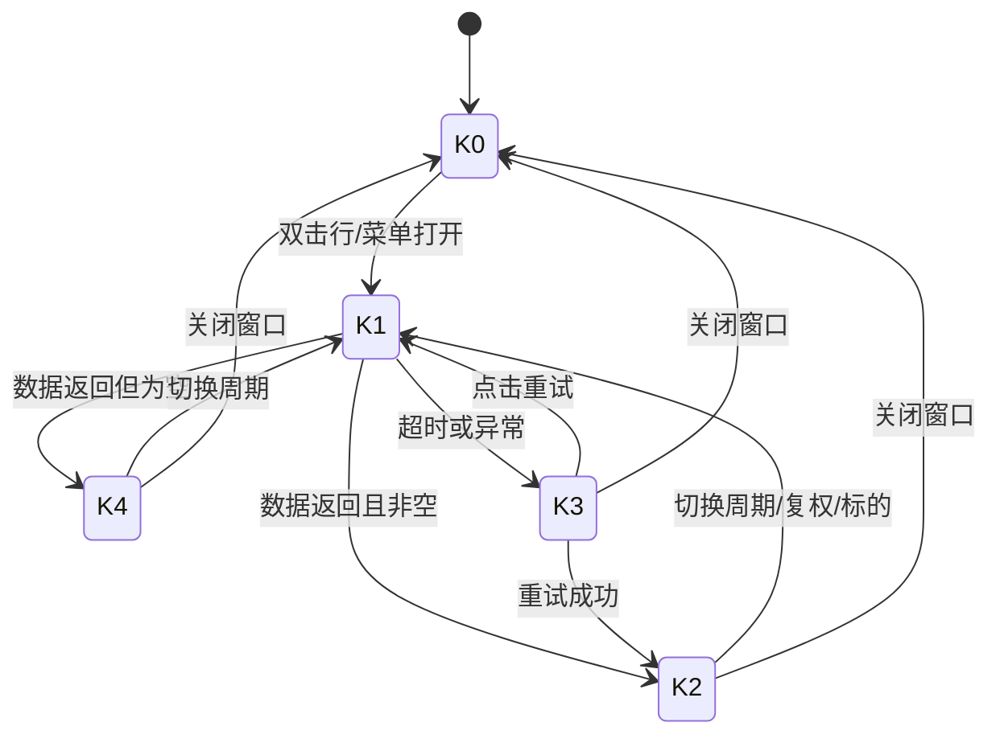
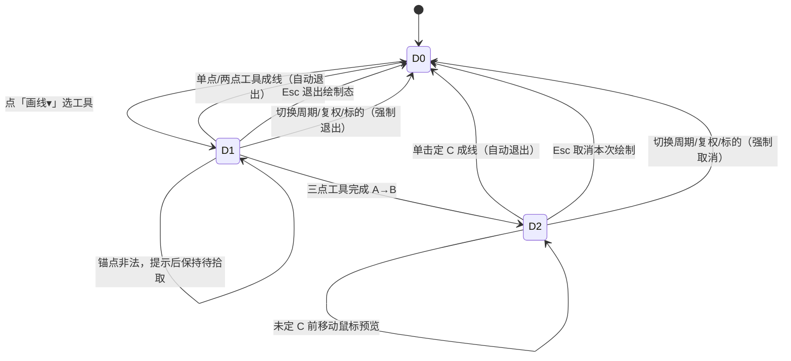
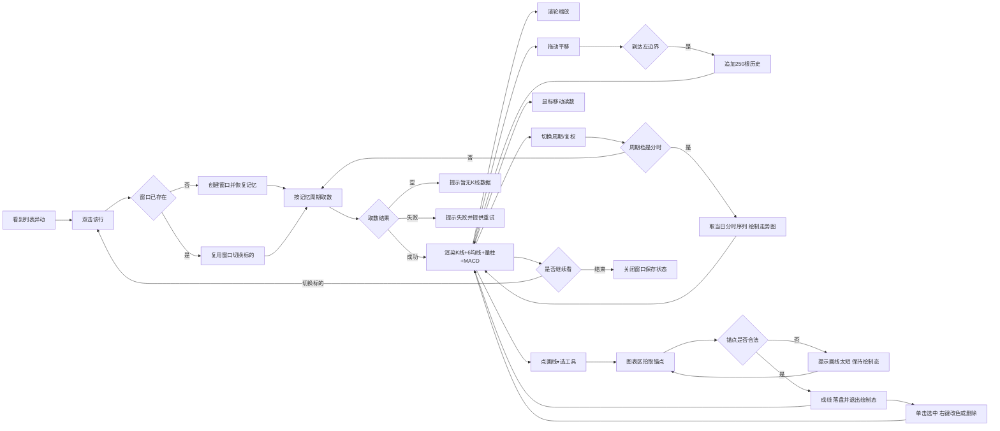

# PRD-盯盘君-K线图-v1.0.0

## 1. 文档概述

### 1.1 文档信息

| 字段 | 内容 |
| --- | --- |
| 项目名称 | 盯盘君（MarketEye）桌面行情悬浮窗 |
| 文档版本 | v1.0.0 |
| 版本状态 | 未发布 |
| 创建日期 | 2026-10-30 |
| 更新日期 | 2026-10-31 |
| 基于需求 | ①用户需求（2026-10-30）：「点击某个股票，二级页面展示 K 线，K 线可缩放，并可切换不同周期，周期可以自定义，类似于同花顺的 K 线展示」 ②用户需求（2026-10-30，第二轮）：「K线图周期选择应该包括：分时 1分钟 5分钟 15分钟 30分钟 60分钟 120分钟 日 周 月；均线应该可以选择：5日 10日 20日 60日 120日 250日；增加 MACD 的副图以及 MACD 副图对应的信息；参考同花顺的 K 线图及副图展示」 ③用户需求（2026-10-31，第三轮）：「再加一个画线功能，比如黄金分割线、水平线、波浪尺线等，可以调整线的颜色，画完的线需要保留在对应 k 线图上」；经确认的口径：画线按「标的 + 周期」各自独立；首批含水平线、垂直线、趋势线、矩形、黄金分割、波浪尺、平行通道共 7 种；颜色通过选中线后的右键菜单调整 |

### 1.2 变更记录

| 版本 | 日期 | 变更人 | 变更类型 | 关联章节 | 变更内容 |
| --- | --- | --- | --- | --- | --- |
| v1.0.0 | 2026-10-31 | - | 新增 | §1.1、§1.4、§2.1–§2.4、§3.1、§3.2 F-01–F-18、§3.3.1–§3.3.8、§3.4、§4.1–§4.3、§5.1 | 初始版本（含 2026-10-31 第三轮画线需求）：新增独立 K 线窗口，支持 10 档固定周期（分时、1/5/15/30/60/120 分、日、周、月）+ 自定义 N 分钟/N 日、前/后/不复权切换、滚轮锚点缩放、拖动平移与历史回溯、蜡烛主图 + 6 条均线（5/10/20/60/120/250）、成交量与 MACD（12,26,9）双副图、十字光标浮层与副图数值行、数据缓存与失败重试、窗口状态记忆；分时档按整日固定时槽绘制且不参与缩放平移；原双击打开网页的行为迁至右键菜单。**第三轮增补画线**：新增 F-15~F-18 与 R-08，支持水平线、垂直线、趋势线、矩形、黄金分割、波浪尺、平行通道 7 种画线，锚点按「时间标签 + 价格」记录（不存像素/索引），缩放平移后跟随重映射；画线按「标的 + 周期」独立保存到配置，重开窗口仍在；选中后可右键改色或删除，支持 Ctrl+Z 撤销最近 20 步 |

### 1.3 项目背景

悬浮窗的职责是"发现"，不是"研究"。用户看到某只标的异动（涨跌幅、量比、换手突变）后，下一步一定是要看形态——但当前双击行只能跳转到外部网页，等于把用户交给浏览器：网页慢、有广告、切走就丢失悬浮窗的上下文，且无法在两个标的之间快速对比。

项目已具备的能力（窗口绘制、DPI 换算、主题 token、圆角自绘、事件绑定）足够在本地画出一张可用的 K 线图，不需要引入任何第三方绘图库。做完之后，"发现异常 → 看形态"可以在同一个程序内闭环，不必在悬浮窗与浏览器之间来回切。（本期不含"加入自选"等写操作，自选仍由主面板的管理面板维护。）

### 1.4 功能概述

| 能力 | 说明 |
| --- | --- |
| 独立窗口 | 从列表行或右键菜单打开，一个窗口跟随切换标的，不堆叠多窗 |
| 周期 | 分时、1/5/15/30/60/120 分钟、日、周、月共 10 档常驻；另可自定义 N 分钟（1–120）与 N 日（1–250） |
| 复权 | 日/周/月支持前复权、后复权、不复权，默认前复权 |
| 缩放 | 滚轮以鼠标位置为锚点缩放，可见 20–300 根（分时档固定整日，不缩放） |
| 平移 | 左键拖动平移，拖到最左自动加载更早历史（分时档不适用） |
| 图形 | 蜡烛图 + 6 条均线（可分别开关）+ 成交量副图 + MACD 副图 + 价格轴/时间轴 + 最新价虚线；分时档为价格线 + 均价线 + 昨收基准线 |
| 读数 | 十字光标联动顶部时间标签、右侧价格标签、信息浮层，以及成交量/MACD 副图标题行的数值 |
| 画线 | 水平线、垂直线、趋势线、矩形、黄金分割、波浪尺、平行通道共 7 种；锚点按时间 + 价格记录，缩放平移与复权切换后跟随；单击选中后可右键改 8 色或删除，Ctrl+Z 撤销 20 步；按「标的 + 周期」独立保存，重开窗口仍在 |
| 实时性 | 已加载数据 30 秒内不重复请求，最后一根 K 线用实时报价刷新 |
| 健壮性 | 加载中/失败/空数据三态明确，失败可点重试，不自动轮询 |

### 1.5 目标用户

| 角色 | 使用场景 |
| --- | --- |
| 个人投资者（唯一角色） | 盘中看到自选里某只票突然拉升，双击看 5 分钟与日线形态，判断是突破还是假动作；复盘时切到周线看大级别位置 |

## 2. 需求全景

### 2.1 功能架构

### 2.2 功能模块划分

| 编号 | 功能域 | 职责范围 | 不包含 |
| --- | --- | --- | --- |
| M-01 | 数据层 | 按标的与周期取历史 K 线；自定义周期在本地聚合；「分时」档取当日逐分钟序列；内存缓存与有效期；最后一根用实时报价刷新 | 不负责坐标换算与绘制 |
| M-02 | 图表渲染 | 数据 → 坐标映射；蜡烛、6 条均线、量柱、MACD 三线、坐标轴、最新价线、十字光标与浮层的绘制；分时档改为价格线 + 均价线 | 不发起请求，不改数据 |
| M-03 | 交互 | 周期/复权切换、滚轮缩放、拖动平移与边界回溯、十字光标跟随、复位 | 不负责窗口创建销毁 |
| M-04 | 窗口生命周期 | 入口触发、单实例复用与标的切换、关闭、尺寸/位置/周期/复权的记忆与恢复 | 不涉及主面板布局 |
| M-05 | 状态与容错 | 加载中、失败可重试、空数据与停牌、超时提示 | 不改变主面板的行情刷新 |
| M-06 | 画线 | 7 种画线工具的几何计算与绘制、锚点吸附、选中与改色、删除与撤销、按「标的 + 周期」保存与恢复、复权换算 | 不参与 K 线取数与聚合；不改变缩放平移的可见范围 |

### 2.3 功能依赖关系

### 2.4 界面功能架构

| 入口名称 | 所在层级 | 触发方式 | 功能路径 | 对应功能点 | 对应功能域 |
| --- | --- | --- | --- | --- | --- |
| 标的行 | 一级：主面板列表区 / 二级：标的行 | 双击 | 盯盘君 → 列表区 → 标的行 | F-01 | M-04 |
| 右键菜单项「查看K线」 | 一级：右键菜单 / 二级：菜单项 | 右键 → 点击 | 盯盘君 → 列表区 → 标的行 | F-01 | M-04 |
| K线窗口（Esc / 关闭按钮） | 一级：K线窗口 | 按键 / 点击 | 盯盘君 → 列表区 → 标的行 | F-01 | M-04 |
| 右键菜单项「在浏览器打开」 | 一级：右键菜单 / 二级：菜单项 | 右键 → 点击 | 盯盘君 → 右键菜单 → 在浏览器打开 | F-12 | M-04 |
| 周期按钮组 | 一级：K线窗口 / 二级：工具条 / 三级：周期按钮 | 点击 | 盯盘君 → K线窗口 → 工具条 → 周期 | F-02、F-13 | M-01、M-03 |
| 「自定义…」按钮 | 一级：K线窗口 / 二级：工具条 / 三级：自定义周期 | 点击 → 输入 → 确认 | 盯盘君 → K线窗口 → 工具条 → 周期 | F-02 | M-01 |
| 复权切换 | 一级：K线窗口 / 二级：工具条 / 三级：复权 | 点击 | 盯盘君 → K线窗口 → 工具条 → 复权 | F-03 | M-01、M-03 |
| 均线开关 | 一级：K线窗口 / 二级：工具条 / 三级：均线▾面板 | 点击展开 → 勾选 | 盯盘君 → K线窗口 → 工具条 → 均线 | F-06 | M-02 |
| 图表区 | 一级：K线窗口 / 二级：图表区 | 滚轮 | 盯盘君 → K线窗口 → 图表区 → 缩放 | F-04 | M-03 |
| 图表区 | 一级：K线窗口 / 二级：图表区 | 左键拖动 | 盯盘君 → K线窗口 → 图表区 → 平移 | F-05 | M-03 |
| 图表区 | 一级：K线窗口 / 二级：图表区 | 双击 | 盯盘君 → K线窗口 → 图表区 → 平移 | F-05 | M-03 |
| 图表区 | 一级：K线窗口 / 二级：图表区 | 悬停 / 移动 | 盯盘君 → K线窗口 → 图表区 → 十字光标 | F-08 | M-02 |
| 副图区 | 一级：系统自动行为 | 自动触发，无用户操作 | 盯盘君 → K线窗口 → 图表区 → 成交量副图 | F-07 | M-02 |
| MACD 副图区 | 一级：系统自动行为 | 自动触发，无用户操作 | 盯盘君 → K线窗口 → 图表区 → MACD副图 | F-14 | M-02 |
| 数据层 | 一级：系统自动行为 | 自动触发，无用户操作 | 盯盘君 → K线窗口 → 数据层 | F-09 | M-01 |
| 状态区 | 一级：系统自动行为 | 自动触发，无用户操作 | 盯盘君 → K线窗口 → 图表区 → 状态 | F-10 | M-05 |
| 窗口状态 | 一级：系统自动行为 | 自动触发，无用户操作 | 盯盘君 → K线窗口 → 状态记忆 | F-11 | M-04 |
| 「画线▾」按钮 | 一级：K线窗口 / 二级：工具条 / 三级：画线▾面板 | 点击展开 → 选工具 | 盯盘君 → K线窗口 → 工具条 → 画线 | F-15 | M-06 |
| 画线工具项（7 项） | 一级：K线窗口 / 二级：工具条 / 三级：画线▾面板 | 点击 | 盯盘君 → K线窗口 → 工具条 → 画线 → 水平线/垂直线/趋势线/矩形/黄金分割/波浪尺/平行通道 | F-15 | M-06 |
| 图表区（绘制画线） | 一级：K线窗口 / 二级：图表区 | 按下-拖动-松开（两点）/ 单击（水平线、垂直线）/ 三点工具分两段 | 盯盘君 → K线窗口 → 图表区 → 画线 | F-15、F-16 | M-06 |
| 已有画线 | 一级：K线窗口 / 二级：图表区 / 三级：画线 | 单击选中 → 右键 | 盯盘君 → K线窗口 → 图表区 → 画线 → 颜色/删除 | F-17 | M-06 |
| 画线数据 | 一级：系统自动行为 | 自动触发，无用户操作 | 盯盘君 → K线窗口 → 画线 → 保存与恢复 | F-18 | M-06 |

> **交互迁移**：主面板列表行双击的原有行为（打开行情网页）迁到右键菜单「在浏览器打开」（F-12），双击改为打开 K 线窗口。这是本期唯一一处既有手势语义变更，见 R-06。
>
> F-07、F-09、F-10、F-11、F-14 为系统自动行为，无用户主动触发的界面元素，按标注「一级：系统自动行为」登记，与折叠轮播 PRD 的处理方式一致。

## 3. 功能需求

### 3.1 用户故事

| 编号 | 用户故事 | 价值 |
| --- | --- | --- |
| US-01 | 作为个人投资者，我想双击自选里的标的直接看到 K 线，以便不用离开悬浮窗就能判断形态 | 「发现异动 → 看形态」闭环在同一程序内完成，不再被浏览器切走 |
| US-02 | 作为个人投资者，我想用滚轮放大某一段走势，以便看清几根 K 线之间的高低关系 | 局部形态可放大核对，不用靠肉眼估计 |
| US-03 | 作为个人投资者，我想在 5 分钟、日线、周线之间快速切换，以便同时看短期节奏和大级别位置 | 多周期切换成本从"开网页改设置"降到一次点击 |
| US-04 | 作为个人投资者，我想自定义 45 分钟或 3 日这样的周期，以便按自己的交易节奏看盘 | 周期贴合个人交易节奏，而不是只能用平台给的固定档 |
| US-05 | 作为个人投资者，我想在图上移动鼠标就读到那根 K 线的开高低收与量，以便精确核对 | 读数不用另找数据源，避免看错某一根 |
| US-06 | 作为个人投资者，我想在除权前后看到连续的形态，以便不被跳空缺口误导 | 复权可选，形态判断不被除权缺口污染 |
| US-07 | 作为个人投资者，我想在同一天里看价格曲线与均价线的相对位置，以便判断当日买卖力道强弱 | 分时形态当日闭环，不用开网页核对均价 |
| US-08 | 作为个人投资者，我想在主图下方直接看到 MACD 的金叉死叉与红绿柱变化，以便不切换软件就能确认动能 | 形态判断与动能判断在同一张图内完成，避免多软件来回核对 |
| US-09 | 作为个人投资者，我想在图上画水平线和黄金分割，把关键支撑压力位标出来，以便下次打开这只票时还能看到自己标的位置 | 判断依据从「脑子记」变成「图上标」，复盘不用重新找回上次的判断 |
| US-10 | 作为个人投资者，我想用波浪尺量一段已经走完的波段，看回撤位和扩展位，以便估算下一段的目标价 | 目标位从模糊感觉变成可量化的几个价位 |

### 3.2 详细功能点

#### F-01 打开与关闭 K 线窗口

**功能路径**：盯盘君 → 列表区 → 标的行

**功能描述**：从主面板列表行双击、或右键菜单「查看K线」打开独立窗口；窗口为系统边框窗口，可自由调整大小、最大化。同一时刻只存在一个 K 线窗口，再次打开其他标的时复用该窗口并切换标的。

**触发条件**：双击列表行；或右键菜单点击「查看K线」。窗口已打开时再次双击其他标的即切换标的。

**输入字段定义**

| 字段名 | 类型 | 必填 | 校验规则 | 默认值 | 说明 |
| --- | --- | --- | --- | --- | --- |
| 标的代码 | 文本 | 是 | 必须是可识别的沪深/港股代码 | 双击行的代码 | 港股与指数同样支持 |
| 标的名称 | 文本 | 是 | 取配置中的别名，缺失时用代码 | — | 显示在窗口标题 |
| 初始周期 | 枚举 | 是 | 属于 10 档之一或自定义档 | 上次使用的周期 | 首次为「日」 |
| 复权方式 | 枚举 | 是 | 前复权/后复权/不复权 | 上次使用的方式 | 首次为前复权 |

**业务处理逻辑**

1. 折叠态下双击标题栏仍为折叠/展开（既有行为），不触发 K 线；
2. 展开态双击列表行 → 解析代码 → 若窗口已存在则切换标的并复位到最新 120 根，否则创建窗口；按下后位移超过 3 逻辑像素的第二次按下不构成双击（见 R-06-6）；
3. 创建时按记忆的尺寸与位置摆放；若记忆位置已超出当前屏幕可用区域，改为居中；
4. 窗口打开后立即以记忆的周期与复权方式取数并渲染；
5. 关闭窗口（关闭按钮或 Esc）后释放缓存引用，保留尺寸/位置/周期/复权记忆；
6. 主面板退出时一并关闭 K 线窗口，不留残留进程。

**窗口与布局尺寸**

| 项 | 默认值（逻辑像素） | 说明 |
| --- | --- | --- |
| 窗口尺寸 | 880 × 640 | 首次打开无记忆时使用；较单副图版本加高 80，用于容纳 MACD 副图 |
| 最小尺寸 | 640 × 480 | 小于此值时按此值恢复 |
| 工具条高度 | 40 | 周期按钮组、自定义、复权、均线开关所在行 |
| 价格轴宽度 | 56 | 右侧，绘制价格刻度与最新价标签 |
| 时间轴高度 | 22 | 底部，绘制时间刻度 |
| 主图 : 成交量副图 : MACD 副图 | 6 : 2 : 2 | 图区高度先扣工具条与时间轴，再按此比例分三段 |

> 三图最小尺寸校验：480 − 系统标题栏（约 31）− 工具条 40 − 时间轴 22 = 图区约 387，主图约 232、成交量约 77、MACD 约 77，均高于各自最小可读高度（主图 160、副图 60）；宽度 640 − 价格轴 56 = 绘图宽约 584。

**输出结果**：一个独立窗口，标题为 `名称 代码 · 周期 · 复权 · 现价 涨跌幅`，内容为已渲染的图表。

失败反馈：标的代码无法解析时提示 `该标的暂无K线数据`，窗口不打开。

**交互流程**：双击行 → 窗口出现（≤300ms 显示骨架与加载提示）→ 数据返回后绘制 → 拖拽调整大小 → 关闭。

#### F-02 周期切换

**功能路径**：盯盘君 → K线窗口 → 工具条 → 周期

**功能描述**：工具条提供 10 个固定周期按钮与一个「自定义…」入口；切换后重新取数并从最新一根开始展示。其中「分时」档不按 K 线根数绘制，改为当日走势图（价格线 + 均价线，见 F-13）；「120 分」档按每交易日 2 根绘制（上午、下午各 1 根）。

**触发条件**：点击周期按钮；或点击「自定义…」并在输入框中确认。

**输入字段定义**

| 字段名 | 类型 | 必填 | 校验规则 | 默认值 | 说明 |
| --- | --- | --- | --- | --- | --- |
| 周期档 | 下拉/按钮单选 | 是 | 分时/1分/5分/15分/30分/60分/120分/日/周/月/自定义 | 日 | 单选互斥，共 10 个固定档 |
| 自定义数值 | 数字 | 是（仅自定义档） | 整数；分钟 1–120，日 1–250 | 上次值 | 越界时阻止并提示范围 |
| 自定义单位 | 单选 | 是（仅自定义档） | 分钟 / 日 | 分钟 | — |

**业务处理逻辑**

1. 点击固定档：直接切换到该档，重置到最新 120 根（「分时」档除外，见第 9 条）；
2. 点击「自定义…」：弹出输入面板，含数值输入框与「分钟 / 日」单位单选，提供确认与取消，越界时在框下提示且不关闭面板；
3. 自定义周期以基础周期聚合得到：分钟档按当日交易时段分组，不跨日、不跨午休；日档按连续交易日累加，不按自然周/月切分；
4. 聚合规则：开盘价取首根开盘价、收盘价取末根收盘价、最高价取区间最大、最低价取区间最小、成交量与成交额取区间求和；
5. 分钟档（含 120 分）的复权控件置灰（分钟线与分时走势不涉及复权）；
6. 港股标的的 1/5/15/30/60/120 分钟档与自定义「分钟」单位置灰并提示 `港股仅支持分时与日线以上周期`；「分时」档对港股可用；若记忆的周期为分钟档，打开时回退到「日」；
7. 聚合末段不足 N 根时按 R-01-8 处理，不丢弃、不与下一段合并；
8. 切换成功后写入记忆，并在窗口标题中体现当前周期；
9. 点击「分时」档：主图切换为当日走势图形态（价格线 + 均价线 + 昨收基准，见 F-13），横轴固定为当日交易分钟时槽，可见范围恒为整日；均线开关与复权控件在该档置灰，MACD 副图以当日分时价格序列递推（跨日不延续，见 F-14）并照常显示；
10. 点击「120 分」档：每交易日固定 2 根（上午 09:30–11:30、下午 13:00–15:00），与「60 分」并列，不参与自定义聚合。

**输出结果**：图表按新周期重绘；若新周期数据不足 20 根，按实际根数绘制并在左下角提示 `数据不足，仅 X 根`（分时档不适用，其横轴恒为当日全部交易分钟）。

失败反馈：自定义数值越界 → 输入框下方提示 `分钟范围 1–120` / `日范围 1–250`，不关闭输入框、不发起请求。

#### F-03 复权切换

**功能路径**：盯盘君 → K线窗口 → 工具条 → 复权

**功能描述**：日、周、月周期下可切换前复权、后复权、不复权；默认前复权。

**触发条件**：点击复权切换控件。

**输入字段定义**

| 字段名 | 类型 | 必填 | 校验规则 | 默认值 | 说明 |
| --- | --- | --- | --- | --- | --- |
| 复权方式 | 单选 | 是 | 前复权/后复权/不复权 | 前复权 | 分钟档不可用 |

**业务处理逻辑**

1. 切换后按同一周期重新取数并重绘，保持当前可见根数与右端位置不跳变；
2. 分钟档（含 120 分）、分时档、以及数据源不支持不复权的标的，控件置灰并保留上次有效值；
3. 切换不改变十字光标选中位置对应的 K 线序号，若该位置在新数据范围内则保持选中。

**输出结果**：K 线连续，除权缺口按所选方式处理；窗口标题体现当前复权方式。

#### F-04 缩放

**功能路径**：盯盘君 → K线窗口 → 图表区 → 缩放

**功能描述**：滚轮以鼠标所在位置为锚点缩放可见 K 线根数，范围 20–300 根。

**触发条件**：鼠标位于图表区内滚动滚轮。

**输入字段定义**

| 字段名 | 类型 | 必填 | 校验规则 | 默认值 | 说明 |
| --- | --- | --- | --- | --- | --- |
| 可见根数 | 整数 | 是 | 20–300 | 120 | 单次缩放比例 1.1 |
| 锚点 | 整数 | 是 | 0 ≤ 锚点 < 可见根数 | 鼠标所在根 | 缩放后该根保持在同一屏幕位置 |

**业务处理逻辑**

1. 鼠标横坐标 → 当前可见区域内对应的 K 线序号，作为锚点；
2. 滚轮向上：可见根数 ÷ 1.1 并四舍五入（放大）；向下：× 1.1 向上取整（缩小）；
3. 结果钳制在 20–300；到达边界时继续滚动无效果、不报错；
4. 计算锚点相对位置（0–1），缩放后按新根数还原锚点所在屏幕横坐标；
5. 缩放后若右端超出最新一根，以最新一根为右边界；
6. 重绘只重算坐标与图形元素，不重新请求数据；
7. 分时档不适用缩放：滚轮无效果，并在图表左上角提示一次 `分时视图固定整日，不支持缩放`（1.5 秒后自动消失），横轴保持当日全部交易分钟不变形。

**输出结果**：蜡烛宽度与间距随根数变化，锚点位置视觉稳定；左侧时间轴刻度自动抽稀。

#### F-05 平移与历史回溯

**功能路径**：盯盘君 → K线窗口 → 图表区 → 平移

**功能描述**：左键按住横向拖动平移视图；拖到已加载数据的最左端时自动加载更早的历史数据。双击图表区复位。

**触发条件**：左键按下并移动；或拖到左边界；或双击图表区。

**输入字段定义**

| 字段名 | 类型 | 必填 | 校验规则 | 默认值 | 说明 |
| --- | --- | --- | --- | --- | --- |
| 位移根数 | 整数 | 是 | 可正可负 | 0 | 由水平位移 ÷ 单根宽度得出 |
| 已加载根数 | 整数 | 是 | ≤ 数据源上限 | 按 R-03-1 首取（约 490，随可见根数与均线预热变化） | 见 R-03 |

**业务处理逻辑**

1. 拖动过程中按位移量实时平移，不请求数据；纵向拖动忽略；
2. 松开鼠标后若视图左端已到已加载数据边界，触发一次历史加载（每次追加 250 根，或到数据源上限为止）；
3. 加载期间在图表左上角显示 `加载更早数据…`，不阻塞当前交互；
4. 追加数据后保持当前视图位置不跳动（左侧新增部分不挤走视野）；
5. 到达数据源深度上限时，继续拖动显示边界提示 `已到最早数据`，且不再请求；
6. 双击图表区：回到最新一根、可见根数恢复 120、十字光标隐藏；
7. 分时档不适用平移与回溯：左键拖动无效果，双击仅隐藏十字光标，不发起历史数据请求。

**输出结果**：视图平移；历史数据追加；边界提示出现后自动消失。

失败反馈：历史加载失败 → 图表角落提示 `加载失败，松开后重试`，保留当前数据继续可交互。

#### F-06 主图绘制

**功能路径**：盯盘君 → K线窗口 → 工具条 → 均线

**功能描述**：绘制蜡烛图、6 条均线、价格轴、时间轴与最新价虚线。分时档不走本功能点，见 F-13。

**输入字段定义**

| 字段名 | 类型 | 必填 | 校验规则 | 默认值 | 说明 |
| --- | --- | --- | --- | --- | --- |
| 均线开关 | 布尔 × 6 | 否 | MA5/MA10/MA20/MA60/MA120/MA250 各自独立 | 六条全开 | 收纳在工具条「均线▾」按钮弹出的勾选面板内；分时档整体置灰 |
| 价格轴刻度数 | 整数 | 是 | 3–8 | 5 | 按价格区间自动取整 |
| 时间轴刻度数 | 整数 | 是 | 3–8 | 6 | 根数多时抽稀 |

**业务处理逻辑**

1. 价格范围取可见区内最高价与最低价的极值，上下各留 5% 余量，并按价格量级取整到合适刻度间隔；
2. 蜡烛绘制：收盘价 ≥ 开盘价用上涨色，否则用下跌色；实体宽度 = 单根宽度 × 0.7，最小 1px；最高价与最低价用 1px 竖线；
3. 均线：对每根 K 线的收盘价做简单移动平均，数据不足 N 根时不绘制该段；6 条线颜色互不相同且与涨跌色不冲突，图例按 MA5 → MA250 固定顺序排列；MA120/MA250 在根数不足的周期上（如 1 分钟档、120 分档）通常整段不出现，属预期；
4. 最新价虚线：贯穿主图，右轴显示价格标签，标签底色跟随当日涨跌色；
5. 时间轴：日线以上显示日期（根数多时只显示月），分钟线显示 `月-日 时:分`，按刻度抽稀；
6. 涨跌色、文字色、分隔线色一律取自主题 token，深浅主题均正确；
7. 均线开关切换后立即重绘，不重新取数；6 个开关收纳在工具条「均线▾」按钮弹出的勾选面板内（每项带对应颜色圆点），勾选即时生效且面板保持打开，点击面板外或再次点按钮关闭——10 个周期按钮 + 自定义 + 复权 + 面板按钮在最小宽度 640 下仍为单行，不溢出、不换行。

**输出结果**：一张完整的 K 线主图，含坐标准确的蜡烛、均线、轴刻度与最新价线。

#### F-07 成交量副图

**功能路径**：盯盘君 → K线窗口 → 图表区 → 成交量副图

**功能描述**：主图下方固定比例绘制成交量柱状图，与主图共用同一套横坐标。

**业务处理逻辑**

1. 主图 : 成交量 : MACD 副图高度比为 6 : 2 : 2（见 F-01 窗口与布局尺寸），成交量副图顶部绘制 `成交量` 标注与当前可见区最大量对应刻度；
2. 量柱颜色跟随该根 K 线的涨跌方向；
3. 量柱宽度与蜡烛实体一致，与主图逐根对齐；
4. 缩放/平移时与主图同步，不出现错位。

**输出字段定义**

| 字段名 | 类型 | 说明 |
| --- | --- | --- |
| 量柱高度 | 数字 | 按可见区最大成交量归一到副图高度 |
| 量柱颜色 | 颜色 | 跟随该根 K 线涨跌：涨用上涨色、跌用下跌色 |
| 最大量刻度 | 文本 | 副图顶部标注当前可见区最大成交量，随缩放平移更新 |
| 副图标题 | 文本 | 固定为 `成交量` |

#### F-08 十字光标与信息浮层

**功能路径**：盯盘君 → K线窗口 → 图表区 → 十字光标

**功能描述**：鼠标在图表区移动时，显示竖向与横向虚线，并在时间轴、价格轴、浮动信息块上给出对应数值。

**触发条件**：鼠标进入图表区；离开图表区或窗口失焦时隐藏。

**输入字段定义**

| 字段名 | 类型 | 必填 | 校验规则 | 默认值 | 说明 |
| --- | --- | --- | --- | --- | --- |
| 选中根序号 | 整数 | 是 | 落在可见区与已加载范围内 | — | 由横坐标反推 |
| 光标价格 | 数字 | 是 | 落在当前价格范围内 | — | 由纵坐标反推 |

**业务处理逻辑**

1. 横坐标吸附到最近的 K 线中心（而不是连续像素），保证读数与蜡烛一一对应；
2. 竖向虚线贯穿主图、成交量副图与 MACD 副图，横向虚线只在主图与所在副图内；
3. 时间轴上高亮显示该根的完整时间；价格轴上显示光标价格；
4. 信息浮层固定在图表左上角，字段为：时间、开盘、最高、最低、收盘、涨跌幅、涨跌额、成交量、成交额（无数据时该行显示 `—`）；同时在成交量与 MACD 副图的标题行刷新选中根数值（见 F-14 输出字段）；分时档浮层字段改为：时间、价格、均价、涨跌幅、成交量、成交额（见 F-13）；
5. 浮层不接收鼠标事件，不遮挡最新价虚线右侧标签；
6. 十字光标重绘只更新光标相关元素，不重绘蜡烛，保证移动流畅。

**输出结果**：光标跟随移动，读数实时更新；离开即消失。

#### F-09 数据获取、缓存与末根刷新

**功能路径**：盯盘君 → K线窗口 → 数据层

**功能描述**：按标的 + 周期 + 复权取历史数据；相同条件 30 秒内复用缓存；已加载的最后一根用实时报价刷新；「分时」档取当日逐分钟序列（同一 30 秒门禁，跨日自动换新）。

**业务处理逻辑**

1. 首次打开或切换周期/复权时请求一次，按 R-03 的深度上限取数；
2. 相同标的 + 周期 + 复权在 30 秒内再次请求时直接复用内存缓存，不发请求；
3. 打开期间跟随主面板报价轮询（≤5 秒）更新最后一根：用实时价更新收盘价，最高价取 实时价与历史最高 的较大者、最低价取较小者；新交易时段的第一根则按新数据追加；
4. 切换标的后旧标的缓存保留最近 3 个，超出后按最久未使用淘汰；
5. 自定义周期不单独请求，先取基础周期数据再聚合，聚合结果按同样的 30 秒有效期缓存；
6. 30 秒有效期只约束"是否重新发起请求"，过期不丢弃已取到的数据，仍可用于重绘（缩放、平移、改均线不触发请求）；
7. 窗口关闭时释放该窗口的内存缓存；只有同一窗口内的标的切换会保留最近 3 个标的的数据。

**输出结果**：图表数据与主面板报价一致（最后一根），历史部分不被频繁请求。

失败反馈：见 F-10。

#### F-10 加载中、失败与空数据

**功能路径**：盯盘君 → K线窗口 → 图表区 → 状态

**功能描述**：三种非就绪状态有明确、可操作的呈现。

| 状态 | 触发条件 | 呈现 | 用户可做的操作 |
| --- | --- | --- | --- |
| 加载中 | 首次请求未返回 | 图表区居中显示 `加载中…`，坐标轴先按占位刻度绘制 | 无（可关闭窗口） |
| 失败 | 请求超时（8 秒）或返回异常 | 居中显示 `数据加载失败` 与「重试」按钮；底部一行小字说明最后一次尝试时间 | 点击重试、切换周期、关闭窗口 |
| 空数据 | 返回成功但无任何 K 线（新股、长期停牌、退市） | 居中显示 `暂无K线数据` | 切换周期或关闭窗口 |

**业务处理逻辑**

1. 失败不自动轮询重试，避免触发数据源限流；用户点击后才重试；
2. 重试期间按钮置灰并显示 `重试中…`；
3. 已有数据的情况下再次请求失败（**含向左回溯加载失败**）时，不进入失败态：保留当前图，只在图表顶部提示一行 `加载失败，可重试`，1.5 秒后自动消失，画面不清空；
4. 同一条件连续失败 3 次后，「重试」按钮禁用 30 秒，期间显示 `30 秒后可重试`，恢复后自动可点。

#### F-11 窗口状态记忆

**功能路径**：盯盘君 → K线窗口 → 状态记忆

**功能描述**：记住窗口尺寸、位置、周期、复权方式与均线开关，下次打开沿用。

**业务处理逻辑**

1. 窗口关闭、或拖拽缩放结束后保存尺寸与位置；
2. 周期、复权、均线开关每次变更即保存；
3. 恢复时校验位置是否仍在屏幕可用范围内（多显示器、分辨率变化后），超界则居中；
4. 尺寸小于最小尺寸时按最小尺寸恢复；
5. 记忆项缺失或损坏时按默认值恢复，不阻断打开。

#### F-12 在浏览器打开

**功能路径**：盯盘君 → 右键菜单 → 在浏览器打开

**功能描述**：把原有「双击行打开行情网页」的行为迁到右键菜单，保证外部网页入口不丢失、老用户习惯有替代路径。

**触发条件**：展开态在列表行上右键 → 点击「在浏览器打开」。

**输入字段定义**

| 字段名 | 类型 | 必填 | 校验规则 | 默认值 | 说明 |
| --- | --- | --- | --- | --- | --- |
| 标的代码 | 文本 | 是 | 右键所在行的代码，须可识别 | 右键行代码 | — |
| 标的类型 | 枚举 | 是 | 指数 / 个股 / 基金 | 按代码判定 | 决定打开的页面类型 |

**业务处理逻辑**

1. 取右键所在行的代码与类型，按既有规则映射到对应市场的行情页面；
2. 交给系统默认浏览器打开；
3. 打开失败（无默认浏览器、被安全软件拦截）时不弹窗、不改变标题栏状态，只在调试日志记录一次；
4. 折叠态没有列表行，此入口不可用。

**输出结果**：系统默认浏览器打开该标的的行情页面，与本期之前双击行的效果一致。

#### F-13 分时走势图

**功能路径**：盯盘君 → K线窗口 → 工具条 → 周期 → 分时

**功能描述**：选中「分时」档时，主图不再绘制蜡烛，改为**当日逐分钟价格折线 + 均价线 + 昨收基准线**；横轴为当日全部交易分钟时槽，图形形状在全天保持稳定，不因已有多少个数据点而被拉伸。

**触发条件**：点击「分时」按钮；或记忆的周期为「分时」时打开窗口即进入该档。

**输入字段定义**

| 字段名 | 类型 | 必填 | 校验规则 | 默认值 | 说明 |
| --- | --- | --- | --- | --- | --- |
| 分时数据点 | 数字序列 | 是 | 每个交易分钟至多 1 点，含时间、价格、累计成交量、累计成交额 | — | 空序列按"今日暂无分时数据"处理 |
| 昨收基准 | 数字 | 是 | 必须 > 0 | — | 缺失时以首个数据点价格代替，并在副图提示一行 `昨收缺失` |
| 交易时段 | 枚举 | 是 | 沪深：09:30–11:30、13:00–15:00，共 242 个时槽；港股：09:30–12:00、13:00–16:00，共 332 个时槽 | 按标的市场判定 | 决定横轴槽数与点位；时槽按「各时段含首尾端点的分钟标记数」计（沪深 121 + 121 = 242，港股 151 + 181 = 332），尚未到达的时槽留空 |

**业务处理逻辑**

1. 按交易分钟等距布点：同一分钟出现多点时取最后一个；14:57 后的收盘集合竞价点并入 15:00 槽；
2. 沪深个股 15:00 之后的盘后固定价成交点（15:01–15:30）**不参与绘制**，保证横轴恒为 242 槽；港股收市竞价（16:00–16:10）的成交价并入 16:00 槽，16:01 起的点不绘制；
3. 均价线 = 累计成交额 ÷（累计成交量 × 100），即每股均价（数据源的成交量以「手」为单位，1 手 = 100 股），逐点绘制；
4. 纵轴以昨收为对称中轴，上下取可见区最大偏离幅度并各留 8% 余量；右侧刻度同时显示价格与涨跌幅（涨跌幅 = 价格 ÷ 昨收 − 1）；
5. 价格线颜色：最新价 ≥ 昨收用上涨色，否则用下跌色；均价线固定使用均线配色第 1 色（不与涨跌语义冲突）；昨收基准线用虚线 + 次要文字色；
6. 当日尚无成交（未开盘、停牌）时不画折线，绘图区居中显示 `今日暂无分时数据`，横轴仍按整日时槽绘制；
7. 分时档下均线开关与复权控件置灰；成交量副图照常绘制；MACD 副图直接以当日分时价格序列（每分钟一个值）递推计算，不额外取 1 分钟 K 线数据；
8. 盘中每 30 秒刷新一次当日序列（与 F-09 的 30 秒门禁共用），同时用实时报价即时更新末点价格与末点量；已收盘的历史点不重算；
9. 分时档不参与缩放、平移与历史回溯（见 F-04、F-05）。

**输出结果**：一张当日走势图，含价格线、均价线、昨收基准线、涨跌幅右轴、成交量副图与 MACD 副图。

**交互流程**：点击「分时」→ 取当日序列（首次 ≤1.5 秒）→ 绘制整日走势 → 移动鼠标读数 → 切换回 K 线档。

失败反馈：取数失败或超时 → 按 F-10 进入 K3 失败态并提供重试；已有数据时刷新失败只在顶部提示一行 `加载失败，可重试`，保留当前走势。

#### F-14 MACD 副图

**功能路径**：盯盘君 → K线窗口 → 图表区 → MACD副图

**功能描述**：成交量副图下方常驻 MACD(12,26,9) 副图，含 DIF 线、DEA 线、MACD 柱，并在副图标题行实时输出三个数值；参数固定，不提供配置入口。

**触发条件**：无用户操作；K2 就绪即绘制，切换周期、缩放、平移、十字光标移动时同步重绘（分时档同样绘制）。

**输入字段定义**

| 字段名 | 类型 | 必填 | 校验规则 | 默认值 | 说明 |
| --- | --- | --- | --- | --- | --- |
| DIF（快线） | 数字 | 是 | 收盘价 12 周期 EMA − 26 周期 EMA | — | 与主图同一批收盘价，不另取数 |
| DEA（信号线） | 数字 | 是 | DIF 的 9 周期 EMA | — | 由 DIF 序列递推 |
| MACD 柱 | 数字 | 是 | (DIF − DEA) × 2 | — | 国内口径的两倍柱 |

**业务处理逻辑**

1. 逐根按收盘价递推 EMA（首根 EMA 取该根收盘价）；分时档以当日分时价格序列代替收盘价序列，**EMA 每日从首点重启、不跨日延续**（与 K 线档跨日连续递推不同，属口径差，读数为当日动能而非跨日动能）；数据不足 26 根时照常计算并绘制，不从左边界留空——分时档开盘初期 DIF/DEA 贴近 0 属预期，标题行照常显示数值；
2. 纵轴以 0 轴为中轴，上下对称取可见区内 |DIF|、|DEA|、|柱| 的最大值并各留 10% 余量，0 轴用 `line` 色虚线；
3. 柱体：柱值 ≥ 0 用上涨色、< 0 用下跌色；DIF 线与 DEA 线各用一种与 6 条均线色、涨跌色均不冲突的颜色，两线颜色本身互不相同；
4. 副图标题行固定输出 `MACD(12,26,9)  MACD:xx  DIF:xx  DEA:xx`，保留两位小数，数值颜色与对应元素一致；无光标时显示最新一根的值；
5. 副图与主图共用同一套横坐标，缩放、平移、十字光标与成交量副图同步，柱体与蜡烛逐根对齐；
6. 末根随实时报价刷新时只重算末两根引用到的 DIF/DEA/柱，不整段重算；
7. 副图可用高度不足 60 逻辑像素时（窗口被拖到极矮），只画柱体与 0 轴，隐藏两条线，标题行保留数值。

**输出字段定义**

| 字段名 | 类型 | 说明 |
| --- | --- | --- |
| MACD 柱值 | 数字 | 选中根（无光标时为最新根）的柱值，保留两位小数 |
| DIF 值 / DEA 值 | 数字 | 同上 |
| 标题行文本 | 文本 | 固定格式 `MACD(12,26,9)  MACD:xx  DIF:xx  DEA:xx` |
| 零轴 | 线 | 与横轴共面的虚线，`line` 色 |
| 副图标题 | 文本 | 固定为 `MACD(12,26,9)` |

**输出结果**：一根与主图逐根对齐的 MACD 副图，金叉/死叉位置与红绿柱变化可直接读出，无需切换到其他软件。

#### F-15 画线工具条与绘制手势

**功能路径**：盯盘君 → K线窗口 → 工具条 → 画线

**功能描述**：工具条提供「画线▾」入口，展开后列出 7 种画线工具。选中某个工具后图表区进入绘制态，通过单击或拖动拾取锚点；绘制完成后立即成线、写入配置，并自动退出绘制态。画线不改变当前可见范围、不触发任何数据请求。

**触发条件**：点击「画线▾」展开面板并点击工具项；工具选中后，在图表区按下左键即开始拾取锚点。

**输入字段定义**

| 字段名 | 类型 | 必填 | 校验规则 | 默认值 | 说明 |
| --- | --- | --- | --- | --- | --- |
| 画线工具 | 枚举单选 | 是 | 7 项之一：水平线 / 垂直线 / 趋势线 / 矩形 / 黄金分割 / 波浪尺 / 平行通道 | 上次使用的工具 | 面板内单选；换工具不影响已画的线 |
| 锚点 1 / 2 / 3 | 画布坐标 | 是 | 落在绘图区内（横向不越过右侧价格轴、纵向不越过底部时间轴） | — | 横向吸附最近 K 线中心，纵向优先吸附该根收盘价（R-08-5） |
| 线条颜色 | 枚举 | 是 | 8 个预设色之一 | 反差色（深色主题白、浅色主题黑） | 成线时取默认色，之后可在右键菜单改 |

**业务处理逻辑**

1. 工具条新增「画线▾」按钮，展开面板列 7 项；关闭面板不改变已选工具；
2. 选中工具后进入绘制态：工具项高亮、图表区光标改为十字、窗口顶部提示工具名与操作方式（如 `黄金分割：拖动确定起点与终点`，1.5 秒后自动消失但工具保持选中）；
3. 绘制态内左键**只用于拾取锚点**：不进入平移状态、双击一律忽略；滚轮缩放保持可用（便于对位），缩放后已拾取的锚点按时间与价格重新映射，不随之漂移。**一旦成线退出绘制态，手势立即恢复既有语义**（双击复位、单击选中），不做「成线后若干毫秒内屏蔽点击」的延迟判定——单点工具成线后紧接着的第二次点击属正常浏览操作，按既有规则处理；
4. 拾取方式按工具分三类：**单击取点**（水平线、垂直线）、**两点拖动**（趋势线、矩形、黄金分割）、**三点两段**（波浪尺、平行通道：第一段拖动定 A→B，松开后跟随鼠标预览，单击定 C）；
5. 拾取过程中实时显示预览：未完成的线段为虚线 + 锚点方块，已完成部分按正式样式绘制；
6. 成线条件：锚点全部落在绘图区内，且任意两锚点的横向或纵向距离 ≥ 3 逻辑像素；不满足时丢弃本次绘制并提示 `画线太短，请重新绘制`，绘制态保持；
7. 成线后立即保存并退出绘制态（工具取消高亮）。**不做「连续绘制」模式**——避免用户忘记退出后拖不动图；
8. Esc 行为分两种：有进行中的绘制（已拾取部分锚点但未完成）→ 取消本次绘制、保持绘制态；无进行中的绘制 → 退出绘制态；
9. 画线绘制在独立图层，位于 K 线与量柱、MACD 之上，十字光标与信息浮层之下。由于画布的叠放次序由创建顺序决定，**每次整图重绘后必须把画线层重新提到光标层之下、图元层之上**；十字光标移动只重建光标层，不得重绘或清除画线层；
10. 加载中、失败、空数据三态下画线层**不显示**（避免上一份行情坐标下的旧线浮在空图上）；「画线▾」仍可展开，此时图表区不响应绘制并提示 `数据加载完成后可画线`；进入就绪态后按当前数据重新绘制画线；
11. 画线不改变当前可见根数与视图位置，不发起任何取数请求，不影响 30 秒缓存与末根刷新；
12. 分时档支持全部 7 种工具（R-08-13）：锚点横向吸附分时槽，时间取该槽对应的分钟标签。

**输出结果**：图上出现对应线条、档位线与标注；该条记录写入配置中「该标的、该周期」对应的分组。

**失败反馈**：锚点非法 → `画线太短，请重新绘制`；数量超限 → `本周期最多 50 条画线，请先删除`；加载未完成 → `数据加载完成后可画线`。

**交互流程**：点「画线▾」→ 选工具 → 图表区拖出锚点（三点工具再单击一次）→ 预览 → 松开成线 → 自动退出绘制态。

**工具条宽度约束**：工具条在 640 逻辑像素宽窗口下已接近上限（150% 缩放下实测约占 630/640 逻辑像素），新增「画线▾」不得导致换行或截断（AC-57）。允许压缩既有按钮内边距，禁止缩小字号、禁止把周期按钮改成两行。

#### F-16 七种画线的几何与标注

**功能路径**：盯盘君 → K线窗口 → 图表区 → 画线

**功能描述**：定义 7 种工具的锚点数量、拾取方式、几何计算与标注内容。所有纵向位置以**价格值**为唯一来源、横向位置以**锚点时间**为唯一来源，绘制时经坐标映射换算为像素（R-08-4）；因此缩放、平移、回溯加载后线条仍贴在同一根 K 线上。

**输入字段定义**

| 字段名 | 类型 | 必填 | 校验规则 | 默认值 | 说明 |
| --- | --- | --- | --- | --- | --- |
| 锚点价格 | 数值 | 是 | > 0，保留 2 位小数 | 吸附值或按像素换算的价格 | 与价格轴刻度同精度 |
| 锚点时间 | 文本 | 是 | K 线档：日线为 `YYYY-MM-DD`、分钟线为 `YYYY-MM-DD HH:MM`；分时档为 `YYYY-MM-DD HH:MM`（当日日期 + 槽时刻） | 吸附到的 K 线/槽标签 | 分时档的日期取自当日分时数据所属交易日 |
| 黄金分割档位 | 固定集合 | — | {0, 23.6, 38.2, 50, 61.8, 78.6, 100}% | 全档 | 不可配置 |
| 波浪尺扩展档位 | 固定集合 | — | {0.382, 0.618, 1.0, 1.618} | 全档 | 不可配置 |
| 幅度百分比分母 | 固定口径 | — | 一律取**锚点 A 的价格** | 锚点 A | 矩形、趋势线、平行通道统一口径 |

**工具几何定义**

| 工具 | 锚点数 | 拾取方式 | 绘制内容 | 标注 |
| --- | --- | --- | --- | --- |
| 水平线 | 1 | 单击 | 横贯绘图区的实线，y = 锚点价格 | 右端内侧显示价格 |
| 垂直线 | 1 | 单击 | 纵贯绘图区的实线，x = 锚点时间对应 K 线中心 | 时间轴上方显示该根时间标签 |
| 趋势线 | 2 | 拖动 | A→B 直线段，不向两端延长 | 两端各显示价格；段中点上方显示涨跌幅 `(P_B − P_A) / P_A × 100%` |
| 矩形 | 2 | 拖动 | 以两点为对角的矩形：实线边框 + 内部点阵填充 | 框内顶部显示上下边价差，以及 `abs(P_上 − P_下) / P_A × 100%` |
| 黄金分割 | 2 | 拖动 | A 为起点、B 为终点；`0% = P_B`、`100% = P_A`；档位价 `= P_B + (P_A − P_B) × k`；7 条横贯线（0% 与 100% 实线，其余虚线）+ A→B 斜线 | 每条水平线右端 `61.8% 1234.56`（比例 1 位小数、价格 2 位小数） |
| 波浪尺 | 3 | 拖动 + 单击 | A（波段起点）、B（波段终点）、C（回撤点）；幅度 `H = P_B − P_A`；预测位 `= P_C + H × k`，k ∈ {0.382, 0.618, 1.0, 1.618}；A→B、B→C 两条斜线 + 自 C 起的 4 条横贯虚线 | 4 条线右端 `0.618 1234.56`；C 点旁显示实测回撤比例 `(P_B − P_C) / H × 100%` |
| 平行通道 | 3 | 拖动 + 单击 | A、B 定基线并延长至绘图区左右边界；过 C 作同斜率平行线；两线之间点阵填充 | 上轨、下轨价格；通道幅度 `abs(上轨价 − 下轨价) / P_A × 100%` |

**业务处理逻辑**

1. 黄金分割的方向口径：**0% 恒在终点 B、100% 恒在起点 A**，向上画与向下画得到互为镜像的一组位置，与同花顺一致；
2. 档位线数量固定 7 条（0/23.6/38.2/50/61.8/78.6/100），不提供自定义档位；
3. 横贯型水平线（水平线、黄金分割 7 档、波浪尺 4 档、平行通道两轨）左右端点一律取绘图区左右边界，不侵入右侧价格轴，避免压住价格刻度；
4. **越界口径**：纵向——价格超出当前纵轴可见范围时线条仍绘制、由画布自然裁剪，仅当标注位置落在视口外时跳过该条标注；横向——见 R-08-8；
5. 标注位置：横贯线标注在绘图区右缘内侧、右对齐，与线同色；标注与十字光标浮层重叠时以浮层为准（浮层在光标层，位于画线层之上）；
6. 价格取整到 2 位小数，比例取 1 位小数；计算用原始浮点、仅在显示时取整，避免逐级取整累积误差；
7. 矩形与通道的填充使用固定密度点阵（半透明观感），颜色取线条色；**深浅主题均使用同一密度**，深色主题下不得遮住 K 线实体，浅色主题下不得使文字与刻度难以辨认；
8. 趋势线、波浪尺、平行通道的斜线不做端点延长，锚点即端点；
9. 末根 K 线随报价刷新时，锚点按时间重新定位，线条跟随该根移动，不按上一次的像素位置绘制（R-08-16）。

**输出结果**：线条、档位线、填充与标注按上表绘制；数据无副作用。

**失败反馈**：锚点数量不足（三点工具只给了 A、B）时丢弃，提示 `画线太短，请重新绘制`。

**交互流程**：选工具 → 拾取锚点 → 预览（含档位与标注实时更新）→ 完成 → 自动退出绘制态。

#### F-17 画线的选中、改色与删除

**功能路径**：盯盘君 → K线窗口 → 图表区 → 画线

**功能描述**：非绘制态下，单击已有线条即可选中；选中后线条加粗、锚点显示方块，右键弹出菜单可改颜色、删除本条、删除当前周期全部。同一时刻只允许选中一条。

**触发条件**：在图表区单击某条已有画线（命中范围内）；或在选中状态下右键。

**输入字段定义**

| 字段名 | 类型 | 必填 | 校验规则 | 默认值 | 说明 |
| --- | --- | --- | --- | --- | --- |
| 命中容差 | 固定值 | — | 点到线段的距离 ≤ 4 逻辑像素 | 4 | 按逻辑像素判定，与 DPI 缩放无关 |
| 线条颜色 | 枚举单选 | 是 | 8 个预设色之一 | 反差色（深色白、浅色黑） | 菜单内当前色带勾选标记 |
| 删除范围 | 枚举 | 是 | 本条 / 当前周期全部 | — | 全部删除需二次确认 |

**颜色预设**（取值与 ui-rules §1.5.3 同源，修订以该规范为准）

| 序号 | 深色主题 | 浅色主题 | 说明 |
| --- | --- | --- | --- |
| 1 | `#FFFFFF` | `#111827` | 反差色（默认） |
| 2 | `#F5A623` | `#D97706` | 橙 |
| 3 | `#4A90D9` | `#2563EB` | 蓝 |
| 4 | `#2DD4BF` | `#0B8C7F` | 青 |
| 5 | `#E879F9` | `#A21CAF` | 品红 |
| 6 | `#A78BFA` | `#6D28D9` | 紫 |
| 7 | `#EAB308` | `#A16207` | 黄 |
| 8 | `#94A3B8` | `#475569` | 灰 |

> **颜色约束的真实边界**：序号 2/3/4 与 MA5/MA10/MA120 同值，属**有意复用**同一套色板——画线是用户主动绘制、默认色取反差色，与默认全开的均线在观感上不会混淆；区分靠「画线线宽 1px 且无均线那样的连续折线」「选中后加粗到 2px 并显示锚点方块」。**硬约束只有两条**：默认色不得与任何均线色相同；8 色任一不得与涨跌红绿（`#F04438` / `#12B76A`）同值。

**业务处理逻辑**

1. 命中判定：水平线与各档位线按「点的纵向距离 ≤ 容差」，趋势线/波浪尺/平行通道按「点到线段距离 ≤ 容差」，矩形按四条边分别判定，垂直线按「点的横向距离 ≤ 容差」；多条命中时取距离最小者；
2. 选中态表现：线宽 1 → 2、锚点处绘制 4×4 逻辑像素方块；同时在窗口顶部显示该条类型与颜色名（1.5 秒）；
3. **右键菜单为本期新增**：K 线画布此前未绑定右键，本次为画线功能新增该绑定，仅在有选中线条时弹出；菜单项为 8 个色块（当前色带 `✓`）、`删除这条`、`删除当前周期全部`、`取消选中`；无选中时右键不弹菜单、不做任何响应；
4. **绘制态下右键不弹菜单**（避免与绘制过程中的取消操作混淆，取消绘制用 Esc）；
5. 改色后立即重绘并保存，选中态保持，菜单关闭；
6. `删除当前周期全部` 弹出二次确认 `删除本周期全部画线？`（是 / 否），确认后删除并保存，可被撤销；
7. 点击空白处（无命中）或按 Esc 取消选中；选中态下再点另一条线直接改选，不叠加；
8. 拖动平移与滚轮缩放时选中态保持，线条按新坐标重绘；
9. 切换标的、切换周期、切换复权后**选中态一律清空**（避免选中一条当前不可见的线）；
10. 键盘只提供 `Ctrl+Z` 撤销（F-18），**本期不做 Delete 键删除**，删除只走右键菜单；
11. 删除或改色纳入撤销范围（F-18-7）。

**输出结果**：线条颜色/存在性变化立即反映在画布上并保存；不影响其他画线与 K 线数据。

**失败反馈**：无命中时右键无响应；删除全部时选「否」不产生任何变化。

**交互流程**：单击线条 → 加粗选中 → 右键 → 点色块（或删除）→ 立即生效 → 点空白处取消选中。

#### F-18 画线的保存、恢复与复权换算

**功能路径**：盯盘君 → K线窗口 → 画线 → 保存与恢复

**功能描述**：画线按「标的 + 周期」分组保存到配置，重开窗口、切换标的再切回时自动恢复；切换复权方式时按**每个锚点各自**所在 K 线的收盘价比值换算，避免线条随复权基准整体偏移。

**触发条件**：成线、改色、删除、撤销后自动保存；打开窗口或切换标的/周期时自动读取。

**输入字段定义**

| 字段名 | 类型 | 必填 | 校验规则 | 默认值 | 说明 |
| --- | --- | --- | --- | --- | --- |
| 标的代码 | 文本 | 是 | 与 K 线标的同一标识 | — | 一级分组 |
| 周期 | 枚举 | 是 | 十个固定档之一，或自定义档（数值 + 单位）；**自定义档必须单独成组，不得与任何固定档共用一组** | — | 二级分组 |
| 工具类型 | 枚举 | 是 | 7 种之一 | — | 未知值整条跳过 |
| 锚点时间 | 文本 | 是 | 与 F-16 的时间口径一致、非空 | — | 绘制时据此定位 |
| 锚点价格 | 数值 | 是 | > 0 且为有限数 | — | 绘制时映射到纵轴 |
| 锚点基准价 | 数值 | 是 | 该锚点所在 K 线（或分时槽）在**绘制时**的收盘价/现价 | 成线时自动记录 | 复权换算用，用户不可见 |
| 颜色 | 文本 | 是 | 8 色之一；非法值回落默认反差色 | 反差色 | — |

**业务处理逻辑**

1. 每条画线记录：工具类型、颜色、各锚点的时间与价格、以及各锚点所在 K 线在绘制时的收盘价（基准价）；
2. 成线、改色、删除、删除全部、撤销后在极短延迟内合并落盘，避免连续操作引发频繁写盘；**关闭窗口、切换标的、切换周期时立即冲刷待写数据**，保证未落盘的改动不丢失；
3. 打开窗口与切换标的时，按当前「标的 + 周期」读取并绘制；切换周期时先绘制目标周期的线，其他周期的数据保留在配置中不丢失；
4. **周期归属必须区分自定义档**：自定义档生效时，程序内部保留的仍是上一个固定档的标识，若按其归属会导致「自定义 45 分」与「30 分」、或「自定义 3 日」与「日」互相串线。因此自定义档一律按其数值与单位单独成组；
5. 锚点时间在当前数据中查不到（数据窗口未覆盖该日期/时段）时：该条整体不绘制、不删除、不改写，待该时间重新出现在已加载范围内时再现，不提示；
6. **分时档例外**：分时图只含当日数据、历史分时无法回溯，故分时分组的画线**仅当日有效**——打开分时图时若记录的日期不是当日，自动清除该分时分组下的全部画线，并提示一次 `分时画线仅当日有效，已清理`；同一天内切到其他周期再切回分时，画线仍保留；
7. **复权换算按锚点逐个进行**：复权方式变化后，对每个锚点取其时间在新口径下的收盘价 `c2`，与记录时的基准价 `v0` 求比值 `k = c2 / v0`，该锚点绘制价 `= 记录价 × k`。**不得用单一系数乘全部锚点**——两个锚点跨除权日时，单系数必然使其中一个错位（AC-58 专门验此项）。换算结果不写回配置，切回原复权方式即恢复原值；
8. 若某锚点的时间在新口径数据中不存在，该锚点按记录原值绘制，并在窗口顶部提示一次 `复权口径已变化，画线可能偏移`；
9. 容量上限：**先判每（标的 + 周期）≤ 50 条，再判全局 ≤ 500 条**；超每周期上限提示 `本周期最多 50 条画线，请先删除`，超全局上限提示 `画线总数已达 500 条，请先删除部分画线`；
10. 撤销：`Ctrl+Z` 撤销最近一次画线操作（新增 / 删除 / 改色），栈深 20；**「删除当前周期全部」无论删掉多少条，一律视为一次操作、只入栈一条记录**，撤销时整体恢复；**撤销范围按（标的 + 周期）分桶，只作用于当前分组**——切周期后按 Ctrl+Z 不会删掉另一个周期里看不见的线；切换标的视为新会话，清空撤销记录；关闭窗口清空全部撤销记录；本期不做重做（Redo）；
11. 读取时逐条校验：工具类型未知、锚点结构缺失、价格 ≤ 0 或非数值、时间格式不符 → 跳过该条并保留其余；不得因单条损坏导致整块被丢弃或程序异常；
12. 画线配置缺失或结构错误时按空处理，不影响 K 线其他功能；
13. 画线数据仅本地存储，不参与任何网络请求。

**输出结果**：同一标的、同一周期、同一复权方式下，重开窗口后画线的位置、颜色与标注完全一致。

**失败反馈**：写入失败（磁盘只读等）时提示 `画线保存失败`，线条仍在本次会话中可见，不静默丢弃。

**交互流程**：成线 → 保存 → 关闭窗口 → 重开 → 自动恢复 → 缩放平移后仍贴在原 K 线。

### 3.3 业务规则

本节按子功能域分节，每节包含业务约束（含违反处理）与逻辑规则；窗口生命周期状态机统一在 §3.3.7。

**规则冲突的裁决顺序**（高 → 低）：

1. **数据正确性**：聚合边界、复权一致性、空数据判定不得为了让图"好看"而放宽（R-01-3、R-01-8、R-05-1）；
2. **请求安全**：限流与缓存（R-04）优先于实时性诉求，宁可显示 30 秒前的数据也不自动重试；
3. **交互一致性**：与主面板既有手势保持同一语义（R-06），冲突时以主面板为准；
4. **视觉与便利**：缩放/平移的边界钳制、均线默认开关等，可被前三者覆盖。

具体冲突示例：港股标的记忆周期为「5 分钟」时，R-01（周期有效性）优先于 R-06/状态记忆，打开时回退到「日」；回溯加载失败时，R-04-3（不自动重试）优先于"保持视图完整"的诉求，只提示不重试。

#### 3.3.1 周期定义与聚合（R-01）

| 规则 | 内容 |
| --- | --- |
| R-01-1 固定档 | 分时、1分、5分、15分、30分、60分、120分、日、周、月，共 10 档 |
| R-01-2 自定义档 | N 分钟（1–120）与 N 日（1–250），单位二选一 |
| R-01-3 分钟聚合边界 | 按交易时段分组，每日 09:30 起重新起算，午休（11:30–13:00）断开，不跨日拼接 |
| R-01-4 日聚合边界 | 按连续交易日累加 N 根，不按自然周或自然月切分 |
| R-01-5 聚合算法 | 开盘=首根开盘、收盘=末根收盘、最高=区间最大、最低=区间最小、成交量与成交额=区间求和 |
| R-01-6 基础周期选择 | N 分钟能被 5 整除时用 5 分钟线聚合，否则用 1 分钟线；N 日用日线聚合 |
| R-01-7 周期记忆 | 自定义档的数值与单位一并记忆，下次打开沿用；分时档与固定档同样参与记忆 |
| R-01-8 残段处理 | 一个时段内末段不足 N 根时单独成根（按实际跨度绘制），不丢弃、不并入下一时段；日线聚合时最早的残段同理 |
| R-01-9 120 分档 | 每交易日固定 2 根（上午 09:30–11:30、下午 13:00–15:00），属分钟档（不涉及复权），不参与自定义聚合 |
| R-01-10 分时档 | 不属于 K 线根序列：取当日逐分钟数据点，按整日交易时槽等距布点（沪深 242、港股 332），固定整日展示，不参与缩放、平移与回溯 |
| R-01-11 分时与自定义互斥 | 选中「分时」时取消自定义档的选中态；选中自定义档时「分时」取消选中，二者不得同时生效 |

> 残段示例：N=45 用 5 分钟线聚合，上午 09:30–11:30 共 24 根 5 分钟线，24÷9（每根 45 分钟=9 个 5 分钟）得 2 根完整 + 余 6 根，余下 6 根（30 分钟）单独成第 3 根，标注实际跨度；下午重新起算。

**优先级**：R-01 与 R-02、R-03 冲突时按 数据正确性 > 视觉连续性 > 交互便利 排序。具体到本组：残段必须保留（R-01-8）优先于"根数看起来整齐"；自定义档越界必须阻止（违反处理）优先于"沿用上次值"。

违反处理：自定义数值越界或非整数时阻止提交并提示范围，不改动当前图表。

#### 3.3.2 缩放与平移边界（R-02）

| 规则 | 内容 |
| --- | --- |
| R-02-1 根数范围 | 20–300，越界时钳制，不提示；数据源总量本身不足 20 根时按实际根数例外，此时仍正常绘制 |
| R-02-2 锚点稳定 | 缩放以鼠标所在根为锚点，缩放前后该根屏幕横坐标偏差 ≤ 1px |
| R-02-3 右端约束 | 视图右端不得超过最新一根；左端不得早于已加载数据的第一根 |
| R-02-4 回溯上限 | 到达数据源深度上限后停止加载并提示 |
| R-02-5 复位 | 双击图表区恢复最新 120 根 |
| R-02-6 纵轴 | 纵轴随可见区极值自适应，不支持纵向缩放与纵向拖动 |

**优先级**：R-02-1（根数钳制）先于 R-02-2（锚点稳定）——到达 20 或 300 边界时，先保证根数不越界，锚点位置允许微调；R-02-3（右端约束）先于 R-02-2，缩放后若右端会超出最新一根，以右端不越界为准。

#### 3.3.3 数据深度与取数（R-03）

| 周期 | 单次可取根数上限 | 约合时间跨度 | 说明 |
| --- | --- | --- | --- |
| 分时 | 沪深 242 点 / 港股 332 点 | 当日 | 不累积、不回溯，跨日重新开始 |
| 1 分钟 | 800 | 约 3.3 个交易日 | 更早数据不可得 |
| 5 分钟 | 800 | 约 16 个交易日 | 回溯按 250 根递进 |
| 15 分钟 | 800 | 约 10 周 | 每日 16 根 |
| 30 分钟 | 800 | 约 5 个月 | 每日 8 根 |
| 60 分钟 | 800 | 约 10 个月 | 每日 4 根 |
| 120 分钟 | 320 | 约 8 个月 | 每日固定 2 根，上限低于其它分钟档 |
| 日 | 800 | 约 3 年 | — |
| 周 / 月 | 800 / 302 | 约 15 年 / 25 年 | 实际以上市时间为准（月线 302 根 ≈ 25 年） |

| 规则 | 内容 |
| --- | --- |
| R-03-1 首次取数 | 取 min(可见根数 + 均线所需 250 根 + 一屏余量, 数据源上限) |
| R-03-2 递进加载 | 每次向左追加 250 根，直到上限 |
| R-03-3 上限提示 | 到上限后显示 `已到最早数据`，1.5 秒后自动消失 |

#### 3.3.4 请求节流与缓存（R-04）

| 规则 | 内容 |
| --- | --- |
| R-04-1 缓存有效期 | 相同标的 + 周期 + 复权，30 秒内复用，不重复请求 |
| R-04-2 请求合并 | 30 秒内连续切换周期不重复请求已缓存的周期 |
| R-04-3 无自动轮询 | 历史数据不轮询；只有最后一根跟随主面板报价更新 |
| R-04-4 失败节奏 | 失败后不自动重试；用户点击重试，同一条件连续失败 3 次后按钮禁用 30 秒 |
| R-04-5 请求隔离 | K 线取数失败不得影响主面板行情刷新与成交额展示 |

#### 3.3.5 视觉规则（R-05）

| 规则 | 内容 |
| --- | --- |
| R-05-1 涨跌配色 | 收盘 ≥ 开盘用上涨色，否则用下跌色；量柱同规则；不得使用与主面板不同的红绿色值 |
| R-05-2 均线配色 | 6 条均线各用一种区别于涨跌色与背景的色值，且两两不同；新增色值须先登记到 UI 规范（见 §4.3） |
| R-05-3 主题跟随 | 主面板切换深浅主题后，K 线窗口立即同步重绘 |
| R-05-4 字体 | 数字用等宽数字字体，中文用中文字体，与主面板一致 |
| R-05-5 尺寸换算 | 所有尺寸经 DPI 换算，不得写死物理像素 |
| R-05-6 网格 | 主图与两个副图绘制极淡的水平网格线，颜色取分隔线色，不绘制垂直网格 |
| R-05-7 MACD 配色 | DIF 线、DEA 线各用一种与 6 条均线色、涨跌色均不相同的色值；柱体按正负取涨跌色；两者色值须先登记到 UI 规范 |
| R-05-8 分时配色 | 价格线按最新价相对昨收取涨跌色；均价线固定用均线第 1 色；昨收基准线用次要文字色虚线 |

#### 3.3.6 交互语义变更（R-06）

| 规则 | 内容 |
| --- | --- |
| R-06-1 双击行 | 原「打开行情网页」改为「打开 K 线窗口」 |
| R-06-2 网页入口 | 保留在右键菜单「在浏览器打开」，功能与原来一致 |
| R-06-3 折叠态 | 折叠态双击标题栏仍为展开，不触发 K 线窗口 |
| R-06-4 单实例 | 同一时刻只允许一个 K 线窗口；打开新标的时复用并切换 |
| R-06-5 关闭联动 | 主面板退出时关闭 K 线窗口 |
| R-06-6 双击判定 | 按下后位移超过 3 逻辑像素的点击不构成双击（避免"拖窗口"时误开 K 线窗口） |

#### 3.3.7 窗口状态机（R-07）

| 状态名 | 编码 | 含义 |
| --- | --- | --- |
| 未打开 | K0 | 无 K 线窗口 |
| 加载中 | K1 | 窗口已创建，首屏数据未返回 |
| 就绪 | K2 | 数据已渲染，可交互 |
| 失败 | K3 | 首屏取数失败（无图可留），等待用户重试 |
| 空数据 | K4 | 返回成功但无数据 |

> K3 只用于"首屏没有数据可画"的情况；已有图形时的回溯失败不改变状态，仍为 K2，仅叠加一条顶部提示（见 F-10），避免"有图却显示失败页"的自相矛盾。

| 流转 | 前置条件 | 触发动作 |
| --- | --- | --- |
| K0 → K1 | 双击行或菜单点击，代码可解析 | 创建或复用窗口，发起取数，绘制占位坐标轴 |
| K1 → K2 | 返回成功且根数 > 0 | 计算价格范围并绘制全部图形 |
| K1 → K3 | 8 秒超时或返回异常 | 显示失败态与重试按钮 |
| K2 → K1 | 周期/复权/标的变更 | 清空图形（保留坐标轴骨架），发起新请求 |
| K4 → K1 | 空数据态下用户切换周期/复权 | 发起新请求，仍无数据则回到 K4 |
| 任意 → K0 | 关闭按钮、Esc、主面板退出 | 保存尺寸/位置/周期/复权/均线开关 |

#### 3.3.8 画线规则（R-08）

画线在就绪态下另有一套**交互子态**，与 R-07 的窗口状态机正交，不改变 K1/K3/K4 的判定：

| 状态名 | 编码 | 含义 | 可执行操作 |
| --- | --- | --- | --- |
| 浏览态 | D0 | 未选工具，左键用于平移与选中 | 拖动平移、双击复位、单击选中画线、右键改色/删除 |
| 待拾取 | D1 | 已选工具，尚未按下第一个锚点 | 左键拾取锚点、滚轮缩放、Esc 退出 |
| 半成品 | D2 | 三点工具已定 A→B，等待 C | 移动预览、单击定 C、Esc 取消本次绘制 |

| 流转 | 前置条件 | 触发动作 |
| --- | --- | --- |
| [*] → D0 | 窗口进入就绪态 | 画线子态初始为浏览态 |
| D0 → D1 | 点「画线▾」并选工具 | 工具高亮、光标变十字、顶部提示操作方式 |
| D1 → D0 | 单点工具单击，或两点工具拖动完成，且锚点合法 | 成线、保存、工具取消高亮 |
| D1 → D2 | 三点工具第一段拖动完成且 A、B 合法 | 保留 A→B，进入跟随预览 |
| D2 → D0 | 单击定 C 且锚点合法 | 成线、保存、工具取消高亮 |
| D1 → D1 | 锚点非法（落在绘图区外，或任意两锚点距离 < 3 逻辑像素） | 提示 `画线太短，请重新绘制`，保持待拾取、不产生记录 |
| D2 → D2 | 已定 A→B、尚未定 C，鼠标移动 | 按当前光标位置预览 C 点与各档位，不成线 |
| D1 → D0 | 按 Esc | 退出绘制态，不产生记录 |
| D2 → D0 | 按 Esc | 取消本次绘制，不产生记录 |
| D1 → D0 | 切换周期、复权、标的 | 强制退出绘制态，清空选中态 |
| D2 → D0 | 切换周期、复权、标的 | 强制取消本次绘制，清空选中态 |

| 规则 | 内容 |
| --- | --- |
| R-08-1 工具清单 | 水平线、垂直线、趋势线、矩形、黄金分割、波浪尺、平行通道，共 7 种。不提供文字标注、箭头、斐波那契扩展、江恩角度线 |
| R-08-2 归属维度 | 按「标的 + 周期」独立：同一标的不同周期的画线互不可见、互不覆盖（用户 2026-10-31 确认口径） |
| R-08-3 周期归属 | 固定档与自定义档都必须是独立分组；自定义档不得与任何固定档共用分组，否则「自定义 45 分」与「30 分」、「自定义 3 日」与「日」会串线 |
| R-08-4 坐标口径 | 横向存锚点时间、纵向存价格值（2 位小数）。**禁止存画布像素或 K 线序号**：纵轴范围每帧按可见区最高最低价重算，像素值随缩放平移立即失效；K 线序号在向左回溯加载后整体位移 |
| R-08-5 吸附 | 横向一律吸附到最近 K 线（或分时槽）中心；纵向优先吸附该根收盘价（容差 4 逻辑像素），否则按像素换算价格 |
| R-08-6 手势优先级 | 绘制态下左键归画线，平移不启动、双击被忽略；滚轮缩放保持可用；浏览态恢复 R-06 既有语义，不得改变主面板手势 |
| R-08-7 图层与叠放 | 画线层位于 K 线与副图之上、十字光标与浮层之下。画布叠放次序由创建顺序决定，**每次整图重绘后须把画线层重新提到光标层之下**；光标移动只重建光标层，不得重绘或清除画线层；加载中/失败/空数据三态下画线层不显示 |
| R-08-8 越界处理 | **横向**：锚点时间不在已加载数据范围内 → 整条跳过绘制，配置保留、不改写；**纵向**：价格超出当前纵轴可见范围 → 线条仍绘制并由画布裁剪，仅当标注落在视口外时跳过该标注 |
| R-08-9 复权换算 | 按锚点逐个换算：`该锚点绘制价 = 记录价 × (新口径下该时点收盘价 / 记录时基准价)`。**禁止用单一系数乘全部锚点**——跨除权日的两点必然错位 |
| R-08-10 颜色 | 8 个预设色（F-17 表），默认取反差色。硬约束：默认色不得与任何均线色相同；任一不得与涨跌红绿同值。允许与均线复用同色板，靠线宽与选中加粗区分 |
| R-08-11 容量 | 先判每（标的 + 周期）≤ 50 条，再判全局 ≤ 500 条；两级超限使用不同提示文案 |
| R-08-12 撤销 | `Ctrl+Z` 栈深 20，覆盖新增/删除/改色，按（标的 + 周期）分桶，只作用于当前分组；切标的清空、关窗清空；本期不做重做，也不提供 Delete 键删除 |
| R-08-13 分时档 | 7 种工具均可用；横向吸附分时槽，时间取「当日日期 + 槽时刻」；分时不缩放不平移，画线随窗体重排 |
| R-08-14 非就绪态 | 加载中/失败/空数据下「画线▾」可展开，但图表区不响应绘制与选中，提示 `数据加载完成后可画线`；画线层不显示 |
| R-08-15 工具条宽度 | 新增「画线▾」不得使工具条换行或截断；640 逻辑像素宽下须重新核算控件宽度预算 |
| R-08-16 末根刷新 | 末根随报价变化时，锚点按时间重新定位后绘制，不沿用上一次的像素位置 |
| R-08-17 切换清理 | 切换标的：清空选中态与撤销记录（视为新会话）；切换周期或复权：清空选中态，撤销记录按分组保留 |

> **与既有规则的冲突裁决**：画线坐标正确性（R-08-4）高于手势便利（R-08-6）——宁可让用户在绘制态下多按一次 Esc，也不允许把锚点存成像素导致缩放后线条漂移。分时档下 R-08-13 优先于 R-01-10（不因画线放开缩放平移）。

### 3.4 业务流程

## 4. 非功能性需求

### 4.1 性能要求

| 指标 | 目标值 | 测量条件 |
| --- | --- | --- |
| 窗口打开到骨架可见 | ≤ 300ms | 双击行到图表区出现坐标轴与加载提示 |
| 数据返回后首帧绘制 | ≤ 60ms | 300 根 K 线 + 6 条均线 + 300 根量柱 + 300 根 MACD 柱与两条线，150% 缩放 |
| MACD 指标计算 | ≤ 3ms | 800 根收盘价递推 DIF/DEA/柱，纯内存计算 |
| 分时档首帧绘制 | ≤ 50ms | 242 点价格线 + 均价线 + 242 根量柱 + MACD，150% 缩放 |
| 缩放单帧 | ≤ 16ms | 连续滚动 10 格，每次重绘耗时 |
| 平移单帧 | ≤ 16ms | 拖动过程中单次重绘耗时 |
| 十字光标移动 | ≤ 8ms | 只重绘光标层，不含蜡烛重绘 |
| 常驻内存增量 | ≤ 30MB | 一个窗口、800 根日线 + 250 根分钟线缓存 |
| 单次取数耗时 | ≤ 1.5s（P90） | 从发请求到数据可绘制的网络耗时 |
| 请求频次 | 静止时 0 次/30 秒 | 不操作鼠标键盘、仅主面板轮询时 |
| 画线重绘 | ≤ 16ms | 50 条画线 + 300 根 K 线，缩放与平移的单帧耗时 |
| 画线预览 | ≤ 16ms | 拖动拾取锚点时每次鼠标移动触发的重绘 |
| 有画线时的十字光标 | ≤ 8ms | 画线层不重建，仅重建光标层 |

### 4.2 安全要求

| 项 | 要求 |
| --- | --- |
| 数据性质 | 只读公开历史行情，无凭据、无账号 |
| 本地写入 | 仅写窗口尺寸位置、周期、复权、均线开关等偏好项，以及用户主动绘制的画线（锚点时间 + 价格），不落任何行情全量数据 |
| 画线数据校验 | 读取画线数据时逐条白名单校验（工具类型、锚点结构、价格 > 0 且有限、时间格式、颜色枚举），非法条目跳过且不影响其余，禁止因手工编辑配置导致异常或越界绘制 |
| 容量上限 | 每（标的 + 周期）≤ 50 条、全局 ≤ 500 条，防止配置文件无限膨胀 |
| 输入校验 | 自定义周期输入必须做整数与范围校验，禁止把用户输入直接拼进请求 |

### 4.3 兼容性要求

| 项 | 要求 |
| --- | --- |
| 操作系统 | Windows 10 / 11 |
| DPI 缩放 | 100%–200%，全部尺寸经换算，不写死物理像素；画线命中容差按逻辑像素换算（4 逻辑像素） |
| 屏幕分辨率 | 窗口最小 640×480 逻辑像素，需能完整显示在 1280×720 之上 |
| 多显示器 | 记忆的位置超界时居中到主屏 |
| 主题 | 深浅主题均正确；画线 8 色已登记为 ui-rules §1.5.3，实现取值以该表为准 |
| 标的市场 | 沪深 A 股、ETF/LOF、指数、港股（港股支持分时与日线以上周期，分钟档置灰） |

## 5. 验收标准

### 5.1 功能验收条件

| 编号 | 对应功能点 | 前置条件 | 操作步骤 | 预期结果 |
| --- | --- | --- | --- | --- |
| AC-01 | F-01 | 展开态，自选含宁德时代 | 双击该行 | 300ms 内出现 K 线窗口，标题含名称、代码、周期、复权、现价与涨跌幅 |
| AC-02 | F-01 | K 线窗口已打开一只标的 | 双击另一只 | 复用同一窗口，内容切换为新标的，不新开窗口 |
| AC-03 | F-11 | K 线窗口已打开 | 按 Esc 与点击关闭按钮 | 窗口关闭，主面板不受影响；再次双击行沿用上次尺寸与位置 |
| AC-04 | F-01 | 折叠态 | 双击标题栏 | 正常展开，不弹出 K 线窗口 |
| AC-05 | F-02 | 日线视图 | 依次点击 10 个周期按钮 | 每次切换后图表按对应周期重绘，标题周期随之更新；K 线档可见根数回到 120，分时档横轴为整日时槽 |
| AC-06 | F-02 | 打开「自定义…」 | 输入 45 并选分钟 | 图表为 45 分钟周期；K 线根数与 9:30 起的时段对齐，午休处无跨段长柱 |
| AC-07 | F-02 | 自定义输入框 | 输入 0、121、250 分钟、3.5 | 均阻止提交并提示范围；图表保持原样 |
| AC-08 | F-03 | 日线，前复权，选一只近一年有分红的标的 | 依次切换到后复权、不复权 | 三档价格序列数值不同；前复权、后复权在除权日前后连续无缺口；不复权在除权日出现跳空（属预期）；切换前后可见根数与右端位置不跳变，纵轴按新数据自适应 |
| AC-09 | F-03 | 分钟周期 | 观察复权控件 | 控件置灰不可点，保留上次有效值 |
| AC-10 | F-04 | 130 根可见 | 滚轮向上滚 10 格 | 可见根数依次为 118 → 107 → 97 → 88 → 80 → 73 → 66 → 60 → 55 → 50（四舍五入口径，允许 ±1 的取整差异），终值 50；每格缩放后鼠标所指那根 K 线仍在鼠标下方（偏差 ≤ 1px） |
| AC-11 | F-04 | 20 根可见 | 继续滚轮向上 | 根数停在 20 不再减少；向下滚同理停在 300 |
| AC-12 | F-05 | 任意周期，已加载数据未达上限 | 左键按住向左拖动到底，反复操作直到不再追加 | 视图平移，纵向不动；每次松手自动追加 min(250, 距上限剩余) 根并保持视图位置不跳；追加至数据源上限后不再发请求（5 分钟档约在第 3 次回溯时到达 800 根上限） |
| AC-13 | F-05 | 已到数据源上限 | 继续向左拖 | 显示 `已到最早数据`，1.5 秒后消失，不再发请求 |
| AC-14 | F-05 | 已缩放/平移 | 双击图表区 | 回到最新一根、120 根、光标隐藏 |
| AC-15 | F-06 | 日线视图，首次打开 | 观察图形与工具条 | 上涨 K 线为红色实体、下跌为绿色实体；MA5/10/20/60/120/250 六个勾选框**默认全部勾选**；日线取数 ≥250 根时六条线均可见且颜色两两不同 |
| AC-16 | F-06 | 工具条 | 取消 MA20、再取消 MA120 与 MA250，随后全部勾回 | 对应均线立即出现/消失，全过程不重新请求数据；六条线颜色互不相同且与涨跌色不冲突 |
| AC-17 | F-08 | 任意视图 | 鼠标在图表区移动 | 十字光标吸附到 K 线中心，时间轴与价格轴显示对应值，左上浮层显示时间、开、高、低、收、涨跌幅、涨跌额、成交量、成交额共 9 项；MACD 副图标题行的 MACD/DIF/DEA 三个数值同步变为选中根的值 |
| AC-18 | F-08 | 十字光标移动中 | 观察流畅度 | 移动无明显卡顿（单次 ≤ 8ms），蜡烛不重绘闪烁 |
| AC-19 | F-09 | 交易时段内，主面板正常轮询 | 观察最后一根 | 最后一根 K 线的收盘价在 5 秒内跟随实时价变化，最高/最低价随之扩展，历史根不变；非交易时段跟随主面板既有轮询节奏，本条不适用 |
| AC-20 | F-10 | 断开网络后打开 | 等待 8 秒 | 显示 `数据加载失败` 与重试按钮；点重试显示 `重试中…`；连续失败 3 次后按钮禁用 30 秒并显示 `30 秒后可重试`；主面板行情刷新不受影响 |
| AC-21 | F-10 | 新股/停牌标的 | 打开 K 线 | 显示 `暂无K线数据`，不崩溃、不出现空坐标异常 |
| AC-22 | F-06 | 深色/浅色主题 | 切换主题后开 K 线 | 窗口配色随主题变化，涨跌色与主面板一致 |
| AC-23 | F-06 | 150% 缩放、窗口拖到 640×480 与最大化 | 观察布局 | 工具条不重叠、价格轴与时间轴不挤压、量柱与蜡烛逐根对齐；三图分区随高度按 6:2:2 重算，无重叠或负高度 |
| AC-24 | F-11 | 关闭前设为 45 分钟 + 后复权 + 关掉 MA5 | 重新打开 | 沿用 45 分钟、后复权、MA5 关闭状态 |
| AC-25 | F-12 | 主面板右键菜单 | 点击「在浏览器打开」 | 与原双击行为一致，跳转到该标的的行情网页；折叠态右键无此入口 |
| AC-26 | F-09 | K 线窗口长时间打开 | 静置 5 分钟不操作，记录请求次数与内存 | 30 秒内不重复请求历史数据（请求计数为 0）；仅最后一根随报价更新；内存增量 ≤ 30MB 且 5 分钟内不再上升 |
| AC-27 | F-07 | 任意周期，任意缩放级别 | 观察副图 | 成交量副图约占图区 1/5、MACD 副图约占 1/5、主图约占 3/5；成交量副图顶部显示 `成交量` 与可见区最大量刻度；每根量柱颜色与其 K 线涨跌一致；拖动与缩放后量柱、MACD 柱与蜡烛仍逐根对齐（柱心与蜡烛中心横坐标偏差 ≤ 1px） |
| AC-28 | F-02 | 港股标的（如 `hk00700`） | 打开 K 线，依次点击分时、5 分钟 | 「分时」档可用并正常绘制当日走势；1/5/15/30/60/120 分钟档与自定义「分钟」单位置灰，提示 `港股仅支持分时与日线以上周期`；若上次记忆周期为分钟档，打开时自动落到「日」 |
| AC-29 | F-01 | 展开态，按住列表行拖动窗口超过 3 逻辑像素后松开，并在双击间隔内再次按下 | 观察 | 不打开 K 线窗口，窗口正常移动 |
| AC-30 | F-05 | 已加载数据的就绪态，注入回溯请求失败 | 向左拖动触发回溯 | 不进入失败态、画面不清空；顶部提示 `加载失败，可重试` 并在 1.5 秒后消失；可继续缩放平移 |
| AC-31 | F-02 | 自定义 45 分钟（5 分钟线聚合） | 观察上午时段 K 线 | 每个交易日上午生成 2 根完整 45 分钟 K 线 + 1 根 30 分钟的残段；下午重新起算；残段不丢弃、不与下午拼接 |
| AC-32 | F-13 | 沪深个股，交易时段内 | 开盘后 5 分钟点「分时」，收盘后再点一次 | 横轴恒为 242 个时槽（09:30→15:00 均匀分布）；15:01–15:30 的盘后成交点不出现在图上；同一时刻点在两次截图中的横坐标相同（图形不随数据点数被拉伸） |
| AC-33 | F-13 | 港股 `hk00700` | 点「分时」 | 横轴为 332 个时槽（09:30–12:00、13:00–16:00），12:00–13:00 午休段连续无空隙；16:00 后的收市竞价点不绘制；价格线与均价线正常出现 |
| AC-34 | F-13 | 分时档 | 滚轮上下滚动 5 格、左键拖动、再双击 | 图形形状与横轴槽数完全不变；首次滚轮时提示一次 `分时视图固定整日，不支持缩放`（1.5 秒消失）；拖动与双击均不发起历史数据请求（请求计数为 0） |
| AC-35 | F-02 | 日线视图 | 点「120分」 | 每交易日 2 根（上午段、下午段各 1 根），最近 10 个交易日共 20 根；同一时间段根数恰为 60 分档的一半；复权控件置灰；标题周期显示 `120分` |
| AC-36 | F-14 | 日线视图，任选一只有足够历史的标的 | 用收盘价手算 12/26/9 EMA，与副图标题行及柱体比对 | DIF = EMA12 − EMA26、DEA = DIF 的 9 周期 EMA、柱 = (DIF − DEA) × 2，三者与手算结果偏差 ≤ 0.01；DIF > DEA 时柱为上涨色，DIF < DEA 时为下跌色；0 轴虚线贯穿副图 |
| AC-37 | F-14 | 已就绪视图 | 十字光标逐根移动；随后把窗口高度拖到最小 480 及更矮 | 标题行 `MACD(12,26,9) MACD:xx DIF:xx DEA:xx` 随选中根实时变化；副图 ≥60 像素时两条线与柱体齐全；<60 像素时只保留柱体与 0 轴、标题行数值仍显示，不报错、不黑块 |
| AC-38 | F-01、F-06 | 150% 缩放 | 分别在 880×640 与最小 640×480 下观察三图分区与均线面板 | 三个图区不重叠、无负高度，价格轴与时间轴不被挤压；均线▾面板点开后可勾选 6 项且每项带颜色圆点（工具条单行要求统一由 AC-57 验收） |
| AC-39 | F-15 | 日线就绪态 | 点「画线▾」并选「水平线」，在图上单击一次 | 面板列出 7 项工具；选中后工具高亮、光标变十字、顶部提示操作方式；单击后出现横贯主图的水平线并在右端标注价格，随即自动退出绘制态（工具取消高亮） |
| AC-40 | F-15 | 绘制态（已选趋势线） | 在图上按住左键横向拖动 300 像素后松开，再双击图表区 | 拖动过程中视图位置不变（不产生平移）、无取数请求；松开即成线并退出绘制态，此时双击按既有语义复位到最新 120 根（与 AC-14 一致） |
| AC-41 | F-16 | 日线，取两根 K 线收盘价 A=1520.00、B=1380.00 | 选黄金分割，从 A 拖到 B | 出现 7 条横贯主图的档位线：0%=1380.00、23.6%=1413.04、38.2%=1433.48、50%=1450.00、61.8%=1466.52、78.6%=1490.04、100%=1520.00（偏差 ≤ 0.01）；每条右端标注「比例% 价格」；A→B 有斜线连结 |
| AC-42 | F-16 | 日线，三点价格 A=100、B=130、C=112 | 选波浪尺：A 拖到 B 松开，再单击 C | 出现 4 条档位线 0.382=123.46、0.618=130.54、1.0=142.00、1.618=160.54（偏差 ≤ 0.01）；A→B、B→C 两条斜线；C 旁显示实测回撤 60.0% |
| AC-43 | F-16 | 日线视图 | 选平行通道：A 拖到 B，再单击 C | 两条线斜率一致（同一横向偏移下两线 y 差恒定，偏差 ≤ 1px）；两线之间有点阵填充；标注上下轨价格与通道幅度 |
| AC-44 | F-16 | 日线视图 | 分别绘制趋势线、矩形、垂直线 | 趋势线端点为所点两根 K 线中心、涨跌幅标注与手算一致；矩形成框、边框实线、内部点阵填充并标注幅度；垂直线贯穿主图且 x 落于指定 K 线中心（偏差 ≤ 1px） |
| AC-45 | F-15 | 日线，可见 120 根 | 在相邻两根 K 线正中间按下画水平线；再在距某根收盘价 2 逻辑像素处按下 | 第一条的 x 吸附到较近那根 K 线中心（偏差 ≤ 1px）；第二条的 y 吸附为该根收盘价（标注价格等于该根收盘价） |
| AC-46 | F-17 | 已画一条橙色黄金分割线 | 单击该线 → 右键 → 选蓝色 | 线变蓝并保持选中（线宽 2、锚点显示方块）；关闭窗口重开后颜色仍为蓝色 |
| AC-47 | F-17 | 当前周期有 3 条画线，另一周期有 1 条 | 单击第一条选中 → 右键 → 删除这条；再单击任一条选中 → 右键 → 删除当前周期全部 → 确认 | 第一次删除后剩 2 条；第二次后本周期清零，另一周期的 1 条不受影响 |
| AC-48 | F-18 | 日线画 2 条、5 分钟画 1 条 | 切到 5 分钟，再切回日线，再切到另一只标的 | 5 分钟只显示 1 条；回到日线显示 2 条；另一只标的不显示以上任何一条 |
| AC-49 | F-18 | 同一周期画三种工具共 3 条 | 按 Esc 关闭窗口后重新打开同一标的同一周期 | 3 条线的位置、颜色、档位标注与关闭前一致（横纵偏差 ≤ 1px） |
| AC-50 | F-18 | 已画水平线与黄金分割 | 滚轮放大 10 格，再向左拖动平移 3 屏 | 每条线仍落在原 K 线中心（横坐标偏差 ≤ 1px）；标注价格数值不变；纵向位置随价格轴自适应，不脱离对应价位 |
| AC-51 | F-18 | 前复权下在 1500.00 画一条水平线 | 切换到不复权，再切回前复权 | 该线始终贴在同一根 K 线的收盘价上（偏差 ≤ 0.5%），不出现整体飞离；切回前复权后标注价格恢复为 1500.00 |
| AC-52 | F-17 | 连续画 3 条画线 | 按 Ctrl+Z 两次，再按一次 | 第一次撤销最近 1 条、第二次再撤销 1 条，剩 1 条；栈空后再按无动作、不报错 |
| AC-53 | F-15 | 同一周期已画 50 条 | 再画第 51 条 | 拒绝并提示 `本周期最多 50 条画线，请先删除`；已有 50 条不受影响 |
| AC-54 | F-15 | 同一周期存在 50 条画线 | 滚轮缩放、拖动平移、移动十字光标 | 缩放与平移单帧 ≤ 16ms，十字移动 ≤ 8ms；无闪烁；光标移动不重绘画线层 |
| AC-55 | F-15 | 分时档 | 画水平线与黄金分割，再滚轮滚动一次 | 均正常绘制，x 吸附分时槽；滚轮仍提示 `分时视图固定整日，不支持缩放`，画线不被清空；切换到其他标的后再切回仍在 |
| AC-56 | F-15 | 加载中 / 失败 / 空数据三态 | 点「画线▾」并选工具，在图表区拖动 | 面板可展开；图表区不生成线条，提示 `数据加载完成后可画线`；数据就绪后可正常绘制 |
| AC-57 | F-15 | 窗口 640×480，分别在 100% / 150% / 200% 缩放下 | 观察工具条并展开「画线▾」 | 三档缩放下工具条均单行、无换行无截断（总宽不超过窗口逻辑宽度）；「画线▾」面板展开后 7 项完整可见且可点击 |
| AC-58 | F-18 | 前复权；选近一年有分红或送转、复权因子偏离 ≥ 1% 的标的；A 取除权日前、B 取除权日后的 K 线 | 画趋势线 A→B，再切到不复权、切回前复权 | 切到不复权时 A、B 两端各自仍贴在自己那根 K 线的收盘价上（各端偏差 ≤ 0.5%），不出现「一端贴住、另一端整体偏移」；切回前复权后恢复原值 |
| AC-59 | F-18 | 手工把配置中某条画线的工具类型改成未知值，把另一条锚点价格改成 0 | 重新打开同一标的同一周期 | 两条非法记录被跳过、不绘制；同组其余画线正常显示；程序不报错，K 线其他功能不受影响 |
| AC-60 | F-17 | 同一周期的 5 条画线为上次会话遗留（本会话未新增任何画线） | 单击任一条选中 → 右键 → 删除当前周期全部 → 确认，然后按 Ctrl+Z，再按一次 | 5 条全部恢复，位置与颜色与删除前一致（删除全部只占一次撤销）；第二次按 Ctrl+Z 时栈已空，无动作、不报错 |
| AC-61 | F-17 | 已选中一条画线，分别在深色与浅色主题下 | 依次把颜色改为 8 个预设色，每次切换后截图取色 | 8 次均生效；画布实际像素色与所选色一致（色差 ≤ 3/255）；默认色在深色主题为 `#FFFFFF`、浅色主题为近黑 `#111827` |
| AC-62 | F-18 | 分时档已画 2 条画线，数据日期为上一交易日 | 把分时数据日期改为当日（模拟跨日）后重新打开分时档 | 该分时分组的 2 条画线被自动清除并提示 `分时画线仅当日有效，已清理`；同日切到日线再切回分时则 2 条仍在 |
| AC-63 | F-18 | 构造已有的画线总量达到 500 条（可分布于多个标的与周期） | 在任一分组再画第 501 条 | 拒绝并提示 `画线总数已达 500 条，请先删除部分画线`；已有画线不受影响 |

> 本期不生成 HTML 原型：K 线窗口为系统边框窗口、界面以整块图表为主，布局与交互已由 §3.2 F-01、F-06 及 §3.3.5 的视觉规则确定，下游界面设计直接依据本文件与 ui-rules。
