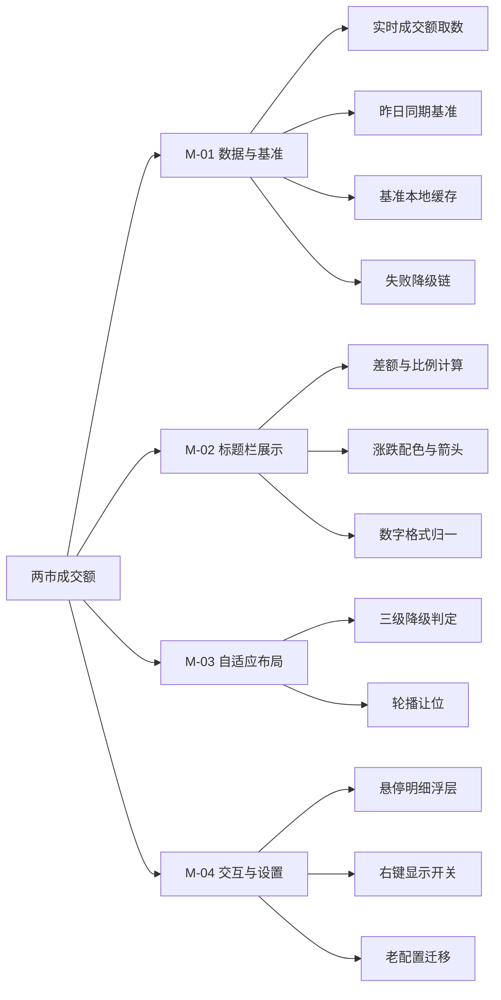
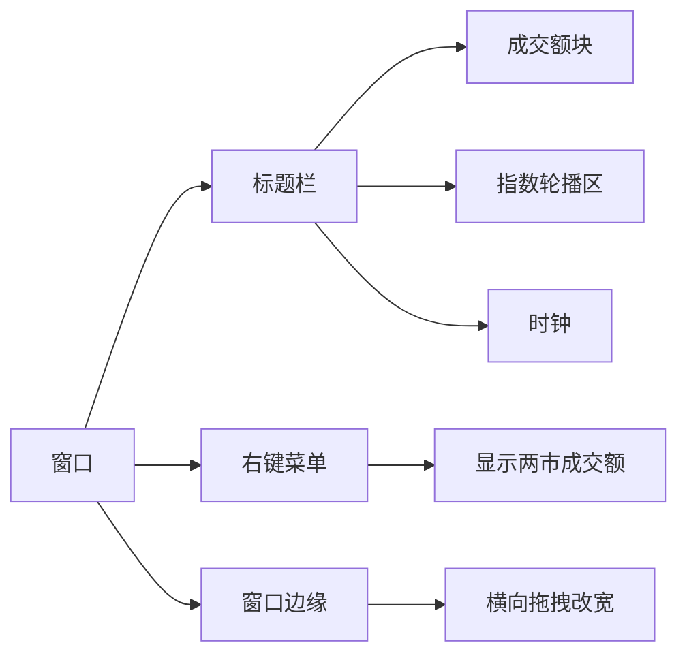
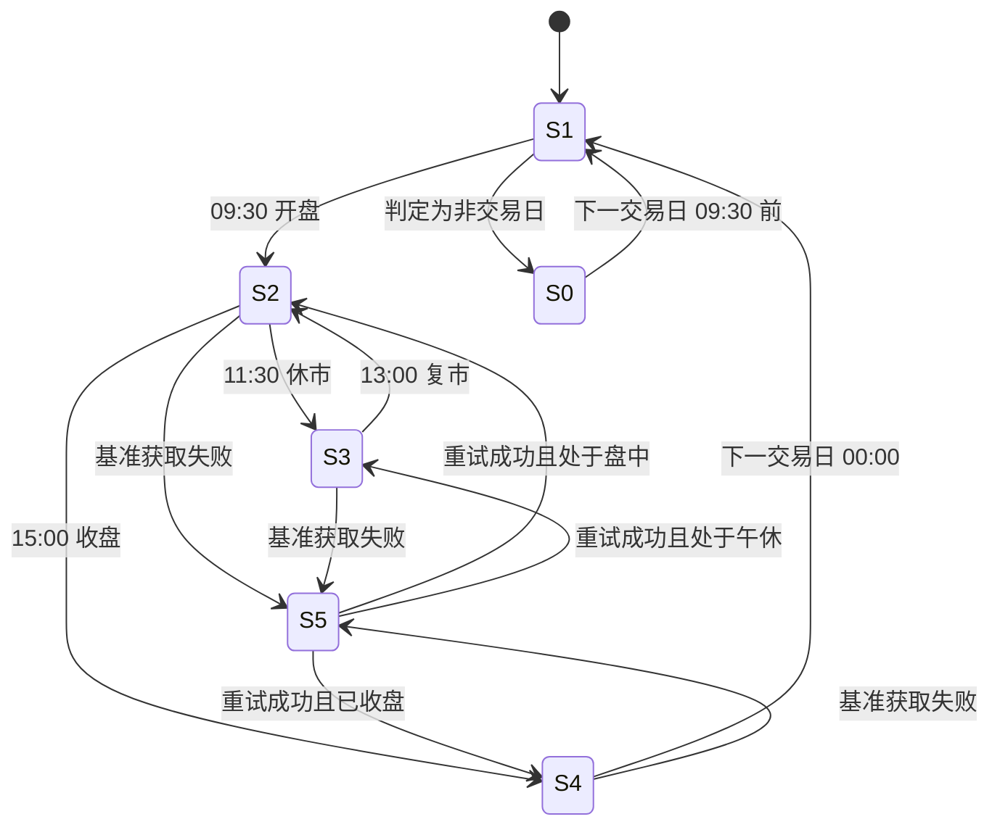
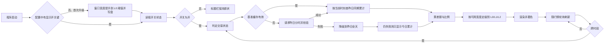

# PRD-盯盘君-两市成交额-v1.0.0

## 1. 文档概述

### 1.1 文档信息

| 字段 | 内容 |
| --- | --- |
| 项目名称 | 盯盘君（MarketEye）桌面行情悬浮窗 |
| 文档版本 | v1.0.0 |
| 版本状态 | 未发布 |
| 创建日期 | 2026-10-30 |
| 更新日期 | 2026-10-30 |
| 基于需求 | 用户需求（2026-10-30）：「增加 A 股实时成交量相比昨天增减多少亿级增减比例的展示」 |

### 1.2 变更记录

| 版本 | 日期 | 变更人 | 变更类型 | 关联章节 | 变更内容 |
| --- | --- | --- | --- | --- | --- |
| v1.0.0 | 2026-10-30 | - | 新增 | — | 标题栏常驻展示沪深两市成交额与「较昨日同期」差额及比例；阈值按当日最宽文本形态预留，空间不足按单行三段 / 竖排两行 / 隐藏三级降级，轮播宽度永不低于可读下限；盘中比昨日同期、收盘后比昨日全天，午休冻结且数字连续；基准成功路径每交易日一次，失败按「昨日全天 → 仅今日 → —」降级且有重试上限；悬停出明细浮层；右键菜单可关闭，老配置首次升级把窗口加宽到 L0 阈值一次 |

### 1.3 项目背景

悬浮窗折叠后只占一条标题栏，作用是「一眼看到关键数字」。当前标题栏只有名称、折叠态指数轮播与时钟，**量能信息缺失**：判断"今天是放量下跌还是缩量回调"，必须另开行情软件或网页。

量能是判断行情性质的第一层信息——同样的跌幅，放量与缩量代表完全不同的资金态度。把两市成交额放进标题栏，可以让"看指数涨跌"和"看量能强弱"在同一眼里完成，这也是折叠态这一形态存在的意义。

本功能不新增行情轮询频次：实时成交额搭乘既有的报价请求，历史基准在成功路径下每个交易日只取一次（失败重试与兜底的总次数见 R-04-2）。

### 1.4 功能概述

| 能力 | 说明 |
| --- | --- |
| 实时成交额 | 沪深两市当日累计成交额，随行情轮询刷新 |
| 增减对比 | 与**昨日同期**（昨日同一时刻的累计值）比较，给出差额（亿元）与百分比 |
| 口径切换 | 盘中比"昨日同期"，收盘后比"昨日全天"，口径随交易状态自动切换并保持数字正确 |
| 宽度自适应 | 标题栏空间不足时按三级降级展示，不挤压指数轮播的可读性 |
| 明细浮层 | 悬停展示今日累计、昨日基准、差额、基准时点与口径说明 |
| 显示开关 | 右键菜单可关闭，关闭后标题栏恢复原状 |

### 1.5 目标用户

| 角色 | 使用场景 |
| --- | --- |
| 个人投资者（唯一角色） | 盘中把悬浮窗折叠在屏幕角落，一眼确认当日量能相对昨日是放大还是萎缩；收盘后确认全天成交额与昨日全天的对比 |

## 2. 需求全景

### 2.1 功能架构

### 2.2 功能模块划分

| 编号 | 功能域 | 职责范围 | 不包含 |
| --- | --- | --- | --- |
| M-01 | 数据与基准 | 取当日两市累计成交额；取昨日分时成交额并生成"昨日同期累计"基准；基准落盘缓存；请求失败时的降级顺序 | 不负责绘制，不判断宽度 |
| M-02 | 标题栏展示 | 由今日累计与昨日基准算出差额与比例；按格式规则渲染文本；按放量/缩量着色 | 不直接发起网络请求 |
| M-03 | 自适应布局 | 按当前可用宽度决定展示级别；把被占用的宽度从轮播可用区中扣除 | 不改变窗口尺寸，不自动加宽 |
| M-04 | 交互与设置 | 悬停明细浮层；右键显示开关及其持久化；老配置首次升级时的窗口宽度迁移 | 不改动行情刷新周期 |

### 2.3 功能依赖关系

### 2.4 界面功能架构

| 入口名称 | 所在层级 | 触发方式 | 功能路径 | 对应功能点 | 对应功能域 |
| --- | --- | --- | --- | --- | --- |
| 成交额块 | 一级：标题栏 / 二级：展示元素 | 静态展示，无点击 | 盯盘君 → 标题栏 → 成交额块 | F-01 | M-02 |
| 成交额块 | 一级：标题栏 / 二级：展示元素 | 时间跨过时段边界，自动切换 | 盯盘君 → 标题栏 → 成交额块 → 时段口径 | F-04 | M-01、M-02 |
| 成交额块 | 一级：标题栏 / 二级：展示元素 | 悬停 300ms | 盯盘君 → 标题栏 → 成交额块 → 明细浮层 | F-05 | M-04 |
| 程序启动 / 进入交易时段 | 一级：系统自动行为 | 自动触发，无用户操作 | 盯盘君 → 数据层 → 昨日同期基准 | F-02 | M-01 |
| 右键菜单项「显示两市成交额」 | 一级：右键菜单 / 二级：菜单项 | 点击勾选 | 盯盘君 → 右键菜单 → 显示两市成交额 | F-06 | M-04 |
| 窗口边缘 | 一级：窗口区块 | 拖动（既有能力，本期作为 F-03 的触发源） | 盯盘君 → 标题栏 → 成交额块 → 展示级别 | F-03 | M-03 |

> 成交额块**不绑定点击事件**：标题栏空白处的既有交互是双击折叠，成交额块位于该热区内，绑点击会与之冲突。
>
> F-02 为系统自动行为，无界面元素，故以「程序启动 / 进入交易时段」作为入口登记，与折叠轮播 PRD 对「折叠态进入」的处理一致。

## 3. 功能需求

### 3.1 用户故事

| 编号 | 用户故事 | 价值 |
| --- | --- | --- |
| US-01 | 作为个人投资者，我想在折叠状态下直接看到今日两市成交额，以便不打开任何网页就知道今天量能处于什么水平 | 折叠态从只有指数涨跌升级为"涨跌 + 量能"双信息 |
| US-02 | 作为个人投资者，我想看到成交额相对昨日同期的增减金额与比例，以便判断今天是放量还是缩量，而不是只看一个孤立的绝对数 | 把绝对数变成可判断的强弱信号 |
| US-03 | 作为个人投资者，我想在鼠标悬停时看清对比基准是哪一天、哪个时点，以便知道这个百分比的含义，不被"较昨日全天"和"较昨日同期"混为一谈 | 数字可解释，避免误读为"较昨日全天"而在盘中得出错误结论 |
| US-04 | 作为个人投资者，我想能关掉这块显示，以便在窄窗口下优先保留指数轮播 | 信息密度由用户自己控制，不与轮播争空间 |

### 3.2 详细功能点

#### F-01 标题栏成交额展示

**功能路径**：盯盘君 → 标题栏 → 成交额块

**功能描述**：在标题栏右侧、指数轮播区与时钟之间常驻一块成交额文本，内容为「今日累计成交额 + 较昨日同期差额 + 比例」。折叠态与展开态均展示。

**触发条件**：程序启动后自动展示；行情轮询返回新数据时刷新数值。

**输入字段定义**

| 字段名 | 类型 | 必填 | 校验规则 | 默认值 | 说明 |
| --- | --- | --- | --- | --- | --- |
| 今日累计成交额 | 数字（元） | 是 | ≥0；沪市与深市之和 | — | 由实时报价得到，随轮询刷新 |
| 昨日同期累计成交额 | 数字（元） | 是 | ≥0；仅含昨日 09:30 至当前时刻 | — | 来自基准数据，缺失时按 R-04 降级 |
| 差额 | 数字（元） | 否 | 可正可负 | — | 今日累计 − 昨日同期 |
| 比例 | 数字（%） | 否 | 保留一位小数；分母不满足 R-01-7 的条件时不展示 | — | 差额 ÷ 昨日同期 × 100 |

**业务处理逻辑**

1. 轮询取得报价后，取沪市与深市成交额相加得到今日累计；
2. 按 R-02 判定当前交易时段，决定对比基准是"昨日同期"还是"昨日全天"；
3. 按 R-01 计算差额与比例；
4. 按 R-05 格式化三段文本；
5. 按 R-03 的当前展示级别决定渲染形态；
6. 按差额正负着色：差额为正（放量）用上涨色，为负（缩量）用下跌色，相等用平盘色；箭头符号与颜色同时使用，保证色觉障碍下仍可区分。

**输出结果**

| 场景 | 展示 |
| --- | --- |
| 数据完整 | `1.24万亿  ↑823亿 +11.5%` |
| 基准缺失（降级） | `1.24万亿  —` |
| 非交易时段/未开盘 | `—` |
| 数据尚未首次返回 | `—` |

失败反馈：无弹窗。数值区按 R-04 的降级顺序展示；基准重试最多 3 次（间隔 2 秒、5 秒、15 秒），仍失败转 D1；D1 也失败转 D2/D3，之后 10 分钟内不再尝试。今日累计取数失败沿用上一次的报价结果（与既有行情刷新逻辑一致）。

**交互流程**：无用户主动交互；数值随轮询被动刷新。刷新时只更新文本内容与颜色，不重建窗口，不改变布局。

#### F-02 昨日同期基准的获取与缓存

**功能路径**：盯盘君 → 数据层 → 昨日同期基准

**功能描述**：每个交易日首次需要时，获取上一交易日与当日的分时成交额序列，生成"昨日每分钟累计成交额"索引表，供盘中按当前时刻查询。

**触发条件**：启动后首次进入盘中时段；或本地缓存中的基准日期不是"上一交易日"。

**输入字段定义**

| 字段名 | 类型 | 必填 | 校验规则 | 默认值 | 说明 |
| --- | --- | --- | --- | --- | --- |
| 基准日期 | 日期 | 是 | 必须是上一交易日 | — | 缓存命中判据 |
| 昨日分时累计序列 | 数组（时间 → 累计成交额） | 是 | 至少覆盖 09:30–15:00，条数 ≥ 200 | — | 以分钟为粒度 |
| 昨日全天成交额 | 数字（元） | 是 | >0 | — | 收盘后口径使用，兼作序列校验 |

**业务处理逻辑**

1. 读取本地基准缓存：若基准日期等于当前"上一交易日"，直接使用，不发请求；
2. 否则发起一次基准请求，解析出昨日分时序列并累加生成索引表；
3. 用"序列末条累计值 ≈ 昨日全天成交额"做一致性校验，偏差超过 1% 视为数据异常，转入降级；
4. 校验通过后写入缓存文件，供当日与次日复用；
5. 请求失败按 R-04 的重试与降级顺序处理。

**输出结果**：内存中一张"昨日累计成交额"索引表，可即时查到任意时刻对应的昨日同期累计值。

失败反馈：静默降级，不打扰用户；降级结果在悬停浮层中标注（见 F-05）。

#### F-03 宽度自适应降级

**功能路径**：盯盘君 → 标题栏 → 成交额块 → 展示级别

**功能描述**：成交额块与指数轮播共用标题栏中部的可用宽度。空间不足时按三级降级，保证轮播始终不低于可读下限。

**触发条件**：窗口宽度变化、启用/关闭成交额显示、标题文字长度变化、DPI 变化时重新计算。

**输入字段定义**

| 字段名 | 类型 | 必填 | 校验规则 | 默认值 | 说明 |
| --- | --- | --- | --- | --- | --- |
| 可用宽度 | 数字（画布像素） | 是 | >0 | — | 标题右侧到时钟左侧的净宽度 |
| 完整块宽度 | 数字（画布像素） | 是 | 按当前字体实测 | — | 三段文本实测宽度 |
| 两行块宽度 | 数字（画布像素） | 是 | 按当前字体实测 | — | 差额与比例各占一行时的最大宽度 |
| 轮播最小宽度 | 数字（画布像素） | 是 | 按当前字体实测 | — | 两个汉字名称 + 分隔 + 一条涨跌幅 |

**业务处理逻辑**

1. 计算可用宽度 = 时钟左侧边界 − 标题右侧边界；
2. 判断 `可用宽度 ≥ 完整块宽度 + 间距 + 轮播最小宽度`：是则用 L0；
3. 否则判断 `可用宽度 ≥ 两行块宽度 + 间距 + 轮播最小宽度`：是则用 L1；
4. 否则用 L2（不展示），把全部宽度让给轮播；
5. 成交额块右对齐，紧贴时钟左侧，与轮播之间留固定间距。

**展示级别定义**

| 级别 | 形态 | 内容 | 块宽（150% 实测，最宽形态） | 折算条件（150% 缩放） |
| --- | --- | --- | --- | --- |
| L0 | 单行三段 | `1.24万亿  ↑823亿 +11.5%` | 217px | 可用宽度 ≥ 331px，对应窗口宽 ≥ 372 逻辑像素 |
| L1 | 竖排两行 | 上行 `↑823亿`，下行 `+11.5%` | 约 78px（差额最宽形态 `+1.2万亿`） | 可用宽度 ≥ 192px，对应窗口宽 ≥ 280 逻辑像素 |
| L2 | 不展示 | 无 | 0 | 可用宽度 < 192px |

> **阈值按最宽形态预留，不按当前文本实时判定**：两市合计成交额常态在 1 万亿以上、差额可能出现 `-1250亿` 或 `+1.2万亿`，若按当前文本宽度判定，数字跨过 1 万亿时会突然降级、用户会看到布局跳变。因此阈值以当日可能出现的最大宽度形态一次性算定，当日不变。
>
> 阈值口径：可用宽度已从时钟左侧 10px 间距之后起算（即块右端贴时钟、块左端与轮播之间留 8px），故判定式为 `可用宽度 ≥ 块宽 + 8 + 轮播最小宽度`。

> L1 牺牲"今日累计总额"（可在悬停浮层查看），保留用户最关心的"增减多少、增减多少比例"。

**输出结果**：成交额块以 L0/L1/L2 之一渲染；指数轮播的可用宽度相应扣减，扣减后不得低于轮播最小宽度。

#### F-04 交易时段口径

**功能路径**：盯盘君 → 标题栏 → 成交额块 → 时段口径

**功能描述**：按当前时间判定交易状态，决定对比基准与是否展示，保证任何时点上的数字都可解释。

**触发条件**：每次刷新数值时判定；跨时段（如 11:30、13:00、15:00）时切换口径并在浮层中更新说明。

**输入字段定义**

| 字段名 | 类型 | 必填 | 校验规则 | 默认值 | 说明 |
| --- | --- | --- | --- | --- | --- |
| 当前时间 | 日期时间 | 是 | 本机时间 | 当前时刻 | 判定依据 |
| 交易状态 | 枚举 | 是 | 未开盘/集合竞价/盘中/午休/已收盘/非交易日 | — | 见 3.3 状态机 |

**业务处理逻辑**

1. 09:30 之前（含集合竞价）：不展示数值，显示 `—`；
2. 09:30–11:30、13:00–15:00：基准取"昨日同一时刻"累计值；
3. 11:30–13:00 午休：今日累计停留在 11:30 的值，基准取昨日 11:30 累计值，与盘中口径一致；
4. 15:00 及以后：今日累计为全天值，基准取昨日全天值，口径切换为"较昨日全天"。因昨日 15:00 的同期累计恰等于昨日全天，切换瞬间数字不跳变，只是分母的含义由"同期"变为"全天"；
5. 非交易日（周末、节假日）：主显示为最近一个交易日收盘后的结果，口径为"较前一交易日全天"，浮层须同时标注**数据所属日期**与基准日期，避免被误读为当日数据。

**输出结果**：数值与浮层说明随状态变化；口径切换不影响数字正确性，只在浮层中显示当前基准。

#### F-05 悬停明细浮层

**功能路径**：盯盘君 → 标题栏 → 成交额块 → 明细浮层

**功能描述**：鼠标停留在成交额块上超过 300ms 时，在块下方弹出浮层，列出今日累计、昨日基准、差额、比例与口径说明。

**触发条件**：鼠标进入成交额块热区并停留 300ms；鼠标离开或窗口失焦时关闭。

**输入字段定义**

| 字段名 | 类型 | 必填 | 校验规则 | 默认值 | 说明 |
| --- | --- | --- | --- | --- | --- |
| 今日累计 | 文本 | 是 | 按 R-05 格式化 | — | 沪市 + 深市 |
| 基准时点 | 文本 | 是 | `昨日 10:43` / `上一交易日全天` | — | 明确口径 |
| 昨日基准值 | 文本 | 是 | 按 R-05 格式化 | — | 分母 |
| 差额 | 文本 | 否 | 带正负号 | — | 绝对值 + 百分比 |
| 沪市 / 深市拆分 | 文本 | 否 | 各自格式化 | — | 便于核对 |

**业务处理逻辑**

1. 悬停计时器在鼠标进入热区时启动，300ms 内离开则取消；
2. 浮层绘制在窗口内容之上、成交额块下方，左右边界按窗口宽度自动收边；
3. 浮层不接收鼠标事件，鼠标可无阻碍穿过；
4. 窗口折叠/展开切换、窗口缩放时立即关闭浮层。

**输出结果**：一块临时浮层，鼠标离开后消失，不写配置、不留状态。

失败反馈：无数据时浮层只显示 `数据获取中`；获取失败时显示 `获取失败，稍后自动重试`（具体重试节奏按 R-04-2，不在浮层承诺时长）。

#### F-06 显示开关与老配置迁移

**功能路径**：盯盘君 → 右键菜单 → 显示两市成交额

**功能描述**：右键菜单增加一个勾选项，控制成交额块是否展示；关闭后标题栏恢复原状，轮播获得全部可用宽度。首次升级到本版本时，若窗口宽度不足 L0 阈值，自动加宽到 L0 阈值一次。

**触发条件**：用户点击菜单项；或程序启动时检测到配置中不存在本功能的开关键。

**输入字段定义**

| 字段名 | 类型 | 必填 | 校验规则 | 默认值 | 说明 |
| --- | --- | --- | --- | --- | --- |
| 显示成交额 | 布尔 | 否 | 缺键视为开启 | 开启 | 菜单勾选状态 |
| 窗口宽度 | 数字（逻辑像素） | 否 | ≥最小宽度 | 保持原值 | 迁移规则见下 |

**业务处理逻辑**

1. 菜单项勾选状态每次弹出前与实际状态对齐（既有菜单刷新机制）；
2. 点击后翻转状态，按新状态立即重排标题栏，并写入配置；
3. 关闭状态不发起基准请求；
4. **迁移规则**：启动时若配置中不存在"显示成交额"键（即老版本配置），则视为首次升级，把窗口宽度提升到当前字体的实测 L0 阈值（150% 缩放下为 372 逻辑像素，预留余量后取 400），只加宽不收窄，且只执行一次；已有该键的老配置不再迁移。

**输出结果**：标题栏布局按开关状态变化；窗口宽度迁移只发生一次并写入配置。

**交互流程**：右键 → 勾选/取消「显示两市成交额」→ 标题栏即时重排，无需重启。

### 3.3 业务规则

本节按子功能域分节，每节含业务约束（含违反处理）与逻辑规则；交易时段的完整状态机统一在 §3.3.2。

**规则冲突的裁决顺序**（高 → 低）：

1. **数字正确性**：口径、除零保护、单位跃迁不得为了让标题栏"好看"而放宽（R-01、R-05）；
2. **轮播可用性**：宽度不足时先降成交额的级，不压缩轮播到不可读（R-03-1）；
3. **请求克制**：基准取数失败优先降级而不是频繁重试（R-04）；
4. **展示连续性**：同一交易日内展示级别不因数字增长而跳变（R-03-4）。

具体冲突示例：窗口宽度恰好在 L0/L1 之间抖动时，R-03-4（级别单调）优先于"尽可能显示完整三段"，保持上一次级别；基准请求失败时，R-04-2 的重试上限优先于"尽快拿到数据"。

#### 3.3.1 计算口径（R-01）

| 规则 | 内容 |
| --- | --- |
| R-01-1 市场范围 | 只统计沪深两市，不含北交所 |
| R-01-2 沪市口径 | 取上证指数报价中的成交额，覆盖沪市全部标的 |
| R-01-3 深市口径 | 取深证成指报价中的成交额；实测与深证综指一致，两者互为校验 |
| R-01-4 今日累计 | 沪市 + 深市，不做任何估算与插补 |
| R-01-5 差额 | 今日累计 − 基准值，保留到亿元整数 |
| R-01-6 比例 | 差额 ÷ 基准值 × 100%，保留一位小数 |
| R-01-7 除零保护 | 基准值 < 100 亿元时，比例不展示（显示 `—`），差额照常展示 |
| R-01-8 单位跃迁 | 数值 ≥ 1 万亿元时改用"万亿"为单位，避免长数字挤占标题栏 |

违反处理：取数字段缺失（非 0）时整块显示 `—`，不猜测、不使用昨日数据顶替今日。

#### 3.3.2 交易时段状态机（R-02）

**状态列表**

| 状态名 | 编码 | 含义 | 展示 |
| --- | --- | --- | --- |
| 非交易日 | S0 | 周末或节假日 | 上一交易日全天对比，浮层标注日期 |
| 未开盘 | S1 | 交易日 09:30 之前 | `—` |
| 盘中 | S2 | 09:30–11:30、13:00–15:00 | 较昨日同期 |
| 午休 | S3 | 11:30–13:00 | 较昨日 11:30 累计 |
| 已收盘 | S4 | 15:00 之后 | 较昨日全天 |
| 数据异常 | S5 | 基准或今日取数失败 | 按 R-04 降级展示 |

| 流转 | 前置条件 | 触发动作 |
| --- | --- | --- |
| S1 → S2 | 时间到达 09:30 且为交易日 | 取一次昨日基准，开始按分钟查询同期累计 |
| S2 → S3 | 时间到达 11:30 | 冻结今日累计，基准取昨日 11:30 累计 |
| S3 → S2 | 时间到达 13:00 | 恢复实时累计与同期查询 |
| S2 → S4 | 时间到达 15:00 | 今日取全天值，基准取昨日全天值，浮层口径改为"昨日全天" |
| S4 → S1 | 进入下一自然日 | 缓存判据按新的"上一交易日"重算 |
| 任意 → S5 | 基准请求重试 3 次仍失败，或今日成交额字段缺失 | 按 R-04 降级；重试成功后按当前时间回到 S2 / S3 / S4，不一律回盘中 |

#### 3.3.3 降级规则（R-03）

| 规则 | 内容 | 违反/不满足时 |
| --- | --- | --- |
| R-03-1 轮播优先 | 成交额块占用的宽度不得使轮播可用宽度低于轮播最小宽度 | 成交额降一级 |
| R-03-2 级别判定顺序 | 先算 L0 是否可行，再算 L1，都不行则 L2 | — |
| R-03-3 阈值口径 | 阈值由当前字体实测宽度派生，不写死像素 | DPI 变化后自动跟随 |
| R-03-4 级别单调 | 同一次重排内级别不得反复跳变（宽度抖动导致闪烁） | 保持上次级别 |
| R-03-5 关闭态 | 开关关闭时成交额块宽度计为 0，轮播独占可用宽度 | — |

#### 3.3.4 缓存与失败降级（R-04）

**降级顺序**

| 层级 | 数据来源 | 展示 | 备注 |
| --- | --- | --- | --- |
| D0 | 昨日分时序列（本期主口径） | `差额 + 比例` | 盘中与午休使用 |
| D1 | 昨日全天成交额（日线数据） | `差额`，比例照常（分母为全天值） | 分时失败时的替代口径，浮层标注"基准：昨日全天" |
| D2 | 无基准 | 只显示今日累计，差额与比例位置为 `—` | 浮层标注"基准不可用" |
| D3 | 今日成交额也缺失 | 整体 `—` | 不影响轮播与列表刷新 |

**规则**

| 规则 | 内容 |
| --- | --- |
| R-04-1 成功路径 | 基准成功获取后每个交易日不再请求（下次请求由跨日触发） |
| R-04-2 失败重试 | 失败后 2 秒、5 秒、15 秒各重试一次，共 3 次；仍失败转 D1；D1 也失败转 D2，并在 10 分钟内不再尝试。单日基准请求总数（含 D1 兜底）上限 8 次 |
| R-04-3 缓存有效期 | 缓存中的基准日期等于"上一交易日"时有效，否则视为过期并重取 |
| R-04-4 跨日 | 进入新的自然日后，缓存判据自动前移；不做跨日复用 |
| R-04-5 隔离 | 基准获取失败不得影响行情刷新、不得写错误日志淹没有效信息，同一失败只记录一次 |
| R-04-6 一致性校验 | 昨日分时累计与昨日全天值偏差超过 1% 时，判为数据异常，走 D1 |
| R-04-7 降级可感知 | 从 D0 降到 D1 时数字会明显变负（分母由"昨日同期"变为"昨日全天"），属预期变化；悬停浮层须标注当前基准类型，避免被当成行情突变 |

#### 3.3.5 数字格式（R-05）

| 场景 | 规则 | 示例 |
| --- | --- | --- |
| 今日累计 ≥ 1 万亿 | 保留两位小数 + `万亿` | `1.24万亿` |
| 今日累计 < 1 万亿 | 四舍五入到整数 + `亿` | `7978亿` |
| 今日累计 < 100 亿 | 保留一位小数 + `亿` | `86.4亿` |
| 差额 | 带符号 + 四舍五入到整数 + `亿`；绝对值 ≥ 1 万亿时用 `万亿` | `+823亿`、`-1250亿` |
| 比例 | 带符号 + 一位小数 + `%` | `+11.5%`、`-8.2%` |
| 无数据 | 全角破折号样式的 `—` | `—` |
| 千分位 | 不使用千分位 | `24310亿` 而非 `24,310亿`（此形态仅在未触发万亿单位时出现） |
| 字体 | 数字与符号用等宽数字字体，中文单位用中文字体 | 与列表区涨跌幅同口径 |

### 3.4 业务流程

## 4. 非功能性需求

### 4.1 性能要求

| 指标 | 目标值 | 测量条件 |
| --- | --- | --- |
| 新增网络请求 | 成功路径 1 次/交易日；最坏情况 ≤ 8 次/交易日（含重试与兜底） | 全天运行，统计对基准数据源的请求次数 |
| 实时成交额请求 | 0 次新增 | 与既有报价轮询合并，不额外发请求 |
| 数值刷新耗时 | ≤ 5ms | 单次刷新（文本更新 + 着色）在 150% 缩放下计时 |
| 布局重算耗时 | ≤ 3ms | 窗口拖宽过程中的单次重排 |
| 悬停浮层出现延迟 | 300ms ± 100ms | 从鼠标进入热区到浮层可见 |
| 内存增量 | ≤ 2MB | 基准序列 + 缓存，不缓存历史分时全量 |
| 空闲 CPU | 与当前版本一致（接近 0） | 非交易时段静置 10 分钟 |

### 4.2 安全要求

| 项 | 要求 |
| --- | --- |
| 数据性质 | 只读公开行情，无用户凭据、无账号 |
| 本地写入 | 仅写基准缓存文件与配置中的开关/宽度，不外发任何本机信息 |
| 请求头 | 与既有行情请求一致，不携带敏感字段 |

### 4.3 兼容性要求

| 项 | 要求 |
| --- | --- |
| 操作系统 | Windows 10 / 11（与主程序一致） |
| DPI 缩放 | 100%–200%，阈值全部按字体实测派生 |
| 窗口宽度 | 190（最小）至屏幕宽度；L0 需 ≥ 372 逻辑像素、L1 需 ≥ 280 逻辑像素（150% 下按最宽文本形态折算） |
| 主题 | 深色、浅色两套主题均需正确着色 |
| 老配置 | 缺键即视为首次升级，按 F-06 迁移一次 |

## 5. 验收标准

### 5.1 功能验收条件

| 编号 | 对应功能点 | 前置条件 | 操作步骤 | 预期结果 |
| --- | --- | --- | --- | --- |
| AC-01 | F-01 | 盘中，窗口宽度 ≥ 372 逻辑像素 | 观察标题栏 | 单行显示 `今日累计  差额  比例` 三段，位于轮播与时钟之间，右对齐 |
| AC-02 | F-01 | 盘中 10:43 | 核对数值与外部行情 | 今日累计 = 沪市 + 深市成交额，误差 < 1%；差额 = 今日累计 − 昨日 10:43 累计 |
| AC-03 | F-01 | 盘中，昨日基准可用 | 检查比例 | 比例 = 差额 ÷ 昨日同期 × 100%，保留一位小数，符号与差额一致 |
| AC-04 | F-01 | 差额为正 | 观察颜色与箭头 | 差额与比例均为上涨色，带 ↑；差额为负时为下跌色带 ↓；相等时为平盘色 |
| AC-05 | F-03 | 窗口宽度 340 逻辑像素 | 观察标题栏 | 自动降为 L1 竖排两行（上行差额、下行比例），指数轮播仍完整显示名称与涨跌幅 |
| AC-06 | F-03 | 窗口宽度拖到 290 逻辑像素 | 观察标题栏 | 成交额块消失，轮播占满可用宽度且不截断到不可读 |
| AC-07 | F-03 | 从 340 拖到 500 再拖回 340 | 全程录屏，逐帧检查标题栏 | 级别按 L1 → L0 → L1 切换；每帧内成交额块与轮播区无重叠像素、无上一级别的残留文字；块内文字不被裁切 |
| AC-08 | F-04 | 09:00（开盘前） | 观察标题栏 | 显示 `—`，不发基准请求 |
| AC-09 | F-04 | 11:29 记录一次数值，等到 11:35 | 对比 11:29 与 11:35 的显示 | 两次数值完全相同（今日累计冻结在 11:30 值，基准为昨日 11:30 累计），差额与比例也相同 |
| AC-10 | F-04 | 15:10（收盘后） | 悬停查看浮层 | 口径标注为"昨日全天"，今日累计为全天值，比例以昨日全天为分母 |
| AC-11 | F-06 | 首次升级（配置无开关键），原窗宽 320 | 启动程序 | 窗口宽度被提升到 400 逻辑像素并写入配置；再次启动宽度不再变化 |
| AC-12 | F-06 | 右键菜单 | 取消勾选「显示两市成交额」 | 成交额块立即消失，轮播占满宽度；重启后仍为关闭状态；期间无基准请求 |
| AC-13 | F-05 | 成交额块可见 | 鼠标停留 300ms | 浮层出现在块下方，含今日累计、基准时点、昨日基准、差额、比例；移开即消失 |
| AC-14 | F-02 | 断开网络后启动 | 观察标题栏与列表 5 分钟 | 标题栏成交额区显示 `—`（今日报价亦不可得，按 D3）；列表行情显示 `—` 且圆点转红，不影响程序响应；全程无弹窗；同一条错误日志只出现一次 |
| AC-15 | F-02 | 昨分时累计与昨日全天偏差 > 1% | 注入异常数据 | 自动改用昨日全天口径，浮层标注"基准：昨日全天" |
| AC-16 | F-01 | 深色/浅色主题 | 分别观察 | 文本用主题主文字色，放量/缩量用对应涨跌色，无硬编码颜色 |
| AC-17 | F-01 | 昨日同期累计 < 100 亿元（如开盘后 1 分钟） | 观察标题栏 | 差额正常显示，比例位置显示 `—`，不出现除零、`inf` 或异常大数 |
| AC-18 | F-01 | 今日累计由 9976 亿增长到 1.02 万亿 | 观察标题栏 | 数值自动切为 `1.02万亿`，宽度不溢出、不与轮播重叠，展示级别不发生跳变 |
| AC-19 | F-04 | 周六（非交易日） | 观察标题栏并悬停 | 主显示为最近一个交易日（周五）收盘后的结果，浮层同时标出数据所属日期与基准日期 |
| AC-20 | F-05 | 成交额块可见 | ① 鼠标停留 250ms ② 停留 400ms ③ 移出 ④ 窗口失焦 | ① 无浮层 ② 浮层出现 ③ 浮层消失 ④ 浮层消失；浮层出现期间鼠标仍可拖动窗口、双击折叠，事件不被浮层拦截 |
| AC-21 | F-02 | 注入基准请求持续失败 | 观察数值与浮层 | 依次降级：D0 差额+比例 → D1 差额（比例以昨日全天为分母）→ D2 仅今日累计 → D3 全 `—`；每次降级浮层标注当前基准类型；10 分钟内不再尝试请求 |

> 本期不生成 HTML 原型（界面为标题栏内一处文本块，形态由 §3.2 F-03 的三级降级表与 ui-rules 的配色/字体约定确定），下游界面设计直接依据本文件。
