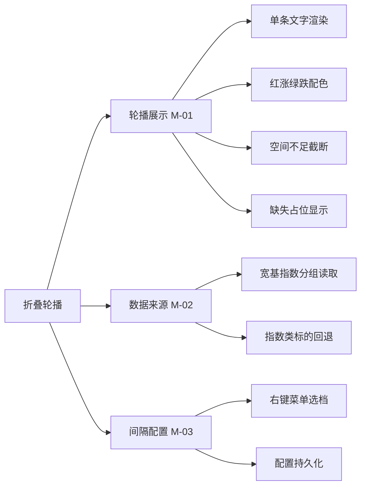
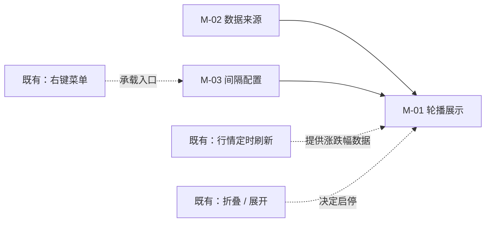
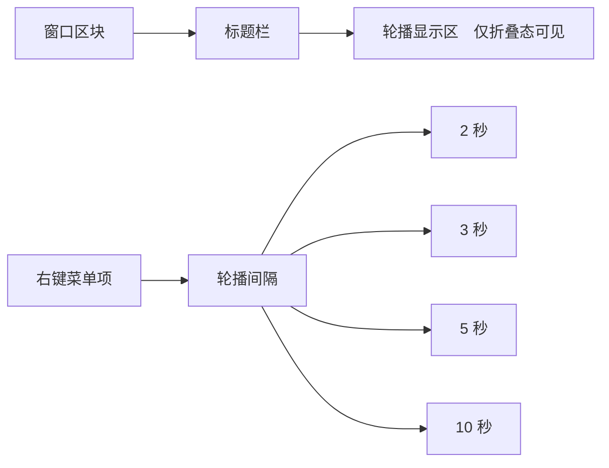
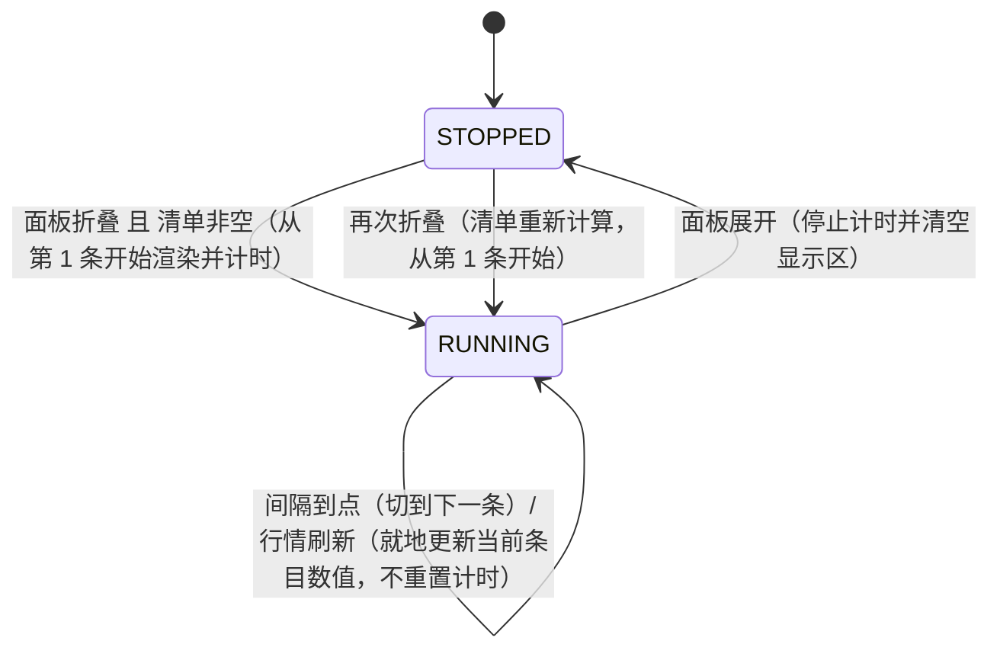
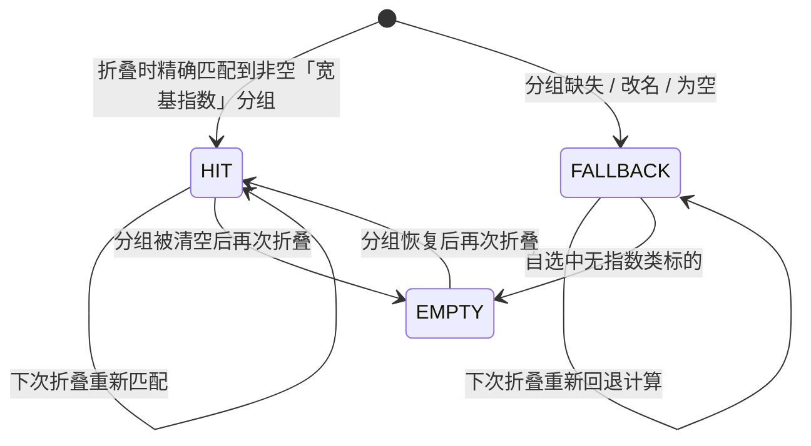
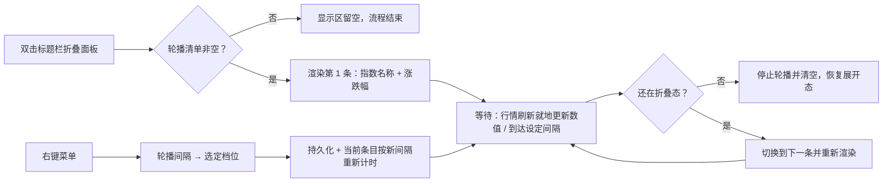

# PRD-盯盘君-折叠轮播-v1.0.0

## 1. 文档概述

### 1.1 文档信息

| 字段 | 内容 |
| --- | --- |
| 项目名称 | 盯盘君 MarketEye |
| 文档版本 | v1.0.0 |
| 版本状态 | 未发布 |
| 创建日期 | 2026-10-21 |
| 更新日期 | 2026-10-21 |
| 基于需求 | 用户口头需求（2026-10-21）：面板折叠时，在标题栏空白区滚动展示宽基指数涨跌幅，格式"指数名称  涨跌幅"，间隔按秒设置 |

### 1.2 变更记录

| 版本 | 日期 | 变更人 | 变更类型 | 关联章节 | 变更内容 |
| --- | --- | --- | --- | --- | --- |
| v1.0.0 | 2026-10-21 | - | 新增 | — | 新增折叠态标题栏轮播：宽基指数按固定格式逐条轮播展示涨跌幅，红涨绿跌与列表一致、缺失显示占位符、空间不足截断（窗口极窄至标题与时钟已占满时改为不渲染，保证标题与时钟始终完整）；数据来源为「宽基指数」分组（与「自选」等分组同级，精确匹配；缺失或为空时回退自选中全部指数类标的，指数类不含个股与 ETF/LOF 等场内基金），清单在折叠态内保持不变；轮播间隔经右键菜单按秒选档（2/3/5/10 秒，默认 3 秒）并本地持久化、选档即时生效；展开态自动停止轮播，轮播显示区鼠标事件全部穿透 |

### 1.3 项目背景

盯盘君折叠后只剩一条标题栏，用户把它钉在屏幕边缘当"时间条"用：占位极小，但除了标题和时间之外什么都没有。而宽基指数（上证指数、深证成指、创业板指、科创50、恒生科技、沪深300 等）恰恰是大盘整体温度计，用户折叠悬浮窗的动机往往正是"不想看细盘，只想偶尔瞟一眼大盘"。

当前矛盾：折叠态没有任何行情信息，用户想知道大盘涨跌就必须展开面板，"折叠省空间"与"要看大盘"两件事互斥。

### 1.4 功能概述

本次功能在折叠态的标题栏中部空白区（标题文字与时钟之间）增加一个轮播显示区：

- 按固定格式逐条展示宽基指数：`指数名称  涨跌幅`（如 `上证指数  +0.01%`），一次显示一条
- 每隔 N 秒自动切换到下一条，循环往复；N 可在右键菜单按秒选档（2/3/5/10 秒，默认 3 秒），选择后本地记忆
- 涨跌幅颜色与列表区一致：红涨绿跌，零涨跌用次要文字色；涨跌幅带符号（+/-）、恒为两位小数，与列表口径相同
- 数据随行情刷新自动更新，切换条目不产生额外网络请求
- 展开面板时轮播自动停止，再次折叠自动恢复；轮播显示区不拦截任何鼠标事件，拖动、双击折叠、右键菜单行为与现状完全一致

### 1.5 目标用户

| 角色 | 使用场景 | 关注点 |
| --- | --- | --- |
| 个人投资者（主要） | 交易时段把折叠后的标题栏钉在屏幕边缘，偶尔瞟一眼大盘 | 不展开面板就能知道宽基指数的涨跌方向和幅度 |
| 多屏办公者 | 主屏工作、副屏挂悬浮窗标题栏 | 信息一行即可，不打扰；切换节奏可调，不闪眼 |

## 2. 需求全景

### 2.1 功能架构



### 2.2 功能模块划分

| 模块 | 职责范围 | 包含子功能 | 包含功能点 | 边界说明 |
| --- | --- | --- | --- | --- |
| M-01 轮播展示 | 折叠态标题栏中部的单条文字渲染与定时切换，含配色、截断、数据缺失占位 | 单条文字渲染、红涨绿跌配色、空间不足截断、缺失占位显示 | F-01 | 只负责"显示"，不负责数据从哪来（M-02）、间隔多少（M-03）；展开态完全不渲染 |
| M-02 数据来源 | 确定轮播的标的清单并从既有行情数据中取涨跌幅 | 宽基指数分组读取、指数类标的回退 | F-02 | 复用既有行情刷新结果，不新增任何网络请求；清单为空时轮播区留空 |
| M-03 间隔配置 | 轮播间隔的档位定义、选档入口与持久化 | 右键菜单选档、配置持久化 | F-03 | 只管间隔；折叠/展开由既有功能负责，本模块不改其行为 |

### 2.3 功能依赖关系



- M-01 依赖 M-02 提供标的清单与涨跌幅、依赖 M-03 提供切换节奏
- M-01 复用既有行情刷新的数据，自身零网络请求
- M-03 的入口挂在既有右键菜单下，菜单结构新增一个级联子菜单

### 2.4 界面功能架构



| 入口名称 | 所在层级 | 触发方式 | 功能路径 | 对应功能点 | 对应功能域 |
| --- | --- | --- | --- | --- | --- |
| 轮播显示区 | 一级：标题栏 / 二级：展示元素 | 无交互（鼠标事件穿透） | 折叠轮播 → 轮播展示 | F-01 | M-01 |
| 折叠态进入 | 一级：系统自动行为 | 自动触发，无用户操作 | 折叠轮播 → 轮播数据来源 | F-02 | M-02 |
| 右键菜单项「轮播间隔」 | 一级：右键菜单 / 二级：菜单项 | 右键 → 悬停展开子菜单 | 折叠轮播 → 轮播间隔设置 | F-03 | M-03 |
| 子菜单项「2 秒」 | 一级：右键菜单 / 二级：子菜单项 | 单击 | 折叠轮播 → 轮播间隔设置 | F-03 | M-03 |
| 子菜单项「3 秒」 | 一级：右键菜单 / 二级：子菜单项 | 单击 | 折叠轮播 → 轮播间隔设置 | F-03 | M-03 |
| 子菜单项「5 秒」 | 一级：右键菜单 / 二级：子菜单项 | 单击 | 折叠轮播 → 轮播间隔设置 | F-03 | M-03 |
| 子菜单项「10 秒」 | 一级：右键菜单 / 二级：子菜单项 | 单击 | 折叠轮播 → 轮播间隔设置 | F-03 | M-03 |

> 层级约定与 PRD-盯盘君-自定义列-v1.0.0 §2.4 完全一致：一级 = 窗口区块 / 右键菜单 / 系统自动行为，二级 = 区块内元素 / 菜单项 / 子菜单项。F-02 属系统自动行为，无界面元素，列出仅为满足「每个功能点有入口」的映射完整性；折叠、移动等既有入口不属于本 PRD 范围。

## 3. 功能需求

### 3.1 用户故事

| 编号 | 用户故事 | 价值 |
| --- | --- | --- |
| US-01 | 作为个人投资者，我把悬浮窗折叠钉在屏幕边缘，希望标题栏能轮流显示宽基指数的涨跌幅，这样不展开面板也能掌握大盘温度 | 折叠态从"零信息"变为"大盘温度计"，折叠与看盘不再互斥 |
| US-02 | 作为对闪烁敏感的用户，我希望轮播切换的间隔可以自己定，这样节奏可快可慢，看着舒服 | 间隔可调，适配不同阅读习惯 |
| US-03 | 作为用户，我希望选好的间隔下次启动还记得，不用每天重设 | 配置持久化，一次设置长期有效 |

### 3.2 详细功能点

#### F-01 折叠态轮播展示

| 属性 | 内容 |
| --- | --- |
| 功能路径 | 折叠轮播 → 轮播展示 |
| 功能描述 | 面板折叠时，在标题栏中部空白区（标题文字右侧、时钟左侧）显示当前轮播条目，格式为"指数名称 + 两个空格 + 涨跌幅"，一次只显示一条；每隔设定间隔切换到清单中的下一条，循环往复 |
| 触发条件 | 面板进入折叠态且轮播清单非空 |

**输出字段定义**：

| 字段名 | 类型 | 必填 | 校验规则 | 默认值 | 说明 |
| --- | --- | --- | --- | --- | --- |
| 指数名称 | 文本 | 是 | 长度不超过显示区可容纳宽度，超出时截断并追加省略号 | — | 取标的在自选列表中显示的简称 |
| 分隔符 | 文本 | 是 | 固定为两个空格 | 两个空格 | 名称与涨跌幅的间隔 |
| 涨跌幅 | 文本 | 是 | 带符号百分数，恒为两位小数，符号与数值间无空格（如 `+0.01%`、`-0.53%`、`+0.00%`） | — | 与列表区涨跌幅同源同口径（列表区零值亦显示 `+0.00%`） |
| 占位符 | 文本 | 否 | 当前条目涨跌幅无数据时整段显示 `—` | — | 如 `上证指数  —`，条目照常轮播 |

**业务处理逻辑**：

1. 面板折叠瞬间启动轮播：取清单第 1 条渲染到显示区，同时启动间隔计时
2. 每到间隔：切换到清单下一条（到达末尾回到第 1 条），重新渲染
3. 行情每次刷新后：若当前条目有新涨跌幅，立即更新显示（不等下一次切换，也不重置计时）
4. 面板展开瞬间停止轮播并清空显示区
5. 显示区为纯展示元素：鼠标悬停、点击、拖动、双击、右键均按标题栏既有行为处理，轮播自身不响应任何事件

**输出结果**：

- 成功：显示区持续显示 `指数名称  涨跌幅`，名称用主文字色，涨跌幅红涨绿跌
- 失败/边界：清单为空时显示区留空；涨跌幅无数据时显示 `—` 占位

**交互流程**：无交互。轮播显示区不接收任何鼠标事件，全部穿透到标题栏既有行为（拖动 / 双击折叠 / 右键菜单）。

#### F-02 轮播数据来源

| 属性 | 内容 |
| --- | --- |
| 功能路径 | 折叠轮播 → 轮播数据来源 |
| 功能描述 | 确定轮播的标的清单：在自选分组列表中查找名为「宽基指数」的分组（与「自选」等分组同级，名称精确匹配）；找到且非空则按其标的顺序作为轮播清单；该分组不存在或没有标的时，回退为自选中全部指数类标的；仍为空则不轮播 |
| 触发条件 | 每次进入折叠态时计算一次；清单在折叠态内保持不变，期间发生的自选变更于下次折叠时生效 |

**输入字段定义**：

| 字段名 | 类型 | 必填 | 校验规则 | 默认值 | 说明 |
| --- | --- | --- | --- | --- | --- |
| 分组名称 | 文本 | 是 | 与「宽基指数」精确匹配：区分大小写与全半角，首尾空格视为不匹配 | 宽基指数 | 用于在自选分组列表中定位轮播清单 |
| 标的清单 | 列表 | 是 | 每项为该分组内已存在的标的，顺序与分组内顺序一致 | — | 轮播按此顺序循环 |
| 回退清单 | 列表 | 否 | 自选中全部指数类标的（沪深交易所指数与港交所指数，不含个股、不含 ETF/LOF 等场内基金），按自选顺序排列 | — | 仅当「宽基指数」分组缺失、改名或为空时使用 |

**业务处理逻辑**：

1. 在自选分组列表中查找名称精确等于「宽基指数」的分组，找到且非空 → 以其标的顺序作为轮播清单
2. 未找到（含改名、首尾带空格、近似名）或为空 → 收集自选中全部指数类标的（判定口径见回退清单校验规则），作为轮播清单
3. 仍为空 → 轮播清单为空，显示区留空（F-01 边界）
4. 折叠态内自选或分组发生变更（含经右键菜单打开管理面板操作）：本轮播清单不变；被移除标的的行情随之缺失，按 F-01 占位符规则显示

**输出结果**：有序标的清单；涨跌幅数据一律取自既有行情刷新结果，本功能点不产生网络请求。

**交互流程**：无显式交互，随折叠动作自动执行，清单计算对用户透明。

#### F-03 轮播间隔设置

| 属性 | 内容 |
| --- | --- |
| 功能路径 | 折叠轮播 → 轮播间隔设置 |
| 功能描述 | 右键菜单新增「轮播间隔」级联子菜单，提供 2 秒 / 3 秒 / 5 秒 / 10 秒四档；点选后立即生效并本地持久化，当前档位在子菜单中有标识 |
| 触发条件 | 用户在右键菜单中点开「轮播间隔」并点击某一档位 |

**输入字段定义**：

| 字段名 | 类型 | 必填 | 校验规则 | 默认值 | 说明 |
| --- | --- | --- | --- | --- | --- |
| 轮播间隔 | 下拉单选 | 是 | 取值仅限 2 / 3 / 5 / 10（秒） | 3 秒 | 每条轮播的停留时长 |

**业务处理逻辑**：

1. 子菜单四项按秒数升序排列，当前档位带选中标识
2. 点击某一档位：立即以新间隔重建计时（当前条目立即重新计时，不跳条），并持久化
3. 非法或损坏的本地配置：回退默认 3 秒，不报错、不打断运行

**输出结果**：轮播节奏即时变化；重启后沿用所选档位。

**交互流程**：右键打开菜单 → 悬停「轮播间隔」展开子菜单 → 点击目标档位 → 菜单关闭 → 当前条目立即重新计时，显示区不跳条。

### 3.3 业务规则

#### 3.3.1 轮播展示（M-01）

**业务约束**

| 约束条件 | 适用范围 | 违反处理 |
| --- | --- | --- |
| 仅折叠态渲染轮播内容 | M-01 全部展示逻辑 | 展开态一律不渲染，显示区清空（阻止渲染，无需提示） |
| 轮播显示区不拦截鼠标事件 | 全部交互路径 | 事件穿透到标题栏既有行为；若实现中出现拦截，视为缺陷（警告并记录日志） |
| 名称与涨跌幅合计不得遮挡标题与时钟 | 渲染阶段 | 允许并按 R-02 截断名称，不弹提示 |

**业务状态机**

| 状态 | 编码 | 含义 |
| --- | --- | --- |
| 停止 | STOPPED | 展开态或清单为空，显示区不渲染内容 |
| 运行 | RUNNING | 折叠态且清单非空，显示区按间隔轮播 |



| 流转 | 前置条件 | 触发动作 |
| --- | --- | --- |
| STOPPED → RUNNING | 面板进入折叠态，且 F-02 计算出的清单非空 | 系统自动：渲染第 1 条并启动间隔计时 |
| RUNNING → STOPPED | 面板展开 | 系统自动：停止计时、清空显示区 |
| RUNNING → RUNNING | 间隔到点 / 行情刷新 | 系统自动：切换下一条 / 就地更新当前条目涨跌幅 |

> 清单在折叠态内保持不变（见 F-02），故不存在"运行中清单变空"的流转；折叠期间自选被清空或分组被删时，按 R-03 对缺失数据占位，状态不变。

**业务逻辑规则**

| 规则编号 | 触发条件 | 执行动作 | 优先级 |
| --- | --- | --- | --- |
| R-01 涨跌配色 | 渲染任一轮播条目 | 涨跌幅大于 0 红色、小于 0 绿色、等于 0 用次要文字色；名称恒为主文字色 | 高（覆盖任何默认色） |
| R-02 空间截断 | 名称加涨跌幅超出显示区可用宽度 | 先保证涨跌幅完整显示，名称从尾部截断并追加省略号 | 高 |
| R-03 数据缺失 | 当前条目在最新行情中无涨跌幅 | 涨跌幅段显示 `—`，条目照常参与轮播 | 中 |
| R-04 展开即停 | 面板由折叠转为展开 | 停止计时并清空显示区；再折叠时从清单第 1 条重新开始 | 高 |

#### 3.3.2 数据来源（M-02）

**业务约束**

| 约束条件 | 适用范围 | 违反处理 |
| --- | --- | --- |
| 「宽基指数」分组名称必须精确匹配（区分大小写与全半角，首尾空格视为不匹配） | 清单计算第一阶段 | 允许并视为分组缺失，进入回退分支，不弹提示 |
| 指数类判定不含个股与 ETF/LOF 等场内基金 | 清单回退阶段 | 判定为非指数的标的不进入回退清单（阻止入选，无需提示） |
| 清单在折叠态内不可变 | 整个折叠周期 | 允许（折叠期间的自选变更不影响本轮播），下次折叠生效；缺失数据按 R-03 占位 |

**业务状态机**

| 状态 | 编码 | 含义 |
| --- | --- | --- |
| 分组命中 | HIT | 「宽基指数」分组存在且非空，清单即分组标的 |
| 回退 | FALLBACK | 分组缺失或为空，清单为自选中的指数类标的 |
| 空 | EMPTY | 两条路径均为空，轮播区留空 |



| 流转 | 前置条件 | 触发动作 |
| --- | --- | --- |
| 任意 → HIT / FALLBACK / EMPTY | 面板进入折叠态，清单重新计算 | 系统自动：按 F-02 业务处理逻辑逐级判定 |

**业务逻辑规则**

| 规则编号 | 触发条件 | 执行动作 | 优先级 |
| --- | --- | --- | --- |
| R-05 来源优先级 | 折叠时计算清单 | 先精确匹配「宽基指数」分组；缺失或为空再回退指数类标的；两者皆空则留空 | 高（自上而下逐级降级，命中即止） |
| R-06 清单冻结 | 折叠态内自选变更 | 本轮播清单不变，变更于下次折叠生效 | 高 |
| R-07 零网络请求 | 任何阶段 | 涨跌幅一律取自既有行情刷新结果，本模块不得发起请求 | 高（违反视为缺陷，记录日志） |

#### 3.3.3 间隔配置（M-03）

**业务约束**

| 约束条件 | 适用范围 | 违反处理 |
| --- | --- | --- |
| 轮播间隔仅接受 2 / 3 / 5 / 10 秒四档 | 配置读写全流程 | 违反时静默回退默认 3 秒并继续运行，不弹提示（允许并记录日志） |
| 档位变更必须持久化 | 选档成功后 | 持久化失败不阻断运行，本次会话内仍按新档位执行（警告并记录日志） |

**业务状态机**

| 状态 | 编码 | 含义 |
| --- | --- | --- |
| 默认档 | DEFAULT | 间隔为默认 3 秒（含首次使用与非法值回退） |
| 自选档 | CUSTOM | 间隔为用户选定的 2 / 5 / 10 秒之一 |

```mermaid
stateDiagram-v2
    [*] --> DEFAULT
    DEFAULT --> CUSTOM : 选定 2 / 5 / 10 秒
    CUSTOM --> CUSTOM : 选定其他档位
    CUSTOM --> DEFAULT : 选定 3 秒 / 配置非法回退
    DEFAULT --> DEFAULT : 选定 3 秒
```

| 流转 | 前置条件 | 触发动作 |
| --- | --- | --- |
| 任意 → CUSTOM | 用户点选 2 / 5 / 10 秒 | 系统自动：重建计时并持久化 |
| 任意 → DEFAULT | 用户点选 3 秒，或读取到非法配置值 | 系统自动：按 3 秒重建计时；非法值场景同时回写默认值 |

**业务逻辑规则**

| 规则编号 | 触发条件 | 执行动作 | 优先级 |
| --- | --- | --- | --- |
| R-08 档位枚举 | 读取或写入轮播间隔 | 只接受 2 / 3 / 5 / 10 秒；其他取值按默认 3 秒处理 | 高 |
| R-09 即时生效 | 用户点选新档位 | 不等当前条目停留结束，立即按新间隔重新计时（不跳条） | 高 |
| R-10 持久化 | 档位变更成功 | 写入本地配置，重启后沿用 | 中 |

### 3.4 业务流程



- 主链路（折叠 → 轮播 → 展开）：折叠 → 自动开始轮播 → 期间行情刷新数值自动跟新 → 需要看细节时展开（轮播让位）→ 再折叠从头轮播
- 配置链路（随时插入）：折叠或展开态均可右键 → 轮播间隔 → 选档；选档后在「等待」节点处汇合，立即改变轮播节奏，不跳条
- 全程无网络请求、无弹窗、无声音，对既有交互零打扰

## 4. 非功能性需求

### 4.1 性能要求

| 指标 | 目标值 | 测量条件 |
| --- | --- | --- |
| 单次轮播切换重绘 | < 50ms | 窗口宽 333 逻辑像素（当前默认配置）、150% DPI |
| 新增网络请求 | 0 个 | 轮播全生命周期（数据全部复用既有行情刷新） |
| 新增常驻内存 | < 1MB | 对比未启用本功能的上一版本同场景（折叠态运行 1 小时） |
| 间隔计时不漂移 | 每条停留误差 < 200ms | 连续轮播 30 分钟 |

### 4.2 安全要求

只读既有公开行情数据；轮播间隔配置仅存本地配置文件，不外发。

### 4.3 兼容性要求

- Windows 10/11，DPI 缩放 100%~200% 下文字与配色正确、截断阈值随缩放正确计算
- 屏幕分辨率 1366×768 及以上；多显示器间跨屏拖动后轮播区位置与截断正确
- 窗口宽度下限 190 逻辑像素（既有硬下限）至上限任意值：均不遮挡标题与时钟，空间不足走截断规则 R-02

## 5. 验收标准

### 5.1 功能验收条件

| 编号 | 对应功能点 | 前置条件 | 操作步骤 | 预期结果 |
| --- | --- | --- | --- | --- |
| AC-01 | F-01 | 自选含「宽基指数」分组且行情已取到 | 双击标题栏折叠 | 标题栏中部显示 `宽基指数第 1 条  涨跌幅`，格式含两个空格，名称主文字色 |
| AC-02 | F-01 | 折叠轮播运行中 | 等待设定间隔 | 自动切换到清单下一条，到达末尾后回到第 1 条循环 |
| AC-03 | F-01 | 折叠轮播运行中，交易时段 | 等待一次行情刷新 | 当前条目涨跌幅更新为最新值，条目不因此重置计时 |
| AC-04 | F-01 | 折叠轮播运行中 | 双击标题栏展开 | 显示区清空、轮播停止；再折叠后从清单第 1 条重新开始 |
| AC-05 | F-01 | 折叠轮播运行中 | 在显示区按下左键拖动 / 双击 / 右键 | 行为与折叠态标题栏现状完全一致（移动窗口 / 折叠 / 弹菜单），轮播不被误触发 |
| AC-06 | F-01 | 某标的行情缺失（如休市未取到） | 轮播到该标的 | 显示 `该指数名称  —`，照常切到下一条 |
| AC-07 | F-01 | 涨跌幅分别为正 / 负 / 零 | 依次轮播到三种条目 | 分别显示红色 `+x.xx%`、绿色 `-x.xx%`、次要文字色 `+0.00%`；恒为两位小数、符号与数值间无空格，与列表区口径一致（列表区零值同样带 + 号） |
| AC-08 | F-01 | 窗口拖到最小宽 190 逻辑像素后折叠 | 观察标题栏 | 标题与时钟始终完整不被遮挡；可用宽度不足以容纳涨跌幅时不渲染轮播（留空）。窗口宽 ≥ 273 逻辑像素时，长名称条目按 R-02 截断加省略号，涨跌幅完整（编码期按派生门槛校准：约 ≤249 留空、≥273 可容纳四字名称） |
| AC-09 | F-02 | 「宽基指数」分组存在且非空 | 折叠并记录轮播顺序 | 轮播顺序与分组内标的顺序一致，仅含该分组标的 |
| AC-10 | F-02 | 将「宽基指数」分组删除或清空其标的，且其余分组无指数类标的，然后折叠 | 观察轮播内容 | 来源分组缺失，回退清单为空，显示区留空。编码期修订：原场景（仅改名但保留标的）不成立——回退分支会把这些指数类标的重新收集进来，清单非空，与 R-05 一致 |
| AC-11 | F-02 | 自选为空 | 折叠 | 显示区留空，不报错；添加标的并折叠后恢复轮播 |
| AC-12 | F-02 | 临时在任意分组加入一只指数类标的（如上证指数），再把「宽基指数」分组删空后折叠 | 观察轮播清单 | 回退生效：轮播清单为自选中全部指数类标的（含刚加入的），按自选顺序排列，不含个股与 ETF |
| AC-13 | F-03 | 默认配置首次折叠 | 右键 → 轮播间隔 | 子菜单含 2 秒 / 3 秒 / 5 秒 / 10 秒四项，3 秒带选中标识 |
| AC-14 | F-03 | 折叠轮播运行中 | 点选「5 秒」 | 当前条目立即按 5 秒重新计时（不跳条），子菜单标识移到 5 秒；重启程序后仍为 5 秒 |
| AC-15 | F-03 | 手工把本地配置中的间隔改为非法值 | 启动程序 | 回退默认 3 秒，程序正常运行，子菜单标识在 3 秒 |
| AC-16 | F-02 | 折叠轮播运行中 | 经右键菜单打开管理面板，删除「宽基指数」分组中的部分标的 | 本轮播清单不变：仍在的标的照常轮播，被删标的行情缺失按 `—` 占位；展开再折叠后清单更新 |

> 本期不生成 HTML 原型（已与需求方确认），界面以 §2.4 与 F-01 的格式与配色描述为准。
