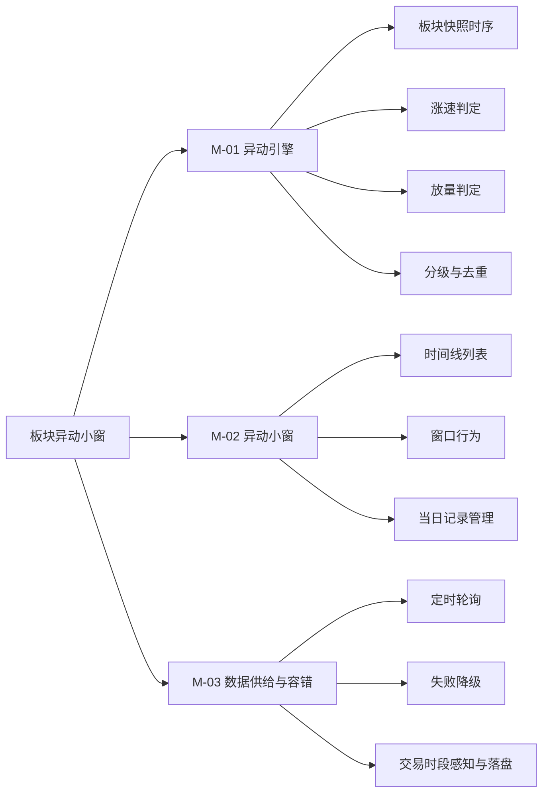
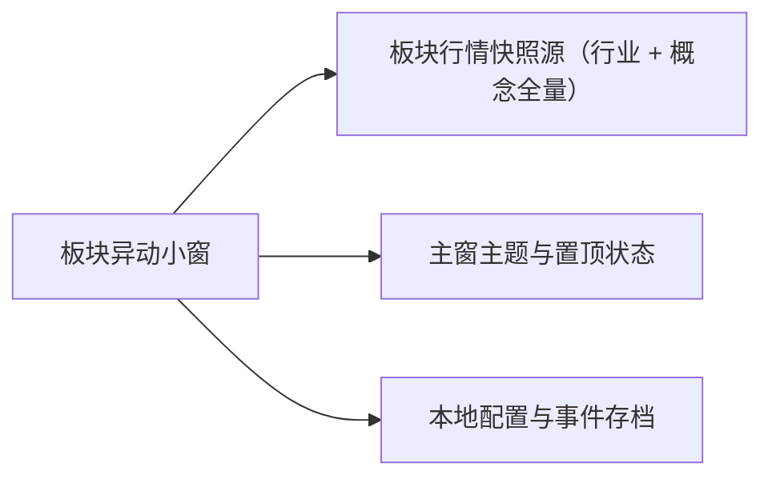
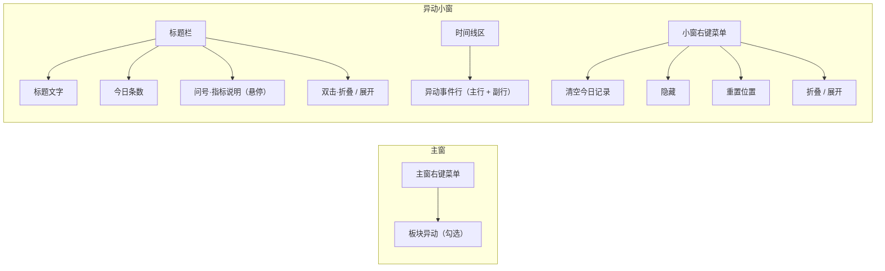
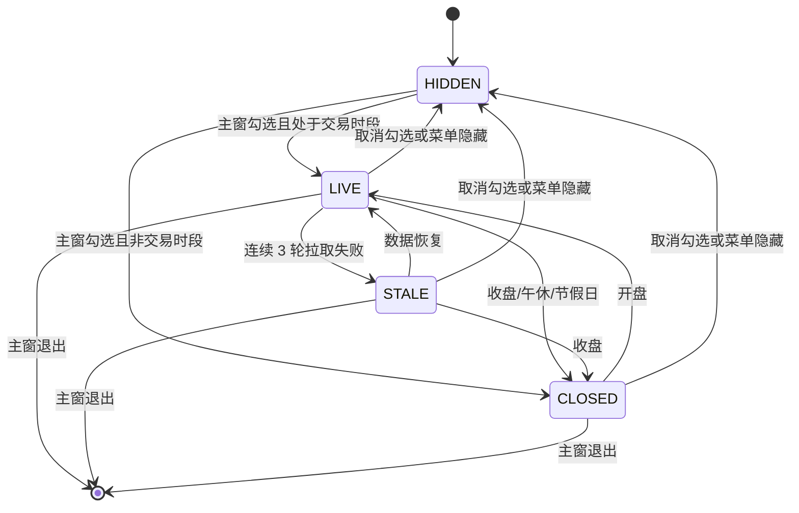
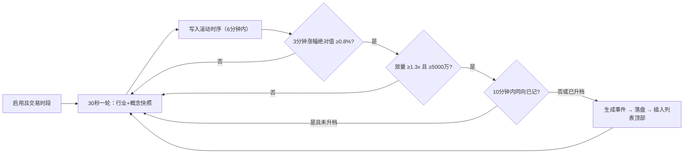

# PRD-盯盘君-板块异动-v1.0.0

## 1. 文档概述

### 1.1 文档信息

| 项 | 内容 |
| --- | --- |
| 项目名称 | 盯盘君 MarketEye |
| 文档版本 | v1.0.6 |
| 版本状态 | 未发布 |
| 创建日期 | 2026-11-16 |
| 更新日期 | 2026-11-16 |
| 基于需求 | 用户口头需求：「增加一个板块异动的监控，随时间线的异动，方便我对盘面的掌控」；四项口径经确认：独立小窗呈现、涨速 + 放量双条件、板块全量（约 210~220 个，以接口返回为准）、阈值 ±0.8% |
| 关联文档 | [SDD-盯盘君-板块异动-v1.0.0](../../../设计文档/板块异动/v1.0.0/SDD-盯盘君-板块异动-v1.0.0.md)（设计环节产出） |

### 1.2 变更记录

| 版本 | 日期 | 变更人 | 变更类型 | 关联章节 | 变更内容 |
| --- | --- | --- | --- | --- | --- |
| v1.0.0 | 2026-11-16 | - | 新增 | — | 新增独立小窗「板块异动」：以 30 秒为周期采集全市场 210 个板块（49 个行业 + 161 个概念）的涨跌幅与成交额快照，本地维护 6 分钟滚动时序，按「3 分钟涨幅绝对值 ≥ 0.8%」+「同期成交额增量 ≥ 前一等长窗口 1.3 倍且 ≥ 5000 万」判定板块异动，按时间线倒序展示（时间、方向、板块、3 分钟涨幅、强度档位、放量倍数、板块当前涨幅、领涨股），同板块同向 10 分钟去重、升档追加「升级」、方向反转立记；当日事件落盘、重启恢复、次日开盘清空；小窗无边框置顶、可拖动、位置记忆、主题跟随、截图让位；主窗右键菜单新增「板块异动」开关项 |
| v1.0.1 | 2026-11-16 | - | 修改 | §3.1 F-02、§3.3 R-20、§4 AC-35~36 | 原型评审反馈：标题栏新增指标说明入口——鼠标悬停标题栏问号显示「涨速 / 放量 / 档位 / 去重」四项口径浮层，覆盖列表不挤压行高；档位不作为涨跌语义着色 |
| v1.0.2 | 2026-11-16 | - | 修改 | §1.1、§1.4、§2.3、§2.4、§3.2 F-01、§3.3.1、§3.3.2、§4.1 | 设计取证后的口径修正：① 板块数量改为「以接口返回为准」——2026-11-16 盘中实测 49 行业 + 172 概念 = 221 个，概念数随接口调整浮动，原写死 210 会让验收与实现都对不上；② §2.4 补「标题栏问号（悬停指标说明）」入口及其映射行，否则存在无入口的功能点；③ R-20 从 M-03 移到 M-02（属界面规则，不属数据供给） |
| v1.0.3 | 2026-11-17 | - | 增量 | §2.4、§3.2 F-02、§3.3.2 R-21、§4 AC-37~38 | 用户提出「板块异动悬浮框增加双击折叠功能」：交互对齐主窗折叠轮播——双击标题栏在「全高 / 只留标题栏」间切换，折叠态保留状态圆点、标题、指标说明入口与今日条数，采集与计数照常，折叠状态落盘重启沿用；右键菜单同步增加「折叠 / 展开」入口（R-21） |
| v1.0.4 | 2026-11-18 | - | 缺陷修复 | §3.3.1 R-01/R-02/R-03/R-04、§3.3.2 R-22、§5 AC-39/40 | 线上实测 15 条异动全部标「未校验」：时序只保留 6 分钟，而前窗基点最远在 6 分 15 秒前、且取点只认「≤ 窗口线」，采样抖动下基点必被丢掉 → 放量倍数恒算不出、放量过滤形同失效。修 R-01 保留 8 分钟、R-02 取点 ±15 秒容差双向生效、R-04 收窄为「前窗基点不可得」（约开盘后 7 分钟内）；另修滚动条只画不响应（R-22），滑块可拖、轨道点击翻页 |
| v1.0.5 | 2026-11-18 | - | 缺陷修复 | §3.3.2 R-22、§5 AC-40 | 滚轮方向与常规列表相反（下滚向历史、上滚回最新），实机确认后按平台惯例修正：滚轮下滚视口向列表深处翻（内容上移）、上滚回最新，每次 3 条 |
| v1.0.6 | 2026-11-18 | - | 缺陷修复 | §3.3.2 R-21、§5 AC-41 | 折叠态小窗出现「阴影」：截图让位恢复分支把窗口高度写死成全高，而圆角主体只画到标题栏，列表区整块透明、文字压在颜色键上，抗锯齿边缘混出品红。修：恢复一律按标题栏高度；R-21 补「任何路径不得撑开折叠态」口径，新增 AC-41 |

### 1.3 项目背景

主窗能看自选个股、指数、两市成交额与盘面结构（白黄线、量能），但看不到「资金今天在哪些板块之间轮动」。板块异动是盘面节奏的直接信号：某个板块在几分钟内被快速拉起或砸下，往往先于指数和自选股表现。用户目前只能靠翻行情软件的板块榜，看到的是「当下谁涨得多」，而不是「什么时候、谁先动的、有没有量」。

本功能把「板块在几分钟内发生显著异动」这件事记录成一条时间线：盘中随时能看到今天资金轮动的先后顺序与方向，盘后可以复盘今天的节奏。

### 1.4 功能概述

新增独立置顶无边框小窗「板块异动」，按时间线记录当日板块异动事件：

1. **快照采集**：每 30 秒拉取一次全市场板块行情快照（涨跌幅、当日累计成交额、成分数、领涨股），覆盖 49 个行业板块 + 概念板块全量。板块数以接口当日返回为准（2026-11-16 实测：49 行业 + 172 概念 = 221 个，概念数会随接口调整浮动），实现不得写死。
2. **本地时序**：每个板块维护最近 6 分钟的滚动快照序列。3 分钟涨幅一律由本地时序计算，不采用行情源可能提供的涨速字段（其口径与本功能不一致）。
3. **异动识别**：由两类条件共同判定——**涨速条件**（3 分钟涨幅绝对值 ≥ 0.8%）与**放量条件**（同期成交额增量 ≥ 前一等长窗口的 1.3 倍，且增量本身 ≥ 5000 万，绝对下限用于滤除小板块噪声）。两类条件同时满足判为一次异动。方向按涨幅符号分向上 / 向下，强度按 0.8% / 1.5% / 2.5% 分弱 / 中 / 强三档。
4. **时间线展示**：事件按时间倒序排列，每条含时间、方向、板块名、3 分钟涨幅、强度档位、放量倍数、板块当前涨幅、领涨股及其涨幅；涨红跌绿；标题栏窗口名右侧设问号入口，悬停展开判定口径说明（涨速 / 放量 / 档位 / 去重），不占列表空间。
5. **去重与升级**：同板块同方向 10 分钟内不重复记录；若强度升档则追加一条「升级」事件；方向反转立即记录新事件。

小窗支持拖动、位置记忆、置顶与主题跟随主窗、截图让位；当日事件落盘，程序重启后恢复，次日开盘自动清空。

### 1.5 目标用户

| 角色 | 使用场景 |
| --- | --- |
| 个人投资者（盯盘者） | 盘中把小窗放在主窗旁，一眼看到「刚才哪个板块被拉起来了、有没有量」，判断今天的资金主线与轮动节奏；盘后回看时间线复盘 |

## 2. 需求全景

### 2.1 功能架构

### 2.2 功能模块划分

| 模块 | 职责与边界 |
| --- | --- |
| M-01 异动引擎 | 负责维护板块滚动时序、计算 3 分钟涨幅与区间成交额、执行「涨速 + 放量」判定、强度分级、去重与升级。只产出事件对象，不负责网络请求与界面绘制 |
| M-02 异动小窗 | 负责独立小窗的生命周期与展示：时间线列表（倒序、滚动、容量控制）、标题栏与计数、拖动/位置记忆/置顶/主题跟随/截图让位、右键菜单（清空今日记录 / 隐藏 / 重置位置） |
| M-03 数据供给与容错 | 负责板块快照的定时拉取（30 秒一轮、两个请求）、失败降级与恢复、交易时段感知（收盘停止轮询）、当日事件的落盘与重启恢复、跨日清空 |

边界说明：本功能不做多日历史回看、不做板块下钻到成分股、不做声音或闪烁提醒、不做自定义板块与个股异动。事件只保留当日，跨日清空。

| 项 | 说明 |
| --- | --- |
| 多日历史回看 | 只保留当日事件，跨日清空 |
| 板块下钻 | 不提供点击事件查看成分股列表 |
| 提醒 | v1 不提供声音、闪烁、气泡提示 |
| 自定义板块 | 板块集合固定为数据源提供的行业 + 概念全量（数量随接口浮动，2026-11-16 实测 221 个） |
| 个股异动 | 只做板块维度 |

### 2.3 功能依赖关系

- 依赖**板块行情快照源**：本功能唯一新增的数据源。一轮由两个请求构成（行业板块全量 + 概念板块全量），实测单轮约 0.4~0.5 秒、覆盖 221 个板块；具体来源与字段映射在设计环节确定。
- 依赖**主窗主题与置顶状态**：小窗配色跟随主窗主题，窗口层级跟随主窗置顶开关。
- 依赖**本地配置与事件存档**：窗口位置与显隐状态写入已有配置；当日事件独立存档（不与配置混写，避免高频写配置）。

### 2.4 界面功能架构

层级约定与 PRD-盯盘君-折叠轮播-v1.0.0 §2.4 一致：一级 = 窗口区块 / 右键菜单，二级 = 区块内元素 / 菜单项。

| 入口名称 | 所在层级 | 触发方式 | 功能路径 | 对应功能点 | 对应功能域 |
| --- | --- | --- | --- | --- | --- |
| 板块异动（勾选） | 一级：主窗右键菜单 / 二级：菜单项 | 点击 | 板块异动 → 显隐开关 | F-02 | M-02 |
| 标题文字 / 今日条数 | 一级：异动小窗 / 二级：标题栏元素 | 无（纯展示） | 板块异动 → 时间线浏览 | F-02 | M-02 |
| 异动事件行 | 一级：异动小窗 / 二级：列表元素 | 无（纯展示，点击不响应） | 板块异动 → 时间线浏览 | F-02 | M-02 |
| 标题栏问号 | 一级：异动小窗 / 二级：标题栏元素 | 悬停 | 板块异动 → 时间线浏览 | F-02 | M-02 |
| 时间线区 | 一级：异动小窗 / 二级：列表 | 滚轮滚动 | 板块异动 → 时间线浏览 | F-02 | M-02 |
| 小窗拖动 | 一级：异动小窗 / 二级：整窗 | 按住左键拖动 | 板块异动 → 窗口行为 | F-02 | M-02 |
| 清空今日记录 | 一级：小窗右键菜单 / 二级：菜单项 | 点击 | 板块异动 → 当日记录管理 | F-02 | M-02 |
| 隐藏 | 一级：小窗右键菜单 / 二级：菜单项 | 点击 | 板块异动 → 显隐开关 | F-02 | M-02 |
| 重置位置 | 一级：小窗右键菜单 / 二级：菜单项 | 点击 | 板块异动 → 窗口行为 | F-02 | M-02 |

> F-01（异动识别）与 F-03（数据刷新与容错）为系统自动触发的非入口功能点：无用户入口，其效果通过时间线内容与标题栏状态标记体现。验收对应：F-01 见 AC-01~AC-14；F-03 见 AC-27~AC-34。

## 3. 功能需求

### 3.1 用户故事

- 作为盯盘者，我想在盘中随时看到「刚才几分钟哪个板块被拉起来了」，以便第一时间判断资金主线，而不是等自己翻板块榜才发现。
- 作为盯盘者，我想看到异动发生的时间顺序，以便判断资金是「一个板块接力下一个」还是「同时全面开花」。
- 作为盯盘者，我想知道异动有没有量能配合，以便过滤掉几笔大单拉一下就回落的假动作。
- 作为盯盘者，我想在盘后回看今天的时间线，以便复盘当天的轮动节奏。
- 作为用户，我想把这条时间线放在主窗旁边不影响我看自选，重启程序后今天的记录还在。

### 3.2 详细功能点

#### F-01 异动识别与时间线生成

- **功能路径**：板块异动 → 异动识别（系统自动，无用户入口）
- **功能描述**：基于滚动时序判定板块异动，产出事件对象并按规则去重、升级、排序。
- **触发条件**：每个采集周期（30 秒）到达新快照后自动执行。
- **输入字段定义**：

| 字段名 | 类型 | 必填 | 校验规则 | 默认值 | 说明 |
| --- | --- | --- | --- | --- | --- |
| 涨速窗口 | 数字（系统内定） | 是 | 3 分钟，容差不超过半个采集周期（±15 秒） | 3 分钟 | 取当前快照与 3 分钟前最近快照的涨跌幅之差 |
| 3 分钟涨幅阈值 | 数字 | 是 | ≥ 0，可调（须走变更流程） | 0.8% | 3 分钟涨幅绝对值达到该值才进入放量判定 |
| 放量倍数阈值 | 数字 | 是 | ≥ 1，可调 | 1.3 | 近 3 分钟成交额增量 ÷ 前 3 分钟成交额增量 |
| 放量绝对下限 | 金额 | 是 | > 0，可调 | 5000 万 | 近 3 分钟成交额增量本身须达到该值，防止极小板块噪声 |
| 成分数下限 | 数字（系统内定） | 是 | ≥ 1 | 5 | 成分股数量不足该值的板块不参与判定 |
| 强度档位 | 枚举（展示态） | 是 | 仅限：弱 / 中 / 强 | 弱 | 按 3 分钟涨幅绝对值 0.8% / 1.5% / 2.5% 分档 |
| 去重窗口 | 数字 | 是 | > 0，可调 | 10 分钟 | 同板块同方向在该窗口内不重复记录 |

- **业务处理逻辑**：
  1. 前置过滤：成分股数量少于 5 只的板块直接跳过，不参与后续判定，不产生事件。
  2. 每个采集周期把全部板块的快照（时刻、涨跌幅、当日累计成交额）追加进各自时序，时序只保留最近 6 分钟（超出丢弃最早）；同一板块同一时刻只保留一条。
  3. 对每个板块计算：3 分钟涨幅 = 当前涨跌幅 − 3 分钟前涨跌幅；近 3 分钟成交额 = 当前累计额 − 3 分钟前累计额；前 3 分钟成交额 = 3 分钟前累计额 − 6 分钟前累计额。
  4. 判定两类条件：涨速条件为 3 分钟涨幅绝对值 ≥ 0.8%；放量条件为近 3 分钟成交额 ≥ 前 3 分钟成交额 × 1.3 且 ≥ 5000 万。两类条件同时满足才判为异动。
  5. 开盘不足 6 分钟、程序刚启动或休市复牌后时序重建不足 6 分钟时，放量条件不参与判定（视为满足），事件副行的放量列显示「—」，并在同行追加「未校验」标识。
  6. 方向：3 分钟涨幅 > 0 为向上（↑），< 0 为向下（↓）；强度按 3 分钟涨幅绝对值落入 0.8%~1.5%（弱）、1.5%~2.5%（中）、≥ 2.5%（强）。
  7. 去重：同板块同方向在 10 分钟窗口内已有事件时默认不记；例外是当前档位高于该窗口内上次记录的档位（弱→中、中→强、弱→强），此时追加一条并标注「升级」，且以该条为起点重新计算 10 分钟窗口；方向反转不受窗口约束，立即追加新事件并以新事件重新起算窗口。
  8. 事件对象字段：发生时刻、方向、板块名、3 分钟涨幅、强度档位、放量倍数（或「—」）、板块当前涨跌幅、领涨股名、领涨股涨幅、是否升级。
  9. 事件写入时间线，倒序排列（最新在上，同一分钟内多条按发生时刻倒排），当日容量上限 200 条，超出时丢弃最早事件。
- **输出结果**：满足条件时新增一条事件并落盘；不满足时无动作。
- **交互流程**：无用户交互，由采集周期驱动。

#### F-02 异动小窗展示与窗口行为

- **功能路径**：板块异动 → 显隐开关；板块异动 → 时间线浏览；板块异动 → 当日记录管理；板块异动 → 窗口行为
- **功能描述**：独立无边框置顶小窗，展示时间线列表与当日计数，支持拖动、位置记忆、置顶与主题跟随、截图让位。
- **触发条件**：主窗右键菜单「板块异动」勾选/取消勾选；小窗上按住左键拖动；小窗右键菜单；列表内滚轮。
- **输入字段定义**：

| 字段名 | 类型 | 必填 | 校验规则 | 默认值 | 说明 |
| --- | --- | --- | --- | --- | --- |
| 小窗显隐 | 布尔 | 是 | 仅限开/关 | 关 | 菜单勾选态与实际显隐恒一致，重启恢复上次状态 |
| 小窗位置 | 坐标 | 否 | 出屏时自动收回屏幕内 | 主窗右侧 | 拖动后即时落盘 |
| 列表容量 | 数字（系统内定） | 是 | 当日最多 200 条 | 200 | 列表可视行数约 9 行，超出滚动 |

- **业务处理逻辑**：
  1. 时间线每行两段：主行「时刻 + 方向箭头 + 板块名 + 3 分钟涨幅」，副行「档位 + 放量倍数 + 当前涨幅 + 领涨股及涨幅」。涨幅与金额按 1 位小数、带正负号展示。向上事件文字为红、向下为绿，副行用次要色。
  2. 标题栏左侧显示「板块异动」，右侧显示「今日 N 条」；数据中断时显示「数据中断」标记，非交易时段显示「休市」标记（两者互斥，中断优先）。
  3. 标题栏窗口名右侧设一个圆形问号入口（13px 圆环、次要色描边、悬停提亮），鼠标悬停即在该入口下方展开「指标说明」浮层，移开即收起。浮层覆盖在列表之上，不挤压行高、不改变窗口尺寸，宽度与窗口左右内边距对齐；内容固定四项口径——涨速（3 分钟涨幅绝对值 ≥ 0.8%）、放量（成交额 ≥ 前 3 分钟 1.3 倍且 ≥ 5000 万）、档位（0.8 / 1.5 / 2.5% 对应弱 / 中 / 强）、去重（同向 10 分钟一条，升档记「升级」），底部一行注「时序不足 6 分钟时放量豁免，该条标「未校验」」。浮层配色随主题，档位不着涨跌色（避免被误读为方向）。
  4. 新事件插入列表顶部；用户处于浏览历史位置时保持当前视口不动，仅在视口位于顶部时随新增下移。
  5. 列表超过可视行数时右侧出现滚动条：拖滑块跟手、点轨道翻页、滚轮各 3 条，三种方式都能浏览历史事件。
  6. 拖动小窗任意位置移动，松手位置即时持久化；恢复时校验出屏并收回屏幕内。
  7. 置顶跟随主窗置顶开关；主题切换时小窗立即换色。
  8. 前台出现其他程序铺满屏幕的窗口（截图遮罩、录屏、全屏播放）时自动隐藏，该窗口退出后恢复；系统桌面与任务栏不算。
  9. 小窗右键菜单：「折叠 / 展开」（同双击标题栏）、「清空今日记录」（列表、计数与存档同步清零，采集继续且不清空时序，避免清空后立刻重报同一次异动）、「隐藏」、「重置位置」。
  10. 双击标题栏在小窗全高与「只留标题栏」之间切换：折叠后仅保留状态圆点、标题、指标说明入口与今日条数，位置不变，采集照常、计数持续更新；再双击恢复全高与滚动位置。折叠状态写入配置，重启后沿用。
  11. 主窗退出时小窗一并退出；小窗不抢焦点，不影响主窗操作。
- **输出结果**：成功即按上述行为生效；落盘失败不阻断展示，记录日志。
- **交互流程**：勾选 → 小窗出现在主窗右侧 → 盘中看时间线随异动增长 → 滚轮回看 → 盘后回看 → 右键隐藏或次日开盘自动清空。

#### F-03 数据刷新与容错

- **功能路径**：板块异动 → 数据刷新（系统自动，无用户入口）
- **功能描述**：板块快照的定时拉取、失败降级、交易时段感知、当日事件落盘与跨日清空。
- **触发条件**：定时触发（交易时段内每 30 秒）；小窗显示状态变化。
- **输入字段定义**：

| 字段名 | 类型 | 必填 | 校验规则 | 默认值 | 说明 |
| --- | --- | --- | --- | --- | --- |
| 轮询周期 | 数字（系统内定） | 是 | 交易时段内固定 30 秒，v1 不提供设置入口 | 30 秒 | 与涨速窗口的容差联动，改周期须同步评估窗口取点 |
| 降级阈值 | 数字（系统内定） | 是 | 连续 3 轮失败 | 3 | 置位后标题栏显示数据中断标记 |
| 事件存档 | 文件 | 是 | 当日一个存档，次日覆盖 | — | 与配置分离，独立写入 |

- **业务处理逻辑**：
  1. 小窗显示且处于交易时段时，每 30 秒串行拉取行业板块与概念板块全量快照（两个请求，轮间留短间隔避免触发对端限流）。
  2. 一轮失败（超时、解析失败、返回空）沿用上一轮快照且不追加时序；连续 3 轮失败，标题栏显示「数据中断」标记，列表保持不动。
  3. 数据恢复后清除中断标记，时序从恢复点重新起算 6 分钟（不跨越中断区间做差，避免把中断期间的涨幅误判成本轮异动），该区间内事件按 F-01 第 5 条标注「未校验」。
  4. 非交易时段（含午休、收盘后、节假日）：停止轮询，标题栏显示「休市」，列表保留当日全部事件供复盘。
  5. 午休复牌与跨日开盘时清空时序，从复牌点重新起算 6 分钟（与中断恢复同口径），避免用 11:2x 的快照计算 13:00 的 3 分钟涨幅。
  6. 每次新增事件即落盘（交易日期 + 事件数组）；程序启动时按当前交易日期读取存档，日期一致则恢复列表与计数，不一致则视为新交易日、清空并覆盖存档。程序整夜运行时，时段由非交易转交易时同样执行跨日清空。
  7. 小窗隐藏时停止轮询；重新勾选显示后，若当日存档存在则恢复列表，并重新开始采集时序。
- **输出结果**：成功即更新时序与列表；失败降级显示，不弹窗打扰。
- **交互流程**：开盘自动采集 → 产生事件入列表 → 中午休市停摆（时序清空）→ 13:00 续采 → 收盘定格 → 次日开盘自动清空。

### 3.3 业务规则

#### 3.3.1 M-01 异动引擎

**业务约束**：

| 约束条件 | 适用范围 | 违反处理 |
| --- | --- | --- |
| 涨速必须由本地滚动时序计算，不得依赖接口提供的现成涨速字段 | 涨速判定 | 接口无该字段或字段口径不一致时以本地计算为准（阻止并纠正） |
| 放量判定必须与涨速同窗口（同为 3 分钟），不得跨不同长度窗口比较 | 放量判定 | 窗口不一致时判定结果无效（阻止并纠正） |
| 分级与去重必须基于同一条事件对象，不得先写列表再判重 | 事件生成 | 出现重复事件视为缺陷 |
| 板块集合必须为行业全量与概念全量的并集（数量以接口返回为准，实测 221 个），不按成交额截断 | 快照采集 | 截断会造成小板块异动漏采，视为口径错误 |
| 成分股数量少于 5 只的板块不参与判定 | 异动判定 | 直接跳过（噪声过滤），不记录 |

**业务逻辑规则**：

| 编号 | 触发条件 | 执行动作 | 优先级 |
| --- | --- | --- | --- |
| R-01 时序维护 | 每个采集周期新快照到达 | 追加至各板块时序，只保留最近 8 分钟（判放量要再回溯 3 分钟取前窗基点，6 分钟只够边界）；同一板块同一时刻只保留一条，重复快照不重复计入 | 高 |
| R-02 涨速判定 | 3 分钟涨幅绝对值 ≥ 0.8% | 进入放量判定；取点允许 ±15 秒容差（采样带抖动时基准点可能落在窗口线之后零点几秒，就近取点后跨度仍落在 2 分 45 秒~3 分 15 秒内） | 高 |
| R-03 放量判定 | 近 3 分钟成交额增量 ≥ 前 3 分钟增量 × 1.3 且 ≥ 5000 万 | 判为异动，记录放量倍数（保留 1 位小数），副行显示「放量 x.x x」 | 高 |
| R-04 放量豁免 | 前 3 分钟基点不可得（开盘后约 7 分钟内、刚启动或复牌重建） | 放量条件视为满足，副行放量列显示「—」，同行追加「未校验」标识；基点可得后必须走真实倍数判定，不得继续豁免 | 中 |
| R-05 强度分级 | 事件成立 | 3 分钟涨幅绝对值 ∈ [0.8%, 1.5%) 为弱；∈ [1.5%, 2.5%) 为中；≥ 2.5% 为强 | 中 |
| R-06 去重 | 同板块同方向 10 分钟内已有事件 | 默认不记；当前档位高于上次记录档位时追加一条并标注「升级」，以该条为起点重算窗口；方向反转不受窗口约束，立即记录并重算窗口 | 高 |
| R-07 方向定义 | 3 分钟涨幅 > 0 或 < 0 | 分别产出向上（up）/ 向下（down）事件；等于 0 不构成事件 | 高 |
| R-08 列表容量 | 当日事件数 > 200 | 丢弃最早事件，保持最新 200 条；计数显示实际保留条数 | 低 |
| R-09 排序 | 新增事件 | 插入列表顶部（时间倒序）；同一分钟内多条按发生时刻倒排 | 中 |

**业务状态机**（小窗整体）：

| 状态 | 编码 | 含义 |
| --- | --- | --- |
| 隐藏态 | HIDDEN | 未勾选或已隐藏，窗口不显示，不轮询 |
| 采集中 | LIVE | 交易时段，30 秒一轮采集并产出事件 |
| 中断态 | STALE | 连续 3 轮拉取失败，停止推进时序，显示中断标记 |
| 收盘态 | CLOSED | 非交易时段，停止轮询，列表定格供复盘 |

| 流转 | 前置条件 | 触发动作 |
| --- | --- | --- |
| HIDDEN → LIVE | 勾选且交易时段 | 显示小窗，读取当日存档，清空时序，启动轮询 |
| HIDDEN → CLOSED | 勾选且非交易时段 | 显示小窗与当日存档，不轮询，显示休市标记 |
| LIVE → STALE | 连续 3 轮失败 | 停止推进时序，标题栏显示中断标记 |
| STALE → LIVE | 一轮成功 | 清除标记，时序从恢复点重新起算 |
| LIVE/STALE → CLOSED | 时段转非交易 | 停止轮询，显示休市标记，清空时序 |
| CLOSED → LIVE | 时段转交易 | 跨日则清空存档与计数；清空时序；从恢复点重新起算 6 分钟并恢复轮询 |
| LIVE/STALE/CLOSED → HIDDEN | 取消勾选或菜单隐藏 | 隐藏窗口，停止轮询，菜单勾选态同步 |
| LIVE/STALE/CLOSED → 退出 | 主窗退出 | 小窗一并退出，不写残留状态 |

#### 3.3.2 M-02 异动小窗

**业务约束**：

| 约束条件 | 适用范围 | 违反处理 |
| --- | --- | --- |
| 位置持久化失败不得阻断显示 | 位置记忆 | 允许并记录日志 |
| 小窗不得超出屏幕可视范围 | 拖动/重置/恢复 | 出屏时自动收回（阻止并纠正） |
| 显隐状态必须与主窗菜单勾选态恒一致 | 显隐开关 | 以实际显隐为准回写菜单 |
| 小窗不得遮挡其他程序的全屏界面 | 窗口层级 | 检测到跨进程铺满屏幕窗口即让位（阻止并纠正） |
| 用户正在浏览历史位置时，新增事件不得打断滚动位置 | 列表刷新 | 保持当前视口不动，仅在视口位于顶部时随新增下移（阻止并纠正） |
| 事件方向与配色必须一致：向上为红、向下为绿 | 列表绘制 | 配色与方向不一致视为缺陷（阻止并纠正） |

**业务逻辑规则**：

| 编号 | 触发条件 | 执行动作 | 优先级 |
| --- | --- | --- | --- |
| R-10 位置记忆 | 拖动松手或重置位置 | 即时持久化；恢复时校验出屏并收回 | 高 |
| R-11 置顶与主题跟随 | 主窗置顶开关或主题变更 | 小窗同步生效 | 中 |
| R-12 截图让位 | 前台被其他进程铺满屏幕的窗口占据（系统桌面与任务栏除外） | 小窗隐藏；该窗口退出后恢复原位置与置顶 | 高 |
| R-13 标题栏状态标记 | 处于 STALE 或 CLOSED | 分别显示「数据中断」/「休市」；两者互斥，中断优先；回到 LIVE 后清除 | 中 |
| R-14 清空记录 | 菜单「清空今日记录」 | 列表与计数清零，存档同步清空；采集继续，不清空时序（避免清空后立刻重报同一次异动） | 中 |
| R-20 指标说明 | 鼠标悬停标题栏问号入口 | 在入口下方展开指标说明浮层（涨速门槛 / 放量倍数与绝对下限 / 档位边界 / 去重与升级），移开即收起；浮层覆盖列表、不挤压行高与窗口尺寸；文字随主题换色，档位不着涨跌色 | 低 |
| R-21 双击折叠 | 双击小窗标题栏 | 在小窗全高与「只留标题栏」之间切换（交互对齐主窗折叠轮播）：折叠后窗口高度等于标题栏高度，只显示状态圆点、标题、指标说明入口与今日条数，列表、滚动条与空态引导隐藏；位置不变，采集与计数照常；再次双击恢复全高，滚动位置保持不变。右键菜单「折叠 / 展开」与双击等价；折叠状态写入配置，重启后沿用；折叠态滚轮与指标说明入口不响应。**折叠态高度在任何路径下都不得被撑开**：截图让位恢复、位置记忆回写等分支同样按标题栏高度还原，否则主体绘制止于标题栏、列表区透明，文字压在颜色键上会出现品红阴影（v1.0.6 实际发生并修复） | 低 |
| R-22 滚动条操作 | 列表条数超过可视行数（滚动条出现） | 三种方式都能翻看历史：① 拖动右侧滑块，列表随指针位置实时跟手；② 点击滑块上方/下方轨道，向对应方向翻一页（可视行数条）；③ 滚轮下滚视口向列表深处翻（更早事件、内容上移）、上滚回最新，各 3 条，方向与常规列表一致（v1.0.5 修正）。拖动滑块期间窗口不跟随移动、松手不改变窗口位置记忆；滑块隐藏（不足一屏）时按下该区域按拖窗口处理 | 中 |

#### 3.3.3 M-03 数据供给与容错

**业务约束**：

| 约束条件 | 适用范围 | 违反处理 |
| --- | --- | --- |
| 轮询不得并发，两个请求串行并留短间隔 | 快照采集 | 触发对端限流视为缺陷（历史上并发请求曾被直接断连） |
| 收盘态不得发出任何快照请求 | 时段感知 | 违反视为缺陷 |
| 中断与休市期间不得跨越做差 | 时序计算 | 跨越中断或休市的差值会把停摆期涨幅计入，视为口径错误 |
| 事件存档不得写入主配置文件 | 落盘 | 高频写配置会导致配置损坏，视为缺陷 |

**业务逻辑规则**：

| 编号 | 触发条件 | 执行动作 | 优先级 |
| --- | --- | --- | --- |
| R-15 失败降级 | 一轮拉取失败 | 沿用上轮快照，不推进时序；连续 3 轮转 STALE | 高 |
| R-16 恢复重建 | 数据恢复 | 清标记，时序从恢复点重新起算 6 分钟，不跨中断做差 | 高 |
| R-17 收盘冻结 | 非交易时段 | 停止轮询，清空时序，保留当日事件供复盘，显示休市标记 | 高 |
| R-18 事件落盘 | 新增事件或清空记录 | 立即写入当日存档（交易日期 + 事件数组） | 高 |
| R-19 跨日清空 | 启动或时段转交易时发现存档日期 ≠ 当前交易日期 | 清空列表与计数，覆盖存档 | 中 |

### 3.4 业务流程

**主链路：采集到展示**

**复盘链路：盘后回看**

**边界链路：容错**

连续 3 轮失败 → 停止推进时序并显示中断标记 → 恢复后重新起算 6 分钟窗口（该区间事件标注「未校验」），期间不产出跨中断的假异动。

## 4. 非功能性需求

### 4.1 性能要求

| 指标 | 目标值 | 测量条件 |
| --- | --- | --- |
| 单轮采集耗时 | ≤ 3 秒（实测约 0.5 秒） | 交易时段、正常网络 |
| 轮询周期 | 30 秒固定 | 交易时段 |
| 判定计算耗时 | < 20ms（221 个板块） | 单轮快照到达后 |
| 重绘 | 无可见卡顿（< 50ms） | 新增事件插入列表时 |
| 常驻内存增量 | < 10MB | 小窗开启前后对比（时序 221 板块 × 13 个快照 = 6 分钟 ÷ 30 秒 + 1） |
| 非交易时段 CPU | 接近 0（取样均值 < 5%） | 收盘态无定时器空转 |
| 网络流量 | ≤ 约 35KB/轮 | 两个请求的响应体合计 |

### 4.2 安全要求

只读公开行情数据，无用户凭据；请求串行并控制频率，不触发对端限流；存档文件只写本地，不外发。

### 4.3 兼容性要求

Windows 10/11；DPI 100%~200% 下字体与布局正常；单/多显示器（出屏收回仅按主显示器校验）；与主窗既有功能（自选分页、折叠轮播、成交额块、盘面速览、K 线）无互斥；与「盘面速览」小窗可同时开启。

## 5. 验收标准

### 5.1 功能验收条件

| 编号 | 功能点 | 前置条件 | 操作步骤 | 预期结果 |
| --- | --- | --- | --- | --- |
| AC-01 | F-01 | 交易时段，构造某板块 3 分钟涨幅 +0.9% 且放量 1.5 倍 | 等待一轮采集 | 时间线顶部新增一条：时刻 + ↑ + 板块名 + 3 分钟涨幅（1 位小数带正负号），红色；副行显示「弱」「放量 1.5x」、当前涨幅、领涨股及涨幅 |
| AC-02 | F-01 | 构造某板块 3 分钟涨幅 −0.9% 且放量 | 同上 | 事件方向为 ↓、绿色 |
| AC-03 | F-01 | 3 分钟涨幅 +0.7%（低于阈值） | 同上 | 不产生事件 |
| AC-04 | F-01 | 3 分钟涨幅 +1.2% 但同期成交额未放大（不足 1.3 倍） | 同上 | 不产生事件（假拉升被过滤） |
| AC-05 | F-01 | 近 3 分钟成交额增量 < 5000 万 | 同上 | 不产生事件 |
| AC-06 | F-01 | 构造成分股 3 只的板块，涨速与放量均达标 | 同上 | 不产生事件（成分数下限过滤） |
| AC-07 | F-01 | 开盘不足 6 分钟（或复牌后时序刚重建） | 观察首轮事件 | 放量条件放行，副行放量列显示「—」并追加「未校验」标识 |
| AC-08 | F-01 | 3 分钟涨幅分别 1.0% / 1.8% / 3.0% | 观察三条事件 | 档位依次为弱 / 中 / 强 |
| AC-09 | F-01 | 同板块同方向 5 分钟内再次满足条件且未升档 | 观察 | 不新增事件 |
| AC-10 | F-01 | 同板块同方向先前为「弱」，10 分钟内涨幅升至 1.8% | 观察 | 追加一条并标注「升级」；此后 10 分钟从该条重新起算（期间未再升档则不重记） |
| AC-11 | F-01 | 同板块先前向上异动，10 分钟内出现向下异动 | 观察 | 立即追加一条向下事件，不受去重窗口限制 |
| AC-12 | F-01 | 同一采集周期内同一板块快照被重复写入 | 观察该板块事件 | 同一时刻只有一条快照、不产生重复事件 |
| AC-13 | F-01 | 同一分钟内产生两条事件 | 观察列表 | 按发生时刻倒序排列 |
| AC-14 | F-01 | 当日事件超过 200 条 | 持续观察 | 列表只保留最新 200 条，标题栏计数与实际一致 |
| AC-15 | F-02 | 主窗运行中 | 打开主窗右键菜单 | 存在「板块异动」勾选项，默认未勾选；勾选后小窗出现在主窗右侧 |
| AC-16 | F-02 | 列表超过可视行数 | 滚轮滚动 | 可浏览历史事件；浏览过程中新增事件不打断当前视口 |
| AC-17 | F-02 | 小窗可见 | 拖动到任意位置后重启 | 位置与显隐恢复为关闭前最后状态 |
| AC-18 | F-02 | 拖动越出屏幕边缘 | 松手 | 自动收回屏幕内 |
| AC-19 | F-02 | 小窗可见 | 主窗切换主题 | 小窗配色立即跟随，无残留旧色 |
| AC-20 | F-02 | 小窗可见 | 切换主窗置顶开关 | 小窗层级同步变化 |
| AC-21 | F-02 | 小窗可见 | 唤起系统截图（Win+Shift+S） | 小窗在遮罩出现后 ≤0.5s 内隐藏，截图中不可见 |
| AC-22 | F-02 | 已有若干事件 | 右键「清空今日记录」 | 列表与计数归零，存档同步清空；随后不重报清空前那一刻的异动 |
| AC-23 | F-02 | 小窗可见 | 右键「隐藏」 | 小窗消失且主窗菜单勾选态同步取消 |
| AC-24 | F-02 | 小窗被拖远 | 右键「重置位置」 | 回到主窗右侧默认位并持久化 |
| AC-25 | F-02 | 小窗可见 | 退出主窗 | 小窗一并退出，无残留进程 |
| AC-26 | F-02 | 小窗与盘面速览同时开启 | 各自拖动、隐藏 | 两窗互不影响，均可独立显隐与记忆位置 |
| AC-27 | F-03 | 已有若干事件 | 关闭程序再重启并勾选 | 当日事件与计数恢复，顺序不变 |
| AC-28 | F-03 | 已有若干事件（昨日） | 次日开盘后启动并勾选 | 列表清空，计数归零 |
| AC-29 | F-03 | 昨日留有小窗（程序整夜运行） | 次日 09:30 自动转交易 | 列表与计数自动清空，无需重启 |
| AC-30 | F-03 | 小窗可见 | 断网或屏蔽数据源，持续 3 轮以上 | 标题栏出现「数据中断」标记，列表保持不动，无新增事件 |
| AC-31 | F-03 | 处于中断态 | 恢复网络 | 标记消失；恢复后首条事件不早于恢复后 3 分钟，期间事件标注「未校验」 |
| AC-32 | F-03 | 上午已有时序数据，午休后 13:00 复牌 | 观察复牌首轮 | 不产生跨休市的异动事件；时序从复牌点重新起算 |
| AC-33 | F-03 | 收盘后或午休 | 观察 | 标题栏显示「休市」；无网络请求（抓包/日志核验）；CPU 取样均值 < 5% |
| AC-34 | F-03 | 交易时段连续运行 10 分钟 | 核对日志与资源 | 采集间隔 30±3 秒、请求串行无重叠、单轮 ≤ 3 秒、内存增量 < 10MB、CPU 取样均值 < 5% |
| AC-35 | F-02 | 小窗已显示、列表有事件 | 鼠标移到标题栏问号入口 → 移开 | 悬停时浮层在入口下方展开且完整可见（四行口径 + 一行注）；移开后立即收起；展开期间列表行高、窗口尺寸、滚动位置均不变，无闪烁 |
| AC-36 | F-02 | 浮层展开 | 逐项对照浮层数值与规则表 | 涨速写 0.8%、放量写 1.3 倍且 5000 万、档位写 0.8 / 1.5 / 2.5% 对应弱 / 中 / 强、去重写同向 10 分钟一条并升档记「升级」，与 R-01、R-02、R-05、R-06 完全一致，无自相矛盾的旧口径 |
| AC-37 | F-02 | 小窗已显示、列表有事件 | 双击标题栏 | 窗口收起到标题栏高度（只余状态圆点、标题、指标说明入口、今日条数），圆角完整、无黑块；位置不变；再次双击恢复全高，列表与滚动位置与折叠前一致 |
| AC-38 | F-02 | 小窗处于折叠态 | 观察新事件到达后重启程序 | 折叠期间采集继续、今日条数随新事件递增；重启后小窗仍为折叠态且高度为标题栏；右键菜单「折叠 / 展开」与双击效果一致 |
| AC-39 | F-02 | 交易时段、事件数超过可视行数 | 开盘满 7 分钟后观察新建事件 | 副行放量列显示真实倍数（如「放量 1.8x」）与「当前 +x.x%」，不出现「放量 — / 未校验」；「未校验」只在开盘后前几分钟（前窗基点不可得）出现 |
| AC-40 | F-02 | 事件数超过可视行数（滚动条已出现） | 拖动右侧滑块 / 点击滑块下方轨道 / 滚动滚轮 | 列表随操作翻到对应位置，滑块位置与视口同步；拖动期间窗口不移动、松手后窗口位置记忆不变；不足一屏时滚动条隐藏且该区域按拖窗口处理 |
| AC-41 | F-02 | 小窗处于折叠态 | 用 Win+Shift+S 或全屏视频触发截图让位，让位结束、窗口恢复 | 恢复后窗口仍为标题栏高，不出现透明列表区；文字周围无品红/紫色阴影；展开后列表、滚动位置与折叠前一致 |
