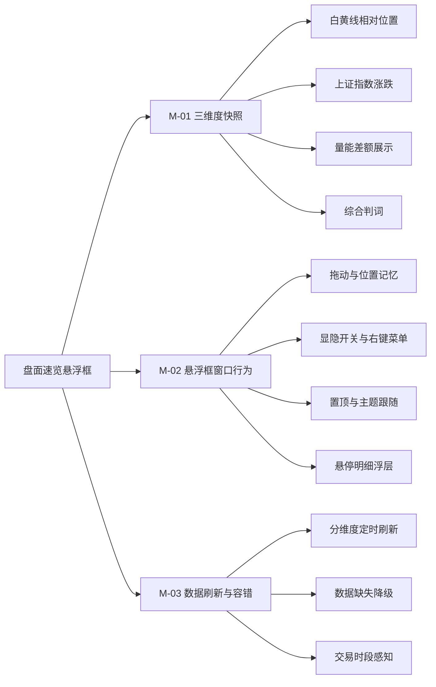
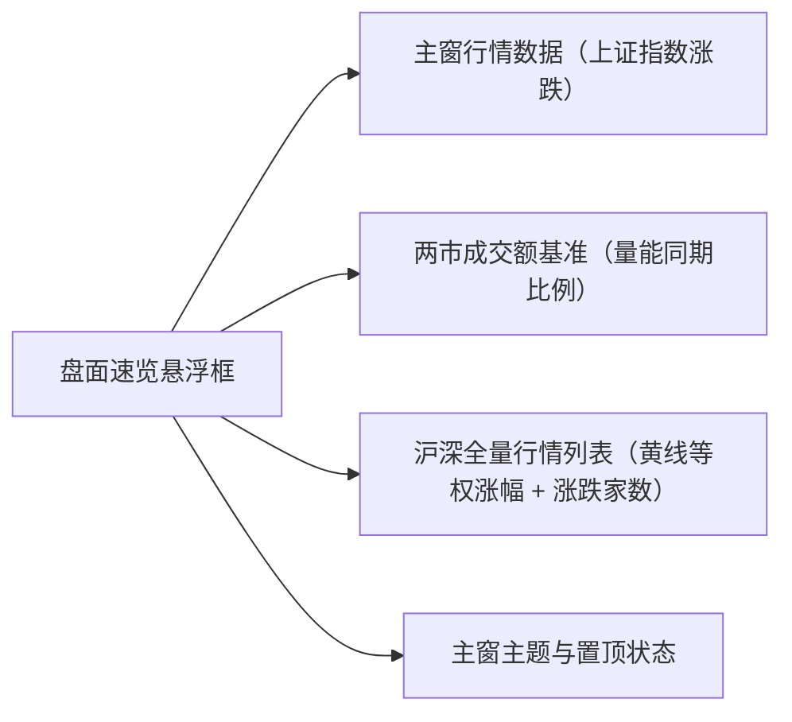
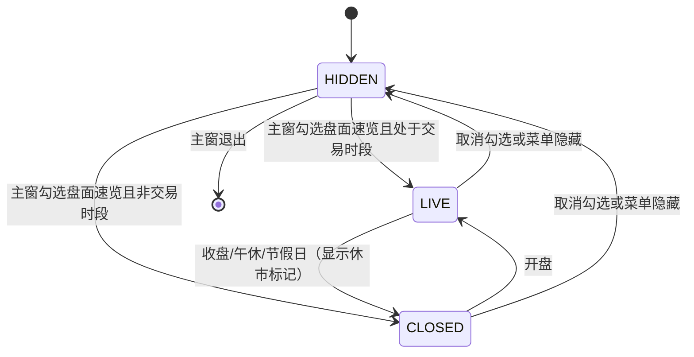
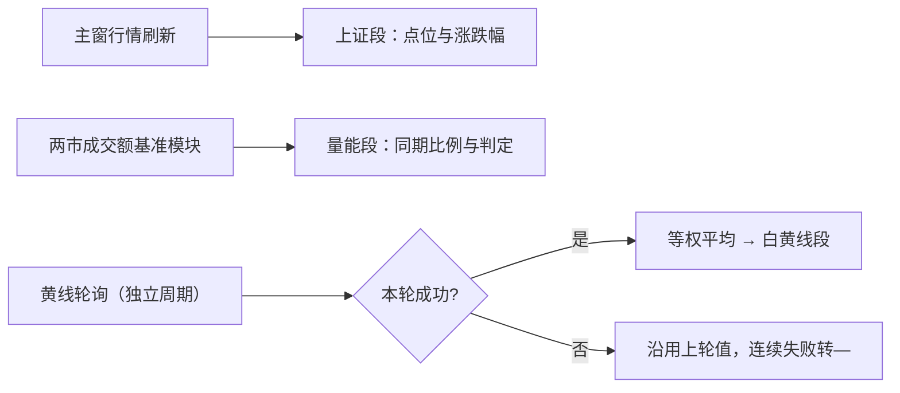

# PRD-盯盘君-盘面速览-v1.0.0

## 1. 文档概述

### 1.1 文档信息

| 项 | 内容 |
| --- | --- |
| 项目名称 | 盯盘君 MarketEye |
| 文档版本 | v1.0.0 |
| 版本状态 | 未发布 |
| 创建日期 | 2026-11-10 |
| 更新日期 | 2026-11-10 |
| 基于需求 | 用户口头需求：独立悬浮框叠加展示盘面三个维度——白黄线相对位置、上证指数涨跌、量能放缩 |
| 关联文档 | [SDD-盯盘君-盘面速览-v1.0.0](../../设计文档/盘面速览/v1.0.0/SDD-盯盘君-盘面速览-v1.0.0.md)（设计环节产出） |

### 1.2 变更记录

| 版本 | 日期 | 变更人 | 变更类型 | 关联章节 | 变更内容 |
| --- | --- | --- | --- | --- | --- |
| v1.0.0 | 2026-11-10 | - | 新增 | — | 新增独立悬浮框「盘面速览」：单行紧凑展示四个信息段——①白黄线相对位置（白=上证指数涨跌幅，黄=沪市全部 A 股一股一票等权平均涨幅，差值超阈值判上/下、否则粘合）；②上证指数点位与涨跌幅；③两市量能对比昨日同期判放量/缩量/平量；④综合判词（由三个维度判定结果叠加推导出的盘面实时状况短语，如「放量·普涨」「缩量·二八行情」，零新增数据）。悬浮框无边框置顶小窗，可拖动、位置记忆、主题跟随主窗；主窗右键菜单新增「盘面速览」开关项；数据缺失降级显示占位符；非交易时段进入收盘态停止刷新 |
| v1.0.1 | 2026-11-11 | - | 增量 | §3.2 F-02、§3.3.2 M-02、§5 | 用户反馈截图时悬浮框浮在截图工具之上挡住选区：新增 F-02 第 6 条与 R-11 截图让位——前台被其他进程铺满屏幕的窗口（系统/第三方截图、录屏、全屏播放）占据时悬浮框自动隐藏，退出后恢复原位置与置顶；补 AC-23/AC-24 |
| v1.1.0 | 2026-11-11 | - | 增量 | §2.1~§2.4、§3.2 F-01/F-02/F-03、§3.3、§5 | 用户三项反馈：①量能段改为与主窗成交额块同款的「箭头 + 带符号金额」（↑+388亿 / ↓-388亿），不再显示放量缩量与百分比（R-12）；②悬停量能段弹量能明细浮层（R-13）；③悬停白黄线段弹沪深涨跌家数浮层（R-13/R-14，合计不含北交所）。数据侧由「只拉沪市 sh_a」改为「一次拉 hs_a 沪深全量」：沪市样本照旧求黄线均值，全量样本统计家数，家数与黄线同批同轮（不另取一份）；补 AC-25~AC-30 |
| v1.1.2 | 2026-11-11 | - | 增量 | §5 R-11 | BUG-12：点击桌面空白处悬浮框消失、点回悬浮框又出现——桌面（Progman）矩形铺满整屏被误判为遮罩；R-11 判定排除系统桌面与任务栏 |
| v1.1.1 | 2026-11-11 | - | 增量 | 附件（家数浮层截图）、§5 R-14、AC-28 | 用户反馈家数浮层全为单色：上涨数字改红、下跌数字改绿（与行情涨跌配色一致），标签与平盘 / 合计 / 数据时点保持普通色；沪市、深市分别家数同规则 |

### 1.3 项目背景

主窗已能看个股与指数行情、两市成交额，但盘面「结构性」信息需要用户在多个信息源之间自行拼装：权重股与中小盘谁强（白黄线关系）、大盘整体涨跌（上证指数）、当天是放量还是缩量（量能）。盯盘时频繁切换注意力。本功能把三个维度压缩成一行文字的独立小悬浮框，常驻屏幕一角，一眼看全盘面结构。

### 1.4 功能概述

新增一个独立于主窗的置顶无边框小悬浮窗「盘面速览」，单行展示三段数据信息与一段综合判词：

1. **白黄线**：白线为上证指数涨跌幅，黄线为沪市全部 A 股「一股一票」等权平均涨跌幅；按差值判定三种相对位置（黄上白 / 黄下白 / 粘合），并显示差值。
2. **上证指数**：最新点位与涨跌幅，涨红跌绿平灰。
3. **量能**：两市今日累计成交额对比昨日同期，超阈值判「放量」/「缩量」，其间为「平量」；段内展示差额（箭头 + 带符号金额，比例见悬停明细）。
4. **综合判词**：把前三个维度的判定结果叠加，翻译成一句几个字的盘面实时状况短语（如「放量·普涨」「缩量·二八行情」「权重抗跌」），零新增数据、纯本地推导。

悬浮窗支持拖动、位置记忆、与主窗联动的置顶和主题；数据缺失时该段降级为占位符「—」；非交易时段停止刷新进入收盘态。

### 1.5 目标用户

| 角色 | 使用场景 |
| --- | --- |
| 个人投资者（盯盘者） | 盘中把小悬浮框拖到屏幕角落常驻，一边干活一边用余光扫盘面结构：权重是否护盘（黄▼白，即白线在上）、大盘涨跌、是否放量，无需展开主窗 |

## 2. 需求全景

### 2.1 功能架构

### 2.2 功能模块划分

| 模块 | 职责与边界 |
| --- | --- |
| M-01 三维度快照 | 负责三个维度的展示与判定：白黄线相对位置（含差值文字）、上证点位涨跌幅、量能放缩（以「箭头 + 带符号金额」呈现当日相对昨日的差额，与主窗成交额块同款），以及由三者判定结果叠加推导的综合判词。只负责「算判定 + 画出来」，不负责数据获取 |
| M-02 悬浮框窗口行为 | 负责独立小窗的生命周期：创建/销毁、拖动移动、位置持久化、显隐开关、右键菜单（隐藏 / 重置位置）、置顶与主题跟随主窗；以及两处悬停明细浮层（白黄线段 → 涨跌家数，量能段 → 量能明细）的弹出与收起 |
| M-03 数据刷新与容错 | 负责三个维度各自的数据获取节奏（上证与量能复用主窗既有行情与基准数据；黄线与涨跌家数按独立周期拉取沪深全量行情列表，一次拉取同时得到沪市等权均值与沪深涨跌家数），以及失败降级（沿用上次有效值或显示占位符）、交易时段感知（收盘态停止刷新） |

边界说明：本功能不提供任何历史回看、不提供点击下钻、不替代主窗的两市成交额块（主窗块保留原样，本功能复用其基准数据）。

### 2.3 功能依赖关系

- 依赖**主窗行情数据**：上证指数涨跌幅直接取主窗自选行情中上证指数的刷新结果，不新增请求。
- 依赖**两市成交额基准**：量能差额与比例复用既有「昨日同期」基准数据，不新增基准请求。
- 依赖**沪深全量行情列表**：本功能唯一新增的数据源（行情列表服务，逐页取沪深全部 A 股）。沪市样本求等权平均得黄线（口径不变），全量样本统计涨跌家数；一次拉取同时服务两个展示，具体来源与节奏在设计环节确定。
- 依赖**主窗主题与置顶状态**：悬浮框配色跟随主窗主题，窗口层级跟随主窗置顶开关。

### 2.4 界面功能架构

层级约定与 PRD-盯盘君-折叠轮播-v1.0.0 §2.4 一致：一级 = 窗口区块 / 右键菜单，二级 = 区块内元素 / 菜单项。

| 入口名称 | 所在层级 | 触发方式 | 功能路径 | 对应功能点 | 对应功能域 |
| --- | --- | --- | --- | --- | --- |
| 盘面速览（勾选） | 一级：主窗右键菜单 / 二级：菜单项 | 点击 | 盘面速览 → 显隐开关 | F-02 | M-02 |
| 白黄线段 | 一级：悬浮框 / 二级：速览区元素 | 鼠标悬停（纯展示，点击仍归整窗拖动） | 盘面速览 → 三维度快照 / 悬停明细 | F-01/F-02 | M-01/M-02 |
| 上证段 | 一级：悬浮框 / 二级：速览区元素 | 无（纯展示；同上） | 盘面速览 → 三维度快照 | F-01 | M-01 |
| 量能段 | 一级：悬浮框 / 二级：速览区元素 | 鼠标悬停（同上） | 盘面速览 → 三维度快照 / 悬停明细 | F-01/F-02 | M-01/M-02 |
| 综合判词段 | 一级：悬浮框 / 二级：速览区元素 | 无（纯展示；同上） | 盘面速览 → 三维度快照 | F-01 | M-01 |
| 涨跌家数浮层 | 一级：悬浮框 / 二级：悬停浮层 | 悬停白黄线段自动弹出，移开自动收起 | 盘面速览 → 悬停明细 | F-02 | M-02 |
| 量能明细浮层 | 一级：悬浮框 / 二级：悬停浮层 | 悬停量能段自动弹出，移开自动收起 | 盘面速览 → 悬停明细 | F-02 | M-02 |
| 悬浮框拖动 | 一级：悬浮框 / 二级：整窗 | 按住拖动 | 盘面速览 → 拖动与位置记忆 | F-02 | M-02 |
| 隐藏 | 一级：悬浮框右键菜单 / 二级：菜单项 | 点击 | 盘面速览 → 显隐开关 | F-02 | M-02 |
| 重置位置 | 一级：悬浮框右键菜单 / 二级：菜单项 | 点击 | 盘面速览 → 拖动与位置记忆 | F-02 | M-02 |

> F-03（数据刷新与容错）为系统自动触发的非入口功能点：无用户入口，其触发即状态机流转（§3.3.1）与定时拉取（§3.3.3），展示效果归 F-01，验收见 AC-08/AC-09/AC-15/AC-16。

## 3. 功能需求

### 3.1 用户故事

- 作为盯盘者，我想一眼看到权重股与中小盘谁强（黄线在上还是白线在上），以便判断当前行情是指数行情还是普涨行情。
- 作为盯盘者，我想在悬浮框里直接看到上证点位与涨跌幅，以便不展开主窗也能知道大盘涨跌。
- 作为盯盘者，我想知道当前量能相对昨天同期是放量还是缩量，以便判断行情的量能支撑。
- 作为用户，我想把这个小框拖到屏幕任意角落并记住位置，以便它不挡我任何东西。

### 3.2 详细功能点

#### F-01 三维度快照展示

- **功能路径**：盘面速览 → 三维度快照
- **功能描述**：悬浮框内单行展示三段信息，各段之间用分隔间隔开。
- **触发条件**：悬浮框可见即持续展示，随数据刷新更新。
- **输入字段定义**：

| 字段名 | 类型 | 必填 | 校验规则 | 默认值 | 说明 |
| --- | --- | --- | --- | --- | --- |
| 白黄线相对位置 | 下拉单选（展示态） | 是 | 仅限：黄上白 / 黄下白 / 黄≈白 | 黄≈白 | 由「黄线涨跌幅 − 白线涨跌幅」差值判定（见 §3.3.1 R-01）；文字顺序固定「黄在前、白在后」 |
| 白黄差值 | 数字（展示态） | 是（粘合态除外） | 百分比，保留 1 位小数，带正负号 | — | 黄线涨跌幅 − 白线涨跌幅，符号与箭头方向一致（▲ 为正、▼ 为负）；粘合态不显示差值文字（见 R-01） |
| 上证点位 | 数字（展示态） | 是 | 保留 2 位小数 | — | 上证指数最新点位 |
| 上证涨跌幅 | 数字（展示态） | 是 | 百分比，保留 2 位小数，带正负号 | — | 复用主窗上证行情；涨红跌绿平灰 |
| 量能差额 | 数字（展示态） | 是 | 形态「箭头 + 带符号金额」，金额单位随量级跃迁（亿 / 万亿），无基准时显示「—」 | — | 两市今日累计减昨日同期基准；↑ 红（较昨日同期放量）、↓ 绿（缩量）、→ 灰（持平） |
| 量能比例 | 数字（展示态，仅悬停明细） | 否 | 百分比，保留 1 位小数，带正负号 | — | 差额 ÷ 基准；基准不足 100 亿时不显示（除零保护），明细浮层内呈现 |
| 综合判词 | 文本（展示态） | 是 | 量能词与结构词以「·」连接，词表见 §3.3.1 R-10 | — | 三个维度判定结果叠加推导的盘面状况短语；任一维度失效时整体显示「—」 |

- **业务处理逻辑**：
  1. 四段按「白黄线段 → 上证段 → 量能段 → 综合判词段」顺序从左到右排布，段间留固定间隔。
  2. 白黄线段形如「黄▲白 +0.3%」/「黄▼白 −0.4%」/「黄≈白」（文字顺序固定黄在前，箭头指向黄线位置；粘合时不显示差值文字）。
  3. 上证段形如「沪 3348.21 +0.35%」。
  4. 量能段形如「↑+388亿」/「↓−388亿」/「→0.0亿」——与主窗成交额块的差额段同款（箭头 + 带符号金额），不再显示「放量 / 缩量 / 平量」文字与百分比；放量缩量的语义由箭头方向与配色承担，判词段的量能词保持不变。
  5. 综合判词段形如「放量·普涨」「缩量·二八行情」（见 §3.3.1 R-10）。
  6. 各段文字颜色按 §3.3.1 R-03 语义着色。
  7. 任一维度数据缺失时，该段整体显示占位符「—」（展示规则，非可配置项），其余段正常；综合判词依赖三段判定，任一段失效即显示「—」。
- **输出结果**：成功即更新对应段；任一段数据缺失，该段显示「—」且不影响其余两段。
- **交互流程**：段内无点击交互；鼠标悬停白黄线段 / 量能段可看明细（归 F-02），整窗可拖动（归 F-02）。

#### F-02 悬浮框窗口行为

- **功能路径**：盘面速览 → 显隐开关；盘面速览 → 拖动与位置记忆；盘面速览 → 悬停明细
- **功能描述**：独立无边框置顶小窗的显隐、拖动、位置记忆、跟随行为，以及段级悬停明细浮层。
- **触发条件**：主窗右键菜单「盘面速览」勾选/取消勾选；悬浮框上按住左键拖动；悬浮框右键菜单；鼠标移入白黄线段 / 量能段。
- **输入字段定义**：

| 字段名 | 类型 | 必填 | 校验规则 | 默认值 | 说明 |
| --- | --- | --- | --- | --- | --- |
| 悬浮框显隐 | 布尔 | 是 | 仅限开/关 | 关 | 主窗菜单勾选态与悬浮框实际显隐恒一致，重启后恢复上次状态 |
| 悬浮框位置 | 位置值（坐标） | 否 | 出屏时自动收回屏幕内 | 主窗正下方 | 拖动后即时落盘，重启恢复 |
| 悬停热区 | 展示态（两处） | 是 | 仅白黄线段、量能段两处；上证段与判词段不响应 | — | 悬停约 0.3 秒后弹出对应明细浮层 |

- **业务处理逻辑**：
  1. 主窗菜单勾选「盘面速览」→ 创建/显示悬浮框；取消勾选或悬浮框菜单「隐藏」→ 隐藏（主窗菜单勾选态同步取消）。
  2. 按住悬浮框任意位置拖动，松手后位置即时持久化；拖动中窗口保持响应刷新。
  3. 菜单「重置位置」→ 回到主窗正下方默认位并持久化。
  4. 置顶跟随主窗置顶开关；主题切换时悬浮框立即换色。
  5. 主窗退出时悬浮框一并退出。
  6. 前台出现其他程序的全屏窗口（系统截图遮罩、第三方截图工具、录屏、全屏播放）时自动隐藏，该窗口退出后原样恢复位置与置顶——悬浮框是独立置顶窗，会浮在截图遮罩之上挡住选区与工具条。
  7. **悬停明细**：鼠标在段内停留约 0.3 秒弹出对应浮层，移开即收起；拖动过程中、截图让位期间不弹。两处内容：
     - 白黄线段 → **沪深涨跌家数**：上涨 / 下跌 / 平盘 家数、合计、沪市与深市分别家数、数据时点。
     - 量能段 → **量能明细**：今日累计、沪市 / 深市拆分、基准时点（如「昨日 11:20」）、昨日基准、差额（带符号金额）、比例、口径说明。
  8. 浮层浮于悬浮框之上且不抢焦点，鼠标可穿透（移向浮层不影响收起判定）；浮层随悬浮框一同隐藏、一同退出。
- **输出结果**：成功即按上述行为生效；失败（如落盘失败、浮层创建失败）不阻断主流程，记录日志。
- **交互流程**：勾选 → 出现 → 拖到角落 → 悬停任一段看明细 → 移开收起 → 重启后原位出现 → 不想看时右键隐藏。

#### F-03 数据刷新与容错

- **功能路径**：盘面速览 → 数据刷新与容错
- **功能描述**：三个维度各自的刷新节奏、失败降级与交易时段感知。
- **触发条件**：定时触发；交易时段由行情数据自带的时段标记感知。
- **输入字段定义**：

| 字段名 | 类型 | 必填 | 校验规则 | 默认值 | 说明 |
| --- | --- | --- | --- | --- | --- |
| 上证/量能刷新周期 | 数字（系统内定） | 是 | 与主窗行情刷新同源 | — | 不新增独立节奏 |
| 黄线刷新周期 | 数字（系统内定） | 是 | 交易时段定时轮询 | — | 独立周期，具体值设计环节确定；黄线为缓变量，无需高频 |
| 涨跌家数口径 | 枚举 | 是 | 仅限：沪深 A 股（不含北交所） | 沪深 A 股 | 与黄线同批数据统计，用户口径「沪深全市场」 |
| 数据失效标记 | 布尔 | 是 | 连续失败后置位 | 否 | 置位后对应段显示「—」 |

- **业务处理逻辑**：
  1. 上证段与量能段复用主窗既有刷新结果，主窗数据到达即同步更新，不新增请求。
  2. 黄线与涨跌家数按独立周期**一次拉取沪深全量列表**同时得到：沪市样本求等权平均得黄线（口径不变，仍为沪市 A 股），全量样本统计沪深涨跌家数。一轮失败沿用上一轮有效值（黄线与家数同进同退，不出现「黄线新、家数旧」的错配），连续多轮失败黄线段转「—」，恢复后自动续上。
  3. 非交易时段（含午休、收盘后、节假日）：停止轮询，悬浮框进入收盘态——保留最后快照并显示休市标记（午间休市与收盘后统一显示「休市」，不区分细分场景）；下个交易日开盘自动恢复。
- **输出结果**：成功即更新；失败降级显示，不弹窗、不报错打扰。
- **交互流程**：开盘自动刷新 → 午休静止 → 13:00 恢复 → 收盘定格最后一帧。

### 3.3 业务规则

#### 3.3.1 M-01 三维度快照

**业务约束**：

| 约束条件 | 适用范围 | 违反处理 |
| --- | --- | --- |
| 黄线必须是沪市全部 A 股的等权平均涨跌幅（一股一票，不看体量） | 白黄线判定 | 数据源取不到全量时不得用部分样本冒充，该段转「—」并记录日志（警告但允许） |
| 量能比例必须复用主窗既有基准口径，不得另起基准 | 量能判定 | 基准不可用时量能段转「—」（警告但允许） |
| 量能段展示形态必须与主窗成交额块一致（箭头 + 带符号金额） | 量能展示 | 形态不一致视为缺陷（阻止并纠正） |
| 涨跌家数必须与黄线同批数据统计，不得单独另取一份 | 家数展示 | 两批数据并存时以黄线那批为准（阻止并纠正） |
| 三个维度判定互相独立，一段失效不拖累其余段 | 全部 | 允许部分降级（允许并记录日志） |

**业务逻辑规则**：

| 编号 | 触发条件 | 执行动作 | 优先级 |
| --- | --- | --- | --- |
| R-01 白黄线判定 | 白黄差值（= 黄线涨跌幅 − 白线涨跌幅）> +0.05% → 黄上白（黄▲白）；< −0.05% → 黄下白（黄▼白）；其间 → 黄≈白（粘合） | 更新白黄线段符号与差值文字。阈值依据：0.05% 覆盖差值 1 位小数展示精度的最小可辨区间，避免±0.0% 边缘抖动频繁翻转；该值可调（调整须走变更） | 高 |
| R-02 量能判定 | 量能比例 ≥ +5% → 放量；≤ −5% → 缩量；其间 → 平量 | 更新判词段的量能词（量能段本身改为差额展示，见 R-12） | 高 |
| R-03 颜色语义 | 上证涨跌幅与量能差额正负；白黄线位置 | 涨/放量为红、跌/缩量为绿、平盘/平量为灰；白黄线按「个股体感」着色：黄▲白（黄在上、白在下，小票强于权重，个股体感好，属理想盘面）为红，黄▼白（权重独强、二八行情）为绿，粘合为灰 | 中 |
| R-04 数据完整性 | 任一维度依赖数据缺失 | 该段整体显示「—」，其余段正常 | 中 |
| R-05 收盘态优先 | 非交易时段 | 停止刷新、保留最后快照并显示收盘标记，覆盖 R-01/R-02 的刷新动作 | 高 |
| R-12 量能差额展示 | 量能段渲染 | 形如「↑+388亿」/「↓−388亿」/「→0.0亿」，与主窗成交额块差额段同款；差额为 0 或绝对值不足 0.05 亿时显「→0.0亿」；无基准时显「—」 | 高 |

**业务状态机**（悬浮框整体）：

| 状态 | 编码 | 含义 |
| --- | --- | --- |
| 隐藏态 | HIDDEN | 未勾选或已隐藏，窗口不显示 |
| 刷新态 | LIVE | 交易时段，三维度定时更新 |
| 收盘态 | CLOSED | 非交易时段（午休/收盘后/节假日），定格最后快照 + 休市标记 |

| 流转 | 前置条件 | 触发动作 |
| --- | --- | --- |
| HIDDEN → LIVE | 主窗菜单勾选，且当前为交易时段 | 创建/显示悬浮框，启动黄线轮询，复用主窗行情 |
| HIDDEN → CLOSED | 主窗菜单勾选，且当前非交易时段 | 创建/显示悬浮框，仅拉一次快照后定格 |
| LIVE → CLOSED | 行情时段标记转为非交易 | 停止黄线轮询，显示收盘标记 |
| CLOSED → LIVE | 行情时段标记转为交易 | 恢复轮询，清除收盘标记 |
| LIVE/CLOSED → HIDDEN | 取消勾选或悬浮框菜单「隐藏」 | 隐藏窗口，停轮询，主窗菜单勾选态同步 |

#### 3.3.2 M-02 悬浮框窗口行为

**业务约束**：

| 约束条件 | 适用范围 | 违反处理 |
| --- | --- | --- |
| 位置持久化失败不得阻断显示 | 位置记忆 | 允许并记录日志（警告但允许） |
| 悬浮框不得超出屏幕可视范围 | 拖动/重置/恢复 | 出屏时自动收回屏幕内（阻止并纠正） |
| 显隐状态必须与主窗菜单勾选态恒一致 | 显隐开关 | 状态冲突时以悬浮框实际显隐为准回写菜单 |
| 悬浮框不得遮挡其他程序的全屏界面（截图选区、录屏画面、全屏播放） | 窗口层级 | 检测到其他进程铺满屏幕的窗口即自动让位（阻止并纠正） |

**业务逻辑规则**：

| 编号 | 触发条件 | 执行动作 | 优先级 |
| --- | --- | --- | --- |
| R-06 位置记忆 | 拖动松手或重置位置 | 即时持久化；启动恢复时校验出屏并收回 | 高 |
| R-07 置顶与主题跟随 | 主窗置顶开关或主题变更 | 悬浮框同步生效 | 中 |
| R-11 截图让位 | 前台被其他进程铺满屏幕的窗口占据（截图/录屏/全屏播放）；系统桌面与任务栏不算 | 悬浮框隐藏；该窗口退出后恢复原位置与置顶 | 高 |
| R-13 悬停明细 | 鼠标在白黄线段 / 量能段停留约 0.3 秒 | 弹出对应明细浮层；移开、拖动开始、截图让位时立即收起；上证段与判词段不响应 | 中 |

#### 3.3.3 M-03 数据刷新与容错

**业务约束**：

| 约束条件 | 适用范围 | 违反处理 |
| --- | --- | --- |
| 黄线轮询失败不得重试风暴 | 黄线刷新 | 按退避节奏重试，连续失败转「—」（允许并记录日志） |
| 收盘态不得发出任何黄线请求 | 时段感知 | 违反视为缺陷 |
| 上证/量能不得新增独立请求 | 数据来源 | 违反视为偏离口径，须回到复用主窗数据 |
| 家数统计不得把北交所计入沪深合计 | 家数口径 | 违反视为口径错误（阻止并纠正） |

**业务逻辑规则**：

| 编号 | 触发条件 | 执行动作 | 优先级 |
| --- | --- | --- | --- |
| R-08 失效降级 | 一轮拉取失败 | 沿用上一轮有效值；连续 3 轮失败该段转「—」（按最高 60 秒/轮，约 3 分钟内完成降级，与黄线缓变特性匹配） | 高 |
| R-09 自动恢复 | 数据恢复可得 | 清除失效标记，恢复该段显示 | 中 |
| R-10 综合判词 | 三段判定齐备 | 判词 = 量能词·结构词，按下方矩阵拼接；上证涨跌子判定：涨跌幅 > +0.05% 为涨、< −0.05% 为跌、其间为平（阈值依据与 R-01 同源，可调） | 中 |
| R-14 涨跌家数 | 每轮全量数据到达 | 按市场前缀分沪（sh）/ 深（sz）统计：涨跌幅 > 0 记上涨、< 0 记下跌、= 0 或停牌（空值）记平盘；沪深合计 = 沪 + 深，**不含北交所**；家数随黄线同批更新，同一轮失败一并沿用上一轮；家数浮层中上涨数字着红色、下跌数字着绿色（与行情涨跌配色一致），标签与其余数字用普通色 | 中 |

**R-10 判词矩阵**（量能词复用 R-02 判定：放量/平量/缩量；结构词按上证涨跌子判定 × 白黄线判定）：

| 上证涨跌 \ 白黄线 | 黄▼白（白在上） | 黄≈白（粘合） | 黄▲白（黄在上） |
| --- | --- | --- | --- |
| 涨 | 二八行情 | 同步上涨 | 普涨 |
| 平 | 盘整 | 盘整 | 盘整 |
| 跌 | 权重抗跌 | 普跌 | 权重领跌 |

判词示例：「放量·普涨」（量能放大 + 中小盘领涨，赚钱效应好）、「缩量·二八行情」（存量资金只拉权重）、「权重领跌」（权重股杀跌、中小盘相对抗跌）、「放量·普跌」（恐慌性放量下跌）。判词词表为封闭枚举（3×7=21 组合），禁止自由文本生成。

### 3.4 业务流程

**主链路：开启与常驻**

**数据链路：三维度各自供数**

**边界链路：容错**

任一维度失效 → 该段「—」→ 恢复后自动续显；悬浮框显隐与主窗菜单勾选态始终一致。

## 4. 非功能性需求

### 4.1 性能要求

| 指标 | 目标值 | 测量条件 |
| --- | --- | --- |
| 黄线一轮全量拉取 | ≤ 10 秒完成 | 交易时段、正常网络 |
| 黄线刷新间隔 | 不高于 60 秒一轮 | 交易时段；缓变量无需更高频 |
| 悬浮框重绘 | 无可见卡顿（< 50ms） | 数据更新触发重绘时 |
| 常驻内存增量 | < 20MB | 悬浮框开启前后主进程对比 |
| 非交易时段 CPU | 接近 0（收盘态） | 无定时器空转 |
| 网络流量 | 黄线轮询 ≤ 约 1MB/轮 | 全量列表分页拉取 |

### 4.2 安全要求

只读公开行情数据，无用户凭据存储，配置文件不外发；新增数据源仅读取公开行情列表接口。

### 4.3 兼容性要求

Windows 10/11；DPI 缩放 100%~200% 下字体与布局正常；单显示器与多显示器（出屏自动收回仅按主显示器可视范围校验）；与主窗既有功能（分页、折叠轮播、成交额块、K 线）无互斥。

## 5. 验收标准

### 5.1 功能验收条件

| 编号 | 功能点 | 前置条件 | 操作步骤 | 预期结果 |
| --- | --- | --- | --- | --- |
| AC-01 | F-01 | 交易时段，主窗上证数据正常 | 观察悬浮框 | 单行三段按序展示，上证段点位 2 位小数、涨跌幅带正负号且涨红跌绿 |
| AC-02 | F-01 | 白黄差值 > +0.05%（黄线高于白线） | 构造或等待该场景 | 白黄线段显示「黄▲白」及差值 1 位小数，红色 |
| AC-03 | F-01 | 白黄差值 < −0.05%（黄线低于白线） | 同上 | 显示「黄▼白」及差值，绿色 |
| AC-04 | F-01 | 白黄差值在 ±0.05% 内 | 同上 | 显示「黄≈白」，无差值文字，灰色 |
| AC-05 | F-01 | 量能比例 ≥ +5% | 观察 | 量能段为差额形态且箭头向上（如「↑+388亿」）、红色；判词段量能词为「放量」 |
| AC-06 | F-01 | 量能比例 ≤ −5% | 同上 | 量能段箭头向下（如「↓−388亿」）、绿色；判词段量能词为「缩量」 |
| AC-07 | F-01 | 量能比例在 ±5% 之间 | 同上 | 量能段按差额符号显示 ↑ / ↓ / →（差额不足 0.05 亿显「→0.0亿」）；判词段量能词为「平量」 |
| AC-08 | F-01 | 黄线拉取连续失败 | 断网或屏蔽该数据源，持续超过连续 3 轮 | 白黄线段转「—」，上证段与量能段不受影响 |
| AC-09 | F-03 | 黄线恢复可得 | 恢复网络 | 白黄线段自动恢复显示，无残余失效标记 |
| AC-10 | F-02 | 悬浮框可见 | 拖动到任意位置后重启程序 | 位置与显隐状态均恢复为关闭前最后状态 |
| AC-11 | F-02 | 拖动越出屏幕边缘 | 拖出屏幕后松手 | 悬浮框自动收回屏幕可视范围内 |
| AC-12 | F-02 | 悬浮框可见 | 点悬浮框右键「隐藏」 | 悬浮框消失且主窗菜单勾选态同步取消 |
| AC-13 | F-02 | 悬浮框位置被拖远 | 点「重置位置」 | 回到主窗正下方默认位并持久化 |
| AC-14 | F-02 | 主窗切换主题 | 在主题切换瞬间观察 | 悬浮框配色立即跟随，无残留旧色 |
| AC-15 | F-03 | 收盘后（或午休） | 观察悬浮框 | 显示休市标记，黄线无网络请求（抓包/日志核验），CPU 接近 0 |
| AC-16 | F-03 | 开盘 | 收盘态下等待开盘 | 自动恢复刷新并清除收盘标记 |
| AC-17 | F-02 | 主窗退出 | 退出主窗 | 悬浮框一并退出，无残留进程 |
| AC-18 | F-01/F-02 | 悬浮框可见 | 对悬浮框做左键单击/双击/滚轮操作 | 均无任何响应；右键菜单仅含「隐藏」「重置位置」两项，不影响主窗任何功能 |
| AC-19 | F-01 | 三段判定齐备，量能 ≥+5%、上证涨且黄▲白（白在下） | 观察判词段 | 判词显示「放量·普涨」，词表内封闭枚举 |
| AC-20 | F-01 | 量能 ≤−5%、上证跌且黄▼白（白在上） | 观察判词段 | 判词显示「缩量·权重抗跌」 |
| AC-21 | F-01 | 上证涨跌幅在 ±0.05% 之间（任意白黄位置、任意量能） | 观察判词段 | 判词结构词恒为「盘整」 |
| AC-22 | F-01 | 三段中任一段失效转「—」 | 断开黄线数据源至该段降级 | 综合判词段同步显示「—」，恢复后自动续显 |
| AC-23 | F-02 | 悬浮框可见 | 按 Win+Shift+S 唤起系统截图 | 悬浮框在遮罩出现后 ≤0.5s 内隐藏，截图中不可见、不遮挡选区与工具条 |
| AC-24 | F-02 | 截图态（悬浮框已让位隐藏） | 按 Esc 退出截图 | 悬浮框回到原位置、原置顶态恢复显示，数值继续刷新 |
| AC-25 | F-01 | 悬浮框可见且有量能基准 | 观察量能段 | 形如「↑+388亿」/「↓−388亿」/「→0.0亿」，与主窗成交额块差额段同款；段内不出现「放量 / 缩量 / 平量」字样 |
| AC-26 | F-01 | 量能较昨日同期放大 / 萎缩 | 观察量能段 | 放大为 ↑ 红、萎缩为 ↓ 绿、持平为 → 灰；判词段的量能词仍为放量 / 缩量 / 平量 |
| AC-27 | F-02 | 指针停留在量能段 ≥0.3 秒 | 悬停 | 弹出量能明细浮层：今日累计、沪 / 深拆分、基准时点、昨日基准、差额、比例、口径；移开立即收起 |
| AC-28 | F-02 | 指针停留在白黄线段 ≥0.3 秒 | 悬停 | 弹出涨跌家数浮层：上涨 / 下跌 / 平盘家数、沪深合计、沪市与深市分别家数、数据时点；合计不含北交所；上涨数字红、下跌数字绿，标签与平盘 / 合计 / 时点不着红绿 |
| AC-29 | F-03 | 交易时段 | 观察家数与黄线 | 两者同一轮数据同批更新（时点一致，不出现「黄线新、家数旧」）；单轮失败一并沿用上一轮 |
| AC-30 | F-02 | 明细浮层正在显示 | 开始拖动悬浮框，或触发截图让位 | 浮层立即收起，屏幕不留残影；拖动结束、截图退出后不自动重弹 |

## 6. 原型交付

> 本期不生成 HTML 原型：悬浮框元素极少（单行三段文字 + 右键菜单两项），全部沿用主窗既有视觉语言与 ui-rules.md 配色 token，界面以 §2.4 与 F-01/F-02 描述为准。
