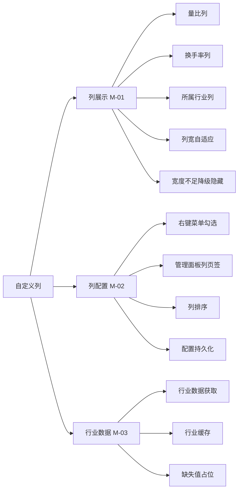
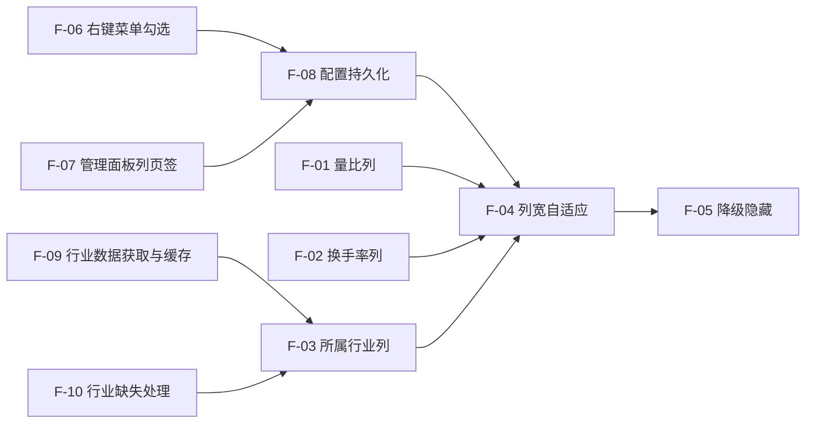
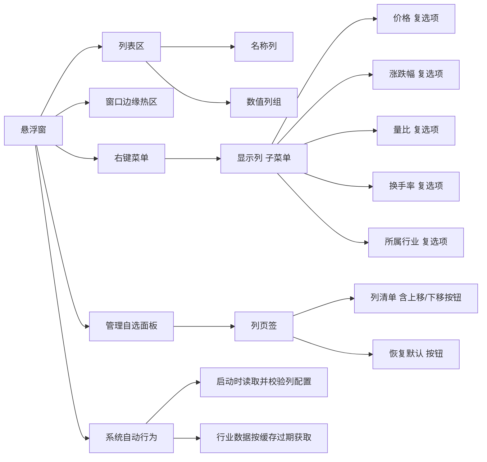
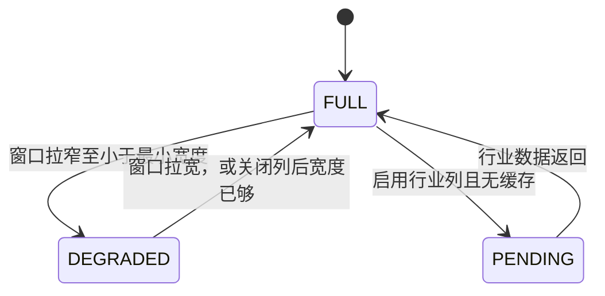
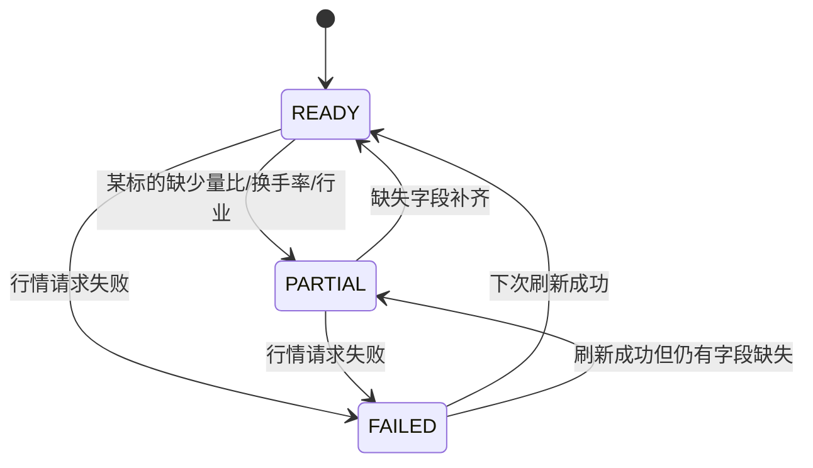
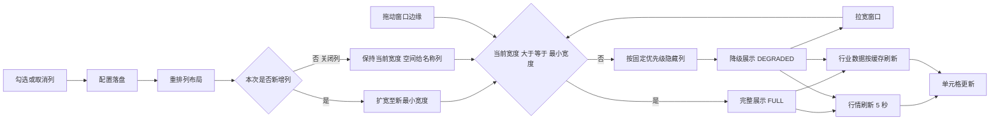

# PRD-盯盘君-自定义列-v1.0.0

## 1. 文档概述

### 1.1 文档信息

| 字段 | 内容 |
| --- | --- |
| 项目名称 | 盯盘君 MarketEye |
| 文档版本 | v1.0.0 |
| 版本状态 | 未发布 |
| 创建日期 | 2026-10-19 |
| 更新日期 | 2026-10-19 |
| 基于需求 | —（本功能为首个进入 SDLC 流程的需求） |

### 1.2 变更记录

| 版本 | 日期 | 变更人 | 变更类型 | 关联章节 | 变更内容 |
| --- | --- | --- | --- | --- | --- |
| v1.0.0 | 2026-10-19 | - | 新增 | — | 新增量比、换手率、所属行业三列与列级显示配置（顺序可调、列宽自适应、宽度不足降级隐藏），新增行业数据获取与缓存，明确占位符口径与窗口最小宽度/硬下限，配置持久化并兼容旧配置 |
| v1.0.1 | 2026-10-19 | - | 修改 | 1.4、1.5、2、3.1、3.2（列总览、F-04、F-05、新增 F-11）、3.3.1、3.3.2、5.1、6.1 | 列变多后若没有表头，用户无法分辨四列数字各是什么，且列顺序可调后更无从对应（新增 US-06）。因此新增固定表头：单行纯文字列名，不随内容滚动，只要窗口已拉到「启用列所需宽度」就显示；表头行占用正文高度并计入窗口最小高度 |

### 1.3 项目背景

盯盘君当前列表每行只有三个信息：名称、最新价、涨跌幅。这三个指标只能回答"现在多少钱、涨了多少"，回答不了"这个量能是否异常"和"它属于什么板块"。

实际看盘时的两类判断缺口：

- **量能判断**：涨跌幅相同，放量上涨与缩量上涨的含义完全不同。看盘人需要量比与换手率来判断资金参与度，而当前必须逐个打开行情页才能看到。
- **横向归类**：自选里同时有个股、ETF、指数，看盘人需要知道某只股票属于哪个行业，才能在板块联动时快速归因。

同时，悬浮窗宽度有限，不同用户关注的指标不同：有人只看价格，有人只关心换手率。固定列集合无法同时满足，因此列本身必须是可配置的，而不是简单地把三列变成六列。

### 1.4 功能概述

本次功能在行情列表的每一行增加三个可展示字段（量比、换手率、所属行业），并把列表从"固定三列"改造为"可配置列集合"：

- 六列组成：名称、价格、涨跌幅、量比、换手率、所属行业
- 列名以固定表头形式显示在列表顶部，不随内容滚走；表头与列同宽同序，随列配置即时变化
- 用户可逐列开启/关闭，可调整列顺序（名称列固定首位）
- 列增多时窗口最小宽度随启用列自动增长；窗口被拖窄时按固定优先级（所属行业 → 换手率 → 量比 → 涨跌幅 → 价格）临时隐藏列，宽度恢复后自动回来
- 配置本地持久化，重启保持；旧配置自动升级为六列全开

### 1.5 目标用户

| 角色 | 使用场景 | 关注点 |
| --- | --- | --- |
| 个人投资者（主要） | 交易时段把悬浮窗钉在屏幕一角，扫一眼自选列表 | 快速识别异动量能、判断个股所属板块 |
| 多标的跟踪者 | 自选里同时有个股、ETF、宽基指数（当前 18 个标的） | 在同一屏内横向对比，减少打开行情页的次数 |

## 2. 需求全景

### 2.1 功能架构



### 2.2 功能模块划分

| 功能域 | 编号 | 职责范围 | 包含子功能 |
| --- | --- | --- | --- |
| 列展示 | M-01 | 决定列表每行画哪些列、每列画什么、放不下时怎么办 | F-01 量比列、F-02 换手率列、F-03 所属行业列、F-04 列宽自适应、F-05 降级隐藏 |
| 列配置 | M-02 | 决定用户如何改变列集合与顺序，以及配置如何保存 | F-06 右键菜单勾选、F-07 管理面板列页签、F-08 配置持久化与兼容 |
| 行业数据 | M-03 | 为行业列提供数据，并处理取不到数据的情况 | F-09 行业数据获取与缓存、F-10 行业缺失处理 |

### 2.3 功能依赖关系



> 说明：F-04 与 F-05 依赖"启用列的集合"，因此必须晚于配置读写；行业列（F-03）依赖行业数据（F-09）先就绪，否则只能显示占位符。

### 2.4 界面功能架构



| 入口名称 | 所在层级 | 触发方式 | 功能路径 | 对应功能点 | 对应功能域 |
| --- | --- | --- | --- | --- | --- |
| 名称列 | 一级：列表区 / 二级：行内元素 | 只读展示 | 盯盘君 → 行情列表 → 名称列 | F-04、F-05 | M-01 |
| 数值列组（价格 / 涨跌幅 / 量比 / 换手率 / 行业） | 一级：列表区 / 二级：行内元素 | 只读展示 | 盯盘君 → 行情列表 → 数值列 | F-01、F-02、F-03、F-04、F-05、F-10 | M-01、M-03 |
| 窗口边缘热区 | 一级：窗口边框 | 按住拖动改变窗口尺寸 | 盯盘君 → 窗口 → 尺寸调整 | F-04、F-05 | M-01 |
| 右键菜单项「显示列」 | 一级：右键菜单 / 二级：菜单项 | 右键 → 悬停展开子菜单 → 点击勾选 | 盯盘君 → 右键菜单 → 显示列 | F-06 | M-02 |
| 子菜单项「价格」 | 一级：右键菜单 / 二级：子菜单项 | 单击切换勾选 | 盯盘君 → 右键菜单 → 显示列 → 价格 | F-06 | M-02 |
| 子菜单项「涨跌幅」 | 一级：右键菜单 / 二级：子菜单项 | 单击切换勾选 | 盯盘君 → 右键菜单 → 显示列 → 涨跌幅 | F-06 | M-02 |
| 子菜单项「量比」 | 一级：右键菜单 / 二级：子菜单项 | 单击切换勾选 | 盯盘君 → 右键菜单 → 显示列 → 量比 | F-06 | M-02 |
| 子菜单项「换手率」 | 一级：右键菜单 / 二级：子菜单项 | 单击切换勾选 | 盯盘君 → 右键菜单 → 显示列 → 换手率 | F-06 | M-02 |
| 子菜单项「所属行业」 | 一级：右键菜单 / 二级：子菜单项 | 单击切换勾选 | 盯盘君 → 右键菜单 → 显示列 → 所属行业 | F-06 | M-02 |
| 管理面板「列」页签 | 一级：管理自选面板 / 二级：页签 | 单击切换页签 | 盯盘君 → 管理自选 → 列 | F-07 | M-02 |
| 列清单中的上移 / 下移按钮 | 一级：管理自选面板 / 二级：列页签 / 三级：行内按钮 | 单击 | 盯盘君 → 管理自选 → 列 → 调整顺序 | F-07 | M-02 |
| 「恢复默认」按钮 | 一级：管理自选面板 / 二级：列页签 / 三级：按钮 | 单击 | 盯盘君 → 管理自选 → 列 → 恢复默认 | F-07 | M-02 |
| 程序启动 / 列配置变更 | 一级：系统自动行为 | 自动触发，无用户操作 | 盯盘君 → 配置 → 列配置 | F-08 | M-02 |
| 程序启动 / 行业缓存过期 | 一级：系统自动行为 | 自动触发，无用户操作 | 盯盘君 → 行情列表 → 行业数据 | F-09 | M-03 |

> F-08、F-09 属于系统自动行为，用户无法直接触发，此处列出仅为满足「每个功能点有入口」的映射完整性；折叠、移动、滚动条拖动等既有入口不属于本 PRD 范围。

## 3. 功能需求

### 3.1 用户故事

| 编号 | 角色 | 活动 | 价值 |
| --- | --- | --- | --- |
| US-01 | 个人投资者 | 在列表里直接看到量比与换手率 | 不用打开行情页就能判断当天是放量还是缩量 |
| US-02 | 个人投资者 | 看到每只股票所属行业 | 板块异动时能立刻归因到自选里的具体标的 |
| US-03 | 多标的跟踪者 | 只保留自己关心的列 | 窄窗口下不浪费横向空间给不看的指标 |
| US-04 | 多标的跟踪者 | 调整列的先后顺序 | 把最常看的指标放在最容易扫到的位置 |
| US-05 | 所有用户 | 关闭程序再打开，列设置仍然生效 | 不需要每次重新配置 |
| US-06 | 多标的跟踪者 | 每列数字上方有一行列名，滚到列表底部时列名仍在 | 不必靠记忆猜某列是量比还是换手率，调过列顺序后也不会看错 |

### 3.2 详细功能点

#### 列总览

| 列名 | 展示内容 | 表头文字 | 格式 | 对齐 | 可关闭 | 默认 | 宽度特征 |
| --- | --- | --- | --- | --- | --- | --- | --- |
| 名称 | 别名；未设别名时用数据源名称 | 空（名称列不写字） | 文本，超宽以省略号截断 | 左 | 否 | 显示 | 弹性，吃掉剩余宽度，最小 78 |
| 价格 | 最新价 | 价格 | 数字，沿用数据源精度（如 1324.97 / 0.775 / 4.240） | 右 | 是 | 显示 | 固定 56 |
| 涨跌幅 | 带符号百分比 | 涨跌幅 | 两位小数，如 `-0.30%`、`+1.25%` | 右 | 是 | 显示 | 固定 54 |
| 量比 | 当日量比 | 量比 | 两位小数，如 `1.12`；无数据显示 `—` | 右 | 是 | 显示 | 固定 40 |
| 换手率 | 当日换手率 | 换手 | 两位小数 + `%`，如 `0.32%`；无数据显示 `—` | 右 | 是 | 显示 | 固定 48 |
| 所属行业 | 行业名称 | 行业 | 文本原样展示，超宽以省略号截断；无数据显示 `—` | 左 | 是 | 显示 | 固定 52 |

> 宽度数值为 100% 缩放下的逻辑像素目标值，最终取值由设计环节按字体实测确定；字体沿用列表现有字号。
> 表头文字取短式（换手 / 行业）以免超出 40~52 的固定列宽；具体字号与是否需进一步缩字由设计环节实测决定，但不得改变列宽。

#### F-11 固定表头

- **功能路径**：盯盘君 → 行情列表 → 表头行
- **功能描述**：在列表顶部固定显示一行列名，标识每列含义。表头不随行内容滚动；列表滚动到底部时列名依然可见。
- **触发条件**：窗口宽度已达到「启用列所需宽度」（即处于完整展示 FULL）时显示；处于降级展示 DEGRADED 时隐藏。
- **输入字段**：

| 字段名 | 类型 | 必填 | 校验规则 | 默认值 | 说明 |
| --- | --- | --- | --- | --- | --- |
| 实际展示列集合 | 列表 | 是 | 与列区使用同一份结果 | — | 表头按它逐列渲染，列顺序一致 |
| 列宽分配结果 | 列表 | 是 | 与列区使用同一份结果 | — | 每个表头文字与对应列同边界 |

- **业务处理逻辑**：
    1. 表头文字与列的对应关系见「列总览」表的「表头文字」列；名称列不写字。
    2. 表头文字用次要文本色，不参与涨跌着色；字号不大于行文字号。
    3. 表头文字**统一右对齐到列右边界**（包括行业列），数值列的列名与下方数据右边缘成同一条竖线；名称列不写字。
    4. 列开关、列顺序变化后，表头与列区在同一帧内一起重排，不出现表头与数据错位。
    5. 表头行固定显示，不参与滚动；滚动条轨道从表头下方开始。
    6. 进入降级展示时表头整行隐藏（列都被隐藏了，残留列名会把名称列挤窄）；回到完整展示时随列一起恢复。
    7. 窗口折起（标题栏模式）时无列表区，表头一并隐藏。
- **输出结果**：列表顶部恒定有一行列名，与下方数据逐列对齐。
- **交互流程**：无交互；跟随列配置与窗口尺寸自动变化。

#### F-01 量比列展示

- **功能路径**：盯盘君 → 行情列表 → 量比列
- **功能描述**：在每行展示当日量比，用于判断当下成交量相对过去五日平均水平的放大或缩小程度。
- **触发条件**：列配置中启用量比列，且该行标的已有行情数据。
- **输入字段**：无用户输入，取自行情数据。
- **输出字段**：

| 字段名 | 类型 | 必填 | 校验规则 | 默认值 | 说明 |
| --- | --- | --- | --- | --- | --- |
| 量比 | 数字 | 是 | 保留两位小数；小于 0 或缺失视为无效 | — | 数据源未提供时显示 `—` |

- **业务处理逻辑**：
    1. 获取该标的行情记录中的量比字段。
    2. 字段为空、非数字或为负 → 输出 `—`。
    3. 否则格式化为两位小数。
    4. 停牌、未开盘行不适用上述规则，按 3.3.3 统一显示 `--`。
- **输出结果**：列内右对齐显示；颜色沿用该行涨跌色，不单独着色。
- **交互流程**：无交互，纯展示，随行情刷新更新。

#### F-02 换手率列展示

- **功能路径**：盯盘君 → 行情列表 → 换手率列
- **功能描述**：在每行展示当日换手率，反映筹码交换活跃度。
- **触发条件**：列配置中启用换手率列，且该行标的已有行情数据。
- **输入字段**：无用户输入，取自行情数据。
- **输出字段**：

| 字段名 | 类型 | 必填 | 校验规则 | 默认值 | 说明 |
| --- | --- | --- | --- | --- | --- |
| 换手率 | 数字 | 是 | 保留两位小数并追加 `%`；小于 0 或缺失视为无效 | — | 数据源未提供时显示 `—` |

- **业务处理逻辑**：取数 → 合法性判断 → 格式化。指数标的若数据源未给出有效值，按同一规则显示 `—`；停牌、未开盘行按 3.3.3 显示 `--`。
- **输出结果**：列内右对齐显示，颜色跟随涨跌色。
- **交互流程**：无交互。

#### F-03 所属行业列展示

- **功能路径**：盯盘君 → 行情列表 → 所属行业列
- **功能描述**：在每行展示标的所属行业名称，用于板块归类。
- **触发条件**：列配置中启用行业列。
- **输入字段**：无用户输入，取自行业数据源。
- **输出字段**：

| 字段名 | 类型 | 必填 | 校验规则 | 默认值 | 说明 |
| --- | --- | --- | --- | --- | --- |
| 所属行业 | 文本 | 否 | 长度按列宽截断；空串视为无效 | — | 取不到时显示 `—` |

- **业务处理逻辑**：
    1. 按标的代码查行业数据。
    2. 命中且非空 → 展示行业名（原样，含数据源可能自带的行业分级后缀）。
    3. 未命中或为空 → 展示 `—`。
- **输出结果**：列内左对齐，使用次要文本色（不参与涨跌着色）。
- **交互流程**：无交互；行业数据变化频率极低，不随行情每 5 秒刷新。

#### F-04 列宽自适应与窗口最小宽度

- **功能路径**：盯盘君 → 行情列表 → 列宽
- **功能描述**：列集合变化时，窗口最小宽度随之变化，保证所有启用列都放得下；用户手动拉宽时增量全部给名称列。
- **触发条件**：启用列集合发生变化；程序启动恢复配置。
- **输入字段**：

| 字段名 | 类型 | 必填 | 校验规则 | 默认值 | 说明 |
| --- | --- | --- | --- | --- | --- |
| 窗口宽度 | 数字 | 是 | 不小于窗口硬下限 190；上限为屏幕可用宽度 | 由配置恢复 | 用户拖动边缘改变；可小于当前启用列所需宽度，此时进入降级展示 |
| 启用列集合 | 多选 | 是 | 至少包含名称列 | 六列全开 | 由配置决定 |

- **业务处理逻辑**：
    1. 计算最小宽度 = 左边距 + Σ(启用列宽) + 列间距 + 滚动条条带 + 右边距。
    2. **仅在新增列或启动恢复配置时**，若当前窗口宽度小于新的最小宽度，自动扩展到最小宽度（保持窗口左边界与竖直位置不变）。
    3. **关闭列时不改变窗口宽度**，腾出的空间分配给名称列；若关闭后当前宽度已满足新的最小宽度，原本被降级隐藏的列自动恢复显示。
    4. 用户拖动窗口边缘改变宽度时**不触发自动扩宽**，宽度不足的情况由 F-05 的降级逻辑处理。
    5. 宽度大于最小宽度时，多余宽度分配给名称列，其余列宽度不变。
    6. 数值列一律右对齐到各自列边界，保证小数点纵向对齐。
    7. 表头行与列区共用同一份列宽结果，因此列宽变化时表头与数据始终对齐；表头行的高度计入窗口最小高度（F-11）。
- **输出结果**：列位置按新宽度重新计算；窗口右侧内容完整可见，不出现未绘制区域。宽度达到最小宽度时，表头与全部启用列完整可见。
- **交互流程**：勾选新列 → 立即重排；若窗口需要变宽，窗口随之扩展。

#### F-05 宽度不足时的降级隐藏

- **功能路径**：盯盘君 → 行情列表 → 列降级
- **功能描述**：用户把窗口拖窄到小于当前最小宽度时，按优先级临时隐藏列，而不是裁掉内容或让文字重叠。
- **触发条件**：窗口宽度 < 当前启用列所需最小宽度。
- **输入字段**：

| 字段名 | 类型 | 必填 | 校验规则 | 默认值 | 说明 |
| --- | --- | --- | --- | --- | --- |
| 窗口宽度 | 数字 | 是 | 不小于 190；由拖动产生 | 由配置恢复 | 判定是否需要降级 |
| 启用列集合 | 列表 | 是 | 至少包含名称列 | 六列全开 | 决定可隐藏的候选列 |
| 降级隐藏集合 | 列表 | 是 | 仅含可关闭列，不含名称列 | 空 | 当前被临时隐藏的列，不写入配置 |

- **输出字段**：

| 字段名 | 类型 | 必填 | 校验规则 | 默认值 | 说明 |
| --- | --- | --- | --- | --- | --- |
| 实际展示列集合 | 列表 | 是 | 名称列必在首位；元素属于启用列集合 | 等于启用列集合 | 参与绘制的列 |
| 启用列所需宽度 | 数字 | 是 | 随启用列集合变化 | — | 恢复阈值：当前宽度达到该值即恢复全部启用列 |
| 剩余展示列所需宽度 | 数字 | 是 | 随实际展示列集合变化 | — | 继续隐藏阈值：宽度仍小于该值时继续按优先级隐藏 |

- **业务处理逻辑**：
    1. 隐藏顺序（先隐藏 → 后隐藏）：所属行业 → 换手率 → 量比 → 涨跌幅 → 价格。
    2. 名称列永不隐藏。
    3. 每隐藏一列后重新计算最小宽度，直到放得下为止。
    4. 降级隐藏是**临时展示状态**，不修改用户的列启用配置。
    5. 窗口重新拉宽后，被隐藏的列自动恢复，顺序不变。
    6. 进入降级展示时表头整行隐藏，把这一行的高度还给内容区；回到完整展示时表头随之恢复（见 F-11 第 6 条）。
- **输出结果**：标题栏右侧的时钟位置不变；隐藏列不留下空白槽位，剩余列重新分配宽度。降级期间顶部不出现残缺列名。
- **交互流程**：拖动窗口边缘过程中实时生效，松手后保持。

#### F-06 右键菜单「显示列」勾选

- **功能路径**：盯盘君 → 右键菜单 → 显示列
- **功能描述**：提供最快的列开关入口。
- **触发条件**：在窗口任意位置点击右键。
- **输入字段**：

| 字段名 | 类型 | 必填 | 校验规则 | 默认值 | 说明 |
| --- | --- | --- | --- | --- | --- |
| 价格 | 布尔 | 否 | 菜单勾选状态与配置一致 | 勾选 | 关闭后该列不占宽度 |
| 涨跌幅 | 布尔 | 否 | 同上 | 勾选 | — |
| 量比 | 布尔 | 否 | 同上 | 勾选 | — |
| 换手率 | 布尔 | 否 | 同上 | 勾选 | — |
| 所属行业 | 布尔 | 否 | 同上 | 勾选 | 关闭后不再触发行业数据请求 |

- **业务处理逻辑**：
    1. 菜单项显示当前勾选状态（复选标记）。
    2. 点击切换 → 立即写入配置 → 重建列表布局。
    3. 若关闭后窗口宽度大于新的最小宽度，**不自动缩小**窗口（避免用户窗口莫名变窄）；多余空间给名称列。
- **输出结果**：列即时出现或消失，无需重启。
- **交互流程**：右键 → 悬停「显示列」→ 点击目标列 → 菜单关闭 → 列表重排。

#### F-07 管理面板「列」页签

- **功能路径**：盯盘君 → 管理自选 → 列
- **功能描述**：提供列顺序调整与批量恢复默认，作为右键菜单的补充。
- **触发条件**：右键菜单选择「管理自选」，切换到「列」页签。
- **输入字段**：

| 字段名 | 类型 | 必填 | 校验规则 | 默认值 | 说明 |
| --- | --- | --- | --- | --- | --- |
| 列清单 | 列表 | 是 | 只读展示已启用列，顺序即展示顺序 | — | 名称列固定第一，不显示排序按钮 |
| 上移 / 下移 | 按钮 | 否 | 首行不可上移，末行不可下移 | — | 每次移动一位 |
| 恢复默认 | 按钮 | 否 | — | — | 六列全开 + 默认顺序 |

- **业务处理逻辑**：
    1. 列页签只负责调整顺序与恢复默认；列的开与关统一在右键菜单「显示列」中操作，两处共用同一份配置。
    2. 上移/下移后立即生效并落盘；名称列不可移动。
    3. 「恢复默认」将列集合与顺序重置为六列全开、默认顺序，并立即重排。
- **输出结果**：列表顺序实时变化；面板内显示"已保存"之类的轻量反馈（不弹模态框）。
- **交互流程**：右键 → 管理自选 → 列页签 → 操作 → 关闭面板后列表已是新顺序。

#### F-08 配置持久化与旧配置兼容

- **功能路径**：盯盘君 → 配置 → 列配置
- **功能描述**：列配置写入本地配置，重启后保持；旧版本配置自动升级。
- **触发条件**：任意列配置变更；程序启动。
- **输入字段**：

| 字段名 | 类型 | 必填 | 校验规则 | 默认值 | 说明 |
| --- | --- | --- | --- | --- | --- |
| 列集合与顺序 | 有序列表 | 是 | 元素属于 6 个预定义列；无重复；含名称列 | 六列全开、默认顺序 | 来自右键菜单或管理面板 |
| 旧版配置 | 对象 | 否 | 无列字段时视为旧版 | — | 启动时读取 |

- **输出字段**：

| 字段名 | 类型 | 必填 | 校验规则 | 默认值 | 说明 |
| --- | --- | --- | --- | --- | --- |
| 持久化列配置 | 有序列表 | 是 | 与内存中的有效列集合一致 | 六列全开 | 下次启动读取 |
| 启动时的有效列集合 | 有序列表 | 是 | 名称列在首位 | 六列全开 | 用于首次布局 |

- **业务处理逻辑**：
    1. 配置内容包含：启用列集合（有序）。
    2. 旧配置中没有列字段 → 按六列全开、默认顺序初始化，并回写配置。
    3. 配置中出现未知列键、重复列键、缺失名称列 → 忽略非法项；名称列强制补回首位。
    4. 配置中全部数值列被关闭 → 允许，只显示名称列。
    5. 窗口宽度小于恢复后的最小宽度 → 启动时自动扩展到最小宽度。
- **输出结果**：重启后列集合与顺序与关闭前一致。
- **交互流程**：无显式交互。

#### F-09 行业数据获取与缓存

- **功能路径**：盯盘君 → 行情列表 → 行业数据
- **功能描述**：为行业列提供数据，独立于实时行情主链路，失败不影响行情展示。
- **触发条件**：启动时行业列处于启用状态；或行业缓存过期且启用了行业列。
- **输入字段**：

| 字段名 | 类型 | 必填 | 校验规则 | 默认值 | 说明 |
| --- | --- | --- | --- | --- | --- |
| 自选标的集合 | 列表 | 是 | 至少 1 个标的 | 当前自选 | 决定批量获取范围 |
| 缓存写入时间 | 日期 | 否 | 无缓存时为空 | — | 用于判断是否超过 7 天 |
| 行业列启用状态 | 布尔 | 是 | — | 启用 | 关闭时不发起获取 |

- **输出字段**：

| 字段名 | 类型 | 必填 | 校验规则 | 默认值 | 说明 |
| --- | --- | --- | --- | --- | --- |
| 行业映射 | 键值对 | 否 | 标的代码 → 行业名称，值可为空 | 空 | 供行业列渲染 |
| 缓存写入时间 | 日期 | 是 | 获取成功时更新 | — | 下次启动用于判断有效期 |

- **业务处理逻辑**：
    1. 行业数据由独立数据源批量获取，一次请求取回所有自选标的的行业。
    2. 结果写入本地缓存，有效期 7 天。
    3. 缓存有效期内不重复请求。
    4. 行业数据获取过程不得阻塞界面操作与行情刷新。
    5. 行业列被关闭时，不再发起请求。
- **输出结果**：行业列按缓存或新数据渲染。
- **交互流程**：无显式交互；首次启用行业列后可能短暂显示 `—`，数据返回后自动填充。

#### F-10 行业缺失处理

- **功能路径**：盯盘君 → 行情列表 → 行业缺失处理
- **功能描述**：明确行业数据取不到时的展示口径。
- **触发条件**：行业数据源未返回该标的行业，或请求失败。
- **输入字段**：

| 字段名 | 类型 | 必填 | 校验规则 | 默认值 | 说明 |
| --- | --- | --- | --- | --- | --- |
| 行业映射 | 键值对 | 否 | 可为空 | 空 | 来自行业数据获取 |
| 获取结果 | 枚举 | 是 | 成功 / 失败 / 超时 | — | 决定是否沿用旧缓存 |
| 旧缓存 | 键值对 | 否 | 可为空 | 空 | 失败时的兜底数据 |

- **输出字段**：

| 字段名 | 类型 | 必填 | 校验规则 | 默认值 | 说明 |
| --- | --- | --- | --- | --- | --- |
| 行业列展示值 | 文本 | 是 | 行业名称或 `—` | `—` | 逐行渲染 |

- **业务处理逻辑**：
    1. 指数、ETF 等本身没有行业分类的标的 → 显示 `—`。
    2. 请求失败但有旧缓存 → 沿用旧缓存。
    3. 请求失败且无缓存 → 全部显示 `—`，不做重试风暴（下次启动或缓存过期后再试）。
    4. 行业缺失**不得**导致该行其他列异常或整行不显示。
- **输出结果**：行业列显示 `—`，其余列正常。
- **交互流程**：无交互。

### 3.3 业务规则

#### 3.3.1 列集合与顺序

**业务约束**

| 约束条件 | 适用范围 | 违反处理 |
| --- | --- | --- |
| 名称列必须存在且固定首位 | 所有列配置入口 | 阻止保存，自动补回首位 |
| 列键不得重复 | 配置读写 | 忽略重复项，保留首次出现 |
| 列键必须属于 6 个预定义列 | 配置读写 | 忽略未知项 |
| 列顺序调整不得移动名称列 | 管理面板 | 名称列不提供上移/下移按钮 |

**业务状态机**

| 状态 | 编码 | 含义 |
| --- | --- | --- |
| 默认态 | DEFAULT | 六列全开、默认顺序，与出厂设置一致 |
| 自定义态 | CUSTOM | 列集合或顺序已被用户修改，且与默认值不同 |
| 修正态 | REPAIRED | 启动时检测到非法配置，已静默修正为合法集合 |

```mermaid
stateDiagram-v2
    [*] --> DEFAULT: 首次启动或配置缺失
    [*] --> CUSTOM: 启动读到合法的自定义配置
    DEFAULT --> CUSTOM: 用户勾选列或调整顺序
    CUSTOM --> DEFAULT: 点击恢复默认
    CUSTOM --> REPAIRED: 启动时检测到未知列/重复列/缺名称列
    DEFAULT --> REPAIRED: 旧配置升级时出现非法项
    REPAIRED --> CUSTOM: 修正结果落盘后按有效配置运行
    REPAIRED --> DEFAULT: 修正后的集合与顺序恰好等于默认值
```

**流转说明**

| 流转 | 前置条件 | 触发动作 |
| --- | --- | --- |
| 初始化 → DEFAULT | 本地无列配置，或旧配置无列字段 | 启动时按六列全开初始化并回写 |
| 初始化 → CUSTOM | 本地存在合法列配置且与默认值不同 | 启动时直接按该配置渲染，不提示 |
| DEFAULT → CUSTOM | 用户勾选/取消列，或上移/下移 | 写入配置并重排列表 |
| CUSTOM → DEFAULT | 用户在管理面板点击恢复默认 | 重置列集合与顺序并落盘 |
| CUSTOM → REPAIRED | 启动读到未知列、重复列或缺少名称列 | 静默剔除非法项、补回名称列，回写配置 |
| DEFAULT → REPAIRED | 首次升级时旧配置含无法映射的列项 | 同上 |
| REPAIRED → CUSTOM | 修正后的集合与默认值不同 | 修正完成后继续以自定义态运行，界面不提示 |
| REPAIRED → DEFAULT | 修正后的集合与顺序恰好等于默认值（如非法项本就是默认集合的多余项） | 修正完成后以默认态运行，界面不提示 |

**业务逻辑规则**

| 触发条件 | 执行动作 | 优先级 |
| --- | --- | --- |
| 用户勾选/取消某列 | 更新启用集合 → 落盘 → 重排列表 | 1 |
| 用户上移/下移某列 | 交换相邻位置 → 落盘 → 重排列表 | 1 |
| 用户点击恢复默认 | 重置为六列全开 + 默认顺序 → 落盘 → 重排 | 2 |
| 配置非法项被检测到 | 静默修正并回写，不弹提示 | 3 |

#### 3.3.2 宽度分配与降级

**业务约束**

| 约束条件 | 适用范围 | 违反处理 |
| --- | --- | --- |
| 窗口宽度不得小于窗口硬下限（190 逻辑像素） | 拖动缩放 | 拖动时钳制在硬下限，不再继续变窄 |
| 自动扩宽只发生在新增列或程序启动时 | 列配置变更、启动 | 关闭列时保持窗口宽度；用户手动拖窄后不强制回弹 |
| 名称列永不被降级隐藏 | 降级逻辑 | 保底显示 |
| 降级隐藏不写入配置 | 降级逻辑 | 仅影响当前绘制 |
| 表头只在完整展示（FULL）下显示，且始终固定不滚动 | 表头行 | 降级时整行隐藏；不得出现「表头在滚、数据不动」或残缺列名 |
| 表头行高度计入窗口最小高度 | 高度计算 | 窗口高度不得压到表头只剩半行 |

**业务状态机**

| 状态 | 编码 | 含义 |
| --- | --- | --- |
| 完整展示 | FULL | 全部启用列都放得下 |
| 降级展示 | DEGRADED | 部分列因宽度不足被临时隐藏 |
| 数据等待 | PENDING | 行业数据尚未返回，行业列显示 `—` |



**流转说明**

| 流转 | 前置条件 | 触发动作 |
| --- | --- | --- |
| 初始化 → FULL | 启动时启用列全部放得下 | 按完整展示渲染，不进入降级 |
| FULL → DEGRADED | 当前宽度 < 启用列最小宽度 | 用户拖动窗口边缘变窄；系统按固定优先级隐藏列 |
| DEGRADED → FULL | 当前宽度 ≥ 启用列最小宽度 | 用户拉宽窗口，或关闭列后所需宽度变小 |
| FULL → PENDING | 行业列启用且缓存不可用 | 启动或有列变更后首次渲染；后台发起请求 |
| PENDING → FULL | 行业数据已就绪 | 数据返回；重绘行业列 |

> PENDING 仅在完整展示下成立：进入降级时所属行业是第一个被隐藏的列，行业数据即使未就绪也不参与渲染，因此不为「降级且行业数据未就绪」单独定义状态。行业数据仍在后台获取，回到完整展示时直接可用。PENDING 是 3.3.3 中 PARTIAL 在行业维度上的展示态表述，二者指同一事实。

#### 3.3.3 数据可用性

**业务约束**

| 约束条件 | 适用范围 | 违反处理 |
| --- | --- | --- |
| 任一单元格数据缺失不得影响该行其余列渲染 | 列表渲染 | 缺失列显示占位符，其余列正常 |
| 行业数据缺失不得阻断行情刷新 | 行情刷新 | 仅行业列显示 `—`，不弹提示 |
| 占位符口径唯一 | 全列表 | 字段无数据用 `—`；停牌、未开盘、行情请求失败用 `--` |
| 行业请求失败不得连试 | 行业数据获取 | 单次失败后放弃，等待下次启动或缓存过期 |

**业务状态机**

| 状态 | 编码 | 含义 |
| --- | --- | --- |
| 数据完整 | READY | 行情字段与行业字段均可用 |
| 部分缺失 | PARTIAL | 部分标的或部分字段不可用，界面可正常使用 |
| 行情失败 | FAILED | 行情请求失败，列表显示连接失败提示 |



**流转说明**

| 流转 | 前置条件 | 触发动作 |
| --- | --- | --- |
| 初始化 → READY | 启动后首次刷新成功且字段齐全 | 正常渲染六列 |
| READY → PARTIAL | 某标的量比/换手率无效，或行业为空 | 对应单元格显示 `—`，其余列正常 |
| PARTIAL → READY | 行业数据返回或行情补齐字段 | 重绘对应单元格 |
| READY → FAILED | 行情请求超时或返回错误 | 列表数值列显示 `--`，标题栏圆点变红 |
| PARTIAL → FAILED | 行情请求超时或返回错误 | 同上，缺失字段一并转为 `--` |
| FAILED → READY | 下一次刷新成功且字段齐全 | 恢复数值显示，回到数据完整态 |
| FAILED → PARTIAL | 下一次刷新成功但仍有字段缺失 | 恢复数值显示，缺失字段仍为 `—` |

**业务逻辑规则**

| 触发条件 | 执行动作 | 优先级 |
| --- | --- | --- |
| 行情记录缺少量比/换手率 | 该单元格显示 `—`，其余列正常 | 1 |
| 行业数据为空 | 行业列显示 `—` | 1 |
| 标的停牌或未开盘 | 该行数值列显示 `--`（沿用既有行为） | 0 |
| 行业请求超时或失败 | 保留旧缓存；无缓存则 `—`；不重试 | 2 |

> 优先级数值越小越先执行。「停牌/未开盘」判定优先于「字段缺失」判定：停牌行数值列一律显示 `--`，不再按字段缺失规则显示 `—`。

### 3.4 业务流程



两条链路共用同一个「宽度是否够用」判定：

- **勾选链路**：改列集合 → 落盘 → 重排 → 新增列时扩宽、关闭列时保持宽度 → 判定 → 完整展示或降级展示。
- **拖动链路**：拖窄 → 判定 → 按固定优先级（所属行业 → 换手率 → 量比 → 涨跌幅 → 价格）隐藏 → 降级展示；拉宽后回到完整展示。

两条铁律：关闭列**不会**把窗口撑大；新增列**一定**会把窗口撑到能放下为止。

降级态下关闭列时，同样走勾选链路重排（图中表现为从降级展示重新进入「重排列布局」并按新的所需宽度判定），不会停留在已无必要的降级状态。

用户操作链路：右键 → 勾选列 → 窗口自动调整宽度 → 列表立即显示新列 → 后续刷新只更新数值，不改变列结构。

## 4. 非功能性需求

### 4.1 性能要求

| 指标 | 目标值 | 测量条件 |
| --- | --- | --- |
| 列配置切换响应 | 勾选到列表重排完成 ≤ 150ms | 18 个标的、六列全开 |
| 窗口拖窄时的重排 | 每次拖动事件到重绘 ≤ 30ms，无可感知卡顿 | 连续拖动 2 秒 |
| 行情刷新间隔 | 交易时段 5 秒、非交易时段 60 秒（维持现状） | — |
| 行业请求频率 | 缓存有效期内 0 次；缓存过期后每次启动最多 1 次 | 7 天有效期 |
| 行业请求耗时 | 单次 ≤ 3 秒；超时不影响行情刷新 | 网络正常 |
| 内存占用 | 常驻内存较当前版本增量 ≤ 5MB | 18 个标的、六列全开 |

### 4.2 安全要求

| 要求 | 说明 |
| --- | --- |
| 只读数据 | 行业数据仅读取公开信息，不上传任何本地数据 |
| 无凭据 | 不引入需要账号或密钥的数据源 |
| 配置不外发 | 列配置仅保存在本地配置文件 |

### 4.3 兼容性要求

| 要求 | 说明 |
| --- | --- |
| 系统 | Windows 10 / 11 |
| DPI | 100% ~ 200% 缩放下列宽与文字不自适应错位 |
| 分辨率 | 1366×768 及以上；六列全开时窗口完整可见 |
| 多显示器 | 窗口跨屏拖动后列布局保持正确 |
| 旧配置 | 无列字段的旧配置可直接启动，自动升级 |

## 5. 验收标准

### 5.1 功能验收条件

| 编号 | 前置条件 | 操作步骤 | 预期结果 |
| --- | --- | --- | --- |
| AC-01 | 六列全开，有行情数据 | 查看任意个股行 | 量比显示两位小数且与数据源一致 |
| AC-02 | 同上 | 查看任意 ETF 行 | 换手率显示为 `x.xx%` 形式 |
| AC-03 | 同上 | 查看任意个股行 | 行业列显示行业名称，非空 |
| AC-04 | 同上 | 查看指数行 | 行业列显示 `—`，该行其余列正常 |
| AC-05 | 行业数据未返回 | 启动程序 | 行业列显示 `—`，行情正常刷新；数据返回后自动填充 |
| AC-06 | 配置中六列全开，保存的窗口宽度为 263 | 启动程序 | 窗口自动扩展到六列所需最小宽度，六列完整可见，右侧无黑块 |
| AC-07 | 六列全开 | 手动拉宽窗口 | 新增宽度全部给名称列，数值列位置不变 |
| AC-08 | 六列全开 | 把窗口拖到最窄 | 按 行业 → 换手率 → 量比 → 涨跌幅 → 价格 的顺序依次隐藏，名称列始终可见，文字不重叠不裁切 |
| AC-09 | 处于降级状态 | 把窗口拉宽 | 被隐藏的列按原顺序自动恢复，配置未被修改 |
| AC-10 | 任意状态 | 右键 → 显示列 → 取消「量比」 | 量比列立即消失，菜单再次打开时该项未勾选 |
| AC-11 | 量比已关闭 | 右键 → 显示列 → 勾选「量比」 | 量比列立即出现，位置符合当前顺序 |
| AC-12 | 六列全开且已打开管理自选 | 切到「列」页签 | 显示已启用的 6 列清单，名称列固定首位且无上移/下移按钮 |
| AC-13 | 管理面板「列」页签 | 把「所属行业」上移一位 | 列表立即变为新顺序，重启后保持 |
| AC-14 | 管理面板「列」页签 | 点击「恢复默认」 | 列集合与顺序恢复为六列全开默认顺序 |
| AC-15 | 已调整列配置，且关闭时窗口宽度不小于最小宽度 | 关闭程序后重新启动 | 列集合与顺序与关闭前一致；窗口宽度按最小宽度规则恢复 |
| AC-16 | 使用旧版配置文件（无列字段） | 启动程序 | 自动按六列全开启动，无报错，配置被回写 |
| AC-17 | 手工构造含未知列键的配置 | 启动程序 | 未知列被忽略，名称列在首位，程序正常运行 |
| AC-18 | 关闭行业列 | 重启程序 | 不发起行业数据请求，列表正常 |
| AC-19 | 六列全开 | 检查涨跌色 | 价格、涨跌幅、量比、换手率随涨跌着色；行业列使用次要文本色 |
| AC-20 | 断网状态 | 启动程序 | 行情显示连接失败提示，界面不崩溃；行业列显示 `—` |
| AC-21 | 六列全开，150% DPI | 检查列对齐 | 小数点纵向对齐，文字不重叠，右侧滚动条可见可拖 |
| AC-22 | 某标的量比字段为空或为负数 | 查看该行 | 量比显示 `—`，该行其余列正常 |
| AC-23 | 某标的换手率字段为空或为负数 | 查看该行 | 换手率显示 `—`，该行其余列正常 |
| AC-24 | 手工构造同时含重复列键、缺名称列的配置 | 启动程序 | 重复项被忽略，名称列回到首位，程序正常运行 |
| AC-25 | 六列全开 | 依次关闭价格、涨跌幅、量比、换手率、所属行业 | 列表仅显示名称列，不报错；重新勾选任一列后立即恢复 |
| AC-26 | 自选中有停牌标的 | 查看该行 | 数值列显示 `--`，名称正常显示 |
| AC-27 | 行业缓存写入未超过 7 天 | 连续重启程序 3 次 | 行业数据请求次数为 0，行业列直接使用缓存 |
| AC-28 | 六列全开、无行业缓存、窗口宽度足够 | 启动程序观察行业列 | 数据返回前显示 `—` 且不影响行情刷新；数据返回后自动填充 |
| AC-29 | 六列全开，拖窄窗口使部分列被隐藏 | 关闭「量比」 | 窗口宽度不变；腾出的空间给名称列；若此时宽度已够，被隐藏的列自动恢复 |
| AC-30 | 任意列配置 | 持续把窗口拖到最窄 | 窗口停在硬下限 190 逻辑像素后不再变窄；列表仍显示名称列，不出现黑块 |
| AC-31 | 管理面板「列」页签，名称列在首位 | 查看列清单首行与末行的按钮状态 | 首行上移按钮禁用、末行下移按钮禁用；点击禁用按钮无任何效果 |
| AC-32 | 断网且行业缓存已过期 | 启动程序并观察 1 分钟 | 行业请求仅发起 1 次且失败，不重复重试；行业列显示 `—`，行情显示连接失败提示，界面不卡死 |
| AC-33 | 行业缓存已有旧值且断网 | 启动程序 | 行业列沿用旧缓存正常显示，不显示 `—`，程序不报错 |
| AC-34 | 断网导致行情请求失败 | 观察列表数值列 | 数值列显示 `--`，不是 `—` 也不是空白 |
| AC-35 | 六列全开，窗口已拉到屏幕可用宽度上限 | 继续尝试拉宽 | 宽度停在屏幕上限，不超出屏幕；此时关闭一列，腾出的空间给名称列 |
| AC-36 | 断网导致 FAILED 的界面 | 恢复网络并等待一次刷新 | 数值列从 `--` 恢复为实际行情，标题栏圆点恢复为交易中的颜色 |
| AC-37 | 自选中有未开盘标的 | 查看该行 | 数值列显示 `--`，名称正常显示 |
| AC-38 | 自选中有 ETF | 查看该行行业列 | 显示 `—` |
| AC-39 | 行业列已关闭 | 启动程序 | 不发起行业数据请求，不出现数据等待态，直接完整展示 |
| AC-40 | 六列全开 | 启动程序 | 列表顶部显示一行列名：价格 / 涨跌幅 / 量比 / 换手 / 行业；名称列上方不写字 |
| AC-41 | 六列全开，内容高度超出可视区 | 把滚动条拖到底部 | 列名始终停在列表顶部，不随内容滚走；最后一行的数据不被表头遮挡 |
| AC-42 | 六列全开 | 检查表头与数据的水平位置 | 每个列名右对齐到所在列右边界，数值列的列名与数据右边缘成一条竖线；数据小数点纵向成线 |
| AC-43 | 六列全开 | 右键取消「涨跌幅」 | 表头同步少掉「涨跌幅」，其右侧列名与数据一起左移，不错位 |
| AC-44 | 六列全开 | 管理面板把「换手率」上移一位 | 表头顺序同步变化，与数据列一一对应 |
| AC-45 | 六列全开 | 把窗口拖窄至进入降级展示 | 表头整行消失，顶部直接是第一个分组标签；拉宽回完整展示后表头恢复 |
| AC-46 | 六列全开，150% DPI | 检查表头文字 | 列名不超出各自列宽、不互相重叠；字号不大于行文字号 |
| AC-47 | 窗口折起为标题栏 | 查看窗口 | 无表头残留、无空白条 |
| AC-48 | 六列全开，窗口高度拖到最小 | 查看列表区 | 表头完整显示，下方至少还能看到 1 行标的 |

## 6. 原型交付

### 6.1 HTML 原型

同目录 `PROTO-盯盘君-自定义列-v1.0.0.html`，单文件自包含、零外部依赖，双击用浏览器打开即可。

覆盖场景：

| 场景 | 尺寸（逻辑像素） | 说明 |
| --- | --- | --- |
| 六列全开 | 390 × 460 | 默认态，含固定表头、滚动条与停牌行 `--` 占位 |
| 滚动到底 | 390 × 460 | 表头停在原位，内容已滚到底（用于核对表头不跟随滚动） |
| 手动拉宽 | 520 × 460 | 增量全部给名称列，表头与数据同步右移 |
| 降级展示 | 263 × 262 | 只放得下 3 列，表头整行隐藏 |
| 硬下限 | 190 × 170 | 只剩名称 + 价格，无表头 |
| 右键「显示列」子菜单 | — | 5 个复选项的勾选状态 |
| 管理面板「列」页签 | 520 × 600 | 列清单、上移/下移、恢复默认 |

> 原型只用于视觉与布局评审，不参与产品构建。拖动缩放、圆角颜色键透明、半透明叠加需实机验证；像素级对齐以实际程序截图为准。
