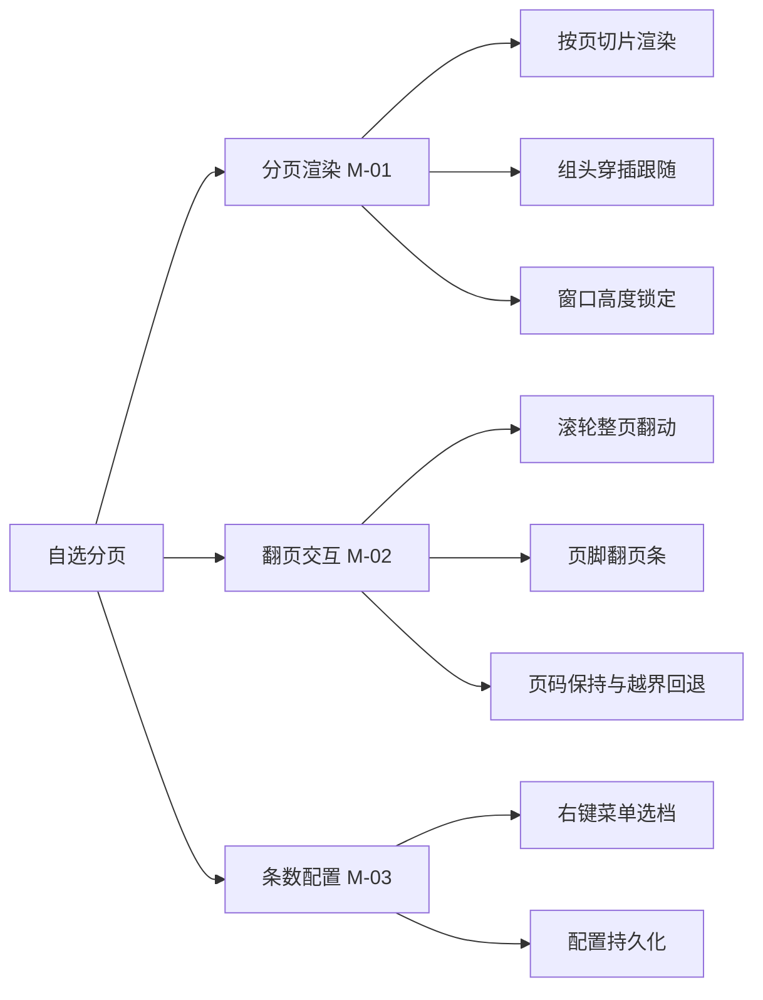
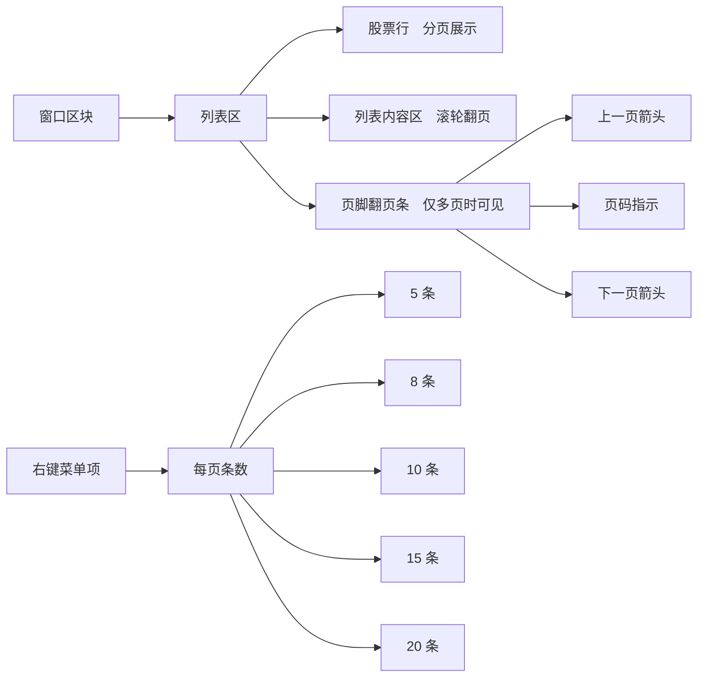
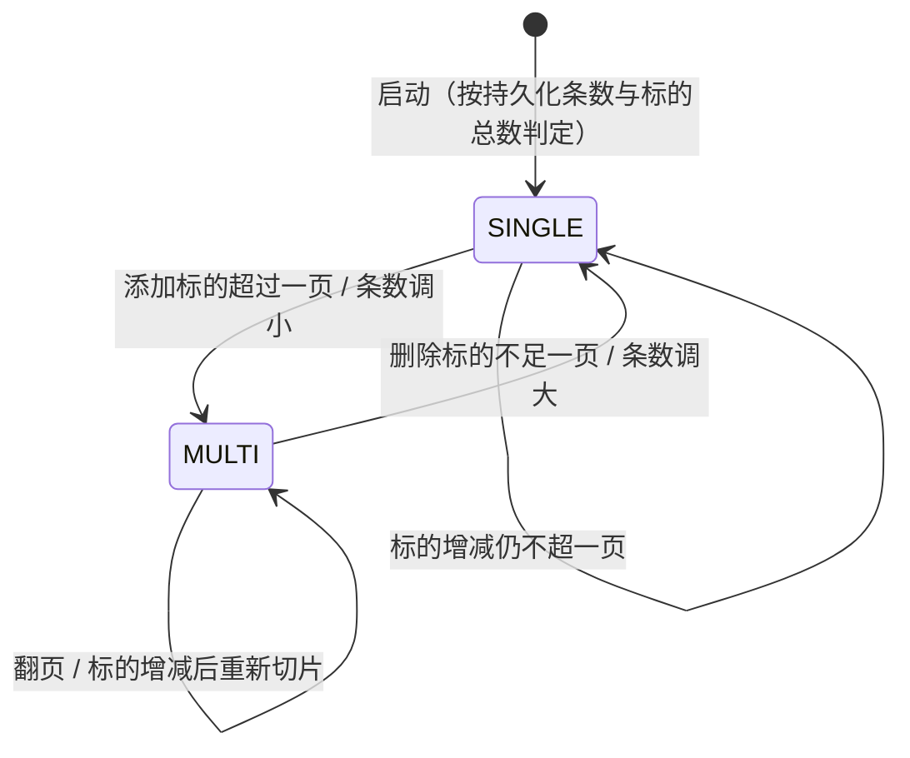
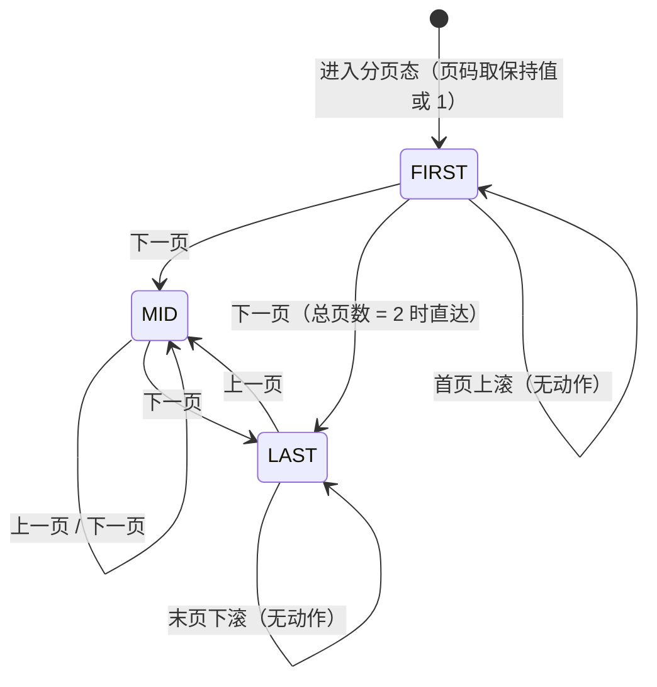
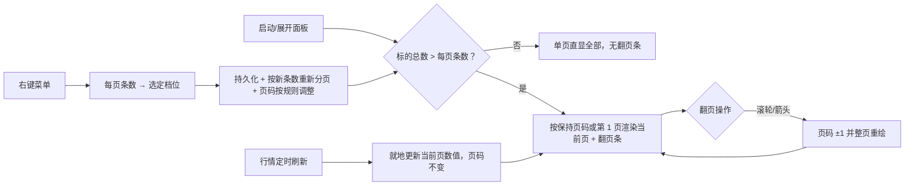

# PRD-盯盘君-自选分页-v1.0.0

## 1. 文档概述

### 1.1 文档信息

| 字段 | 内容 |
| --- | --- |
| 项目名称 | 盯盘君 MarketEye |
| 文档版本 | v1.0.0 |
| 版本状态 | 未发布 |
| 创建日期 | 2026-11-10 |
| 更新日期 | 2026-11-10 |
| 基于需求 | 用户口头需求（2026-11-10）：自选股越来越多，自选股展示区域增加分页功能，可设置每页显示的股票数，要方便翻页 |

### 1.2 变更记录

| 版本 | 日期 | 变更人 | 变更类型 | 关联章节 | 变更内容 |
| --- | --- | --- | --- | --- | --- |
| v1.0.0 | 2026-11-10 | - | 新增 | — | 新增展开态列表分页：全部分组保持连排布局、按股票行数整页切分（组头行穿插跟随、不孤立在页尾），替换现有逐行滚动并移除右侧滚动条；翻页方式为滚轮整页翻动 + 列表底部「‹ 页码/总页数 ›」翻页条点击；右键菜单新增「每页条数」级联子菜单（5/8/10/15/20 条，默认 10 条），选档即时生效并本地持久化；标的总数不超过一页时不显示翻页条；窗口高度锁定为一页高度；页码在界面重建时保持、越界自动回退末页。**状态：已通过独立审核（2 主要 + 8 次要意见已全部合并进 v1.0.0：§2.4 交叉引用订正、增补 R-11 屏幕高度受限规则并回链 §4.3、状态机补两页态直达边、字段类型与页尾留白表述明确、补 AC-18/AC-19、AC-16 具体化、触发方式与约束表述规范化）** |

### 1.3 项目背景

盯盘君展开态的自选列表把全部分组连排渲染，内容超高时靠右侧滚动条逐行滚动查看。随着自选标的增多（当前 2 个分组共 32 只），逐行滚动定位效率低：滚轮一格只滚 2 行，从列表头找到列表尾要滚十几格，翻看"后半部分持仓"很费劲；滚动条滑块细长难拖，中途松手容易丢失位置。

分页是比滚动更符合"浏览清单"心智的形态：一页一屏、整页跳跃、页码即位置，配合可调的每页条数，能在"一屏多看几只"与"窗口紧凑"之间自由取舍。

### 1.4 功能概述

本次功能将展开态列表的查看方式从「逐行滚动」改为「整页翻动」：

- 列表仍保持全部分组连排布局，按每页固定的股票行数整页切分；分组标题行穿插跟随其后的股票展示，不孤立在页尾
- 翻页方式两种并存：鼠标滚轮在列表区直接上/下翻页；列表底部新增一条小巧的翻页条「‹ 2/3 ›」，点击箭头翻页，页码指示当前页与总页数
- 右键菜单新增「每页条数」级联子菜单（5 / 8 / 10 / 15 / 20 条，默认 10 条），选档立即重新分页并本地记忆
- 标的总数不超过一页时不显示翻页条，列表行为与现状一致
- 分页模式下移除右侧滚动条条带，空间让给列内容；窗口高度锁定为恰好一页（标题栏 + 表头 + 页高 + 翻页条）

### 1.5 目标用户

| 角色 | 使用场景 | 关注点 |
| --- | --- | --- |
| 个人投资者（主要） | 自选标的数十只，盘中在分组间来回翻看涨跌 | 整页翻动定位快，页码指示明确，不迷路 |
| 大屏用户 | 屏幕空间充裕，希望一屏多看几只减少翻页次数 | 每页条数可调大，一次看全 |

## 2. 需求全景

### 2.1 功能架构



### 2.2 功能模块划分

| 模块 | 职责范围 | 包含子功能 | 包含功能点 | 边界说明 |
| --- | --- | --- | --- | --- |
| M-01 分页渲染 | 展开态列表按页渲染：每页固定股票行数、组头穿插跟随、无翻页必要时整页直显、窗口高度锁定 | 按页切片渲染、组头穿插跟随、窗口高度锁定 | F-01 | 只负责"当前页长什么样"，不负责翻页动作（M-02）与每页条数来源（M-03）；列布局、行点击、K 线跳转等既有行为不变 |
| M-02 翻页交互 | 滚轮整页翻动、页脚翻页条、页码保持与越界回退 | 滚轮整页翻动、页脚翻页条、页码保持与越界回退 | F-02 | 只管页码切换与指示；滚动条及逐行滚动在分页模式下整体移除，不保留混合模式 |
| M-03 条数配置 | 每页条数的档位定义、选档入口与持久化 | 右键菜单选档、配置持久化 | F-03 | 只管条数；入口挂在既有右键菜单下，不改其他菜单项行为 |

### 2.3 功能依赖关系


- M-01 依赖 M-03 提供每页条数；M-02 依赖 M-01 渲染出多页后才可翻动
- M-01 复用既有分组数据与行情刷新结果，自身零网络请求
- 翻页、选档只改变本地状态，不产生任何网络请求

### 2.4 界面功能架构



| 入口名称 | 所在层级 | 触发方式 | 功能路径 | 对应功能点 | 对应功能域 |
| --- | --- | --- | --- | --- | --- |
| 股票行（当前页） | 一级：窗口区块 / 二级：列表区 / 三级：股票行 | 单击（查看 K 线，沿用既有；悬停/右键等行级交互同现状） | 自选分页 → 分页展示 | F-01 | M-01 |
| 列表内容区 | 一级：窗口区块 / 二级：列表区 | 滚轮上/下滚动 | 自选分页 → 翻页 | F-02 | M-02 |
| 页脚翻页条 | 一级：窗口区块 / 二级：列表区 / 三级：翻页条 | 单击箭头 | 自选分页 → 翻页 | F-02 | M-02 |
| 右键菜单项「每页条数」 | 一级：右键菜单 / 二级：菜单项 | 右键 → 悬停展开子菜单 | 自选分页 → 每页条数设置 | F-03 | M-03 |
| 子菜单项「5 条」~「20 条」 | 一级：右键菜单 / 二级：子菜单项 | 单击 | 自选分页 → 每页条数设置 | F-03 | M-03 |

> 层级约定与 PRD-盯盘君-折叠轮播-v1.0.0 §2.4 一致：一级 = 窗口区块 / 右键菜单，二级 = 区块内元素 / 菜单项，三级 = 元素内控件 / 子菜单项。分页模式下右侧滚动条不再出现，故本表无滚动条入口；翻页条箭头在首页/末页的置灰态见 §3.3.2 业务约束（首页 ‹ 置灰、末页 › 置灰）。

## 3. 功能需求

### 3.1 用户故事

| 编号 | 用户故事 | 价值 |
| --- | --- | --- |
| US-01 | 作为个人投资者，我的自选股越来越多，希望列表一页页翻看而不是一格一格滚，这样能快速定位到后面的持仓 | 整页翻动，定位效率从"十几格滚动"变为"几次翻页" |
| US-02 | 作为大屏用户，我希望一屏多显示几只股票，减少翻页次数 | 每页条数可调，屏幕大小与信息密度自由平衡 |
| US-03 | 作为用户，我希望选好的每页条数下次启动还记得，不用每天重设 | 配置持久化，一次设置长期有效 |

### 3.2 详细功能点

#### F-01 分页展示

| 属性 | 内容 |
| --- | --- |
| 功能路径 | 自选分页 → 分页展示 |
| 功能描述 | 展开态列表按"每页 N 只股票"整页切分渲染：当前页显示清单中连续的一段股票行；分组标题行穿插在股票行之间跟随展示，且不孤立在页尾（组头与其后第一只股票必须在同一页，页尾空间只够放组头时组头移到下一页页首）；标的总数不超过 N 时不分页，全部直显且不显示翻页条 |
| 触发条件 | 程序启动展开、面板展开、配置变更、自选变更、界面重建（缩放松手/重载配置等）时按当前页码渲染 |

**输入字段定义**：

| 字段名 | 类型 | 必填 | 校验规则 | 默认值 | 说明 |
| --- | --- | --- | --- | --- | --- |
| 每页条数 | 数字 | 是 | 取值仅限 5 / 8 / 10 / 15 / 20 | 10 | 每页显示的股票行数，组头行不计入 |
| 页码 | 数字 | 是 | ≥ 1 且 ≤ 总页数；越界时自动回退总页数 | 1 | 当前展示第几页 |
| 标的清单 | 列表 | 是 | 全部分组按既有连排顺序展开的股票行序列（组头位置随其分组首只股票记录） | — | 分页切片的数据源，顺序与现状列表完全一致 |

**业务处理逻辑**：

1. 按标的清单顺序与每页条数 N 计算分页：第 p 页显示第 (p-1)×N+1 至第 p×N 只股票；组头行按其归属位置穿插渲染，若组头按位置将落在某页最后一行而其股票在下一页，则组头一并移入下一页（该页股票行数变为 N-1，页尾留白，不渲染占位行）
2. 末页允许不满 N 只，有多少显示多少，不留空行占位
3. 标的总数 ≤ N 时：单页直显全部标的，不显示翻页条，页码概念不生效
4. 窗口高度锁定为：标题栏 + 表头 + 一页高度（N 行 + 穿插组头）+ 翻页条（多页时）；不再出现"超高滚动"
5. 列布局、行悬停、行点击（查看 K 线等既有交互）与现状完全一致；右侧滚动条条带移除，列内容使用该空间

**输出结果**：

- 成功：当前页股票行与穿插组头正确渲染，翻页条显示「当前页/总页数」
- 失败/边界：自选为空时保持现状空态；行情缺失的标的按既有占位规则显示

**交互流程**：无主动交互，分页展示随渲染时机自动呈现；用户通过 F-02 的入口切换页码。

#### F-02 翻页

| 属性 | 内容 |
| --- | --- |
| 功能路径 | 自选分页 → 翻页 |
| 功能描述 | 两种翻页入口并存：① 鼠标滚轮在列表区向下滚动 = 下一页、向上滚动 = 上一页；② 列表底部翻页条「‹ 2/3 ›」，点击 ‹ 上一页、点击 › 下一页，页码指示当前页/总页数 |
| 触发条件 | 列表处于多页状态（标的总数 > 每页条数）时任意翻页入口可用 |

**输入字段定义**：

| 字段名 | 类型 | 必填 | 校验规则 | 默认值 | 说明 |
| --- | --- | --- | --- | --- | --- |
| 翻页方向 | 枚举（上一页/下一页） | 是 | 仅限上一页 / 下一页 | — | 滚轮与箭头共用同一页码状态，非 UI 录入控件 |

**业务处理逻辑**：

1. 滚轮向下翻下一页、向上翻上一页；已在首页时上滚、已在末页时下滚均无动作（不循环、不回弹）
2. 翻页条仅在多页状态渲染：首页时 ‹ 置灰不可点，末页时 › 置灰不可点，页码文字恒为「当前页/总页数」
3. 翻页立即整页重绘当前页内容，页码指示同步更新
4. 界面重建（缩放松手、保存自选、重载配置、面板展开）时保持翻页前的页码；若因标的减少导致页码越界，自动回退到总页数
5. 行情定时刷新只就地更新当前页数值，不触发翻页、不重置页码

**输出结果**：

- 成功：页码切换，当前页内容与翻页条指示同步更新
- 失败/边界：单页状态下滚轮与翻页条均无翻页行为（翻页条不渲染）

**交互流程**：滚轮滚动 / 点击箭头 → 页码 ±1 → 整页重绘 + 页码指示更新；首末页边界方向操作无反馈动作。

#### F-03 每页条数设置

| 属性 | 内容 |
| --- | --- |
| 功能路径 | 自选分页 → 每页条数设置 |
| 功能描述 | 右键菜单新增「每页条数」级联子菜单，提供 5 / 8 / 10 / 15 / 20 条五档；点选后立即按新条数重新分页并本地持久化，当前档位在子菜单中有标识 |
| 触发条件 | 用户在右键菜单中点开「每页条数」并点击某一档位 |

**输入字段定义**：

| 字段名 | 类型 | 必填 | 校验规则 | 默认值 | 说明 |
| --- | --- | --- | --- | --- | --- |
| 每页条数 | 下拉单选 | 是 | 取值仅限 5 / 8 / 10 / 15 / 20（条） | 10 条 | 每页显示的股票行数 |

**业务处理逻辑**：

1. 子菜单五项按条数升序排列，当前档位带选中标识
2. 点击某一档位：立即按新条数重新分页渲染，并持久化；重新分页时尽量让"翻页前可见的第一只股票"仍出现在当前页，无法满足时回到第 1 页
3. 非法或损坏的本地配置：回退默认 10 条，不报错、不打断运行
4. 单页状态（标的总数 ≤ 新档位）下选档同样生效：列表直显全部、翻页条消失

**输出结果**：每页条数即时变化、窗口高度随之调整；重启后沿用所选档位。

**交互流程**：右键打开菜单 → 悬停「每页条数」展开子菜单 → 点击目标档位 → 菜单关闭 → 立即重新分页，页码按规则 2 调整。

### 3.3 业务规则

#### 3.3.1 分页展示（M-01）

**业务约束**

| 约束条件 | 适用范围 | 违反处理 |
| --- | --- | --- |
| 每页股票行数恒等于设定条数（末页可不满） | 全部分页渲染 | 出现超出条数的页视为缺陷（阻止渲染，记录日志） |
| 组头行不得孤立在页尾 | 分页切片 | 组头移入下一页页首，该页股票行数 N-1、页尾留白不渲染占位行（允许，无需提示） |
| 分页模式下不渲染滚动条、不响应逐行滚动 | 全部渲染与交互 | 移除渲染并屏蔽既有滚轮逐行逻辑（阻止，无需提示） |

**业务状态机**

| 状态 | 编码 | 含义 |
| --- | --- | --- |
| 单页 | SINGLE | 标的总数 ≤ 每页条数，全部直显、无翻页条 |
| 多页 | MULTI | 标的总数 > 每页条数，按页渲染并显示翻页条 |



| 流转 | 前置条件 | 触发动作 |
| --- | --- | --- |
| SINGLE → MULTI | 标的总数超过每页条数 | 系统自动：按当前页码（越界回退）进入分页态并渲染翻页条 |
| MULTI → SINGLE | 标的总数不超过每页条数 | 系统自动：整页直显全部标的，移除翻页条 |

**业务逻辑规则**

| 规则编号 | 触发条件 | 执行动作 | 优先级 |
| --- | --- | --- | --- |
| R-01 条数语义 | 任意分页切片 | 每页条数只计股票行，组头行不计入、穿插跟随；组头与其后第一只股票同页 | 高 |
| R-02 页码边界 | 计算出的页码 > 总页数 | 页码回退为总页数（如末页因删标的消失） | 高 |
| R-03 高度锁定 | 展开态渲染 | 窗口高度 = 标题栏 + 表头 + 一页高度 + 翻页条（多页时），不随内容伸缩 | 高 |
| R-04 复用既有行为 | 行悬停/点击/右键/列布局 | 与现状列表完全一致，分页不改变任何行级交互 | 中 |
| R-11 屏幕高度受限 | 一页高度（含穿插组头）加翻页条超出屏幕可用高度 | 按屏幕可用高度等比收紧行高，维持每页条数语义不变；本规则优先级高于 R-03 | 高（高于 R-03） |

#### 3.3.2 翻页（M-02）

**业务约束**

| 约束条件 | 适用范围 | 违反处理 |
| --- | --- | --- |
| 页码恒在 1 与总页数之间 | 全部翻页动作 | 越界请求无动作（阻止，无需提示） |
| 首页 ‹ 置灰、末页 › 置灰 | 翻页条渲染 | 置灰项不响应点击 |
| 行情刷新不得改变页码 | 定时刷新 | 只就地更新数值，页码不变（允许，无需提示）；若实现中翻页视为缺陷（阻止，记录日志） |

**业务状态机**

| 状态 | 编码 | 含义 |
| --- | --- | --- |
| 首页 | FIRST | 页码 = 1 |
| 中间页 | MID | 1 < 页码 < 总页数 |
| 末页 | LAST | 页码 = 总页数（总页数 = 1 时归入 FIRST） |



| 流转 | 前置条件 | 触发动作 |
| --- | --- | --- |
| FIRST → MID / LAST | 滚轮下滚或点击 › | 页码 +1，整页重绘 |
| MID / LAST → MID / FIRST | 滚轮上滚或点击 ‹ | 页码 -1，整页重绘 |
| FIRST → FIRST / LAST → LAST | 边界方向操作 | 无动作、无回弹动画 |

**业务逻辑规则**

| 规则编号 | 触发条件 | 执行动作 | 优先级 |
| --- | --- | --- | --- |
| R-05 双入口同源 | 滚轮或翻页条触发翻页 | 两者操作同一页码状态，指示同步 | 高 |
| R-06 页码保持 | 界面重建（缩放松手/保存自选/重载配置/展开面板） | 保持翻页前页码，越界按 R-02 回退 | 高 |
| R-07 刷新不翻页 | 行情定时刷新 | 只更新当前页数值，页码与计时不变 | 高 |

#### 3.3.3 条数配置（M-03）

**业务约束**

| 约束条件 | 适用范围 | 违反处理 |
| --- | --- | --- |
| 每页条数仅接受 5 / 8 / 10 / 15 / 20 五档 | 配置读写全流程 | 违反时静默回退默认 10 条并继续运行，不弹提示（允许并记录日志） |
| 档位变更必须持久化 | 选档成功后 | 持久化失败不阻断运行，本次会话内仍按新档位执行（警告并记录日志） |

**业务状态机**

| 状态 | 编码 | 含义 |
| --- | --- | --- |
| 默认档 | DEFAULT | 每页 10 条（含首次使用与非法值回退） |
| 自选档 | CUSTOM | 每页为用户选定的 5 / 8 / 15 / 20 条之一 |

```mermaid
stateDiagram-v2
    [*] --> DEFAULT
    DEFAULT --> CUSTOM : 选定 5 / 8 / 15 / 20 条
    CUSTOM --> CUSTOM : 选定其他档位
    CUSTOM --> DEFAULT : 选定 10 条 / 配置非法回退
    DEFAULT --> DEFAULT : 选定 10 条
```

| 流转 | 前置条件 | 触发动作 |
| --- | --- | --- |
| 任意 → CUSTOM | 用户点选 5 / 8 / 15 / 20 条 | 系统自动：重新分页并持久化 |
| 任意 → DEFAULT | 用户点选 10 条，或读取到非法配置值 | 系统自动：按 10 条重新分页；非法值场景同时回写默认值 |

**业务逻辑规则**

| 规则编号 | 触发条件 | 执行动作 | 优先级 |
| --- | --- | --- | --- |
| R-08 档位枚举 | 读取或写入每页条数 | 只接受 5 / 8 / 10 / 15 / 20；其他取值按默认 10 条处理 | 高 |
| R-09 即时生效 | 用户点选新档位 | 立即重新分页；翻页前可见的第一只股票尽量仍出现在当前页，无法满足时回第 1 页 | 高 |
| R-10 持久化 | 档位变更成功 | 写入本地配置，重启后沿用 | 中 |

### 3.4 业务流程



- 主链路：展开面板 → 多页态整页浏览 → 滚轮/翻页条翻页 → 翻到目标持仓页查看
- 配置链路：右键 → 每页条数 → 选档 → 立即重新分页，窗口高度随档位变化
- 边界链路：标的删减到不足一页 → 翻页条自动消失，回到单页直显
- 全程零新增网络请求、无弹窗、无声音，行级交互与现状一致

## 4. 非功能性需求

### 4.1 性能要求

| 指标 | 目标值 | 测量条件 |
| --- | --- | --- |
| 单次翻页重绘 | < 50ms | 窗口宽 337 逻辑像素、每页 10 条、150% DPI |
| 选档后重新分页 | < 100ms | 20 条档位、32 只标的 |
| 新增网络请求 | 0 个 | 分页与翻页全生命周期（数据全部复用既有行情刷新） |
| 新增常驻内存 | < 1MB | 对比未启用本功能的上一版本同场景（展开态运行 1 小时） |

### 4.2 安全要求

只读既有公开行情数据；每页条数配置仅存本地配置文件，不外发。

### 4.3 兼容性要求

- Windows 10/11，DPI 缩放 100%~200% 下翻页条、页码文字与置灰态正确，页高与窗口高度随缩放正确计算
- 屏幕分辨率 1366×768 及以上；多显示器间跨屏拖动后分页与翻页条显示正确
- 窗口宽度下限 190 逻辑像素（既有硬下限）至上限任意值：列布局与翻页条均不越界
- 20 条档位在高度受限屏幕（1080p、150% DPI）下整页仍可完整显示：超出屏幕可用高度时按 §3.3.1 R-11 收紧行高并维持条数语义

## 5. 验收标准

### 5.1 功能验收条件

| 编号 | 对应功能点 | 前置条件 | 操作步骤 | 预期结果 |
| --- | --- | --- | --- | --- |
| AC-01 | F-01 | 自选 2 个分组共 32 只，每页条数默认 10 | 展开面板 | 第 1 页显示第 1~10 只股票及穿插组头，底部翻页条显示「1/4」；右侧无滚动条 |
| AC-02 | F-01 | 「自选」组跨在第 1 页与第 2 页之间 | 翻到第 1、2 页对比 | 组头「自选」与其后第一只股票同页显示，组头不孤立在任一页尾 |
| AC-03 | F-01 | 每页条数 10，标的 32 只 | 翻到第 4 页（末页） | 末页显示 2 只股票，无空行占位；› 箭头置灰 |
| AC-04 | F-01 | 删除标的至总数 ≤ 每页条数 | 观察列表 | 翻页条消失，全部标的直显；再加标的超过一页后翻页条恢复 |
| AC-05 | F-02 | 多页态第 1 页 | 列表区滚轮向下滚动 | 翻到第 2 页，页码指示变「2/4」；再向下滚依次到末页 |
| AC-06 | F-02 | 多页态第 1 页 | 列表区滚轮向上滚动 | 无动作，停留在第 1 页 |
| AC-07 | F-02 | 多页态末页 | 列表区滚轮向下滚动 | 无动作，停留在末页 |
| AC-08 | F-02 | 多页态中间页 | 点击翻页条 ‹ / › | 各翻一页，页码指示同步；首页时 ‹ 置灰不可点，末页时 › 置灰不可点 |
| AC-09 | F-02 | 翻到第 3 页后拖拽窗口宽度缩放松手 | 观察列表 | 仍显示第 3 页内容 |
| AC-10 | F-02 | 翻到第 4 页后删除标的使总页数降为 3 | 观察列表 | 页码自动回退为「3/3」，显示新末页内容 |
| AC-11 | F-02 | 多页态等待行情刷新 | 观察当前页 | 数值就地更新，页码不变、不翻页 |
| AC-12 | F-03 | 默认配置 | 右键 → 每页条数 | 子菜单含 5/8/10/15/20 条五项升序排列，10 条带选中标识 |
| AC-13 | F-03 | 多页态第 2 页 | 点选「15 条」 | 立即按 15 条重新分页；原第 2 页可见的第一只股票尽量仍在当前页；重启程序后仍为 15 条 |
| AC-14 | F-03 | 每页条数 10、标的 32 只 | 点选「20 条」 | 变为「1/2」两页，窗口高度随页高调整 |
| AC-15 | F-03 | 手工把本地配置中的条数改为非法值 | 启动程序 | 回退默认 10 条，程序正常运行，子菜单标识在 10 条 |
| AC-16 | F-01/F-02 | 多页态 | 行悬停高亮、单击行查看 K 线、行右键弹出行菜单、列布局与列宽 | 四项均与现状列表行为完全一致 |
| AC-18 | F-02 | 翻到第 3 页后依次：经管理面板保存自选、右键「重新加载配置」、双击折叠再展开 | 观察列表 | 三种界面重建后均仍显示第 3 页 |
| AC-19 | F-03 | 第 1 页可见的第一只股票按新条数落在新的靠后页 | 点选「5 条」 | 重新分页后该股票尽量仍在当前页；无法满足时页码回第 1 页，列表正确渲染 |
| AC-17 | F-01 | 每页 10 条、150% DPI、1080p 屏幕 | 切换 20 条档位观察窗口 | 整页（含翻页条）完整显示在屏幕可用高度内 |

> 本期不生成 HTML 原型（界面元素少且全部沿用现有视觉语言自绘：翻页条为文字与细箭头，配色用主题既有文字色/次要色/线条色），界面以 §2.4 与 F-01/F-02 的描述为准。
