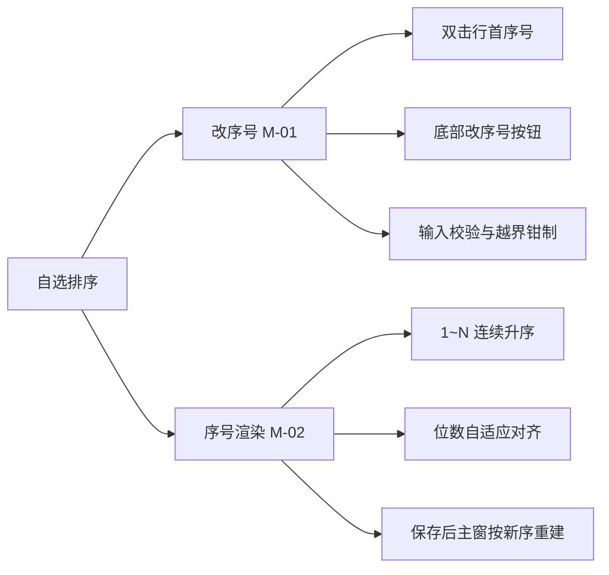

# PRD-盯盘君-自选排序-v1.0.0

## 1. 文档概述

### 1.1 文档信息

| 字段 | 内容 |
| --- | --- |
| 项目名称 | 盯盘君 MarketEye |
| 文档版本 | v1.0.0 |
| 版本状态 | 未发布 |
| 创建日期 | 2026-11-18 |
| 更新日期 | 2026-11-18 |
| 基于需求 | 用户口头需求（2026-11-18）：自选列表排序现在只能靠 ↑ ↓ 一个一个移动，自选股多的时候把最后一个移到第一个很不方便；换一种方式，可以通过手动改编号的方式，编号从小到大排序 |

### 1.2 变更记录

| 版本 | 日期 | 变更人 | 变更类型 | 关联章节 | 变更内容 |
| --- | --- | --- | --- | --- | --- |
| v1.0.0 | 2026-11-18 | - | 新增 | — | 管理自选面板「标的」页新增「改序号」调序方式：双击行首序号或点底部「改序号」按钮，输入目标序号即把该标的搬到该位置、其余顺次挪位、编号重新 1~N 连续升序；↑ ↓ 按钮保留用于相邻微调。R-01~R-05、AC-01~AC-06 |

### 1.3 项目背景

管理自选面板的「标的」页目前只有 ↑ ↓ 两个按钮调整顺序，每次只能挪一位。自选已经涨到 40 项以上，把排在末位的标的挪到第一位要点 40 下，中途还要盯着一行行看有没有挪过头。分页（PRD-盯盘君-自选分页）解决了「看不过来」，但没解决「排不过来」。

用户的心智很直接：清单本来就有编号，把编号改成想要的位置就行。

### 1.4 功能概述

- 列表每行行首是序号（`1.` `2.` …），序号即位置。
- **双击行首序号** → 弹出「改序号（1 ~ N）」输入框，预填当前序号，回车即把该标的搬到第 N 位。
- 底部新增 **「改序号」按钮**，与双击等价，给不习惯双击的入口。
- 搬家后其余标的顺次挪位，编号重新从 1 连续编到 N，恒为升序，不出现重号或空号。
- ↑ ↓ 按钮保留，用于相邻微调（改序号适合长距离，↑↓ 适合一步）。

### 1.5 目标用户

| 角色 | 使用场景 | 关注点 |
| --- | --- | --- |
| 个人投资者（主要） | 自选 40+ 项，想把某个板块龙头挪到最前/最后 | 一次到位，不用点几十下 |
| 大户用户 | 按板块重新梳理自选顺序 | 批量调整时每次操作步骤固定、可预期 |

## 2. 需求全景

### 2.1 功能架构

### 2.2 功能模块划分

| 模块 | 职责范围 | 包含功能点 | 边界说明 |
| --- | --- | --- | --- |
| M-01 改序号 | 把某标的一次性搬到目标位次，其余顺次挪位 | F-01 | 只作用于「管理自选 → 标的」页的自选清单，不涉及「列」页签的列顺序 |
| M-02 序号渲染 | 行首序号始终为 1~N 连续升序、位数自适应对齐 | — | 序号是位置的可视化，不单独持久化 |

### 2.3 功能依赖关系

## 3. 详细需求

### 3.1 需求清单

| 编号 | 需求名称 | 优先级 |
| --- | --- | --- |
| R-01 | 双击行首序号进入改序号 | 高 |
| R-02 | 底部「改序号」按钮入口 | 高 |
| R-03 | 序号输入校验与越界钳制 | 高 |
| R-04 | 顺次挪位与编号连续升序 | 高 |
| R-05 | 改序号后选中并滚动到该行 | 中 |

### 3.2 功能点说明

#### F-01 改序号

- **功能路径**：盯盘君 → 右键菜单 → 管理自选 → 标的页 → 双击某行行首序号（或点「改序号」）
- **触发条件**：已选中一行（双击的那一行即被选中）。
- **交互流程**：
    1. 弹出输入框，标题「改序号（1 ~ N）」，预填该行当前序号并全选，回车或点「确定」提交，Esc 取消。
    2. 输入合法：该标的搬到目标位次，其余标的按原相对顺序顺次挪位；清单重编号为 1~N 连续升序；选中并滚动到搬家后的那一行。
    3. 输入非法（非数字 / 超出 1~N）：不改变顺序，列表标题处红字提示「序号请填数字」或「序号需在 1 ~ N 之间」，1.4 秒后恢复原提示。
    4. 输入与当前序号相同：不做任何改动，直接关闭。
- **规则说明**：
    - 序号语义是「第几位」，不是「优先级数值」：填空号或重号不会被保留，改完立刻重编为连续升序。
    - 改序号只是面板内的暂存改动，点「保存」才落盘；点「取消」/关闭面板则丢弃（与增删改别名一致）。
    - 双击行内容（序号右侧）仍是改别名，两个手势按横坐标区分，互不干扰。
    - ↑ ↓ 按钮保留，行为不变。

### 3.3 界面规则

| 编号 | 规则 | 说明 |
| --- | --- | --- |
| R-01 | 双击行首序号进入改序号 | 命中区为序号文本宽度（含右侧 8px 余量），双击其右侧按改别名处理；未选中任何行时双击不响应 |
| R-02 | 底部「改序号」按钮入口 | 位置在 ↑ ↓ 与「删除」右侧，样式为次要按钮；未选中行时给出「先选中一行再改序号」提示 |
| R-03 | 序号输入校验与越界钳制 | 仅接受整数；超界不自动钳到边界，而是拒绝并提示范围（钳制会让用户以为已经搬到位） |
| R-04 | 顺次挪位与编号连续升序 | 移动后编号从 1 连续编到 N，不留空号、不重号；序号位数随总项数变化（≥100 项时为 3 位）并保持右对齐 |
| R-05 | 改序号后选中并滚动到该行 | 搬家后该行保持选中且滚动到可视区，便于连续调整 |

## 4. 验收标准

| 编号 | 功能点 | 前置条件 | 操作 | 预期结果 |
| --- | --- | --- | --- | --- |
| AC-01 | F-01 | 自选 41 项 | 选中第 41 项，双击行首序号，输入 1，回车 | 该项成为第 1 行，原 1~40 项各下移一位，编号仍为 1~41 连续升序 |
| AC-02 | F-01 | 自选 41 项 | 选中第 1 项，点「改序号」，输入 41，回车 | 该项成为最后一行，其余上移一位，编号连续 |
| AC-03 | F-01 | 选中任一行的中间项 | 输入 0 / 42 / 字母 / 空 | 顺序不变，标题处红字提示，1.4 秒后恢复「自选列表 · N 项 …」 |
| AC-04 | F-01 | 选中第 5 项 | 输入 5 | 无任何变化，输入框关闭 |
| AC-05 | F-01 | 已改序号但未保存 | 点「取消」 | 面板关闭，再次打开顺序为改动前 |
| AC-06 | F-01 | 已改序号并保存 | 观察主窗自选列表 | 主窗按新顺序渲染，与面板一致 |
| AC-07 | F-01 | 未选中任何行 | 双击行首区域 | 不弹输入框，无异常 |
| AC-08 | F-01 | 双击某行名称区 | 双击 | 仍弹「修改显示名称」，不被改序号抢占 |
