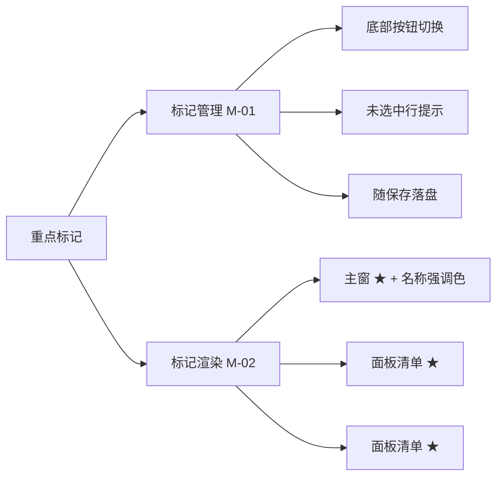
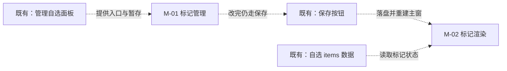

# PRD-盯盘君-重点标记-v1.0.0

## 1. 文档概述

### 1.1 文档信息

| 字段 | 内容 |
| --- | --- |
| 项目名称 | 盯盘君 MarketEye |
| 文档版本 | v1.0.0 |
| 版本状态 | 未发布 |
| 创建日期 | 2026-11-19 |
| 更新日期 | 2026-11-19 |
| 基于需求 | 用户口头需求（2026-11-19）：自选增加一个重点标记功能，重点标记的要突出显示，可以在名字前加个标识 |

### 1.2 变更记录

| 版本 | 日期 | 变更人 | 变更类型 | 关联章节 | 变更内容 |
| --- | --- | --- | --- | --- | --- |
| v1.0.0 | 2026-11-19 | - | 新增 | — | 自选标的支持「重点标记」：管理自选面板底部新增「重点标记」按钮，选中行一键切换标记状态；被标记的标的在主窗自选列表名称前显示 ★ 且名称用强调色突出，管理面板标的清单名称前同步显示 ★（折叠轮播条不做——轮播源为「宽基指数」分组、与自选标记范围不相交，编码期经用户确认移除）。标记不改变自选顺序，随配置持久化，重启保留。R-01~R-05、AC-01~AC-07 |

### 1.3 项目背景

自选已积累 48 项，分页解决了「看不过来」，改序号解决了「排不过来」，但用户实际盯盘时只重点关注其中少数几只（如当日重点观察的龙头或临近触发价的标的）。这少数几只混在长列表里，靠记忆和扫描找它们效率低，需要一眼就能从列表里跳出来。

用户的心智很直接：给重要的那几只「画个星号」，扫一眼就看到。

### 1.4 功能概述

- **管理自选 → 标的页**底部新增 **「重点标记」按钮**（与 ↑↓ / 改序号 / 删除并排）：选中一行后点击，切换该行的标记状态——未标记则标记，已标记则取消；按钮文字随状态变化（「重点标记」/「取消重点」），给明确的下一步预期。
- 被标记的标的在**主窗自选列表**中：名称前显示 ★ 标识，名称文字改用强调色（琥珀色），行内其余列（价格/涨跌幅等）不受影响。
- 被标记的标的在**管理面板标的清单**中：名字前显示 ★，便于在面板里识别当前哪些已标记。
- **折叠轮播条不做标记显示**：轮播源固定为「宽基指数」分组，与自选的标记范围不相交（编码期发现，2026-11-19 经用户确认移除）。
- 标记是标的的一个属性，**不影响自选排序**（顺序仍由编号决定），**随配置持久化**，重启后保留。
- 标记改动是面板内暂存操作，**点「保存」才落盘**；「取消」/关闭面板则丢弃（与改别名、改序号口径一致）。

### 1.5 目标用户

| 角色 | 使用场景 | 关注点 |
| --- | --- | --- |
| 个人投资者（主要） | 48 项自选里只有 3~5 只是当日重点，要一眼定位 | 扫一眼就能从列表里挑出重点；标记不乱动我的排序 |

## 2. 需求全景

### 2.1 功能架构

### 2.2 功能模块划分

| 模块 | 职责范围 | 包含功能点 | 边界说明 |
| --- | --- | --- | --- |
| M-01 标记管理 | 在管理面板中设置/取消某标的的重点标记并随保存持久化 | F-01 | 只作用于「管理自选 → 标的」页的自选清单；一次只操作一行，不做批量标记 |
| M-02 标记渲染 | 被标记标的在主窗列表与面板清单两处的 ★ 显示与名称强调色 | — | 渲染跟随标记状态自动更新，无独立交互 |

### 2.3 功能依赖关系

## 3. 详细需求

### 3.1 需求清单

| 编号 | 需求名称 | 优先级 |
| --- | --- | --- |
| R-01 | 底部「重点标记」按钮切换标记状态 | 高 |
| R-02 | 未选中行操作提示 | 中 |
| R-03 | 主窗列表突出显示（★ + 名称强调色） | 高 |
| R-04 | 面板清单同步显示 ★ | 中 |
| R-05 | 标记持久化且不影响排序 | 高 |

### 3.2 功能点说明

#### F-01 重点标记

- **功能路径**：盯盘君 → 右键菜单 → 管理自选 → 标的页 → 选中一行 → 点底部「重点标记」
- **触发条件**：已选中一行。
- **交互流程**：
    1. 点击「重点标记」：该行标记为重点，按钮文字变为「取消重点」，面板清单该行名字前出现 ★。
    2. 再点一次（此时按钮显示「取消重点」）：取消该行标记，★ 消失，按钮文字恢复「重点标记」。
    3. 未选中任何行时点击：列表标题处红字提示「先选中一行再标记」，1.4 秒后恢复原提示（与改序号的未选中提示同款）。
    4. 标记/取消后继续选中下一行可连续操作，每次点击只作用于当前选中行。
- **规则说明**：
    - 标记是切换（toggle）语义：同一行重复点击在「标记 / 取消」间往返。
    - 一次只作用于一行，不支持多选批量标记。
    - 标记不影响该行序号与自选顺序；改序号、删除等既有操作对标记行行为不变。
    - 标记改动与其他改动（改名、改序号、增删）一样属于面板暂存，点「保存」统一落盘；点「取消」或直接关闭面板则丢弃。

### 3.3 界面规则

| 编号 | 规则 | 说明 |
| --- | --- | --- |
| R-01 | 底部「重点标记」按钮切换标记状态 | 位置在「改序号」右侧、「取消」左侧（按钮行重排为 ↑ ↓ 删除 改序号 重点标记 取消 保存），样式为次要按钮；文字随选中行的标记状态实时变化（未选中行时显示「重点标记」） |
| R-02 | 未选中行操作提示 | 红字提示文案「先选中一行再标记」，显示位置与时长与改序号的非法输入提示一致 |
| R-03 | 主窗列表突出显示 | 名称单元格：★ 紧贴名称左侧，★ 与名称同色（强调色）；名称文字用强调色（琥珀色系，深浅主题各取可读值）；涨跌幅等待既有涨跌配色，不被覆盖 |
| R-04 | 面板清单同步显示 ★ | 面板清单行显示为「序号. ★名称」；★ 不计入别名本身，别名内容不变 |
| R-05 | 标记持久化且不影响排序 | 重启后标记保留；旧配置文件（无标记字段）正常加载，视为全部未标记，向后兼容 |

## 4. 验收标准

| 编号 | 功能点 | 前置条件 | 操作 | 预期结果 |
| --- | --- | --- | --- | --- |
| AC-01 | F-01 | 管理面板打开，选中未标记的一行 | 点「重点标记」 | 该行名字前出现 ★，按钮文字变为「取消重点」 |
| AC-02 | F-01 | 选中已标记的一行 | 点「取消重点」 | ★ 消失，按钮文字恢复「重点标记」 |
| AC-03 | F-01 | 未选中任何行 | 点「重点标记」 | 顺序不变，标题处红字提示「先选中一行再标记」，1.4 秒后恢复 |
| AC-04 | F-01 | 标记一行后不保存 | 点「取消」关闭面板，再重新打开 | 该行无 ★（暂存改动已丢弃） |
| AC-05 | F-01 | 标记一行并保存 | 观察主窗自选列表 | 该行名称前显示 ★ 且名称为强调色，行位置与标记前一致 |
| AC-06 | R-03 | 已保存的标记行 | 观察该行涨跌幅颜色 | 涨跌幅仍按涨红跌绿显示，不被强调色覆盖 |
| AC-07 | R-05 | 标记并保存后重启程序 | 观察主窗与面板 | 标记保留；用旧版配置（无标记字段）启动不报错、全部显示为未标记 |
